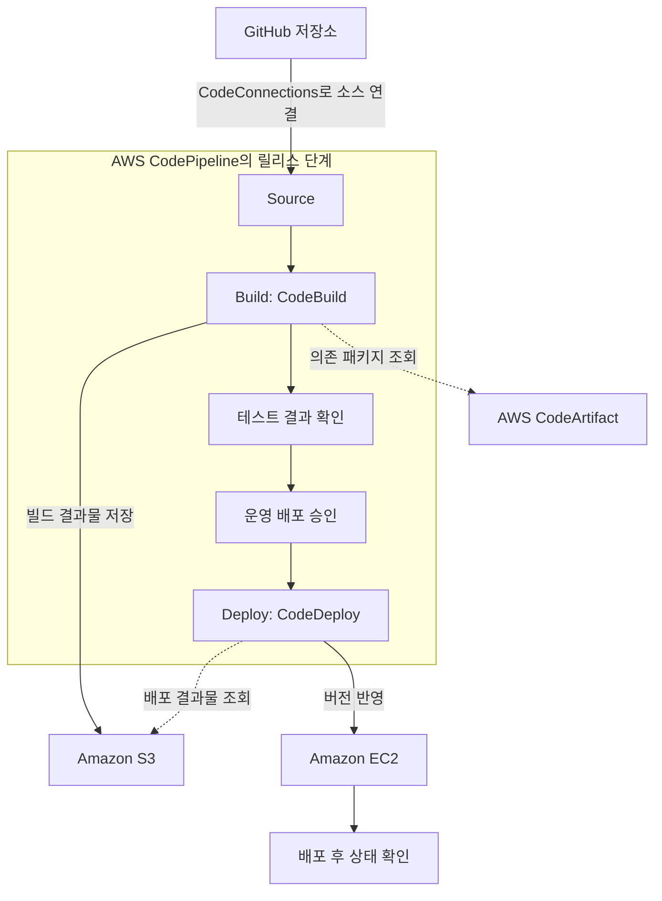

AWS의 개발 도구는 코드를 저장하고, 빌드하고, 배포하고, 실행 결과를 확인하는 작업을 지원한다. 이름이 비슷한 CodeCommit, CodeBuild, CodeDeploy, CodePipeline도 각각 맡는 단계가 다르다.

이 글에서는 개발 과정에 따라 도구의 이름과 역할, 사용하기 좋은 상황을 정리한다. 사용 예시는 설명을 위한 가상 상황이다. 서비스 명칭과 제공 상태는 2026년 10월 30일에 확인한 공식 자료를 기준으로 작성했다.

관리형 서비스와 로컬에서 사용하는 CLI·SDK·프레임워크를 함께 다루되, 모두 별도 클라우드 서비스로 중복 계산하지는 않는다.

## 먼저 구분할 개념

### 소스 코드, 패키지, 빌드 결과물

**소스 코드**는 개발자가 작성하고 버전 관리하는 코드다. **패키지**는 다른 프로젝트에서 설치해 사용할 수 있도록 배포한 라이브러리나 구성 요소다. **빌드 결과물**은 빌드 과정을 거쳐 생성한 실행 파일, 압축 파일, 컨테이너 이미지 등이다.

예를 들어 Java 애플리케이션의 소스는 Git 저장소에 보관하고, 공통 라이브러리는 패키지 저장소에서 가져오며, 빌드한 JAR 파일은 배포에 사용한다.

소스 저장소, 패키지 저장소와 컨테이너 이미지 레지스트리는 목적이 다르다.

### CI와 CD

**지속적 통합(CI)**은 코드 변경을 자주 통합하고 빌드와 테스트로 문제를 확인하는 방식이다.

**지속적 전달(Continuous Delivery)**은 검증된 변경을 배포 가능한 상태로 유지하는 방식이다. 운영 배포 전에 사람의 승인을 둘 수도 있다. **지속적 배포(Continuous Deployment)**는 정한 검증 조건을 통과한 변경을 자동으로 운영에 배포하는 방식이다.

CD라는 약어만 보고 사람의 승인 없이 운영 환경까지 배포된다고 가정하면 안 된다.

### 빌드와 배포

**빌드**는 코드를 컴파일하거나 패키징하고 필요한 검증을 실행해 결과물을 만드는 작업이다. **배포**는 준비된 결과물을 실제 실행 환경에 반영하는 작업이다.

빌드 성공과 배포 성공, 배포 후 서비스 정상 동작은 서로 다른 확인 단계다.

### Infrastructure as Code — IaC

IaC는 인프라 구성을 코드나 템플릿으로 정의해 관리하는 방식이다. 서버나 데이터베이스 설정을 콘솔에서 수동으로 변경하는 대신 버전 관리와 검토 과정을 적용할 수 있다.

코드로 정의했다는 사실만으로 실제 리소스가 바뀌지는 않는다. 템플릿 생성, 변경 확인과 배포 실행을 구분해야 한다.

## 코드와 패키지 보관

### AWS CodeCommit

비공개 Git 저장소를 제공하는 관리형 소스 제어 서비스다.

- **사용하기 좋은 상황:** AWS 계정과 권한 체계 안에서 Git 저장소를 관리하고 싶을 때.
- **간단한 예시:** 사내 API의 소스 코드를 CodeCommit에 저장하고 브랜치와 변경 이력을 관리한다.
- **구분할 점:** Git은 버전 관리 도구이고 CodeCommit은 Git 저장소를 호스팅하는 서비스다. GitHub·GitLab 저장소를 사용하면서 AWS 빌드·배포 서비스를 연결하는 구성도 가능하다.

CodeCommit은 한때 신규 고객 접근이 제한됐으나, AWS는 **2025년 11월 신규 가입 재개**를 발표했다. 현재 상태를 설명할 때 2024년의 제한 안내만 보고 신규 고객이 사용할 수 없다고 단정하지 않는다.

[공식 자료: CodeCommit 개요](https://docs.aws.amazon.com/codecommit/latest/userguide/welcome.html) · [신규 가입 재개 발표](https://aws.amazon.com/blogs/devops/aws-codecommit-returns-to-general-availability/)

### AWS CodeArtifact

개발에 사용하는 소프트웨어 패키지를 저장하고 공유하는 관리형 패키지 저장소 서비스다.

- **사용하기 좋은 상황:** 팀 공통 라이브러리를 배포하거나 외부 패키지의 사용 경로를 관리하고 싶을 때.
- **간단한 예시:** 여러 Python 프로젝트에서 사용하는 공통 패키지를 CodeArtifact에 게시하고 pip로 설치한다.
- **구분할 점:** Git 소스를 보관하는 CodeCommit이나 컨테이너 이미지를 보관하는 ECR과 역할이 다르다.

지원되는 공개 패키지 저장소와 연결해 요청된 패키지를 가져와 보관할 수도 있다. 사용하려는 패키지 형식과 도구의 지원 범위, 저장소 접근 권한을 확인해야 한다.

[공식 자료: CodeArtifact 개요](https://docs.aws.amazon.com/codeartifact/latest/ug/welcome.html)

### AWS CodeConnections

외부 코드 저장소와 CodePipeline 등 AWS 개발 도구 사이의 연결을 관리하는 기능이다.

- **사용하기 좋은 상황:** 외부 저장소의 코드 변경을 AWS 파이프라인의 소스 단계와 연결하고 싶을 때.
- **간단한 예시:** GitHub 저장소와 연결을 설정해 변경된 코드를 CodePipeline이 가져오도록 구성한다.
- **구분할 점:** CodeConnections는 코드 저장소나 빌드 실행 환경이 아니다. 저장소 접근을 위한 연결 리소스다.

이전 이름은 **AWS CodeStar Connections**다. 기존 이름이나 네임스페이스가 남은 리소스가 있다고 해서 종료된 AWS CodeStar 서비스와 같은 것으로 보면 안 된다. 저장소 공급자별 지원과 연결 권한을 확인한다.

[공식 자료: CodeConnections 개요와 명칭 변경](https://docs.aws.amazon.com/dtconsole/latest/userguide/welcome-connections.html)

## 빌드, 배포와 릴리스 흐름

### AWS CodeBuild

소스 코드의 빌드와 테스트 명령을 실행하고 결과물을 만드는 관리형 빌드 서비스다.

- **사용하기 좋은 상황:** 빌드 서버를 직접 운영하는 부담을 줄이고 반복 가능한 빌드 환경이 필요할 때.
- **간단한 예시:** Java 소스를 가져와 테스트를 실행하고 배포용 JAR 파일을 생성한다.
- **구분할 점:** CodeBuild는 작성한 명령을 실행한다. 프로젝트에 맞는 테스트나 검증 규칙을 자동으로 모두 만들어 주지는 않는다.

빌드 명령과 관련 설정은 **buildspec**으로 정의할 수 있다. 기본적으로 소스 루트의 `buildspec.yml`을 사용할 수 있고, 다른 위치나 프로젝트 설정으로 지정하는 방식도 지원한다. 빌드 환경, 실행 권한과 결과물 위치를 함께 구성한다.

[공식 자료: CodeBuild 개요](https://docs.aws.amazon.com/codebuild/latest/userguide/welcome.html) · [buildspec 참조](https://docs.aws.amazon.com/codebuild/latest/userguide/build-spec-ref.html)

### AWS CodeDeploy

애플리케이션의 배포를 자동화하는 서비스다. EC2·온프레미스 인스턴스, Lambda, ECS 같은 지원 대상을 사용한다.

- **사용하기 좋은 상황:** 여러 실행 환경에 새 버전을 반영하고 배포 단계와 상태를 관리해야 할 때.
- **간단한 예시:** 검증한 애플리케이션 버전을 EC2 인스턴스 그룹에 배포하고 상태를 확인한다.
- **구분할 점:** CodeDeploy는 일반적으로 소스를 컴파일하는 빌드 서비스가 아니다. 배포할 결과물과 대상, 배포 설정을 준비해야 한다.

배포 방식과 필요한 구성은 대상 플랫폼에 따라 다르다. 모든 대상에서 같은 배포 방식이나 같은 에이전트 구성을 사용하는 것은 아니다.

배포 되돌리기 기능이 있더라도 데이터베이스의 변경과 외부 시스템의 업무 결과까지 자동으로 이전 상태가 되는 것은 아니다. 애플리케이션 버전과 데이터 변경의 호환성을 별도로 고려한다.

[공식 자료: CodeDeploy 개요와 지원 플랫폼](https://docs.aws.amazon.com/codedeploy/latest/userguide/welcome.html)

### AWS CodePipeline

소스 변경부터 빌드·테스트·배포까지 릴리스 단계를 구성하고 자동화하는 지속적 전달 서비스다.

- **사용하기 좋은 상황:** 각 개발 도구를 연결해 코드 변경이 어떤 절차를 거쳐 배포될지 관리해야 할 때.
- **간단한 예시:** 저장소의 변경을 받아 CodeBuild로 검증하고, 승인 후 CodeDeploy로 운영 환경에 반영한다.
- **구분할 점:** CodePipeline은 전체 릴리스 흐름을 관리한다. 빌드와 배포 작업은 연결된 액션과 서비스가 수행할 수 있다.

CodeBuild만 단독으로 실행할 수도 있고 CodePipeline에 빌드 액션으로 넣을 수도 있다. AWS에 배포한다고 반드시 모든 단계를 CodePipeline으로 구성해야 하는 것은 아니다.

[공식 자료: CodePipeline 개요](https://docs.aws.amazon.com/codepipeline/latest/userguide/welcome.html)

### 공식 이미지: CodePipeline과 CodeBuild의 관계

_CodePipeline의 빌드·테스트 단계에서 CodeBuild를 사용하는 구조. AWS 공식 문서의 원본 이미지._

[이미지 출처: What is AWS CodeBuild?](https://docs.aws.amazon.com/codebuild/latest/userguide/welcome.html)

그림의 Source, Build, Test, Deploy는 릴리스의 단계다. CodeBuild는 Build와 Test 단계에서 실행할 작업을 맡을 수 있다. 전체 단계의 연결과 진행은 CodePipeline이 관리한다.

**파이프라인과 빌드 실행 환경은 다른 구성 요소**라는 점이 핵심이다. 파이프라인을 만들었다고 프로젝트의 빌드·테스트 명령이 저절로 정해지지는 않는다. 그림은 역할을 단순화한 것이며, 단계와 액션은 요구사항에 맞게 구성한다.

## 명령 실행과 개발 환경

### AWS CloudShell

AWS Management Console에서 시작하는 브라우저 기반 셸이다. 콘솔에서 사용 중인 자격 증명을 활용하며 AWS CLI 등 도구가 준비되어 있다.

- **사용하기 좋은 상황:** 로컬 PC에 도구를 설치하지 않고 AWS 명령을 실행하거나 설정을 확인하고 싶을 때.
- **간단한 예시:** 콘솔에서 CloudShell을 열어 접근 권한이 있는 S3 버킷과 리소스 상태를 조회한다.
- **구분할 점:** 터미널을 제공하는 것과 완전한 개발 IDE를 제공하는 것은 다르다. 셸이 열려 있어도 IAM에서 허용한 작업만 수행할 수 있다.

일시적인 명령 실행 환경을 운영 애플리케이션의 상시 실행 서버나 영구적인 빌드 서버로 가정하지 않는다. 저장 공간과 세션·네트워크 조건은 환경별로 확인한다.

[공식 자료: CloudShell 개요](https://docs.aws.amazon.com/cloudshell/latest/userguide/welcome.html)

### AWS Command Line Interface — AWS CLI

명령줄에서 AWS 서비스 API를 사용하는 도구다.

- **사용하기 좋은 상황:** 리소스 조회와 변경을 명령이나 스크립트로 반복하고 싶을 때.
- **간단한 예시:** 특정 환경의 리소스 정보를 조회하고 배포 스크립트에서 AWS API를 호출한다.
- **구분할 점:** CLI는 로컬이나 CloudShell 등에서 실행하는 도구다. 별도 코드 저장소나 배포 파이프라인 서비스가 아니다.

현재 개발에는 AWS CLI v2 문서를 기준으로 기능과 설치 방법을 확인한다. 실행 환경의 자격 증명, 리전과 대상 계정도 함께 확인해야 한다.

[공식 자료: AWS CLI 개요](https://docs.aws.amazon.com/cli/latest/userguide/cli-chap-welcome.html)

### AWS SDKs

애플리케이션 코드에서 AWS API를 호출하는 언어별 라이브러리다.

- **사용하기 좋은 상황:** 서비스의 기능을 애플리케이션 로직 안에 직접 넣어야 할 때.
- **간단한 예시:** Python 백엔드가 SDK를 사용해 S3 객체를 읽고 SQS에 작업 메시지를 보낸다.
- **구분할 점:** CLI가 셸 명령 중심이라면 SDK는 프로그래밍 언어의 함수와 객체를 통해 API를 사용한다.

SDK와 프로그래밍 언어마다 지원 버전과 기능이 다르므로 현재 지원되는 주요 버전을 확인한다. 예전 예제를 가져올 때도 라이브러리 버전과 자격 증명 처리 방식을 확인한다.

[공식 자료: AWS SDKs and Tools 참조](https://docs.aws.amazon.com/sdkref/latest/guide/overview.html)

### AWS Toolkit for Visual Studio Code

VS Code 안에서 AWS 리소스와 개발 기능을 사용하는 확장 도구다.

- **사용하기 좋은 상황:** 익숙한 편집기에서 AWS 리소스를 살펴보고 지원되는 개발·디버깅 작업을 수행하고 싶을 때.
- **간단한 예시:** VS Code에서 서버리스 프로젝트를 열고 AWS 리소스 탐색과 지원되는 로컬 디버깅 기능을 사용한다.
- **구분할 점:** 개발 편집기에 AWS 기능을 연결하는 도구다. CloudShell 같은 셸이나 Q Developer 같은 AI 어시스턴트와 같은 의미가 아니다.

[공식 자료: AWS Toolkit for VS Code](https://docs.aws.amazon.com/toolkit-for-vscode/latest/userguide/welcome.html)

## 인프라와 서버리스 애플리케이션 정의

### AWS Cloud Development Kit — AWS CDK

일반 프로그래밍 언어로 인프라를 정의하고 CloudFormation을 통해 배포하는 오픈 소스 프레임워크다.

- **사용하기 좋은 상황:** 반복되는 인프라 구성을 코드로 재사용하고 조건과 조합을 프로그래밍 언어로 표현하고 싶을 때.
- **간단한 예시:** Python으로 여러 환경의 API와 데이터베이스 구성을 정의하고 공통 구성 요소를 재사용한다.
- **구분할 점:** SDK처럼 애플리케이션 실행 중 개별 API를 호출하는 방식과, CDK로 원하는 인프라 구성을 정의하는 방식은 다르다.

CDK의 합성은 CloudFormation 템플릿 등을 생성하는 단계이고 배포는 실제 리소스에 반영하는 단계다. 합성이 성공했다고 배포까지 완료된 것은 아니다.

[공식 자료: AWS CDK 개요](https://docs.aws.amazon.com/cdk/v2/guide/home.html)

### AWS Serverless Application Model — AWS SAM

서버리스 애플리케이션을 IaC로 정의하고 개발·테스트·배포하는 오픈 소스 프레임워크다. 간소화한 템플릿 문법과 SAM CLI를 제공한다.

- **사용하기 좋은 상황:** Lambda와 API Gateway 같은 서버리스 구성을 선언적으로 작성하고 로컬 개발 기능도 사용하고 싶을 때.
- **간단한 예시:** API와 Lambda 구성을 SAM 템플릿으로 정의하고 SAM CLI로 로컬 실행과 배포를 진행한다.
- **구분할 점:** CDK는 프로그래밍 언어로 인프라를 구성하고, SAM은 CloudFormation을 확장한 선언적 템플릿을 중심으로 작성한다. 두 도구를 함께 사용하는 구성도 가능하다.

로컬 테스트가 통과해도 실제 IAM 권한, 네트워크와 서비스 연동까지 검증됐다고 볼 수는 없다. 배포한 환경에서 필요한 동작을 확인한다.

[공식 자료: AWS SAM 개요](https://docs.aws.amazon.com/serverless-application-model/latest/developerguide/what-is-sam.html)

### AWS Infrastructure Composer

시각적으로 AWS 리소스를 배치하고 연결하면서 IaC 템플릿을 구성하는 도구다. 이전 자료에서는 AWS Application Composer라는 이름이 보일 수 있다.

- **사용하기 좋은 상황:** 리소스 관계를 화면에서 확인하며 CloudFormation·SAM 구성을 작성하고 싶을 때.
- **간단한 예시:** API Gateway, Lambda와 DynamoDB 관계를 배치하고 생성된 템플릿을 검토한다.
- **구분할 점:** 단순한 설명용 그림과 실제 배포에 사용하는 IaC 정의를 구분한다. 생성한 기본 설정도 요구사항에 맞게 검토해야 한다.

현재 공식 문서는 **독립 Infrastructure Composer 콘솔이 2026년 12월 7일에 제공 종료될 예정**이라고 안내한다. 기존 내장 콘솔 화면의 시각적 IaC 편집기와 VS Code용 AWS Toolkit 경험을 구분해야 하며, 이 안내를 모든 Composer 기능의 종료로 확대하지 않는다.

[공식 자료: Infrastructure Composer 개요와 종료 범위 안내](https://docs.aws.amazon.com/infrastructure-composer/latest/dg/what-is-composer.html)

## AI 개발 지원과 실행 환경

### Amazon Q Developer

AWS 애플리케이션의 이해·개발·운영을 지원하는 생성형 AI 어시스턴트다.

- **사용하기 좋은 상황:** AWS 구성과 코드를 설명받거나 수정·개선 초안을 검토하고 싶을 때.
- **간단한 예시:** 기존 코드의 동작을 질문하고 수정 제안을 받은 뒤 테스트와 리뷰로 확인한다.
- **구분할 점:** 제안된 코드와 검증된 코드는 다르다. 실제 저장소의 규칙과 요구사항에 맞는지 확인해야 한다.

현재 공식 문서는 **Q Developer IDE 플러그인의 지원이 2027년 4월 30일에 종료될 예정**이라고 안내한다. IDE 플러그인과 Q Developer의 다른 제공 경로를 구분한다.

[공식 자료: Q Developer 개요와 IDE 플러그인 안내](https://docs.aws.amazon.com/amazonq/latest/qdeveloper-ug/what-is.html)

### Kiro

요구사항과 설계, 구현 작업을 연결하고 코드 작업을 지원하는 AI 개발 도구다.

- **사용하기 좋은 상황:** 자연어 요청을 개발 작업으로 구체화하면서 명세와 구현을 함께 관리하고 싶을 때.
- **간단한 예시:** 신규 API의 요구사항과 설계, 작업 목록을 작성하고 구현 결과를 검토한다.
- **구분할 점:** Bedrock 같은 모델 API 플랫폼과 개발자가 직접 사용하는 개발 도구는 계층이 다르다. 사용 경로별 기능과 권한 설정도 확인한다.

[공식 자료: Kiro 문서](https://kiro.dev/docs/)

### Amazon Corretto

OpenJDK의 배포판이다. Java 애플리케이션을 개발하고 실행하는 환경을 제공한다.

- **사용하기 좋은 상황:** Java 프로젝트의 JDK 배포판과 지원되는 버전을 선택해야 할 때.
- **간단한 예시:** 개발 PC와 빌드 환경에서 프로젝트에 맞는 Corretto 버전을 사용한다.
- **구분할 점:** Corretto는 코드 저장소나 배포 서비스가 아니다. Java 실행 환경이며 버전별 지원 일정과 애플리케이션 호환성을 확인해야 한다.

[공식 자료: Corretto 개요 — Corretto 21 문서](https://docs.aws.amazon.com/corretto/latest/corretto-21-ug/what-is-corretto-21.html)

## 테스트와 실행 중 진단

### AWS Device Farm

AWS가 호스팅하는 실제 모바일 기기에서 애플리케이션을 테스트하고 상호작용하는 서비스다.

- **사용하기 좋은 상황:** Android·iOS 기기별 화면과 동작 차이를 확인하거나 자동화 테스트를 실행해야 할 때.
- **간단한 예시:** 앱과 테스트를 업로드해 여러 지원 기기에서 로그인 흐름을 검증하고 스크린샷과 로그를 확인한다.
- **구분할 점:** 일반 빌드 환경의 단위 테스트와 실제 기기에서의 호환성 검증은 다르다. 필요한 기기·OS·테스트 프레임워크 지원을 확인한다.

[공식 자료: Device Farm 개요](https://docs.aws.amazon.com/devicefarm/latest/developerguide/welcome.html)

### AWS X-Ray

애플리케이션 요청의 추적 데이터를 수집하고 서비스 간 호출과 지연을 분석하는 서비스다.

- **사용하기 좋은 상황:** 여러 서비스와 데이터베이스를 거치는 요청에서 지연이나 오류가 발생하는 구간을 찾고 싶을 때.
- **간단한 예시:** API 응답이 느릴 때 요청 추적으로 외부 API 호출과 데이터베이스 호출의 소요 시간을 비교한다.
- **구분할 점:** 로그, 메트릭과 분산 추적은 서로 보완하는 정보다. 모든 요청이 설정 없이 자동으로 완전하게 추적되는 것은 아니다.

**X-Ray SDK와 Daemon은 2026년 2월 25일부터 유지보수 모드**다. 공식 문서는 애플리케이션 계측에 OpenTelemetry 기반 구성을 사용하도록 권장한다. SDK·Daemon의 지원 변경을 X-Ray 서비스 전체 종료로 이해하지 않는다.

[공식 자료: X-Ray 개요](https://docs.aws.amazon.com/xray/latest/devguide/aws-xray.html) · [SDK·Daemon 지원 일정](https://docs.aws.amazon.com/xray/latest/devguide/xray-sdk-daemon-timeline.html)

### Amazon CodeGuru Profiler

실행 중인 애플리케이션의 성능 데이터를 수집해 CPU 사용과 코드 실행 비용을 분석하는 서비스다.

- **사용하기 좋은 상황:** 어떤 코드가 CPU와 실행 시간을 많이 사용하는지 파악하고 싶을 때.
- **간단한 예시:** Java 서비스의 프로파일을 확인해 반복적으로 많은 CPU를 사용하는 함수의 개선 대상을 찾는다.
- **구분할 점:** 여러 서비스 사이의 요청 경로를 추적하는 X-Ray와, 프로세스 안의 코드 실행을 살펴보는 프로파일링은 관점이 다르다.

CodeGuru라는 이름이 같은 Reviewer·Security와 제공 기능과 상태를 구분한다. [공식 자료: CodeGuru Profiler 개요](https://docs.aws.amazon.com/codeguru/latest/profiler-ug/what-is-codeguru-profiler.html)

### AWS Fault Injection Service — AWS FIS

AWS 리소스에 장애 조건을 적용해 시스템의 대응과 복원력을 확인하는 관리형 실험 서비스다.

- **사용하기 좋은 상황:** 장애 상황에서 재시도, 알림과 복구 구성이 예상대로 동작하는지 검증해야 할 때.
- **간단한 예시:** 사전 운영 환경에서 일부 자원에 장애를 주입해 서비스의 장애 감지와 복구를 관찰한다.
- **구분할 점:** 장애를 예측하는 도구가 아니라 실제 실험을 실행하는 도구다. 대상, 영향 범위와 중지 조건을 먼저 정해야 한다.

실험을 멈추는 것과 이미 발생한 모든 변경을 원상 복구하는 것은 다를 수 있다. 실제 실행할 액션의 종료·복구 동작을 확인한다.

[공식 자료: AWS FIS 개요](https://docs.aws.amazon.com/fis/latest/userguide/what-is.html)

## 기존 자료에서 확인할 제공 상태

### AWS Cloud9

브라우저에서 코드 편집·실행·디버깅을 제공하는 개발 환경이다. 다만 **2024년 7월 25일부터 신규 고객에게 제공되지 않는다.** 기존 고객의 이용과 새 프로젝트에서 선택할 개발 환경을 구분한다.

CloudShell과 둘 다 브라우저에서 접근할 수 있지만, Cloud9은 IDE이고 CloudShell은 셸이므로 같은 기능이라고 보면 안 된다.

[공식 자료: Cloud9 개요](https://docs.aws.amazon.com/cloud9/latest/user-guide/welcome.html) · [신규 고객 제한과 유지보수 목록](https://docs.aws.amazon.com/general/latest/gr/maintenance_services.html)

### Amazon CodeCatalyst

작업 관리와 저장소, 개발 환경, CI/CD를 묶어 제공하는 개발 협업 서비스다. 기존 프로젝트의 개발 흐름을 한곳에서 관리하는 데 사용돼 왔다.

현재는 **2025년 11월 7일부터 신규 고객에게 제공되지 않는다.** 기존 고객은 기존 스페이스를 사용할 수 있지만 새 스페이스는 생성할 수 없다. 새로운 개발 플랫폼의 예시로 소개할 때 이 제한을 함께 명시해야 한다.

[공식 자료: CodeCatalyst 개요](https://docs.aws.amazon.com/codecatalyst/latest/userguide/welcome.html) · [접근 제한과 이전 안내](https://docs.aws.amazon.com/codecatalyst/latest/userguide/migration.html)

### Amazon CodeGuru Reviewer

Java·Python 코드의 잠재적인 결함과 개선 사항을 분석하는 서비스다. 현재는 **2025년 11월 7일부터 새로운 저장소 연결을 만들 수 없고 기존 연결만 사용할 수 있다.**

기존 연결에서 코드 분석 결과를 검토하는 용도와 신규 저장소에 도입하는 구성을 구분한다. 같은 이름의 CodeGuru Profiler까지 모두 같은 제한이 있다고 단정하지 않는다.

[공식 자료: Reviewer 개요](https://docs.aws.amazon.com/codeguru/latest/reviewer-ug/welcome.html) · [새 저장소 연결 제한](https://docs.aws.amazon.com/codeguru/latest/reviewer-ug/codeguru-reviewer-availability-change.html)

### 종료된 이름과 명칭 변경

- **AWS CodeStar:** 2024년 7월 25일에 종료됐다.
- **AWS BugBust:** 2025년 8월 13일에 종료됐다.
- **Amazon CodeGuru Security:** 2025년 11월 20일에 지원이 종료됐다. Reviewer와 Profiler의 상태는 별도로 확인한다.
- **AWS CodeStar Connections:** CodeConnections로 이름이 변경됐다. CodeStar 종료와 구분한다.
- **AWS Application Composer:** Infrastructure Composer라는 현재 명칭과 제공 경로를 확인한다.

[공식 자료: 완전 종료 서비스 목록](https://docs.aws.amazon.com/general/latest/gr/full_shutdown_services.html) · [CodeGuru Security API 지원 종료 안내](https://docs.aws.amazon.com/cli/v1/reference/codeguru-security/) · [CodeConnections 명칭 안내](https://docs.aws.amazon.com/dtconsole/latest/userguide/welcome-connections.html)

## 예시: 외부 Git 저장소에서 EC2 배포까지

아래는 설명을 위해 작성한 Mermaid 구성도다. AWS 공식 아키텍처 이미지나 그대로 실행할 수 있는 배포 정의가 아니다.

이 예시에서는 GitHub가 소스 저장소이고 CodeConnections는 연결을 제공한다. CodeBuild가 의존 패키지를 가져와 검증과 빌드를 수행하고, S3에는 배포할 결과물을 보관한다. CodePipeline은 정한 단계의 진행을 관리하고 CodeDeploy는 EC2에 반영한다.

테스트 결과 확인 단계는 필요한 검증 기준을 표현한 것이다. 실제 테스트를 실행할 액션과 실패 조건은 따로 구성해야 한다. 화살표 중 점선은 데이터를 밀어 넣는 방향이 아니라 패키지·결과물을 조회하는 관계다.

CodeArtifact는 프로젝트가 해당 패키지 저장소를 사용하는 경우에만 필요하다. S3 결과물 경로와 CodeDeploy 배포 대상에 접근할 권한도 각각 설정해야 한다. 컨테이너 배포라면 이미지 저장소와 배포 대상이 달라질 수 있다.

같은 역할을 GitHub Actions 등의 외부 CI/CD 도구로 구성하고 AWS 배포 대상만 사용하는 방식도 가능하다. AWS 서비스를 활용한다는 이유로 소스부터 배포까지 모두 교체해야 하는 것은 아니다.

## 도구를 선택할 때 확인할 차이

- **CodeCommit과 CodeArtifact:** 소스 코드를 버전 관리할지, 설치 가능한 패키지를 공유할지 구분한다.
- **CodeArtifact와 ECR:** 라이브러리 패키지와 컨테이너 이미지의 저장소를 구분한다.
- **CodeBuild와 CodeDeploy:** 결과물을 만들고 검증하는지, 준비된 결과물을 실행 환경에 반영하는지 확인한다.
- **CodePipeline과 CodeBuild:** 전체 릴리스 단계의 진행과 개별 빌드 실행을 구분한다.
- **CloudShell과 CLI:** 명령을 실행하는 환경과 그 안에서 사용하는 도구를 구분한다.
- **CLI와 SDK:** 셸 스크립트로 API를 호출할지, 애플리케이션 코드에 통합할지 비교한다.
- **CDK와 SAM:** 일반 언어의 코드 구성과 선언적 서버리스 템플릿 중 어떤 작성 방식이 적합한지 비교한다.
- **X-Ray와 CodeGuru Profiler:** 요청의 서비스 간 경로와 프로세스 내부 코드 실행을 구분한다.
- **Q Developer와 Kiro:** 사용할 개발 환경과 필요한 AI 지원 기능, 해당 제공 경로의 지원 상태를 확인한다.

## 개발 흐름에 적용할 기준

**동일한 결과물 사용:** 검증한 버전과 배포한 버전을 연결할 수 있도록 소스 커밋과 결과물의 버전을 기록한다. 테스트 환경과 운영 환경에서 서로 다른 결과물을 새로 만들면 검증한 것과 실제 배포한 것이 달라질 수 있다.

**권한 분리:** 소스 조회, 빌드, 패키지 게시와 운영 배포에 필요한 권한을 각각 구분한다. 개발자가 코드를 수정할 수 있다는 사실과 운영 배포를 승인할 수 있다는 것은 다르다.

**비밀 값 관리:** 토큰과 비밀번호를 소스나 빌드 명령에 직접 넣지 않는다. 필요한 경우 지원되는 Secrets Manager나 Parameter Store 연동과 실행 역할을 사용한다.

**검증과 실패 기준:** 명령이 끝났다는 사실만으로 성공을 판단하지 않는다. 테스트 결과와 실패 종료 코드, 배포 후 상태를 확인할 조건을 정의한다.

**복구와 데이터 호환성:** 이전 버전으로 되돌릴 수 있는지, 데이터 스키마와 외부 시스템 변경이 복구를 방해하지 않는지 확인한다.

**서비스 제공 상태:** 오래된 강의의 도구 이름만 따라가기보다 신규 고객 제한, 기능별 지원 범위와 예정된 종료를 확인한다.

## SAA 공부와 연결해서 볼 내용

다음은 이 글의 개념 복습 기준이다. 실제 시험에 포함되는 서비스와 세부 범위는 응시 시점의 공식 시험 안내서를 확인해야 한다.

1. **Git 소스를 보관한다:** CodeCommit과 외부 저장소의 역할을 확인한다.
2. **팀 공통 패키지를 공유한다:** CodeArtifact와 ECR의 차이를 확인한다.
3. **소스 빌드와 테스트를 실행한다:** CodeBuild와 buildspec을 확인한다.
4. **애플리케이션 버전을 반영한다:** CodeDeploy와 배포 대상별 구성을 확인한다.
5. **릴리스 단계를 연결한다:** CodePipeline의 소스·빌드·승인·배포 단계를 확인한다.
6. **브라우저에서 AWS 명령을 실행한다:** CloudShell과 CLI의 관계를 확인한다.
7. **인프라 구성을 코드로 관리한다:** CDK·SAM과 CloudFormation의 관계를 확인한다.
8. **요청의 지연 구간을 찾는다:** X-Ray와 계측 도구의 역할을 구분한다.

개발 도구는 한 번에 모두 사용하는 목록이 아니다. 코드 보관, 결과물 생성, 배포와 실행 확인 중 필요한 작업을 정하고 각 단계의 책임과 권한을 연결한다.

