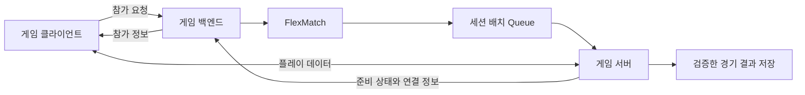
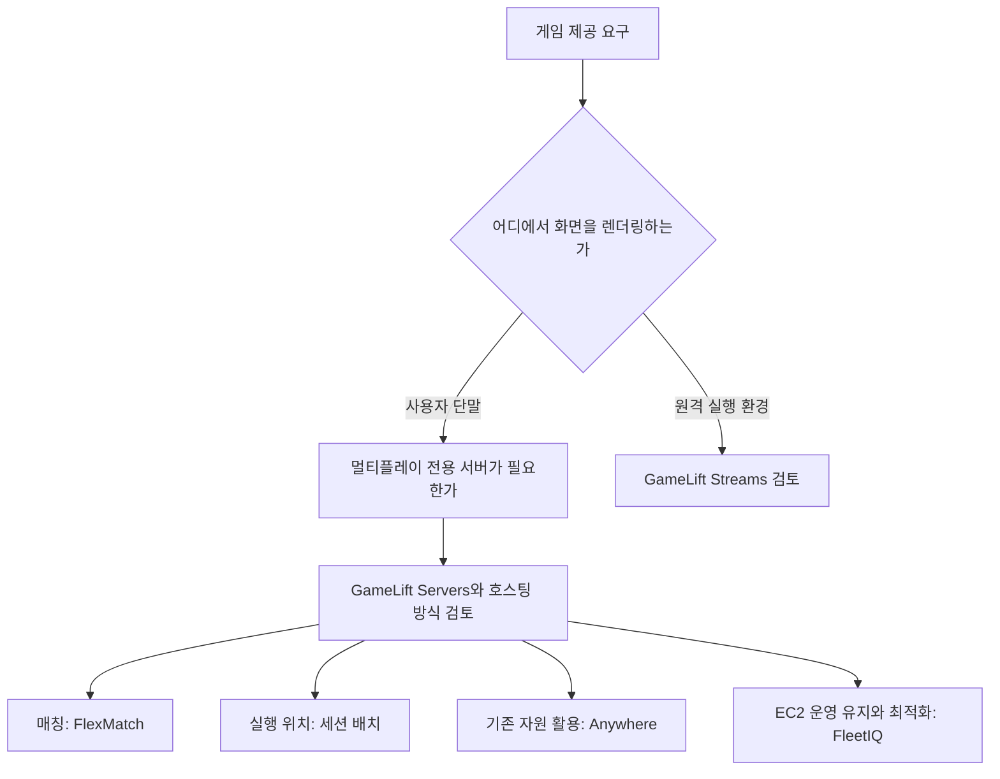

온라인 게임을 운영하려면 플레이어 접속, 경기 구성, 게임 서버 실행, 데이터 저장과 콘텐츠 배포 등이 필요하다. 게임을 만드는 엔진과 게임을 실행·운영하는 클라우드 서비스는 역할이 다르다.

AWS의 게임 기술 분야에서는 Amazon GameLift Servers와 Amazon GameLift Streams를 중심으로 요구 사항을 구분할 수 있다. 전자는 멀티플레이 게임 서버 운영, 후자는 게임 화면의 원격 스트리밍에 사용한다.

이 글에서는 관련 서비스와 기능의 이름, 사용 상황과 예시를 정리한다. 예시는 가상 상황이며, 제품과 지원 범위는 2026년 10월 30일에 확인한 AWS 공식 자료를 기준으로 한다.

## 먼저 구분할 구성 요소

- **게임 클라이언트**: 플레이어 단말에서 실행하는 프로그램이다.
- **게임 서버**: 플레이어의 행동을 처리하고 공유 게임 상태를 관리하는 프로그램이다.
- **게임 백엔드**: 로그인, 참가 요청과 계정·아이템 등 게임 운영 기능을 처리하는 계층이다.
- **매치메이킹**: 함께 플레이할 사람이나 팀을 정하는 과정이다.
- **세션 배치**: 구성된 경기를 실행할 가용 서버를 정하는 과정이다.
- **게임 스트리밍**: 원격에서 실행한 게임의 화면을 보내고 사용자의 입력을 전달하는 방식이다.

예를 들어 실력이 비슷한 플레이어를 한 경기에 모으는 일과, 그 경기를 어느 지역의 서버에서 실행할지 결정하는 일은 다르다. 게임 화면을 플레이어 단말에서 렌더링하는지 AWS에서 렌더링하는지도 구분해야 한다.

[공식 자료: GameLift Servers의 구성과 동작](https://docs.aws.amazon.com/gameliftservers/latest/developerguide/gamelift-howitworks.html) · [GameLift Streams 개요](https://docs.aws.amazon.com/gameliftstreams/latest/developerguide/what-is-service.html)

## 1. Amazon GameLift Servers: 멀티플레이 서버 운영

**Amazon GameLift Servers**는 세션 기반 멀티플레이 게임의 전용 서버를 배포·운영·확장하는 서비스이다. 게임 서버 프로세스와 세션을 관리하고, 플레이어 수요에 맞춘 호스팅 구성을 제공한다.

**사용하기 좋은 상황**은 경기마다 시작과 종료가 있는 멀티플레이 게임에서 전용 서버 운영과 용량 관리를 구성해야 하는 경우이다.

**예시**: 여러 플레이어가 참여하는 대전 게임을 운영한다. 준비된 서버에서 경기를 시작하고, 접속 수요에 맞추어 서버 용량을 조정한다.

**구분할 점**은 GameLift가 게임 규칙이나 계정·아이템 시스템을 모두 만들어 주지는 않는다는 것이다. 개발자는 게임 서버와 클라이언트, 필요한 백엔드를 준비한다. 세션 관리와 상태 보고 등을 서비스에 연동해야 한다.

예전 자료의 Amazon GameLift는 현재 Amazon GameLift Servers라는 이름으로 설명되는 경우가 있다. 현재는 Servers와 Streams의 기능을 구분해서 확인한다.

[공식 자료: Amazon GameLift Servers란?](https://docs.aws.amazon.com/gameliftservers/latest/developerguide/gamelift-intro.html) · [Servers와 Streams의 차이](https://aws.amazon.com/gamelift/servers/faqs/)

### Managed EC2: 서버 빌드를 관리형 호스팅에 배포

**Managed EC2**는 게임 서버 빌드를 AWS의 관리형 EC2 기반 호스팅 자원에 배포하는 방식이다.

**사용 상황과 예시**: 지원하는 운영체제용 게임 서버 실행 파일을 준비하고, Fleet의 위치·인스턴스·실행 구성을 정해 대전 서버를 운영한다.

고객은 어떤 프로그램을 어떻게 실행할지 구성하고, GameLift Servers는 해당 호스팅 방식의 서버 프로세스·배포·용량 관리 기능을 제공한다. 관리형이라고 서버 코드와 배포 설정의 오류까지 자동으로 해결되는 것은 아니다.

[공식 자료: GameLift Servers 호스팅 옵션](https://docs.aws.amazon.com/gameliftservers/latest/developerguide/gamelift-intro-flavors.html)

### Managed containers: 컨테이너 기반 게임 서버

**Managed container fleets**는 컨테이너로 패키징한 게임 서버를 실행하는 관리형 호스팅 방식이다.

**사용하기 좋은 상황**은 게임 서버와 의존성을 컨테이너로 관리하고 일관된 배포 단위를 사용하려는 경우이다.

**예시**: 게임 서버와 보조 프로세스를 Linux 기반 컨테이너 구성으로 준비하고, ECR의 이미지를 배포하여 서버 버전을 관리한다.

**구분할 점**은 컨테이너 이미지만 올리면 게임 서버 연동까지 끝나는 것은 아니라는 것이다. 세션 관리, 상태 보고, 포트·리소스 설정과 업데이트 절차를 준비해야 한다. 일반적인 ECS·EKS 운영과 비교할 때는 게임 세션 배치·수명 주기 관리가 필요한지 검토한다.

[공식 자료: GameLift Servers 관리형 컨테이너 Fleet](https://docs.aws.amazon.com/gameliftservers/latest/developerguide/fleets-intro-containers.html) · [컨테이너 호스팅 방식](https://docs.aws.amazon.com/gameliftservers/latest/developerguide/gamelift-intro-flavors.html)

## 2. Amazon GameLift Servers Anywhere: 고객 자원에서 호스팅

**GameLift Servers Anywhere**는 고객이 준비한 컴퓨팅 자원을 GameLift Servers의 세션 관리와 연결하는 방식이다. 자체 서버, 온프레미스나 다른 클라우드 자원 등을 활용할 수 있다.

**사용하기 좋은 상황**은 기존 호스팅 자원을 유지하거나, 로컬 개발 환경에서 서비스 연동을 반복적으로 시험하려는 경우이다.

**예시**: 개발팀이 로컬 서버를 Anywhere Fleet에 연결해 경기 시작·종료 연동을 검증한다. 운영 환경에서는 기존 데이터센터와 관리형 Fleet을 함께 사용하는 구성도 검토한다.

**구분할 점**은 외부 서버가 AWS 관리형 인프라로 바뀌는 것은 아니라는 것이다. 고객이 서버 배포, 상태 모니터링과 용량 확장을 관리해야 한다. GameLift가 제공하는 세션 관리와 고객의 호스트 운영 책임을 구분한다.

**하이브리드 호스팅**은 Anywhere 자원과 관리형 Fleet을 함께 사용하는 구성 방식이다. 별도의 게임 엔진이나 독립 서비스로 세지 않는다.

[공식 자료: Anywhere와 하이브리드 호스팅](https://docs.aws.amazon.com/gameliftservers/latest/developerguide/gamelift-intro-flavors.html)

## 3. Amazon GameLift Servers FlexMatch: 플레이어 매칭

**FlexMatch**는 정의한 규칙으로 함께 플레이할 사람과 팀을 구성하는 매치메이킹 기능이다. GameLift Servers 호스팅에 통합하거나 독립적으로 사용할 수 있다.

**사용하기 좋은 상황**은 실력, 역할, 팀 구성과 지연 시간 등의 조건을 조합해 경기를 구성해야 하는 경우이다.

**예시**: 팀 대전에서 비슷한 실력의 플레이어를 모으고 역할별 인원 조건을 확인한다. 대기 시간이 길어지면 정한 규칙에 따라 일부 조건을 완화한다.

**구분할 점**은 매칭 성공이 곧 플레이어의 경기 접속 성공은 아니라는 것이다. 이후 세션 배치, 서버 준비와 클라이언트 연결이 필요하다. 독립형으로 사용하면 기존 호스팅 시스템과 이 과정을 직접 연계한다.

규칙을 엄격하게 만들면 경기 품질을 높일 수 있지만 대기가 길어질 수 있다. 반대로 빠른 매칭만 우선하면 실력·지연 시간 차이가 커질 수 있다. 목표에 맞추어 규칙과 완화 조건을 정한다.

[공식 자료: GameLift Servers FlexMatch란?](https://docs.aws.amazon.com/gameliftservers/latest/flexmatchguide/match-intro.html)

## 4. Game session queues: 경기를 실행할 서버 선택

**Game session queue**는 새 게임 세션을 실행할 서버를 찾고 배치하는 기능이다. 플레이어 지연 시간, 가용 용량과 비용 등의 조건을 고려하도록 구성할 수 있다.

**사용하기 좋은 상황**은 여러 Fleet이나 지역 중에서 새 경기를 실행할 위치를 정해야 하는 경우이다.

**예시**: 한국과 일본의 호스팅 자원을 운영한다. 경기 참가자의 지연 시간 데이터와 가용 서버를 바탕으로 배치 후보를 정한다.

**구분할 점**은 FlexMatch와 처리 대상이 다르다는 것이다.

- **FlexMatch**: 함께 플레이할 사람과 팀을 정한다.
- **세션 배치 Queue**: 해당 경기를 실행할 가용 서버를 정한다.

가용 용량이 없거나 조건에 맞는 위치를 찾지 못하면 배치가 실패하거나 지연될 수 있다. 대기 시간과 실패 결과를 클라이언트에 어떻게 안내하고 재시도할지도 설계한다.

이 Queue는 GameLift의 세션 배치 기능이며, 일반 메시지 큐 서비스인 Amazon SQS와 구분한다.

[공식 자료: 게임 세션 배치 구성](https://docs.aws.amazon.com/gameliftservers/latest/developerguide/queues-intro.html)

## 5. Amazon GameLift Servers FleetIQ: EC2 기반 호스팅 최적화

**FleetIQ**는 고객이 직접 사용하는 EC2·Auto Scaling 기반 게임 호스팅에서 Spot 활용 등을 최적화하는 기능이다.

**사용하기 좋은 상황**은 기존 EC2 기반 운영을 유지하면서 게임 호스팅 비용과 자원 활용을 개선하려는 경우이다.

**예시**: 자체 호스팅 시스템이 EC2 Auto Scaling 그룹을 관리한다. FleetIQ의 서버 상태·활용 정보를 연계하고, 적합한 호스팅 자원으로 새 세션을 배정한다.

**구분할 점**은 관리형 GameLift Servers 호스팅과 운영 범위가 다르다는 것이다. 고객이 EC2 인스턴스와 Auto Scaling 구성을 직접 관리하며 기존 시스템과 통합한다. FleetIQ는 이를 보완하는 최적화 기능이다.

Spot 중단 가능성을 줄이도록 자원을 선택하는 것과 중단이 없다는 것은 다르다. 진행 중인 경기의 처리, 새 세션 배정 제한과 종료 절차를 준비한다. 독립형 FleetIQ에 FlexMatch를 추가한다면 독립형 매치메이킹 연동 방식도 검토한다.

[공식 자료: FleetIQ란?](https://docs.aws.amazon.com/gameliftservers/latest/fleetiqguide/gsg-intro.html) · [FleetIQ와 FlexMatch](https://docs.aws.amazon.com/gameliftservers/latest/flexmatchguide/match-intro.html)

## 6. Amazon GameLift Servers Realtime: 비교적 단순한 서버 로직

**GameLift Servers Realtime**은 서버 프레임워크와 GameLift 인프라 연동을 활용하여 멀티플레이 서버를 구성하는 기능이다. JavaScript로 서버 로직을 사용자 지정할 수 있다.

**사용하기 좋은 상황**은 플레이어 사이에 전달하는 데이터가 비교적 적고 서버 시뮬레이션이 복잡하지 않은 세션형 게임이다.

**예시**: 턴마다 선택한 행동과 결과를 전달하는 간단한 카드 게임의 서버 로직을 구성한다.

**구분할 점**은 이름에 Realtime이 있다고 모든 실시간 게임에 적합한 것은 아니라는 것이다. 복잡한 물리 처리나 높은 빈도의 정밀한 시뮬레이션이 필요한 게임은 자체 전용 서버 방식과 비교한다. Realtime도 서버 측 게임 규칙과 클라이언트 연동을 준비해야 한다.

지원 런타임과 SDK는 현재 문서로 확인한다. 오래된 예제의 운영체제·Node.js 버전을 그대로 신규 환경에 적용하지 않는다.

[공식 자료: GameLift Servers FAQ의 Realtime 설명](https://aws.amazon.com/gamelift/servers/faqs/) · [GameLift Servers API의 호스팅 방식 안내](https://docs.aws.amazon.com/gameliftservers/latest/apireference/)

## 7. Amazon GameLift Streams: 게임을 원격으로 실행하고 전달

**Amazon GameLift Streams**는 게임이나 인터랙티브 애플리케이션을 원격에서 실행하고, 지원하는 브라우저로 스트리밍하는 서비스이다.

**사용하기 좋은 상황**은 사용자가 큰 설치 파일을 내려받기 전에 게임을 체험하게 하거나, 브라우저에서 플레이할 환경을 제공하려는 경우이다.

**예시**: 게임 홍보 페이지에서 체험판 세션을 제공한다. 사용자는 지원 브라우저에서 원격 게임을 실행하고 입력을 전달한다.

**구분할 점**은 GameLift Servers와 렌더링 위치가 다르다는 것이다. 일반적인 Servers 구성에서는 플레이어의 클라이언트가 화면을 렌더링하고 서버와 게임 상태를 주고받는다. Streams에서는 원격 실행 환경의 화면을 플레이어에게 전달한다.

게임을 원격에서 실행해도 계정·저장 데이터·결제 등 필요한 백엔드가 자동으로 완성되지는 않는다. 런타임, 입력 장치와 브라우저 지원을 확인하고 게임별 호환성을 시험한다. 모든 사용자에게 동일한 화질·프레임과 지연 시간이 보장되는 것으로 설명하지 않는다.

[공식 자료: GameLift Streams란?](https://docs.aws.amazon.com/gameliftstreams/latest/developerguide/what-is-service.html)

### Application·Stream group·Stream session

- **Application**: 원격으로 실행할 게임·애플리케이션 콘텐츠를 구성한 리소스이다.
- **Stream group**: 사용할 하드웨어, 실행 위치와 스트리밍 용량을 구성하는 자원 집합이다.
- **Stream session**: 사용자에게 제공하는 개별 스트리밍 세션이다.

**구성 예시**: S3에 준비한 게임 파일로 Application을 구성하고, 적합한 런타임과 Stream group을 준비한다. 세션을 시작한 뒤 실제 브라우저에서 실행과 입력을 시험한다.

리소스 준비와 사용자 접속은 서로 다른 단계이다. 체험 후 브라우저를 닫았다고 할당된 자원이 모두 해제되었다고 가정하지 않는다. 사용한 리소스와 용량 설정의 과금 조건을 확인한다.

[공식 자료: 첫 GameLift Streams 스트림 구성](https://docs.aws.amazon.com/gameliftstreams/latest/developerguide/streaming-process.html) · [리전·할당량·제한](https://docs.aws.amazon.com/gameliftstreams/latest/developerguide/regions-quotas.html)

## 공식 이미지로 보는 멀티플레이 호스팅 구조

_AWS 공식 GameLift Servers 호스팅 구성도. 게임 클라이언트, 백엔드, 서버 Fleet과 호스팅 관리 기능을 구분한다._

위쪽 백엔드는 게임 참가 요청과 관련 서비스를 연결하고, 아래쪽 Fleet은 게임 서버를 실행한다. 클라이언트는 연결 정보를 받은 뒤 게임 서버와 직접 플레이 데이터를 주고받는다.

이 그림은 관리형 게임 서버 호스팅의 개념도이다. Streams의 화면 전송 구조를 나타내는 그림이 아니다. 이미지의 GameLift 표기는 현재 GameLift Servers 문서의 설명과 함께 읽는다.

[공식 자료 및 이미지 출처: GameLift Servers 호스팅 동작](https://docs.aws.amazon.com/gameliftservers/latest/developerguide/gamelift-howitworks.html)

## 예시: 대전 게임 참가 과정

다음은 FlexMatch와 GameLift Servers를 함께 사용하는 가상 흐름이다.

1. 게임 백엔드가 플레이어의 참가 요청을 확인한다.
2. FlexMatch가 규칙에 맞는 플레이어와 팀을 구성한다.
3. 세션 배치 기능이 가용 서버를 찾는다.
4. 게임 서버가 세션을 준비하고 참가 연결 정보를 제공한다.
5. 클라이언트가 게임 서버에 연결하여 경기를 진행한다.
6. 종료 결과를 검증하여 필요한 영구 데이터에 반영한다.

아래 Mermaid는 직접 작성한 개념도이다. 인증, 매치 수락, 실패·취소와 재접속 분기는 생략하였다.

매치가 구성되었다는 것과 서버가 준비되었다는 것은 다르다. 서버가 준비되어도 일부 플레이어가 연결하지 못할 수 있다. 각각의 상태와 시간 제한을 구분하여 안내한다.

## 게임 백엔드에 함께 사용할 서비스

게임 전용 호스팅만으로 모든 운영 요구를 충족하지는 않는다. 필요한 기능에 따라 다른 AWS 서비스를 조합할 수 있다.

- **Amazon Cognito**: 지원하는 방식의 플레이어 인증을 구성한다.
- **AWS Lambda·Amazon API Gateway**: 계정 조회 등 필요한 API와 업무 로직을 구현한다.
- **Amazon DynamoDB·관계형 데이터베이스**: 계정, 아이템과 영구 상태를 요구 사항에 맞게 저장한다.
- **Amazon S3**: 빌드·콘텐츠·로그·분석 데이터 등을 보관한다.
- **Amazon CloudWatch**: 서버와 서비스의 지표·로그·알림을 구성한다.
- **스트리밍·분석 서비스**: 플레이 이벤트를 수집하고 지표로 분석한다.

이는 가능한 역할의 예시이며 모두 필수 구성 요소라는 뜻은 아니다. 로그인이나 아이템 변경을 GameLift 서버 접속 기능과 혼동하지 않는다. 특히 재화·구매·보상은 클라이언트가 보낸 값을 그대로 저장하지 않고 서버에서 검증한다.

[공식 자료: GameLift Servers와 백엔드·저장·분석 서비스 연계](https://docs.aws.amazon.com/gameliftservers/latest/developerguide/gamelift-intro.html)

## Servers와 Streams 선택 기준

이 그림은 역할을 구분하는 개념도이다. Streams로 전달하는 게임이 별도의 멀티플레이 서버를 필요로 할 수도 있다. 화면을 어디서 실행할지와 여러 플레이어의 상태를 어디서 관리할지는 다른 결정이다.

단일 플레이 게임의 체험판 스트리밍이라면 전용 멀티플레이 서버가 필요하지 않을 수 있다. 반대로 단말에 설치한 대전 게임이라면 화면 스트리밍 없이 GameLift Servers만 검토할 수 있다.

## 게임 엔진과 AWS 호스팅 서비스의 차이

게임 엔진은 렌더링, 물리와 게임 제작 등을 위한 도구이다. GameLift Servers는 게임 서버 호스팅과 운영, Streams는 원격 실행과 전달에 사용한다.

예전 AWS 자료에는 **Amazon Lumberyard**가 등장한다. 현재 AWS 공식 문서는 Lumberyard를 더 이상 제공하지 않으며, 공식 후속 프로젝트로 **Open 3D Engine(O3DE)**를 안내한다. O3DE는 커뮤니티가 개발하는 오픈 소스 엔진이며, GameLift를 사용하는 데 반드시 필요한 엔진이 아니다.

[공식 자료: Lumberyard 제공 종료와 O3DE 안내](https://docs.aws.amazon.com/lumberyard/)

## 운영 전에 확인할 사항

**플레이어 지연 시간**을 확인한다. 가까운 리전을 선택하는 것만으로 모든 사용자의 통신 품질이 보장되지는 않는다. 실제 플레이어 네트워크, 서버 처리 시간과 경로를 기준으로 측정한다.

**서버 용량과 확장 시간**을 확인한다. 새 인스턴스 시작·서버 준비에는 시간이 필요할 수 있다. 갑작스러운 접속에 대비한 여유 용량과 최대 한도·실패 시 안내를 준비한다.

**중단과 경기 상태**를 설계한다. 프로세스 장애나 Spot 중단 이후 진행 중인 경기가 자동 복구된다고 가정하지 않는다. 종료 처리, 재접속과 영구 상태 저장을 구분한다.

**비용과 리소스 수명**을 확인한다. 플레이어 수뿐 아니라 세션 길이, 인스턴스 활용률, Fleet·스트리밍 용량과 저장·로그 비용을 함께 본다. 시험이 끝나면 불필요한 호스팅 자원을 정리한다.

**실행 환경의 지원 상태**를 확인한다. 현재 지원 운영체제·SDK·컨테이너·런타임을 기준으로 구축한다. 오래된 강의의 버전과 설치 방법을 그대로 적용하지 않는다.

## SAA 공부에서 구분할 내용

이 분야의 모든 기능이 SAA에서 같은 비중으로 다뤄진다는 의미는 아니다. 서비스 역할과 인프라 요구를 연결하는 데 중점을 둔다.

- **Servers와 Streams**: 멀티플레이 서버 운영과 원격 게임 화면 전송을 구분한다.
- **FlexMatch와 세션 배치**: 사람을 정하는 일과 실행 서버를 정하는 일을 구분한다.
- **관리형 Fleet과 Anywhere**: AWS 관리 호스팅과 고객이 관리하는 자원을 구분한다.
- **FleetIQ와 완전 관리형 호스팅**: 기존 EC2 운영을 보완하는 최적화 기능의 범위를 이해한다.
- **세션 상태와 영구 데이터**: 실행 중인 경기와 계정·아이템 저장을 구분한다.
- **Spot과 가용성**: 비용 절감과 중단 위험을 함께 고려한다.
- **게임 엔진과 클라우드 서비스**: 제작 도구와 호스팅·운영 서비스를 구분한다.

게임의 실행 방식과 세션 구조, 데이터의 보존 범위를 먼저 정의해야 한다. 그다음 매칭, 배치, 서버 운영과 화면 전달에 필요한 서비스를 선택한다.

