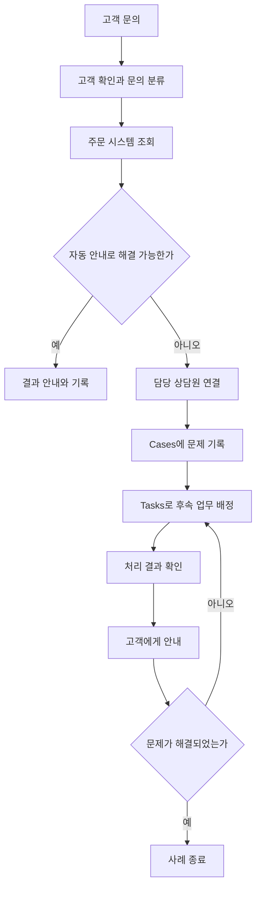
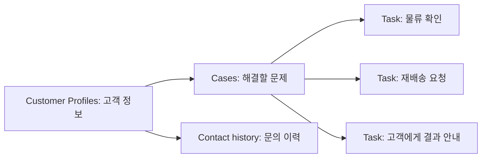

고객이 문의했을 때 필요한 기능은 통화를 연결하는 것만이 아니다. 고객 정보 조회, 문의 분류, 상담원 연결, 후속 업무, 처리 이력과 품질 분석도 필요하다. 자동 응대를 사용하더라도 해결하지 못한 문의를 사람에게 전달하는 절차가 있어야 한다.

AWS의 고객 경험 분야에서는 Amazon Connect Customer를 중심으로 이러한 기능을 구성할 수 있다. 이 글에서는 서비스와 주요 기능의 역할, 사용 상황과 예시를 정리한다. 예시는 이해를 위한 가상 상황이다. 제품 이름과 제공 상태는 2026년 10월 30일에 확인한 AWS 공식 자료를 기준으로 한다.

## Amazon Connect와 Connect Customer의 이름 구분

현재 **Amazon Connect Customer**는 이전에 **Amazon Connect**라고 부르던 고객 응대 제품의 이름이다. Amazon Connect는 고객 응대, 공급망, 의료와 채용 등 여러 업무를 위한 제품군을 가리키는 이름으로 사용된다.

따라서 예전 문서나 강의의 Amazon Connect가 고객센터 제품을 의미한다면 현재의 Connect Customer와 연결해서 이해하면 된다.

이 글의 Customer Profiles, Cases, Tasks, 대화 분석 등은 Connect Customer의 기능과 관련 구성 요소이다. 각각을 모두 독립된 AWS 서비스로 세지는 않는다. 별도 API나 제공 조건이 있다고 해서 제품 분류와 기능의 경계가 같아지는 것은 아니다.

[공식 자료: Connect Customer란?](https://docs.aws.amazon.com/connect/latest/adminguide/what-is-amazon-connect.html)

## 1. Amazon Connect Customer: 고객 응대 환경 구성

**Amazon Connect Customer**는 고객과 상담원을 연결하고, 자동 응대·라우팅·상담 운영을 구성하는 클라우드 기반 서비스이다.

**사용하기 좋은 상황**은 전화와 채팅 등 여러 문의 채널을 운영하면서 상담 흐름과 처리 결과를 함께 관리해야 하는 경우이다.

**예시**: 쇼핑몰 고객이 배송 문의를 하면 주문 상태를 확인한다. 자동으로 해결할 수 있는 문의는 안내하고, 분실·오배송처럼 추가 판단이 필요한 문의는 담당 상담원에게 연결한다.

**구분할 점**은 고객센터를 구성할 기반을 제공하더라도 조직의 업무 규칙이 자동으로 만들어지지는 않는다는 것이다. 영업시간, 고객 확인 방식, 문의 유형, 상담원 권한, 외부 주문 시스템 연동 등을 설정해야 한다.

또한 이메일·문자 전송 API와 다르다. 메시지를 보내는 기능뿐 아니라 고객과의 상호작용을 접수하고 담당자에게 배정하며 처리하는 과정이 필요한 경우에 검토한다.

[공식 자료: Amazon Connect Customer](https://aws.amazon.com/products/connect/customer/)

## 2. Flows와 라우팅: 문의 처리 순서와 담당자 결정

**Flows**는 고객이 문의를 시작한 뒤 안내·분기·처리·연결이 어떤 순서로 진행되는지 정의하는 기능이다.

**사용하기 좋은 상황**은 문의 유형, 영업시간과 고객 상태 등에 따라 응대 절차를 다르게 적용해야 하는 경우이다.

**예시**: 영업시간 안에는 문의를 상담 대기열로 보내고, 영업시간 밖에는 안내와 콜백 접수 절차를 제공한다. 주문 번호를 입력받아 조회하는 단계에는 필요한 외부 시스템 연동을 구성한다.

[공식 자료: Connect Customer Flows](https://docs.aws.amazon.com/connect/latest/adminguide/connect-contact-flows.html)

라우팅에서는 다음을 구분한다.

- **Queue**: 상담원이 처리하기를 기다리는 문의를 보관하는 대기열이다.
- **Routing profile**: 상담원에게 어떤 대기열과 채널의 업무를 배정할지 연결한다.
- **Flow**: 고객의 상호작용과 분기·연결 절차를 정의한다.

**라우팅 예시**: 배송 문의와 결제 문의를 별도 대기열로 나누고, 결제 업무를 처리할 수 있는 상담원에게 해당 대기열을 연결한다.

**구분할 점**은 대기열 생성만으로 적절한 상담원 연결이 완성되지는 않는다는 것이다. 상담원의 상태, 라우팅 프로필, 채널별 동시 처리와 우선순위를 함께 설정한다.

[공식 자료: Connect Customer 라우팅 구성](https://docs.aws.amazon.com/connect/latest/adminguide/connect-queues.html)

## 3. 상담 채널과 Agent workspace: 문의와 작업 화면 통합

Connect Customer는 음성, 채팅·메시징, 이메일, 웹·앱 통화와 영상, 작업 등의 채널과 기능을 제공한다. 채널별 설정과 지원 조건은 다르다.

**Agent workspace**는 상담원이 고객 정보, 문의 내용, 사례와 후속 작업 등을 확인하는 업무 화면이다.

**사용하기 좋은 상황**은 상담원이 여러 화면을 번갈아 확인하면서 고객에게 같은 내용을 다시 묻는 상황을 줄이려는 경우이다.

**예시**: 고객이 웹 채팅에서 설명한 배송 문제를 상담원에게 전달한다. 상담원은 연결된 고객 정보와 이전 문의를 확인하고 필요한 업무를 처리한다.

**구분할 점**은 화면을 제공하는 것과 데이터 연결이 완료된 것은 다르다는 것이다. 외부 CRM이나 주문 시스템의 정보는 적절한 연동·권한 설정이 필요하다. 채널이 달라질 때 어떤 고객 식별자와 이력을 전달할지도 정한다.

[공식 자료: Connect Customer 채널과 상담원 화면](https://docs.aws.amazon.com/connect/latest/adminguide/connect-feature-overview.html)

## 4. Customer Profiles: 고객 정보를 함께 조회

**Customer Profiles**는 외부 애플리케이션의 고객 정보와 Connect Customer의 접촉 이력을 결합하여 상담 중 확인할 수 있게 하는 기능이다.

**사용하기 좋은 상황**은 고객의 구매 내역, 이전 문의와 관련 사례가 여러 시스템에 흩어져 있는 경우이다.

**예시**: 상담원이 고객 프로필에서 최근 구매 내역과 이전 배송 문의를 확인한다. 고객이 같은 문제로 다시 연락했을 때 기존 처리 내용을 참고한다.

**구분할 점**은 정보를 모았다는 것과 고객 인증이 완료되었다는 것은 다르다는 것이다. 같은 전화번호나 비슷한 이름을 가진 레코드를 잘못 연결하지 않도록 식별·매칭 규칙을 검토한다. 프로필의 데이터 출처와 갱신 시점도 확인해야 한다.

### 공식 이미지로 보는 고객 프로필 화면

_AWS 공식 Customer Profiles 화면 예시. 상담 채팅 옆에서 고객 프로필과 관련 사례·접촉·구매 이력을 확인하는 구성을 보여준다._

그림의 오른쪽에는 고객 기본 정보와 네 개의 탭이 표시된다.

1. **Cases**: 고객과 관련된 사례이다.
2. **More information**: 추가 프로필 정보이다.
3. **Contact history**: 고객이 문의한 이력이다.
4. **Product Purchase History**: 연결된 외부 시스템에서 가져온 구매 이력이다.

이미지는 AWS 문서의 예시 화면이며 현재 화면 구성과 일부 다를 수 있다. 표시된 데이터가 모든 조직에서 자동으로 수집되는 것은 아니다. 필요한 소스 연결과 필드 구성을 준비해야 한다.

[공식 자료 및 이미지 출처: Customer Profiles](https://docs.aws.amazon.com/connect/latest/adminguide/customer-profiles.html)

## 5. Cases: 여러 번의 상담에 걸친 문제 관리

**Cases**는 고객의 문제, 해결을 위한 상호작용과 처리 결과를 사례 단위로 관리하는 기능이다.

**사용하기 좋은 상황**은 한 번의 전화나 채팅으로 해결되지 않고, 여러 담당자와 후속 처리가 필요한 문의를 관리하는 경우이다.

**예시**: 고객이 오배송을 신고한다. 하나의 사례에 최초 문의, 사진 확인, 물류팀 조사와 재배송 결과를 기록한다. 고객이 다시 연락하면 같은 사례를 기준으로 진행 상황을 확인한다.

**구분할 점**은 개별 상담과 고객 문제를 구분하는 것이다. 통화가 끝나도 문제가 해결되지 않았다면 사례는 계속 열려 있을 수 있다. 반대로 이미 해결된 문제로 고객이 단순 확인 전화를 할 수도 있다.

사례의 상태, 필요한 필드와 완료 기준을 정의하고, 자동 생성과 상담원의 수동 생성 중 적절한 방식을 사용한다.

[공식 자료: Connect Customer Cases](https://docs.aws.amazon.com/connect/latest/adminguide/cases.html)

## 6. Tasks: 상담 이후의 업무 배정과 추적

**Tasks**는 고객 지원에 필요한 작업을 우선순위에 따라 배정하고 추적하는 기능이다. 전화·채팅 문의처럼 담당자에게 라우팅할 수 있다.

**사용하기 좋은 상황**은 고객에게 다시 연락하거나, 외부 업무 시스템에서 처리해야 할 일이 남아 있는 경우이다.

**예시**: 오배송 사례에 대해 물류팀 확인이 필요하다. 확인 작업을 만들고 담당자에게 배정한 뒤, 결과에 따라 고객에게 연락하는 작업을 이어서 수행한다.

**구분할 점**은 Cases와 Tasks의 단위가 다르다는 것이다.

- Cases는 해결해야 할 고객 문제를 관리한다.
- Tasks는 그 문제를 해결하기 위해 수행할 작업을 관리한다.

작업을 완료했다고 사례가 반드시 해결되는 것은 아니다. 물류팀 확인은 끝났지만 재배송이나 환불이 남아 있을 수 있다. 작업 완료와 사례 종료 조건을 구분한다.

[공식 자료: Connect Customer Tasks](https://docs.aws.amazon.com/connect/latest/adminguide/tasks.html)

## 7. AI agents와 Agent assist: 자동 응대와 상담 지원

Connect Customer의 **AI agents**는 지식과 도구를 사용해 고객의 질문에 답하거나 작업을 수행하도록 구성할 수 있다. 고객을 직접 응대하는 방식과 상담원을 지원하는 방식을 구분한다.

**사용하기 좋은 상황**은 반복 문의를 자동으로 처리하거나, 상담원이 관련 정책과 자료를 찾는 시간을 줄이려는 경우이다.

**예시**: 고객이 교환 가능 기간을 질문하면 연결된 정책 자료를 바탕으로 안내한다. 예외 판단이 필요한 문의는 상담원에게 넘기고, 상담원에게 관련 문서와 권장 절차를 제시한다.

**구분할 점**은 답변 생성과 업무 실행이 다르다는 것이다. 정책을 설명하는 것과 실제 환불 API를 호출하는 것은 필요한 권한과 검증이 다르다. 실행 가능한 도구, 입력값 검증, 사람에게 전달할 조건과 업무별 승인 기준을 정한다.

공식 문서는 AI agents가 Amazon Bedrock을 기반으로 하며 지식 기반, 도구, 사용자 지정 프롬프트와 가드레일 등으로 구성할 수 있다고 설명한다. 제품을 활성화했다고 모든 사내 자료와 시스템을 자동으로 이해하는 것은 아니다.

[공식 자료: 실시간 지원을 위한 AI agents](https://docs.aws.amazon.com/connect/latest/adminguide/connect-ai-agent.html)

## 8. Conversational analytics: 상담 내용과 경향 분석

**Conversational analytics**는 고객과 상담원 또는 대화형 AI 사이의 상호작용을 분석하는 기능이다. 예전 자료나 API에서는 **Contact Lens**라는 이름도 접할 수 있다.

**사용하기 좋은 상황**은 문의 유형, 반복되는 문제, 상담 품질과 개선 대상을 파악하려는 경우이다.

**예시**: 배송 지연 관련 대화가 증가한 원인을 확인한다. 관리자는 분류된 문의와 관련 기록을 검토하고 안내 문구·자동 응대·업무 절차를 수정한다.

**구분할 점**은 채널별 분석 범위가 다르다는 것이다. 음성·채팅에는 실시간 및 사후 분석이 있으며, 이메일은 비동기 특성에 맞춘 분석을 제공한다. 확인한 문서는 이메일에 음성·채팅과 같은 실시간 분석 구분이나 감정 점수를 적용하지 않는다고 설명한다.

분석 결과와 요약은 원문·녹취와 대조한다. 감정 분석을 고객의 실제 상태나 상담원의 성과에 대한 확정적인 판단으로 사용하지 않는다. 민감 정보 삭제 기능도 탐지 누락 가능성을 고려하여 보관·접근 정책과 함께 검토한다.

[공식 자료: Connect Customer 대화 분석](https://docs.aws.amazon.com/connect/latest/adminguide/analyze-conversations.html)

## 9. Forecasting과 상담원 일정: 예상 업무량과 인력 계획

**Forecasting**은 과거 지표를 바탕으로 향후 문의량과 평균 처리 시간 등을 예측하는 기능이다. 예측 결과는 인력 규모와 근무 일정 계획에 활용한다.

**사용하기 좋은 상황**은 시간대별 문의량이 다르거나 행사·성수기에 필요한 인력을 미리 준비해야 하는 경우이다.

**예시**: 쇼핑몰이 과거 행사 기간의 문의량과 처리 시간을 참고하여 다음 행사 주간의 상담 인력 계획을 검토한다. 예측 결과에 실제 행사 조건과 업무 정책을 반영한다.

**구분할 점**은 미래 문의량이 보장되는 것은 아니라는 것이다. 신제품 출시나 대규모 장애처럼 과거에 없던 변화는 예측과 차이를 만들 수 있다. 기능별 요구 이력과 데이터 조건을 확인하고 예측과 실제 지표를 비교한다.

[공식 자료: Connect Customer Forecasting](https://docs.aws.amazon.com/connect/latest/adminguide/forecasting.html)

## 10. Outbound campaigns: 고객에게 먼저 연락

**Outbound campaigns**는 고객이 문의하기를 기다리는 대신, 정해진 대상과 일정·흐름에 따라 먼저 연락하는 기능이다. 지원 채널과 연동 조건을 확인해 구성한다.

**사용하기 좋은 상황**은 예약 안내, 갱신 안내나 고객별 후속 연락을 일정에 맞추어 수행해야 하는 경우이다.

**예시**: 구독 갱신 대상 고객을 프로필 속성으로 구분하고, 정해진 기간에 안내한다. 고객의 응답과 전송 결과에 따라 후속 연락 또는 상담 연결 절차를 구성한다.

**구분할 점**은 단일 메시지 전송 API와 캠페인 운영이 다르다는 것이다. 대상 고객군, 연락 순서, 일정과 결과 추적이 함께 필요하다. 공식 문서는 다단계 흐름을 위한 Visual Journey Builder와 단일 채널 중심의 Guided Campaign Builder를 안내한다.

실제 운영에서는 수신 동의와 거부, 연락 가능 시간, 발신 정보와 국가·채널별 요구 사항을 함께 적용한다.

[공식 자료: Outbound campaign 생성과 구성](https://docs.aws.amazon.com/connect/latest/adminguide/create-outbound-campaign.html)

## 11. Amazon Lex V2: 음성·텍스트 대화 인터페이스

**Amazon Lex V2**는 음성과 텍스트 기반 대화형 인터페이스를 만드는 별도의 AWS 서비스이다. Connect Customer와 연동해 사용할 수 있다.

**사용하기 좋은 상황**은 정해진 업무 의도와 필요한 입력값을 대화로 확인해야 하는 경우이다.

**예시**: 고객이 배송 상태를 확인하고 싶다고 말하면 주문 번호를 요청하고, 연결된 업무 함수로 조회한다. 이해하지 못한 입력이나 조회 실패에는 다시 질문하거나 상담원에게 넘기는 절차를 둔다.

**구분할 점**은 Lex가 고객센터 전체를 제공하는 것은 아니라는 것이다. 대화 구성과 이해는 Lex가 담당하고, 대기열·상담원 연결과 상담 운영에는 Connect Customer 등의 구성이 필요하다.

Lex에서는 의도(intent), 필요한 정보(slot), 업무 처리 연결을 구분한다. 생성형 AI를 활용하는 기능이 있더라도 구성된 대화와 업무 범위, 지원 언어를 확인해야 한다.

[공식 자료: Amazon Lex V2란?](https://docs.aws.amazon.com/lexv2/latest/dg/what-is.html)

## 관련 서비스와의 역할 차이

고객 경험을 구성할 때 다른 분야의 서비스도 함께 사용할 수 있다. 역할을 혼동하지 않는 것이 중요하다.

- **Connect Customer**: 고객 상호작용, 자동 응대와 상담 운영을 구성한다.
- **Lex V2**: 음성·텍스트 대화 인터페이스를 구성한다.
- **AWS Lambda**: 연결한 업무 로직을 실행한다. 주문 조회·취소 등의 실제 동작은 구현과 권한에 따라 달라진다.
- **Amazon SES**: 애플리케이션 이메일 송수신 기능을 제공한다.
- **AWS End User Messaging**: 문자·푸시 등 지원 채널의 메시징 기능을 제공한다.
- **Amazon Bedrock**: 생성형 AI 애플리케이션을 개발할 기반을 제공한다. Connect Customer의 관리형 AI 기능을 사용하는 것과 직접 애플리케이션을 구현하는 것은 운영 범위가 다르다.

[공식 자료: Connect Customer 기능과 Lambda 연동](https://docs.aws.amazon.com/connect/latest/adminguide/connect-feature-overview.html) · [Amazon SES](https://docs.aws.amazon.com/ses/latest/dg/Welcome.html) · [AWS End User Messaging](https://docs.aws.amazon.com/end-user-messaging/latest/userguide/nx-overview.html)

## 예시: 배송 문제를 접수하고 해결하는 과정

다음은 배송 문의를 자동 응대에서 상담원·후속 업무로 연결하는 가상 예시이다.

1. 고객이 전화나 채팅으로 배송 상태를 문의한다.
2. 고객 확인과 주문 조회를 수행한다.
3. 일반적인 상태 안내로 해결되면 결과를 기록한다.
4. 오배송 등 추가 처리가 필요하면 담당 상담원에게 연결한다.
5. 고객 문제를 Cases로 기록하고 필요한 Tasks를 배정한다.
6. 후속 업무 결과를 확인하여 고객에게 안내한다.
7. 업무 기준을 충족하면 사례를 종료한다.

아래 Mermaid는 직접 작성한 처리 흐름 예시이다. 서비스가 이 순서를 자동으로 만들어 주는 것은 아니며 실제 구현에서는 오류·시간 초과·업무 취소 등의 분기도 필요하다.

통화 종료, 작업 완료와 고객 문제 해결은 서로 다른 상태이다. 담당자에게 문의를 전달했더라도 환불이나 재배송이 실패했다면 문제가 해결된 것은 아니다. 실제 업무 시스템의 결과를 기준으로 완료 상태를 결정한다.

## 예시: 프로필·사례·작업의 관계

같은 고객이 여러 번 연락할 수 있고, 하나의 고객 문제에 여러 개의 후속 작업이 필요할 수 있다. 데이터의 목적을 다음처럼 구분한다.

이 그림은 기능의 개념적 관계를 설명한다. 실제 데이터베이스 스키마나 API의 필수 연결 관계를 표현한 것은 아니다.

## 도입 전에 확인할 사항

**리전과 언어**를 기능별로 확인한다. Connect Customer를 사용할 수 있는 리전이라고 Customer Profiles, 대화 분석, 캠페인과 모든 AI 기능의 지원 조건까지 같지는 않다. 채널과 언어별 제공 범위도 확인한다.

[공식 자료: Connect Customer 기능별 리전 지원](https://docs.aws.amazon.com/connect/latest/adminguide/regions.html)

**업무 시스템 연동**에서는 고객 확인과 조회·변경 권한을 구분한다. 주문 번호를 알거나 프로필이 조회되었다는 이유만으로 주문 취소·환불을 허용하지 않는다. 실패·중복 요청·재시도에도 실제 업무가 정확하게 처리되도록 구성한다.

**운영 지표**에서는 대기 시간이나 처리 시간만 보지 않는다. 짧은 상담이 반복 문의로 이어질 수 있으므로 문제 해결 여부와 재문의도 함께 확인한다.

**종료된 기능**도 주의한다. 과거 자료의 **Connect Voice ID**는 음성 특성을 이용한 발신자 인증과 위험 탐지 기능이었으나, 공식 지원 종료일은 2026년 5월 20일이다. 현재 신규 인증 구성의 사용 예시로 제시하지 않는다. 기존 소개 문서나 화면에 이름이 남아 있더라도 개별 종료 안내를 우선 확인한다.

[공식 자료: Voice ID 지원 종료 안내](https://docs.aws.amazon.com/connect/latest/adminguide/voice-id.html)

## SAA 공부에서 구분할 내용

이 글의 모든 기능이 SAA에서 같은 비중으로 출제된다는 의미는 아니다. 서비스의 목적과 조합을 이해하는 데 중점을 둔다.

- **Connect Customer와 Lex**: 고객 응대 운영과 대화 인터페이스를 구분한다.
- **프로필과 인증**: 고객 정보를 조회하는 것과 요청자의 권한을 검증하는 것은 다르다.
- **Cases와 Tasks**: 해결할 문제와 수행할 작업을 구분한다.
- **자동 응대와 업무 실행**: 답변 생성과 실제 시스템 변경을 구분한다.
- **실시간 처리와 사후 분석**: 고객 문의를 처리하는 기능과 결과를 분석하는 기능을 구분한다.
- **메시지 전송과 캠페인**: 전달 채널과 대상·일정·연락 흐름 관리를 구분한다.

고객 경험 서비스는 문의를 받는 채널, 고객 정보, 업무 처리와 후속 기록을 연결하는 데 사용한다. 도구를 선택하기 전에 어떤 문의를 자동으로 해결하고, 언제 사람에게 전달하며, 어떤 결과를 완료로 볼지 정의해야 한다.

