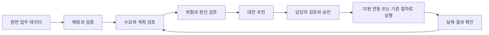
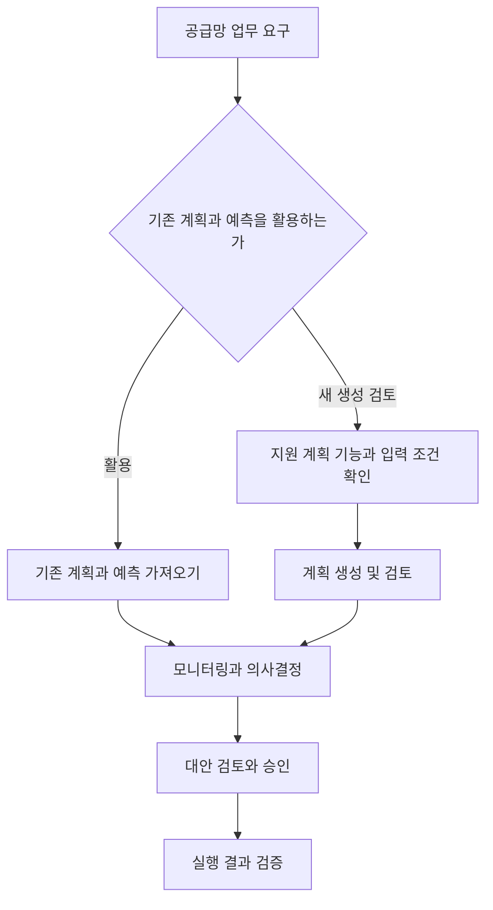

공급망에서는 얼마나 팔릴지 예측하는 것과 실제로 무엇을 언제 구매·생산·이동할지 결정하는 일이 연결된다. 판매량을 잘 예측해도 원자재 부족, 납기 지연이나 창고 제약을 반영하지 못하면 실행하기 어려운 계획이 될 수 있다.

AWS의 공급망 분야에서는 업무용 애플리케이션과 데이터·분석 서비스를 구분해야 한다. 현재 Amazon Connect Decisions는 수요와 공급 계획, 예외 탐지와 대응 의사결정을 지원하는 제품으로 안내된다.

이 글에서는 현재 제품과 기존 AWS Supply Chain 문서의 관계, 주요 기능의 사용 상황을 정리한다. 예시는 가상 상황이며 제품 이름과 제공 상태는 2026년 10월 30일에 확인한 공식 자료를 기준으로 한다.

## 먼저 구분할 용어

- **SKU(Stock Keeping Unit)**: 재고 관리에 사용하는 품목 식별 단위이다. 크기·색상·포장 등이 다르면 다른 SKU로 관리할 수 있다.
- **수요 예측**: 앞으로 필요한 수량 등을 추정하는 것이다.
- **수요 계획**: 예측값과 영업·고객의 입력 등을 검토해 업무에 사용할 수요를 정하는 것이다.
- **공급 계획**: 수요와 재고·조달·생산 제약을 고려해 공급 방법을 정하는 것이다.
- **리드타임**: 주문·생산·이동 등의 시작부터 필요한 결과를 얻기까지 걸리는 시간이다.
- **안전 재고**: 수요와 공급의 불확실성에 대비해 보유하는 재고이다.
- **결품·과잉 재고**: 필요한 수량이 부족하거나, 필요한 수준보다 많은 상태이다.

예를 들어 다음 달에 1,000개가 필요할 것으로 예측했다고 1,000개를 곧바로 발주하는 것은 아니다. 가용 재고, 도착 예정 물량, 리드타임과 최소 주문 조건 등을 함께 검토해야 한다. 이 수치는 설명을 위한 가정이다.

## AWS Supply Chain과 Connect Decisions의 관계

현재 제품 페이지는 **Amazon Connect Decisions를 AWS Supply Chain의 다음 세대**로 소개한다. 공식 문서도 Connect Decisions와 **AWS Supply Chain (Legacy)** 영역을 분리한다.

따라서 단순히 화면의 제품 이름만 바뀌었다고 이해해서는 안 된다. 기존 문서의 데이터 모델, 기능과 화면을 새 제품에 그대로 적용할 수 있는지 확인해야 한다. Legacy로 분류되었다는 사실만으로 모든 기존 기능의 종료일을 임의로 정해서도 안 된다.

또한 **Connect Customer**와 **Connect Decisions**는 목적이 다르다. 전자는 고객 응대, 후자는 공급망 계획과 의사결정을 위한 제품이다.

이 글의 Demand intelligence, Supply intelligence와 온보딩 등은 Connect Decisions 안의 기능 영역이다. 각각을 독립적인 AWS 서비스 개수로 중복해서 세지 않는다.

[공식 자료: Connect Decisions 제품 소개](https://aws.amazon.com/products/connect/decisions/) · [현재 문서와 Legacy 문서 구분](https://docs.aws.amazon.com/connect-decisions/)

## 1. Amazon Connect Decisions: 공급망 계획과 의사결정

**Amazon Connect Decisions**는 AI 기능을 활용해 수요 신호를 정리하고, 공급 계획과 운영 모니터링·대응 의사결정을 지원하는 업무용 솔루션이다.

**사용하기 좋은 상황**은 여러 시스템의 공급망 데이터를 함께 보고, 계획과 실제 운영 사이의 차이에 대응해야 하는 경우이다.

**예시**: 유통업체가 매장·물류센터의 재고와 주문 정보를 함께 확인한다. 예상 수요와 공급 상황의 차이를 검토하고 발주·재고 이동 등의 대응을 결정한다.

**구분할 점**은 ERP나 창고 관리 시스템을 모두 대체하는 제품으로 설명하지 않는다는 것이다. 기존 시스템과의 데이터 연결, 업무 규칙과 실행 연동을 준비한다. 제품을 사용한다고 실제 발주·입고가 자동으로 정확하게 처리되는 것은 아니다.

어떤 데이터를 사용해 어떤 범위의 판단을 지원할지, 추천을 누가 검토하고 어떤 시스템에서 실행할지 정해야 한다.

[공식 자료: Connect Decisions란?](https://docs.aws.amazon.com/connect-decisions/latest/userguide/what-is-amazon-connect-decisions.html)

## 2. Demand intelligence: 수요 예측과 계획 조정

**Demand intelligence**는 품목별 예측을 생성하고, 여러 입력을 조정해 수요 계획을 구성하며 예측 정확도를 확인하는 기능 영역이다.

**사용하기 좋은 상황**은 계절·행사·신제품 등으로 수요가 바뀌고, 통계적 예측과 현업의 정보를 함께 반영해야 하는 경우이다.

**예시**: 음료 판매 업체가 과거 판매와 행사 계획을 참고해 품목·지역별 수요를 검토한다. 영업팀의 고객 주문 예상과 비교하여 계획을 조정한다.

**구분할 점**은 예측이 확정 주문은 아니라는 것이다. 품절 때문에 판매하지 못한 수량이 과거 판매에 나타나지 않을 수도 있고, 일시적인 행사를 일반적인 수요로 오해할 수도 있다. 입력 데이터의 의미와 예측 오차를 함께 확인한다.

공식 페이지는 제한적인 이력·신제품에 대한 예측 기능도 소개하지만, 모든 기능에 데이터 이력이 필요 없다는 뜻은 아니다. 사용하려는 계획·설정의 필수 데이터 조건을 확인한다.

예측과 실제의 차이를 볼 때는 과소·과대 예측, 품목별 오류와 업무 영향을 함께 검토한다. 전체 평균 오차만 낮아도 중요한 품목의 결품 위험은 남아 있을 수 있다.

[공식 자료: Demand intelligence](https://aws.amazon.com/products/connect/decisions/demand-intelligence/)

## 3. Supply intelligence: 공급 제약과 운영 위험 검토

**Supply intelligence**는 재고, 공급자 성과와 수요 신호를 바탕으로 위험과 대응 방안을 확인하는 기능 영역이다.

**사용하기 좋은 상황**은 수요는 증가했지만 물량·생산·운송의 제약이 있어 대안을 비교해야 하는 경우이다.

**예시**: 특정 공급자의 납기가 지연될 가능성을 확인한다. 담당자는 다른 창고의 재고 이동, 대체 조달과 고객 납기 조정 등의 대안을 검토한다.

**구분할 점**은 위험 탐지와 실제 원인 확인·조치가 다른 단계라는 것이다. 추천에는 사용한 데이터, 제약과 예상 효과를 확인해야 한다. 원천 데이터가 늦게 갱신되면 이미 해결된 문제를 계속 위험으로 볼 수도 있다.

### Supply planning은 프리뷰로 구분

확인한 공식 개요와 FAQ는 **Supply planning을 프리뷰**로 안내한다. 생산 능력, 창고 공간, 리드타임과 자재 가용성 등의 제약을 고려한 공급 계획을 설명한다.

프리뷰 기능을 이미 모든 고객·리전에서 동일하게 사용할 수 있는 기능으로 설명하지 않는다. 실제 도입 시 접근 조건과 지원 범위를 확인한다.

[공식 자료: Supply intelligence](https://aws.amazon.com/products/connect/decisions/supply-intelligence/) · [Supply planning 프리뷰 안내](https://aws.amazon.com/products/connect/decisions/faqs/)

## 4. Adaptive intelligence: 판단 결과와 피드백 활용

**Adaptive intelligence**는 계획 조정, 추천 수락·거부와 규칙 변경 등의 피드백을 활용하는 기반 기능으로 소개된다.

**사용하기 좋은 상황**은 담당자의 판단 기준과 예외 처리 이유를 반복 업무에 반영하려는 경우이다.

**예시**: 특정 공급자의 지연 패턴 때문에 담당자가 추천 계획을 수정한다. 수정 이유와 업무 규칙을 남기고 이후 추천을 검토할 때 참고하도록 구성한다.

**구분할 점**은 계속 사용하면 모든 판단이 자동으로 정확해진다는 뜻은 아니라는 것이다. 피드백의 품질과 일관성을 관리해야 한다. 잘못된 데이터나 일회성 사정을 일반 규칙으로 반영하지 않도록 검토한다.

모델을 직접 학습시키는 기반 서비스와도 구분한다. 고객이 별도 모델 훈련 파이프라인을 구축하는 것과 업무 제품 안에서 피드백을 제공하는 것은 운영 범위가 다르다.

[공식 자료: Adaptive intelligence](https://aws.amazon.com/products/connect/decisions/adaptive-intelligence/)

## 5. Agentic onboarding: 업무 규칙과 모니터링 구성

**Agentic onboarding**은 자연어와 업무 문서를 활용해 지표·규칙·임계값 등의 구성을 돕는 기능이다.

**사용하기 좋은 상황**은 무엇을 감시해야 하는지는 알지만 이를 기술 설정으로 옮기기 어려운 경우이다.

**예시**: 담당자가 특정 품목군에서 재고가 안전 수준 아래로 내려가는 상황을 확인하고 싶다고 설명한다. 제안된 지표·조건·필터를 검토한 뒤 적용한다.

**구분할 점**은 자연어 설정과 검증 생략은 다르다는 것이다. 품목·거점의 범위, 단위, 기간과 임계값이 의도대로 해석되었는지 확인한다. 공식 문서는 실제 데이터에 대한 미리보기로 변경 효과를 확인한 후 운영에 반영하는 방식을 설명한다.

업무 규칙 문서를 올렸다고 데이터 연결까지 모두 완료되는 것은 아니다. 인스턴스, 실행 중인 데이터 흐름과 필요한 권한·데이터를 먼저 준비해야 한다.

[공식 자료: Connect Decisions 온보딩](https://docs.aws.amazon.com/connect-decisions/latest/userguide/onboarding.html)

## 6. 데이터 연결과 매핑: 원천 정보를 업무 모델로 변환

공급망 기능을 사용하려면 판매·주문, 품목, 거점과 재고 등의 데이터를 연결해야 한다. 요구 데이터는 사용하는 기능과 계획에 따라 확인한다.

**사용하기 좋은 상황**은 기존 ERP·파일의 필드와 제품이 사용하는 데이터 모델이 다른 경우이다.

**예시**: 원천 시스템의 상품·창고·수량 필드를 목적지 데이터 모델에 연결한다. 상품 코드가 같은지, 수량 단위와 날짜가 올바르게 변환되는지 확인한다.

### 공식 이미지로 보는 데이터 매핑

_AWS 공식 Connect Decisions 데이터 매핑 화면. 원천 데이터와 목적지 모델의 연결 상태 및 Data Agent 설명을 보여준다._

왼쪽 표는 Source와 Target, 처리 상태를 표시하고 오른쪽은 매핑 설명을 제공한다. 화면의 Complete를 업무 데이터 전체의 정확성 보장으로 해석하지 않는다.

변환 결과를 시험하고 매핑을 수락한 뒤, 갱신·실행 상태를 확인한다.

[공식 자료 및 이미지 출처: 데이터 연결과 매핑](https://docs.aws.amazon.com/connect-decisions/latest/adminguide/connecting-your-data.html)

## 7. Data validation: 필수 데이터와 품질 점검

**Data validation**은 구성한 계획·지표·규칙에 필요한 데이터가 존재하고 사용할 수 있는지 확인하는 기능이다.

**사용하기 좋은 상황**은 특정 품목이나 거점에서만 계획·분석이 실행되지 않거나 결과가 부정확한 경우이다.

**예시**: 일부 품목의 공급자·거점 관계가 빠져 있음을 확인한다. 원천 데이터나 매핑을 수정하고 갱신한 뒤 해당 오류가 해결되었는지 검증한다.

검증은 다음처럼 구분된다.

- **존재 검증**: 필요한 데이터셋과 필드가 있는지 확인한다.
- **품질 검증**: 계층·연결·적용 범위와 데이터 사용 조건 등을 확인한다.

**구분할 점**은 일부 정상 데이터의 처리 성공이 전체 성공을 의미하지 않는다는 것이다. 공식 문서는 유효한 품목·거점은 처리하면서 문제가 있는 범위를 구분할 수 있다고 설명한다.

또한 오류를 수동으로 해결 상태로 표시하는 것과 실제 데이터 수정은 다르다. 원인을 고친 뒤 재검증과 영향 범위를 확인한다.

[공식 자료: 데이터 검증과 품질 점검](https://docs.aws.amazon.com/connect-decisions/latest/adminguide/data-validation-and-quality-checks.html)

## 기존 AWS Supply Chain 문서에서 접할 기능

Legacy 문서는 수요·공급 계획, 공급망 데이터 통합, 재고 인사이트, N-tier 공급자 가시성과 지속가능성 정보 관리 등을 설명한다.

- **Demand Planning**: 수요 계획을 생성·조정·공유한다.
- **Supply Planning**: 재고·조달·생산 등의 입력을 바탕으로 공급 계획을 검토한다.
- **Insights**: 재고와 공급망 문제를 확인하고 대응을 검토한다.
- **N-Tier Visibility**: 외부 공급망 파트너와의 가시성·협업을 다룬다.
- **Sustainability**: 공급망의 지속가능성 정보를 관리한다.

**예시**: 기존 사용자가 제조 계획과 공급자 협업 흐름을 확인할 때 이 문서 영역을 참고한다.

**구분할 점**은 이 목록을 새 Connect Decisions의 모든 기능·제공 단계와 일대일로 대응시키지 않는다는 것이다. 기존 환경을 변경하거나 새로 구축할 때는 해당 제품·문서 버전과 실제 인스턴스의 지원 범위를 확인한다.

[공식 자료: AWS Supply Chain Legacy 개요](https://docs.aws.amazon.com/connect-decisions/legacy/adminguide/what-is-service.html) · [Legacy 공급 계획 업무 흐름](https://docs.aws.amazon.com/connect-decisions/legacy/userguide/sharing_manufacturing_plans.html)

## 예시: 행사 수요 증가에 대응

다음은 유통업체가 행사 상품의 결품 위험을 검토하는 가상 상황이다.

1. 품목·거점별 주문, 재고와 입고 예정 데이터를 연결한다.
2. 단위·품목 관계·날짜 등의 검증 결과를 확인한다.
3. 행사 기간의 예상 수요와 기존 계획을 비교한다.
4. 재고 부족과 공급 지연 위험을 검토한다.
5. 대체 발주·거점 간 이동 등의 대안을 확인한다.
6. 담당자가 제약과 비용·효과를 검토한다.
7. 승인한 작업을 지원하는 연동 또는 기존 업무 절차로 실행한다.
8. 실제 주문·이동·입고 결과를 확인하고 계획에 반영한다.

아래 Mermaid는 직접 작성한 업무 흐름이다. 특정 화면·API의 필수 순서를 의미하지 않으며, 공급 계획 기능의 제공 단계와 연동 조건은 별도로 확인해야 한다.

추천을 승인했다고 실제 발주가 완료된 것은 아니다. 외부 시스템의 오류나 권한 문제로 실패할 수 있다. 주문 중복, 변경·취소와 재시도도 업무 기준으로 관리한다.

## 계획 생성과 기존 계획 활용의 차이

Connect Decisions의 온보딩 절차는 새 계획을 생성하는 방식과 기존 계획·예측을 가져오는 방식을 구분한다.

**사용 상황 예시**: 이미 검증된 수요 예측 시스템을 운영한다면 즉시 교체하기보다 해당 예측을 가져와 모니터링·의사결정 기능을 검토할 수 있다.

아래는 두 경로를 설명하기 위해 작성한 개념도이다.

이 그림은 자동 데이터 이전이나 실행을 보장하지 않는다. 기능별 입력 모델, 설정과 제공 조건에 맞게 구성해야 한다.

[공식 자료: 기존 재고 계획·수요 예측 가져오기 선택](https://docs.aws.amazon.com/connect-decisions/latest/adminguide/connecting-your-data.html)

## 함께 검토할 AWS 서비스와 역할

공급망 애플리케이션과 기반 서비스는 역할이 다르다. 요구 사항에 따라 다음 기능을 별도로 구성할 수 있다.

- **Amazon S3**: 파일과 분석용 데이터의 보관에 사용한다.
- **AWS Glue 및 데이터 연결 기능**: 지원하는 데이터 소스와 변환·연계 요구를 검토한다.
- **분석·BI 도구**: 조직의 보고 지표와 시각화를 구성한다.
- **머신러닝 기반 서비스**: 직접 모델을 개발·운영해야 하는 별도 요구가 있을 때 검토한다.
- **업무 API·이벤트 연동**: 승인된 변경을 기존 시스템에 전달하고 결과를 추적한다.

이는 모두 필수로 추가해야 한다는 뜻이 아니다. 관리형 업무 제품이 제공하는 범위와 직접 구축할 범위를 구분한다. 공식 문서는 JDBC와 S3 등 데이터 연결 방식을 설명하지만, 모든 ERP에 아무 설정 없이 연결되는 것으로 해석하지 않는다.

[공식 자료: Connect Decisions의 데이터 연결 개요](https://docs.aws.amazon.com/connect-decisions/latest/userguide/what-is-amazon-connect-decisions.html)

### Amazon Forecast와의 차이

**Amazon Forecast**는 시계열 예측을 위한 별도의 서비스이다. 예측 모델의 입력·학습·출력을 다루는 것과, 공급망 업무의 계획·예외·대응을 다루는 제품은 목적이 다르다.

현재 Forecast는 신규 고객 온보딩이 제한된 유지 관리 단계로 안내된다. 예전 예제에 이름이 나온다고 신규 구축의 기본 선택으로 제시하지 않는다. 기존 고객의 계속 사용과 새로운 공급망 애플리케이션 도입은 구분한다.

[공식 자료: Amazon Forecast 개요](https://docs.aws.amazon.com/forecast/latest/dg/what-is-forecast.html) · [AWS 유지 관리 서비스 목록](https://docs.aws.amazon.com/general/latest/gr/maintenance_services.html)

## 도입 전에 확인할 사항

**기능·리전·언어**를 확인한다. Legacy의 지원 언어를 새 제품 전체에 그대로 적용하지 않는다. 공급 계획 프리뷰와 실제 사용할 기능의 제공 조건도 확인한다.

**데이터의 기준 시점**을 맞춘다. 오늘 재고와 어제 주문, 다음 주 도착 예정 물량을 같은 기준으로 해석하지 않도록 한다. 통화·수량 단위·시간대·반품·취소의 의미도 정한다.

**데이터 이력 조건**을 확인한다. 제한된 이력에 대한 예측 기능 소개와 계획별 필수 데이터 요건은 다를 수 있다. 실제 설정에서 필요한 이력과 검증 결과를 기준으로 판단한다.

**권한과 승인**을 분리한다. 데이터를 조회할 권한과 구매 주문을 변경할 권한은 다르다. 분석·추천·승인·실행·결과 확인의 책임을 정한다.

**성과 검증**을 설계한다. 과거 데이터의 백테스트, 기존 계획과의 비교와 제한된 범위의 시범 운영으로 평가한다. 예측 오차뿐 아니라 결품·과잉 재고·납기·재고 비용에 미치는 영향을 확인한다.

**지원 범위와 비용**을 확인한다. 연결 데이터량, 사용 기능, 업무 연동과 운영 지원 요구를 정리하고 실제 제공 조건을 확인한다. 제품 소개의 성과 수치를 모든 고객에게 보장되는 결과로 사용하지 않는다.

## SAA 공부에서 구분할 내용

이 분야의 모든 기능이 SAA에서 같은 비중으로 다뤄진다는 의미는 아니다. 업무 제품과 기반 인프라의 역할을 이해하는 데 중점을 둔다.

- **수요 예측과 공급 계획**: 필요한 수량 추정과 실행 가능한 공급 방법을 구분한다.
- **업무 애플리케이션과 모델 개발**: 완성된 업무 기능 활용과 직접 모델 운영을 구분한다.
- **데이터 저장과 의미 통합**: 파일이 저장되었다고 품목·거점·단위가 일치하는 것은 아니다.
- **정상 데이터와 전체 범위**: 일부 처리 성공을 전체 품목·거점의 성공으로 보지 않는다.
- **추천과 실제 실행**: 대안을 제시하는 것과 외부 업무 시스템에 적용하는 것을 구분한다.
- **현재 기능과 Legacy 문서**: 이름이 비슷해도 기능·입력 모델·지원 조건을 확인한다.

공급망 서비스를 선택하기 전에 어떤 데이터를 어떤 기준으로 모을지, 어떤 의사결정을 지원할지 정해야 한다. 이후 예측·계획·모니터링·실행 중 필요한 기능과 책임 범위를 구성한다.

