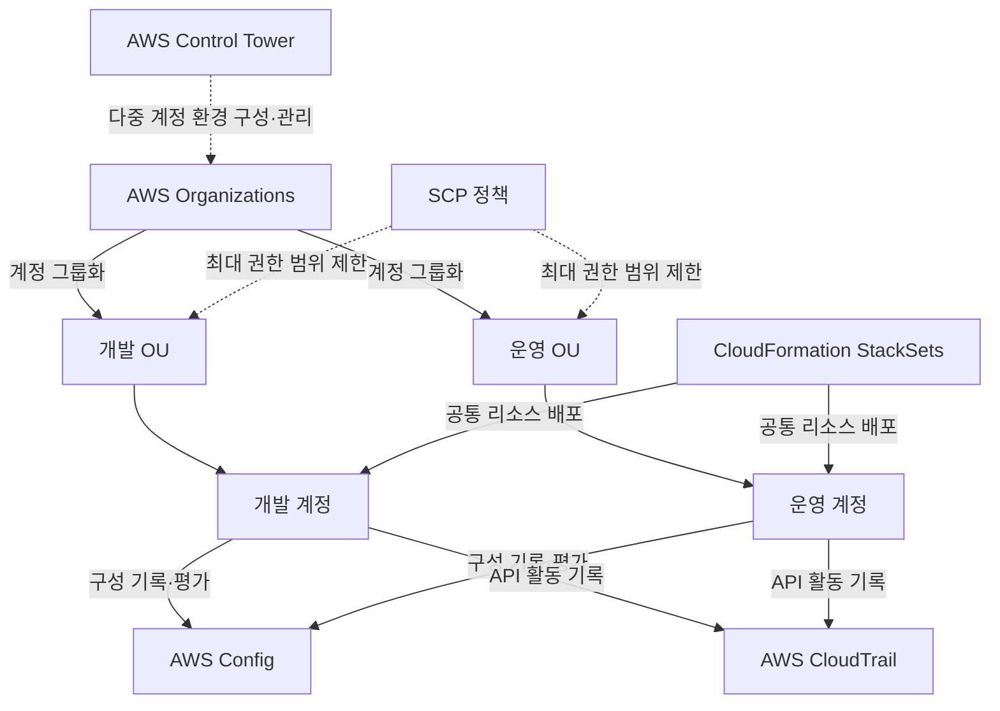

AWS 리소스가 늘어나면 개별 서버를 만드는 것 외에도 계정 분리, 공통 정책, 구성 변경 이력, 비용과 사용 한도를 관리해야 한다. 관리 도구마다 계정을 관리하는지, 리소스를 생성하는지, 상태를 평가하는지에 따라 역할이 다르다.

이 글에서는 계정과 조직, 인프라 정의, 리소스 현황, 비용과 개선 항목을 관리하는 도구를 정리한다. 사용 예시는 설명을 위한 가상 상황이다. 서비스 명칭과 제공 상태는 2026년 10월 30일에 확인한 AWS 공식 자료를 기준으로 작성했다.

## 먼저 구분할 개념

### 계정과 리전

**AWS 계정**은 권한, 비용과 워크로드를 구분하는 기본 단위다. **리전**은 리소스를 배치하는 지리적 영역이다. 개발과 운영을 서로 다른 계정으로 분리하고 각 계정에서 필요한 리전을 사용할 수 있다.

여러 계정을 하나의 조직에 묶었다고 모든 리소스와 권한이 하나로 합쳐지지는 않는다. 계정 간 접근과 리소스 공유는 별도로 구성해야 한다.

### 거버넌스와 운영

**거버넌스**는 누가 무엇을 어떤 기준으로 사용할 수 있는지 정책과 절차를 정하고 관리하는 활동이다. **운영**은 실제 환경의 상태를 관찰하고 변경·장애에 대응하는 활동이다.

허용할 서비스와 계정 구조를 정하는 것과, 서버의 오류 로그를 확인하는 것은 다른 작업이다. AWS 도구는 두 영역에 걸쳐 연동되지만 한 도구가 모든 작업을 대신하지는 않는다.

### 예방, 탐지와 수정

**예방**은 허용하지 않는 작업을 제한하는 것이다. **탐지**는 현재 상태나 변경이 기준에 맞는지 확인하는 것이다. **수정**은 확인한 문제를 실제로 바꾸는 것이다.

설정이 기준에 맞지 않는다고 표시되는 것과 그 설정이 자동으로 수정되는 것은 다르다. 자동 수정을 사용하려면 지원되는 실행 방식, 권한과 변경 범위를 별도로 구성해야 한다.

## 계정과 조직 관리

### AWS Organizations

여러 AWS 계정을 조직으로 묶고 계정 생성, 조직 정책과 통합 결제를 관리하는 서비스다.

- **사용하기 좋은 상황:** 개발·운영·보안 등 여러 계정을 공통 기준으로 관리해야 할 때.
- **간단한 예시:** 개발 계정과 운영 계정을 각각 조직 단위에 넣고 환경에 맞는 공통 정책을 적용한다.
- **구분할 점:** 계정을 묶는 조직 구조와 각 계정 안의 IAM 사용자·역할 권한은 다르다. 조직에 포함됐다는 이유만으로 다른 계정의 리소스에 접근할 수 있는 것은 아니다.

계정은 **조직 단위(OU, Organizational Unit)**로 묶을 수 있다. OU는 관련 계정을 그룹화하는 단위이며 VPC의 서브넷이나 IAM 사용자 그룹과 같은 개념이 아니다.

[공식 자료: AWS Organizations 개요](https://docs.aws.amazon.com/organizations/latest/userguide/orgs_introduction.html)

### 서비스 제어 정책 — SCP

SCP는 Organizations에서 사용하는 조직 정책의 한 종류다. 적용 대상 계정의 IAM 사용자와 역할이 사용할 수 있는 최대 권한 범위를 제한한다.

- **사용하기 좋은 상황:** 여러 멤버 계정에서 공통으로 금지하거나 제한할 작업이 있을 때.
- **간단한 예시:** 지정한 멤버 계정에서 조직이 허용하지 않는 작업을 제한하는 정책을 검토하고 적용한다.
- **구분할 점:** **SCP는 권한을 부여하지 않는다.** 허용 범위 안의 작업도 IAM 정책 등 필요한 권한이 있어야 수행할 수 있다.

SCP는 조직의 모든 기능이 활성화된 경우 사용할 수 있다. 관리 계정의 사용자와 역할에는 적용되지 않는 등 예외가 있으므로 모든 주체를 동일하게 제한한다고 가정하지 않는다.

기존 환경에 정책을 넓게 적용하면 필요한 서비스 동작까지 막을 수 있다. 적용 범위와 예외를 확인하고 제한된 대상에서 영향을 검토한다.

[공식 자료: SCP의 역할과 적용 범위](https://docs.aws.amazon.com/organizations/latest/userguide/orgs_manage_policies_scps.html)

### AWS Control Tower

여러 계정으로 구성한 AWS 환경을 공통 기준에 맞춰 구축하고 관리하도록 돕는 서비스다. Organizations 등 여러 서비스의 기능을 조합한다.

- **사용하기 좋은 상황:** 새 계정을 반복해서 만들면서 계정 구조와 기본 통제, 로깅 구성을 표준화하고 싶을 때.
- **간단한 예시:** 공통 기준을 갖춘 다중 계정 환경을 구성하고 Account Factory로 팀별 계정을 생성한다.
- **구분할 점:** Organizations를 대체하는 별개의 계정 체계가 아니다. Organizations 위에서 여러 기능을 조정하는 관리 계층이다.

Control Tower의 **랜딩 존(Landing Zone)**은 공통 기준을 바탕으로 구성한 다중 계정 환경이다. 모든 애플리케이션의 VPC나 업무 아키텍처를 자동으로 완성한다는 뜻은 아니다.

통제에는 예방적·탐지적·사전 검증 방식이 있다. 일부 문서에서는 이전 명칭인 guardrail이 사용된다. 통제 종류와 적용 대상을 확인해야 하며, 모든 통제가 변경을 즉시 차단하는 것은 아니다.

[공식 자료: Control Tower 개요](https://docs.aws.amazon.com/controltower/latest/userguide/what-is-control-tower.html) · [통제의 유형과 예외](https://docs.aws.amazon.com/controltower/latest/controlreference/controls.html)

### AWS Resource Access Manager — AWS RAM

지원되는 AWS 리소스를 다른 계정 등과 공유하는 서비스다.

- **사용하기 좋은 상황:** 여러 계정에서 공통 인프라를 사용하면서 각 계정의 분리를 유지하고 싶을 때.
- **간단한 예시:** 네트워크 관리 계정의 지원되는 서브넷을 다른 계정이 사용하도록 공유한다.
- **구분할 점:** 계정을 Organizations에 추가하는 것과 리소스를 RAM으로 공유하는 것은 다른 작업이다. 모든 AWS 리소스를 같은 방식으로 공유할 수 있는 것도 아니다.

리소스 종류별 공유 대상과 허용되는 작업을 확인해야 한다. 리소스 소유권 전체를 이전하는 기능으로 이해하지 않는다.

[공식 자료: AWS RAM 개요](https://docs.aws.amazon.com/ram/latest/userguide/what-is.html)

## 인프라 정의와 표준 배포

### AWS CloudFormation

템플릿으로 관련 AWS 리소스를 정의하고 **스택(Stack)** 단위로 생성·변경·삭제하는 서비스다.

- **사용하기 좋은 상황:** 같은 구성을 여러 환경에 반복하고 변경을 검토 가능한 형태로 관리해야 할 때.
- **간단한 예시:** API 서버와 로드 밸런서, 관련 리소스를 템플릿으로 정의해 개발과 검증 환경을 구성한다.
- **구분할 점:** 템플릿 파일과 실제 배포된 스택은 다르다. 템플릿을 수정하거나 생성했다고 실제 리소스 변경까지 완료된 것은 아니다.

CDK나 SAM으로 작성한 인프라도 CloudFormation과 연결될 수 있다. CloudFormation은 애플리케이션의 모든 업무 로직을 실행하는 도구가 아니라 리소스 구성을 관리하는 도구다.

[공식 자료: CloudFormation 개요](https://docs.aws.amazon.com/AWSCloudFormation/latest/UserGuide/Welcome.html)

### 변경 세트 — Change Set

변경 세트는 스택에 적용할 변경을 미리 확인하는 CloudFormation 기능이다.

- **사용하기 좋은 상황:** 업데이트 전에 어떤 리소스가 추가·수정·삭제·교체될 수 있는지 검토하고 싶을 때.
- **간단한 예시:** 데이터베이스 관련 속성을 바꾸기 전에 리소스 교체가 필요한 변경인지 살펴본다.
- **구분할 점:** 변경 세트를 생성하는 단계와 실행하는 단계는 다르다. 변경 내용을 확인할 수 있어도 실제 업데이트의 성공을 보장하지는 않는다.

### 공식 이미지: CloudFormation 변경 세트의 적용 과정

_CloudFormation 변경 세트 생성, 검토와 실행 과정. AWS 공식 문서의 원본 이미지._

[이미지 출처: Update CloudFormation stacks using change sets](https://docs.aws.amazon.com/AWSCloudFormation/latest/UserGuide/using-cfn-updating-stacks-changesets.html)

그림에서는 기존 스택을 기준으로 변경 세트를 만들고 내용을 확인한다. 다른 변경안을 비교하려면 추가 변경 세트를 만들 수 있다. 실제 스택에 반영하는 시점은 **Execute change set**이다.

생성 성공, 검토 완료, 실행 성공은 각각 별도 상태다. 적용 후에는 스택의 결과와 실제 서비스 동작을 확인해야 한다. 그림의 아이콘은 공식 문서 원본이며 현재 콘솔 화면과 모양이 다를 수 있다.

### CloudFormation StackSets

하나의 템플릿을 바탕으로 여러 계정과 리전에 스택을 배포·갱신하는 기능이다.

- **사용하기 좋은 상황:** 여러 계정에 같은 기반 리소스와 설정을 반복 적용해야 할 때.
- **간단한 예시:** 여러 멤버 계정과 지정한 리전에 공통 관리 리소스를 배포한다.
- **구분할 점:** 하나의 스택이 모든 계정의 리소스를 직접 소유하는 구조가 아니다. 대상 계정과 리전에 배포한 스택들을 관리한다.

권한 방식과 대상, 동시 실행과 실패 허용 조건을 확인한다. 조직 정책을 적용하는 기능과 템플릿의 리소스를 배포하는 기능은 목적이 다르다.

[공식 자료: StackSets 개요](https://docs.aws.amazon.com/AWSCloudFormation/latest/UserGuide/what-is-cfnstacksets.html)

### AWS Service Catalog

조직이 승인한 IT 구성과 제품을 카탈로그로 제공하고 사용자가 정한 조건 안에서 배포하도록 하는 서비스다.

- **사용하기 좋은 상황:** 팀마다 제각각 리소스를 만들기보다 승인된 구성을 셀프서비스로 제공하고 싶을 때.
- **간단한 예시:** 조직의 표준 웹 서버 구성을 제품으로 등록하고 개발자가 허용된 옵션으로 배포한다.
- **구분할 점:** 모든 AWS 제품을 판매하는 AWS Marketplace와 다르다. Service Catalog에서는 조직의 승인 구성과 접근·배포 제약을 관리한다.

포트폴리오에 제품을 묶고 사용할 주체와 제약을 설정할 수 있다. 제품 버전 등록과 이미 배포된 환경의 실제 업데이트도 구분해야 한다.

[공식 자료: Service Catalog 개요](https://docs.aws.amazon.com/servicecatalog/latest/adminguide/introduction.html)

### AWS Launch Wizard

지원되는 워크로드를 구성하고 배포하는 과정을 안내하는 도구다.

- **사용하기 좋은 상황:** 지원 대상의 기반 구성을 안내에 따라 만들고 배포 설정을 정리하고 싶을 때.
- **간단한 예시:** Active Directory 인프라나 도메인 컨트롤러 추가 구성을 검토한다.
- **구분할 점:** 모든 애플리케이션의 아키텍처를 자동 설계하는 도구가 아니다. 워크로드별 지원과 네트워크·권한·기술 요구사항을 확인한다.

[공식 자료: Launch Wizard의 Active Directory 안내](https://docs.aws.amazon.com/launchwizard/latest/userguide/launch-wizard-ad-getting-started.html)

## 리소스 검색, 상태와 변경 이력

### AWS Resource Explorer

이름, 태그, ID 등의 메타데이터로 AWS 리소스를 검색하고 찾는 서비스다.

- **사용하기 좋은 상황:** 리소스가 여러 리전과 서비스에 흩어져 있어 위치와 현황을 찾기 어려울 때.
- **간단한 예시:** 특정 프로젝트 태그가 붙은 리소스를 찾아 해당 서비스 화면에서 세부 설정을 확인한다.
- **구분할 점:** 현재 리소스를 검색하는 기능과 과거 구성 변경 이력을 분석하는 기능은 다르다. 검색 결과를 전체 구성 감사 기록으로 사용하지 않는다.

검색 범위와 결과의 완전성은 권한, 인덱스와 리전 통합 설정 등에 따라 달라질 수 있다. 리소스가 검색되지 않았다고 존재하지 않는다고 바로 결론 내리지 않는다.

[공식 자료: Resource Explorer 개요](https://docs.aws.amazon.com/resource-explorer/latest/userguide/welcome.html)

### AWS Resource Groups와 태그

Resource Groups는 관련 리소스를 그룹으로 묶어 지원되는 관리 작업에 활용하는 서비스다. **태그**는 리소스에 붙이는 키·값 메타데이터다.

- **사용하기 좋은 상황:** 애플리케이션이나 환경별 리소스를 같은 기준으로 찾아 관리하고 싶을 때.
- **간단한 예시:** 프로젝트와 환경 태그를 기준으로 관련 리소스를 묶어 관리 대상 범위를 정한다.
- **구분할 점:** 같은 태그를 붙였다고 자동으로 접근 권한이나 네트워크가 연결되는 것은 아니다. 태그를 이용한 정책과 관리 작업은 별도로 구성한다.

태그 이름과 값을 일관되게 정해야 검색과 비용 분류에 활용하기 쉽다. 비밀번호나 개인정보 같은 민감한 값을 태그에 넣지 않는다.

[공식 자료: Resource Groups와 태그](https://docs.aws.amazon.com/ARG/latest/userguide/)

### AWS Config

지원되는 AWS 리소스의 구성과 관계, 시간에 따른 변경 이력을 기록하고 설정을 평가하는 서비스다.

- **사용하기 좋은 상황:** 리소스가 어떤 설정이었는지 확인하고 조직 기준과 다른 구성을 찾고 싶을 때.
- **간단한 예시:** 보안 그룹 설정의 변경 이력을 확인하고 정한 규칙에 맞는지 평가한다.
- **구분할 점:** Config 규칙의 비준수 판정은 변경 요청을 사전에 차단했다는 뜻이 아니다. 기록과 평가, 수정 동작을 구분해야 한다.

기록 대상과 리소스 유형을 설정해야 한다. 모든 리소스의 모든 변경이 별도 구성 없이 기록된다고 가정하지 않는다.

[공식 자료: AWS Config 개요](https://docs.aws.amazon.com/config/latest/developerguide/WhatIsConfig.html)

### AWS CloudTrail

AWS에서 사용자·역할·서비스가 수행한 작업을 이벤트로 기록해 감사와 변경 추적에 활용하는 서비스다.

- **사용하기 좋은 상황:** 누가 어떤 API 작업을 언제 수행했는지 조사해야 할 때.
- **간단한 예시:** 보안 그룹 설정이 바뀐 시점에 어떤 주체가 관련 API를 호출했는지 확인한다.
- **구분할 점:** CloudTrail은 작업 이벤트를, Config는 리소스 구성과 그 변화를 확인하는 데 사용한다. 애플리케이션 응답 시간과 CPU 사용률을 보는 도구와도 다르다.

기본 이벤트 기록은 리전별 최근 90일의 관리 이벤트를 제공한다. 장기 보관이나 데이터 이벤트 등은 필요한 기록·보관 구성을 확인해야 한다.

현재 **CloudTrail Lake는 2026년 5월 31일부터 신규 고객에게 제공되지 않는다.** 이 제한은 Lake에 해당하며 CloudTrail 전체 종료를 뜻하지 않는다. 기존 이벤트 기록과 Trail 등의 기능을 별도로 구분한다.

[공식 자료: CloudTrail 개요](https://docs.aws.amazon.com/awscloudtrail/latest/userguide/cloudtrail-user-guide.html) · [CloudTrail Lake 제공 변경](https://docs.aws.amazon.com/awscloudtrail/latest/userguide/cloudtrail-lake-service-availability-change.html)

### AWS Systems Manager

AWS·온프레미스·다른 클라우드의 관리 대상 노드를 중앙에서 확인하고 명령 실행, 세션, 패치와 자동화 같은 관리 작업을 수행하는 서비스다.

- **사용하기 좋은 상황:** 여러 서버에 같은 운영 작업을 적용하고 관리 상태를 확인해야 할 때.
- **간단한 예시:** 검증 환경의 관리 대상 노드를 확인하고 정해진 패치 작업을 수행한다.
- **구분할 점:** 서버가 존재한다고 자동으로 모든 관리 기능을 사용할 수 있는 것은 아니다. 노드 관리에는 SSM Agent, 권한과 서비스 통신 조건 등이 필요하다.

기능별 요구사항은 다르다. 정보 조회와 명령 실행, 실제 변경 결과 확인을 구분하고 실행 대상과 권한을 제한한다.

[공식 자료: Systems Manager 개요](https://docs.aws.amazon.com/systems-manager/latest/userguide/what-is-systems-manager.html)

## 사용 한도와 소프트웨어 라이선스

### Service Quotas

AWS 서비스의 할당량을 확인하고 지원되는 항목의 증가를 요청하는 서비스다.

- **사용하기 좋은 상황:** 확장과 신규 배포 전에 계정·리전·리소스별 한도를 확인해야 할 때.
- **간단한 예시:** 새 환경에 필요한 EC2 자원을 늘리기 전에 관련 할당량과 증가 가능 여부를 확인한다.
- **구분할 점:** 증가 요청과 승인 완료는 다르다. 모든 한도가 변경 가능한 것도 아니며, 승인된 할당량이 해당 시점의 실제 물리 용량을 예약하는 것은 아니다.

현재 적용된 값, 사용량과 요청 상태를 확인해야 한다.

[공식 자료: Service Quotas 개요](https://docs.aws.amazon.com/servicequotas/latest/userguide/intro.html)

### AWS License Manager

AWS와 관련 환경에서 소프트웨어 라이선스의 사용과 권리를 관리하는 서비스다.

- **사용하기 좋은 상황:** 기존 소프트웨어 라이선스를 활용하거나 여러 계정의 사용 현황을 관리해야 할 때.
- **간단한 예시:** BYOL로 사용하는 소프트웨어의 라이선스 수와 적용 대상의 사용 현황을 추적한다.
- **구분할 점:** License Manager에서 사용량을 관리한다고 공급업체의 계약상 권리가 새로 생기는 것은 아니다. 제품별 계약과 배포 조건을 별도로 확인한다.

BYOL은 기존에 보유한 라이선스를 가져와 사용하는 방식이다. 사용량 추적과 제한 적용은 지원되는 리소스와 연동 조건을 기준으로 구성한다.

[공식 자료: License Manager 개요](https://docs.aws.amazon.com/license-manager/latest/userguide/license-manager.html)

## 비용과 자원 최적화

### AWS Cost Explorer

AWS 비용과 사용량을 기간, 서비스와 계정 등의 기준으로 분석하는 도구다.

- **사용하기 좋은 상황:** 어떤 서비스와 계정에서 비용이 늘었는지 추세를 확인하고 싶을 때.
- **간단한 예시:** 지난달 대비 비용이 증가한 서비스를 찾고 관련 계정과 사용량을 비교한다.
- **구분할 점:** 비용 분석과 사용을 제한하는 정책은 다르다. Cost Explorer를 사용한다고 리소스가 자동으로 중지되지는 않는다.

비용 데이터에는 갱신 지연이 있으므로 실시간 계량기처럼 해석하지 않는다. 분류 기준과 비용 지표를 맞춰 비교해야 한다.

[공식 자료: Cost Explorer](https://docs.aws.amazon.com/cost-management/latest/userguide/ce-what-is.html)

### AWS Budgets

비용·사용량 등의 예산과 알림 조건을 설정하고 지원되는 액션을 연결하는 기능이다.

- **사용하기 좋은 상황:** 정한 예산에 접근하거나 예상 초과가 발생했을 때 알림을 받고 싶을 때.
- **간단한 예시:** 개발 환경의 월간 비용 예산을 정하고 실제·예측 비용의 임계값에 따라 알림을 받는다.
- **구분할 점:** **예산은 모든 AWS 지출을 실시간으로 막는 절대 상한이 아니다.** 비용 갱신과 알림에는 지연이 있고, 리소스 사용을 제어하려면 별도의 정책과 지원되는 액션 구성이 필요하다.

알림 수신 대상과 비용 범위, 포함할 항목을 확인한다. 알림을 설정한 것과 실제 수신·대응을 검증한 것도 다르다.

[공식 자료: AWS Budgets](https://docs.aws.amazon.com/cost-management/latest/userguide/budgets-managing-costs.html)

### AWS Cost Anomaly Detection

비용 사용 패턴에서 평소와 다른 지출을 탐지하고 알림을 제공하는 기능이다.

- **사용하기 좋은 상황:** 정액 예산 기준만으로 놓칠 수 있는 비용 증가를 찾고 싶을 때.
- **간단한 예시:** 평소보다 특정 서비스 비용이 크게 증가했을 때 이상 지출 알림을 받고 원인을 확인한다.
- **구분할 점:** Budgets는 정한 예산과 임계값을 중심으로 관리하고, Cost Anomaly Detection은 비용 패턴의 이상을 찾는다. 이상 탐지가 자동 환불이나 리소스 중지를 뜻하지는 않는다.

[공식 자료: Cost Anomaly Detection](https://docs.aws.amazon.com/cost-management/latest/userguide/manage-ad.html)

### AWS Compute Optimizer

리소스 구성과 사용 지표를 분석해 적정 규모와 유휴 자원 등에 대한 최적화 권고를 제공하는 서비스다.

- **사용하기 좋은 상황:** 리소스를 과도하게 할당했는지, 다른 구성이 적합한지 검토하고 싶을 때.
- **간단한 예시:** 사용률이 낮은 EC2의 권고를 확인하고 업무의 피크 부하까지 검토한 뒤 크기 변경을 결정한다.
- **구분할 점:** 권고 조회와 실제 리소스 변경은 다르다. 수집한 지표와 분석 기간이 업무 특성을 충분히 반영하는지도 확인한다.

지원 리소스와 필요한 지표 조건이 있다. 모든 권고가 업무의 성능과 비용을 동시에 보장한다고 해석하지 않는다.

[공식 자료: Compute Optimizer 개요](https://docs.aws.amazon.com/compute-optimizer/latest/ug/what-is-compute-optimizer.html)

## 환경 점검과 아키텍처 검토

### AWS Trusted Advisor

AWS 환경을 점검하고 비용, 성능, 가용성과 보안 등의 개선 기회를 안내하는 서비스다.

- **사용하기 좋은 상황:** 여러 관점의 권고 사항을 확인하고 개선 우선순위를 정하고 싶을 때.
- **간단한 예시:** 환경 점검에서 발견한 항목을 검토해 담당자와 조치 계획을 정한다.
- **구분할 점:** 권고가 없다는 사실이 모든 위험이 없다는 의미는 아니다. 제공되는 점검 항목과 갱신 방식, 지원 플랜의 범위를 확인한다.

지원 플랜에 따라 사용할 수 있는 점검과 기능이 다르다. 오래된 플랜 이름과 조건을 그대로 적용하지 않고 현재 안내를 확인한다.

[공식 자료: Trusted Advisor](https://docs.aws.amazon.com/awssupport/latest/user/trusted-advisor.html)

### AWS Well-Architected Tool

워크로드의 아키텍처를 권장 기준에 따라 검토하고 결정·위험·개선 계획을 기록하는 서비스다.

- **사용하기 좋은 상황:** 팀이 공통 질문과 기준으로 아키텍처를 점검하고 개선 과정을 추적해야 할 때.
- **간단한 예시:** 서비스 출시 전에 검토 질문에 답하고 위험 항목과 후속 작업을 기록한다.
- **구분할 점:** 모든 실제 리소스를 자동으로 검사해 인증서를 발급하는 도구가 아니다. 답변과 근거 자료의 정확성, 실제 적용 결과를 함께 관리해야 한다.

워크로드와 렌즈, 마일스톤으로 검토를 관리할 수 있다. Trusted Advisor의 리소스 점검과 구조화한 아키텍처 검토는 서로 보완하는 활동이다.

[공식 자료: Well-Architected Tool](https://docs.aws.amazon.com/wellarchitected/latest/userguide/tool.html)

### AWS Well-Architected Agent — Preview

현재 프리뷰로 제공되는 AI 기반 최적화 기능이다. 지정한 환경과 목표를 바탕으로 개선 권고와 실행에 활용할 수 있는 변경안을 제시한다.

- **사용하기 좋은 상황:** 자동 분석을 활용해 비용·보안·성능·복원력의 개선 후보를 검토하고 싶을 때.
- **간단한 예시:** 분석할 계정과 목표를 지정하고 권고의 영향과 IaC 변경안을 검토한다.
- **구분할 점:** 수동 검토를 지원하는 Well-Architected Tool과 다른 경험이다. 프리뷰 제공 상태와 지원 플랜·리전 조건을 확인해야 한다.

AI가 생성한 수정안은 검토 대상이다. 권고 생성과 실제 적용, 적용 후 검증을 별도로 관리한다.

[공식 자료: Well-Architected Agent — Preview](https://docs.aws.amazon.com/wellarchitected/latest/userguide/agent.html)

## 예시: 여러 계정의 공통 관리 기준

아래는 설명을 위해 작성한 Mermaid 구성도다. AWS 공식 아키텍처 이미지나 실제 계정 구성 전체를 나타낸 그림은 아니다.

Organizations는 계정 구조와 조직 정책을, Control Tower는 공통 다중 계정 환경의 구성을 관리한다. StackSets는 지정한 계정과 리전에 리소스를 배포한다. Config와 CloudTrail은 서로 다른 관점의 상태와 이력을 제공한다.

그림에서 Config와 CloudTrail을 하나의 상자로 표시한 것은 역할을 설명하기 위한 단순화다. 실제로는 계정·리전별 구성, 기록과 수집 범위, 중앙 집계와 보관 권한을 설계해야 한다.

SCP 화살표도 개념적인 적용 관계다. IAM 권한이 자동으로 생기거나 모든 주체가 동일하게 제한되는 것은 아니다.

이 구조에 비용 알림을 추가하면 계정 구조, 구성 이력과 비용을 함께 관리할 수 있다. 다만 서비스를 켜는 것만으로 조직의 관리 절차가 완성되지는 않는다. 담당자, 적용 기준과 변경 검토 과정을 정해야 한다.

## 비슷한 도구를 구분하는 기준

- **Organizations와 Control Tower:** 계정·조직 정책의 기반인지, 공통 다중 계정 환경을 구성·관리하는 계층인지 구분한다.
- **IAM과 SCP:** 작업 권한을 부여하는 정책과 조직 차원의 최대 범위 제한을 구분한다.
- **CloudFormation과 Config:** 원하는 리소스 구성을 생성·변경하는지, 실제 구성과 이력을 기록·평가하는지 확인한다.
- **CloudTrail과 Config:** 누가 어떤 작업을 수행했는지와 리소스 설정이 어떻게 변했는지를 구분한다.
- **Resource Explorer와 Resource Groups:** 리소스를 찾는지, 관련 리소스를 그룹으로 관리하는지 확인한다.
- **Service Catalog와 CloudFormation:** 승인된 제품의 제공·제약을 관리하는지, 템플릿으로 리소스를 배포하는지 확인한다.
- **Service Quotas와 Budgets:** 기술적인 사용 한도인지, 비용·사용량의 목표와 알림인지 구분한다.
- **Cost Explorer와 Compute Optimizer:** 비용 추세 분석인지, 리소스 크기와 사용 패턴에 대한 권고인지 확인한다.
- **Trusted Advisor와 Well-Architected Tool:** 환경의 점검 항목인지, 워크로드의 구조화한 아키텍처 검토인지 비교한다.

CloudWatch의 로그·메트릭·알람, Health의 서비스 영향 정보, 알림과 대시보드 같은 도구는 운영 상태를 관찰하고 대응하는 데 함께 사용한다. 구성 감사와 성능 관측을 같은 작업으로 혼동하지 않는다.

## 기존 자료에서 확인할 서비스 상태

- **AWS OpsWorks:** 2024년 5월 1일에 종료됐다. 기존 강의에 나온다고 신규 환경의 구성 관리 도구로 바로 선택하지 않는다.
- **AWS Proton:** 2026년 10월 7일에 지원이 종료됐다. 기존에 배포한 인프라와 Proton을 통한 관리 기능의 상태를 구분한다.
- **CloudTrail Lake:** 신규 고객 제한은 Lake 기능에 해당한다. CloudTrail 전체 종료가 아니다.
- **Systems Manager Incident Manager·Change Manager·Application Manager:** 신규 고객 제한이 있는 기능으로 안내된다. Systems Manager의 모든 기능이 종료됐다는 뜻이 아니다.
- **Service Catalog AppRegistry·Resource Groups Group Lifecycle Events·Management Console myApplications:** 유지보수 단계로 안내되는 개별 기능이다. 상위 서비스 전체의 상태와 구분한다.

[공식 자료: 완전 종료된 서비스 목록](https://docs.aws.amazon.com/general/latest/gr/full_shutdown_services.html) · [Proton 종료 안내](https://docs.aws.amazon.com/proton/latest/userguide/proton-end-of-support.html) · [유지보수 단계의 서비스와 기능](https://docs.aws.amazon.com/general/latest/gr/maintenance_services.html)

## SAA 공부와 연결해서 볼 내용

다음은 이 글의 개념 복습 기준이다. 실제 출제 서비스와 세부 범위는 응시 시점의 공식 시험 안내서를 확인해야 한다.

1. **여러 계정을 공통 기준으로 관리한다:** Organizations와 OU를 확인한다.
2. **멤버 계정에서 사용할 최대 권한 범위를 제한한다:** SCP가 권한을 부여하지 않는다는 점을 확인한다.
3. **다중 계정의 기본 환경을 표준화한다:** Control Tower와 랜딩 존을 확인한다.
4. **템플릿으로 환경을 반복 배포한다:** CloudFormation과 변경 세트, StackSets를 구분한다.
5. **리소스 설정과 변경 이력을 확인한다:** Config를 확인한다.
6. **API 호출 주체와 작업을 추적한다:** CloudTrail을 확인한다.
7. **리소스의 사용 한도를 확인한다:** Service Quotas와 증가 요청 상태를 확인한다.
8. **비용을 분석하고 예산 알림을 받는다:** Cost Explorer와 Budgets의 역할을 구분한다.
9. **최적화와 개선 항목을 검토한다:** Compute Optimizer, Trusted Advisor와 Well-Architected Tool을 비교한다.

관리 도구를 선택할 때는 계정 구조, 정책 적용, 리소스 생성, 상태 평가와 실제 수정을 나눠 생각하면 된다. 기록이 남은 것과 문제가 수정된 것, 권고가 생성된 것과 변경이 적용된 것은 서로 다른 상태다.

