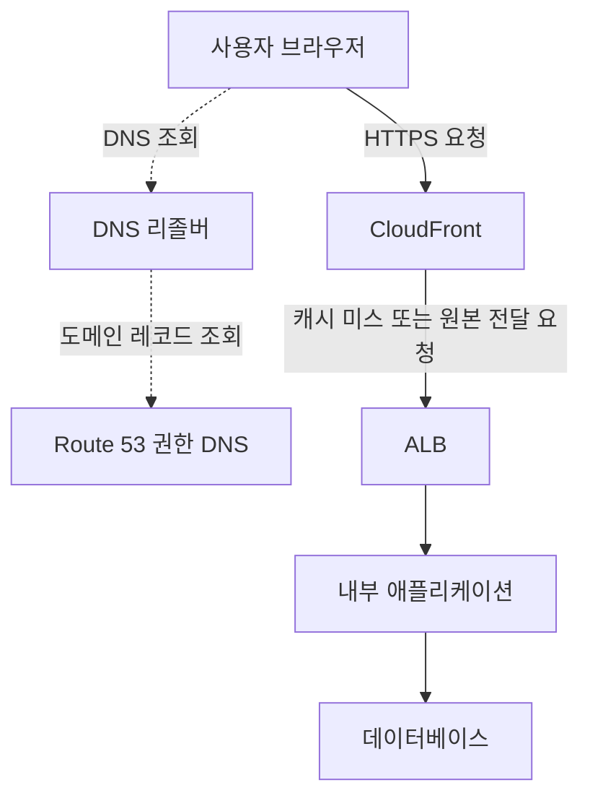

AWS 네트워킹 및 콘텐츠 전송 서비스는 클라우드 내부의 통신, 사용자 요청 전달, 사내망 연결, 콘텐츠 배포와 접근 제어를 지원한다.

네트워크를 구성할 때는 **이름을 조회하는 과정, 실제 데이터가 이동하는 경로, 접근을 허용하는 규칙**을 나누어 생각해야 한다. DNS 설정이 맞아도 라우팅이나 보안 규칙이 잘못되면 접속할 수 있고, 사설 연결을 만들었더라도 애플리케이션 권한이나 암호화 설정은 별도로 필요할 수 있다.

이 글에서는 주요 서비스의 설명, 사용하기 좋은 상황, 간단한 예시를 정리한다. VPC의 하위 기능과 보안 서비스도 관계를 이해하는 데 필요한 범위에서 포함했다. 사용 예시는 이해를 돕기 위한 가상 상황이다.

**자료 확인 기준: 2026년 10월 30일**

## 기본 용어

- **VPC:** AWS에서 정의하는 논리적으로 분리된 가상 네트워크.
- **서브넷:** VPC의 IP 주소 범위를 나눈 구간. 하나의 서브넷은 하나의 가용 영역에 속한다.
- **CIDR:** IP 주소 범위를 표현하는 방식.
- **라우팅:** 목적지에 따라 트래픽을 어느 경로로 보낼지 결정하는 일.
- **DNS:** 도메인 이름에 해당하는 주소 등의 정보를 조회하는 체계.
- **CDN:** 여러 위치의 서버를 이용해 사용자에게 콘텐츠를 전달하는 네트워크.
- **오리진:** CDN이 콘텐츠를 가져오는 원본 서버나 저장소.
- **로드 밸런서:** 여러 대상에 요청이나 연결을 분산하는 구성 요소.
- **VPN:** 네트워크 사이에 암호화된 통신 경로를 만드는 방식.
- **엔드포인트:** 서비스나 자원에 접근하는 접점. AWS에서는 기능별로 구체적인 의미가 다르다.

AWS의 선택 가이드는 네트워크 기반, 글로벌·하이브리드 연결, 엣지·콘텐츠 전송, 애플리케이션 통신, 보안 등으로 서비스를 비교한다. [공식 자료: 네트워킹 및 콘텐츠 전송 선택 가이드](https://docs.aws.amazon.com/decision-guides/latest/decision-guides/choosing-networking-and-content-delivery-service.html)

## 가상 네트워크와 주소 관리

### Amazon VPC — 가상 네트워크 구성

**Amazon Virtual Private Cloud**의 약어다. IP 주소 범위, 서브넷, 경로와 연결을 구성해 AWS 자원 간 통신 환경을 만든다.

- **사용하기 좋은 상황:** 애플리케이션과 데이터베이스의 네트워크를 분리하고 공개·내부 접근 경로를 설계하는 경우.
- **예시:** 인터넷에서 요청을 받는 로드 밸런서와 내부 애플리케이션·DB의 배치 구간을 나눈다.
- **구분할 점:** VPC 전체는 여러 가용 영역을 포함할 수 있지만 각 서브넷은 하나의 가용 영역에 속한다. VPC를 생성하는 것만으로 모든 경로와 접근 권한이 구성되는 것은 아니다.

[공식 문서: Amazon VPC](https://docs.aws.amazon.com/vpc/latest/userguide/what-is-amazon-vpc.html)

### Amazon VPC IPAM — IP 주소 계획·할당 관리

**IP Address Manager**의 약어다. IP 주소 공간을 계획하고 할당·사용 현황을 추적하는 VPC 기능이다.

- **사용하기 좋은 상황:** 여러 계정·리전의 VPC가 늘어나 주소 중복이나 사용 현황 관리가 어려운 경우.
- **예시:** 조직의 주소 풀에서 각 팀의 VPC에 CIDR을 할당하고 사용 현황을 확인한다.
- **구분할 점:** 주소를 관리하는 기능이다. VPC 사이의 데이터 통신 경로를 직접 만드는 Transit Gateway와 역할이 다르다.

[공식 문서: Amazon VPC IPAM](https://docs.aws.amazon.com/vpc/latest/ipam/what-it-is-ipam.html)

### VPC의 주요 구성 요소

다음은 별도의 애플리케이션 서비스와 구분해서 이해할 네트워크 구성 요소다.

- **라우팅 테이블:** 목적지와 전달 대상을 정의한다. 예: 인터넷행 트래픽을 인터넷 게이트웨이로 전달한다.
- **인터넷 게이트웨이:** VPC와 인터넷 사이의 통신을 지원한다.
- **퍼블릭·프라이빗 서브넷:** 인터넷 게이트웨이로의 직접 경로 유무 등 연결 방식에 따라 구분한다. 퍼블릭 서브넷에 있다는 이유만으로 모든 인스턴스가 자동 공개되지는 않는다.
- **보안 그룹:** 연결된 자원의 허용 트래픽을 제어한다.
- **네트워크 ACL:** 서브넷 경계에서 인바운드·아웃바운드 트래픽을 허용하거나 거부한다.

실제 접속에는 라우팅 외에 주소, 보안 규칙, 서비스 리스닝 상태 등이 함께 맞아야 한다. IPv4와 IPv6의 경로도 각각 확인한다. [공식 문서: 라우팅 테이블](https://docs.aws.amazon.com/vpc/latest/userguide/subnet-route-tables.html), [IP 주소](https://docs.aws.amazon.com/vpc/latest/userguide/vpc-ip-addressing.html), [보안 그룹](https://docs.aws.amazon.com/vpc/latest/userguide/vpc-security-groups.html), [네트워크 ACL](https://docs.aws.amazon.com/vpc/latest/userguide/vpc-network-acls.html)

### NAT Gateway — 주소 변환을 이용한 외부 연결

프라이빗 서브넷의 자원이 외부로 연결할 때 사용하는 관리형 NAT 기능이다.

- **사용하기 좋은 상황:** 서버를 인터넷에 직접 공개하지 않으면서 외부 업데이트 서버나 API에 접근해야 하는 경우.
- **예시:** 내부 EC2가 퍼블릭 NAT Gateway를 통해 외부 패키지를 내려받는다.
- **구분할 점:** 외부에서 먼저 시작하는 임의의 연결을 내부 서버로 전달하는 웹 서비스 입구가 아니다. Public·Private NAT의 연결 대상과 경로 조건을 구분한다.

[공식 문서: NAT Gateway](https://docs.aws.amazon.com/vpc/latest/userguide/vpc-nat-gateway.html)

## 도메인 이름과 DNS

### Amazon Route 53 — 도메인·DNS·상태 확인

도메인 등록, DNS 응답과 상태 확인 기능을 제공한다.

- **사용하기 좋은 상황:** 서비스 도메인을 AWS 자원 등에 연결하고 DNS 라우팅 정책을 구성하는 경우.
- **예시:** 웹사이트 도메인이 CloudFront 배포나 로드 밸런서를 가리키도록 설정한다.
- **구분할 점:** DNS는 접속할 대상 정보를 알려준다. 일반적인 웹 요청 본문을 Route 53이 대신 받아 전달하는 프록시 구조는 아니다.

[공식 문서: Amazon Route 53](https://docs.aws.amazon.com/Route53/latest/DeveloperGuide/Welcome.html)

### Route 53 VPC Resolver — VPC의 DNS 조회

VPC 자원의 DNS 조회를 처리하고, 필요에 따라 온프레미스 DNS와 질의를 연계하는 기능이다. 기존 자료에서는 Route 53 Resolver라는 이름으로 나온다.

- **사용하기 좋은 상황:** AWS 내부 이름과 사내 도메인을 함께 조회해야 하는 경우.
- **예시:** AWS 애플리케이션에서 사내 DNS의 업무 시스템 이름을 조회하도록 전달 규칙을 구성한다.
- **구분할 점:** DNS가 해석되는 것과 해당 주소까지 실제로 통신할 수 있는 것은 별개다.

[공식 문서: Route 53 VPC Resolver](https://docs.aws.amazon.com/Route53/latest/DeveloperGuide/resolver.html)

### Route 53 Global Resolver — 원격·하이브리드 클라이언트용 DNS

인터넷에서 접근 가능한 관리형 DNS 리졸버다. 허가된 조직 클라이언트의 공개·사설 도메인 조회와 DNS 필터링을 지원한다.

- **사용하기 좋은 상황:** 여러 지점과 원격 사용자의 DNS 정책을 통합하려는 경우.
- **예시:** 원격 직원의 장치에 조직용 DNS 조회·필터링 정책을 적용한다.
- **구분할 점:** VPC 내부의 기본 리졸버와 사용 대상·접근 구성이 다르다. 허용 클라이언트와 사설 도메인 조회 권한을 구성해야 한다.

[공식 문서: Route 53 Global Resolver](https://docs.aws.amazon.com/Route53/latest/DeveloperGuide/gr-what-is-global-resolver.html)

## 콘텐츠 전송과 요청 분산

### Amazon CloudFront — 정적·동적 콘텐츠 전송

전 세계 엣지 위치를 활용해 웹 콘텐츠를 전달하는 CDN이다. 캐시된 콘텐츠를 제공하거나 설정된 오리진에서 가져온다.

- **사용하기 좋은 상황:** 여러 지역의 사용자에게 웹 콘텐츠를 전달하거나 원본 서버의 반복 조회를 줄이려는 경우.
- **예시:** 상품 이미지와 웹 파일을 엣지 캐시에서 제공하고 필요한 요청만 원본으로 전달한다.
- **구분할 점:** 동적 콘텐츠도 전달할 수 있다. 캐시 여부와 키, 만료 시간은 설정과 응답 조건에 따라 달라지므로 개인별 응답을 무조건 공용 캐시하면 안 된다.

[공식 문서: Amazon CloudFront](https://docs.aws.amazon.com/AmazonCloudFront/latest/DeveloperGuide/Introduction.html)

### Elastic Load Balancing — 여러 대상에 요청 분산

**ELB**라고 부른다. EC2, 컨테이너, IP 주소 등 지원되는 대상에 트래픽을 분산한다.

- **사용하기 좋은 상황:** 여러 애플리케이션 실행 자원에 요청을 나누고 상태 확인 결과를 반영하려는 경우.
- **예시:** 두 가용 영역의 웹 애플리케이션에 요청을 전달한다.
- **구분할 점:** 실행 자원 수를 늘리는 Auto Scaling과 요청을 나누는 로드 밸런서는 역할이 다르다.

주요 유형은 HTTP·HTTPS 요청 처리에 사용하는 **Application Load Balancer(ALB)**, 전송 계층 연결을 처리하는 **Network Load Balancer(NLB)**, 네트워크 보안 장비 등의 트래픽 처리를 지원하는 **Gateway Load Balancer(GWLB)**다. 구체적인 프로토콜과 대상 지원은 유형별로 확인한다. Classic Load Balancer는 이전 세대 유형이다. [공식 문서: Elastic Load Balancing](https://docs.aws.amazon.com/elasticloadbalancing/latest/userguide/what-is-load-balancing.html)

### Amazon API Gateway — API 제공과 요청 관리

REST·HTTP·WebSocket API를 생성하고 배포·인증·요청 관리·관찰 등을 지원한다.

- **사용하기 좋은 상황:** Lambda나 HTTP 백엔드를 API로 제공하고 인증·제한 정책 등을 구성하려는 경우.
- **예시:** 모바일 앱의 상품 조회 API를 만들고 요청을 Lambda에 전달한다.
- **구분할 점:** REST API, HTTP API, WebSocket API의 기능과 과금은 다르다. 단순한 서버 연결 분산과 API 관리 요구도 구분한다.

[공식 문서: Amazon API Gateway](https://docs.aws.amazon.com/apigateway/latest/developerguide/welcome.html)

### AWS Global Accelerator — 글로벌 네트워크를 이용한 경로 개선

고정된 Anycast IP 주소와 AWS 글로벌 네트워크를 활용해 지원되는 애플리케이션 엔드포인트로 트래픽을 전달한다.

- **사용하기 좋은 상황:** 여러 지역 사용자의 연결 경로와 장애 시 대상 전환을 관리하려는 경우.
- **예시:** 두 리전의 애플리케이션 로드 밸런서로 트래픽을 전달한다.
- **구분할 점:** CloudFront처럼 콘텐츠를 캐시하는 CDN은 아니다. 표준 액셀러레이터와 사용자 지정 라우팅 액셀러레이터도 구분한다.

[공식 문서: AWS Global Accelerator](https://docs.aws.amazon.com/global-accelerator/latest/dg/what-is-global-accelerator.html)

### 웹 요청 흐름 예시

다음은 CloudFront와 ALB를 사용하는 웹 애플리케이션의 단순한 예시다. 직접 작성한 Mermaid이며 AWS 공식 구조도는 아니다.

점선은 이름 조회, 실선은 애플리케이션 요청의 관계다. DNS 응답과 HTTP 응답의 돌아오는 경로는 생략했다. 캐시 적중 시 CloudFront가 응답할 수 있으므로 모든 요청이 ALB와 DB까지 전달되는 것은 아니다.

API Gateway를 사용하는 구성이나 CloudFront 없이 ALB로 직접 접속하는 구성도 가능하다. 그림의 모든 서비스를 반드시 함께 사용해야 한다는 의미는 아니다.

## VPC·계정 사이의 연결

### AWS PrivateLink — 특정 서비스·자원의 사설 접근

VPC에서 서비스와 지원 자원에 사설 경로로 접근하도록 지원한다.

- **사용하기 좋은 상황:** 공용 인터넷 경로를 사용하지 않고 AWS 서비스나 다른 계정의 서비스에 접근하려는 경우.
- **예시:** 애플리케이션이 인터페이스 엔드포인트를 통해 지원되는 AWS API에 접근한다.
- **구분할 점:** VPC 두 개의 모든 네트워크를 통째로 연결하는 것과 특정 서비스·자원을 제공하는 것은 다르다.

[공식 문서: AWS PrivateLink](https://docs.aws.amazon.com/vpc/latest/privatelink/what-is-privatelink.html)

**Gateway VPC Endpoint**는 S3·DynamoDB에 인터넷 게이트웨이나 NAT 없이 접근하는 별도 엔드포인트 유형이다. 인터페이스 엔드포인트와 달리 PrivateLink를 사용하지 않는다. ‘VPC 엔드포인트는 모두 PrivateLink’라고 외우지 않는다. [공식 문서: Gateway endpoints](https://docs.aws.amazon.com/vpc/latest/privatelink/gateway-endpoints.html)

### VPC Peering — VPC 두 개의 직접 연결

VPC 사이에 사설 IP 통신을 구성하는 네트워크 기능이다.

- **사용하기 좋은 상황:** 두 VPC의 자원 간에 직접 통신이 필요한 경우.
- **예시:** 애플리케이션 VPC와 공통 서비스 VPC를 연결한다.
- **구분할 점:** 연결 생성 외에 경로와 보안 규칙도 필요하다. 여러 VPC를 연결할 때는 주소 범위와 중계 가능 여부를 별도로 확인한다.

[공식 문서: VPC Peering](https://docs.aws.amazon.com/vpc/latest/userguide/vpc-peering.html)

### AWS Transit Gateway — 여러 네트워크의 연결 허브

여러 VPC와 온프레미스 네트워크를 연결하는 허브다.

- **사용하기 좋은 상황:** VPC별 직접 연결이 많아져 연결 구조와 경로 관리가 복잡해지는 경우.
- **예시:** 여러 업무 VPC와 사내 VPN을 Transit Gateway에 연결하고 라우팅 테이블로 통신 범위를 나눈다.
- **구분할 점:** 연결했다는 이유로 모든 네트워크의 통신을 자동 허용해야 하는 것은 아니다. 연결·라우팅·분리 정책을 함께 구성한다.

[공식 문서: AWS Transit Gateway](https://docs.aws.amazon.com/vpc/latest/tgw/what-is-transit-gateway.html)

### AWS Cloud WAN — 글로벌 광역망 관리

여러 리전의 VPC, 데이터센터와 지점 등을 정책 기반 글로벌 네트워크로 연결·관리한다.

- **사용하기 좋은 상황:** 지역과 계정이 늘어나 글로벌 연결과 네트워크 분리 정책을 통합하려는 경우.
- **예시:** 여러 국가의 지점과 AWS 환경을 연결하고 업무 유형별 네트워크 세그먼트를 구성한다.
- **구분할 점:** 개별 연결 허브인 Transit Gateway와 관리 범위·정책 구성이 다르다. 현재 연결 구조와 운영 방식을 기준으로 비교한다.

[공식 문서: AWS Cloud WAN](https://docs.aws.amazon.com/network-manager/latest/cloudwan/what-is-cloudwan.html)

## 사내망과 사용자 연결

### AWS Site-to-Site VPN — 네트워크 간 IPsec 연결

온프레미스 장비와 AWS 측 게이트웨이 사이에 IPsec VPN 연결을 구성한다.

- **사용하기 좋은 상황:** 사내 네트워크와 AWS 네트워크를 암호화된 경로로 연결하려는 경우.
- **예시:** 사내 라우터와 AWS를 연결해 내부 서버가 AWS의 업무 자원에 접근한다.
- **구분할 점:** VPN 연결에는 두 터널이 제공된다. 가용성을 위해 양쪽 터널과 라우팅·고객 측 장비의 장애 대응을 구성해야 한다.

[공식 문서: AWS Site-to-Site VPN](https://docs.aws.amazon.com/vpn/latest/s2svpn/VPC_VPN.html)

#### AWS 공식 구조도: 온프레미스와 VPC의 VPN 연결

_Virtual Private Gateway를 이용한 VPC와 온프레미스의 VPN 연결. 출처: AWS Site-to-Site VPN 사용자 안내서. 원본 이미지._

[이미지 출처: How AWS Site-to-Site VPN works](https://docs.aws.amazon.com/vpn/latest/s2svpn/how_it_works.html)

왼쪽은 AWS 리전의 VPC와 Virtual Private Gateway, 오른쪽은 고객 측 네트워크다. 그림의 한 연결선은 VPN 연결의 개요를 나타내며 두 터널을 각각 그린 것은 아니다. 실제 연결의 터널·라우팅·장비 설정은 별도로 필요하다.

Virtual Private Gateway를 사용하는 예시이며 Transit Gateway를 VPN 대상으로 사용하는 구성도 가능하다. AWS 안에 생성하는 Customer Gateway 자원과 실제 고객 측 VPN 장비의 역할도 구분한다.

### AWS Direct Connect — 전용 네트워크 연결

고객 네트워크와 Direct Connect 위치를 연결하고 가상 인터페이스 등을 통해 AWS에 접근한다.

- **사용하기 좋은 상황:** 인터넷 기반 경로보다 일관된 연결 특성이나 전용 연결이 필요한 경우.
- **예시:** 데이터센터와 AWS를 연결해 대규모 업무 데이터를 지속적으로 주고받는다.
- **구분할 점:** 전용 연결이라는 이유로 전송 데이터가 기본 암호화되는 것은 아니다. 필요한 경우 지원되는 MACsec, VPN 등의 암호화 방식을 검토한다.

연결 한 개만으로 전체 장애 대응이 해결되지 않는다. 회선·위치·라우터·AWS 측 연결의 이중화 요구를 함께 확인한다. [공식 문서: Direct Connect](https://docs.aws.amazon.com/directconnect/latest/UserGuide/Welcome.html), [암호화](https://docs.aws.amazon.com/directconnect/latest/UserGuide/encryption-in-transit.html)

### AWS Client VPN — 사용자 단말의 VPN 접근

사용자가 VPN 클라이언트로 AWS와 연결된 네트워크 자원에 접근하는 관리형 서비스다.

- **사용하기 좋은 상황:** 원격 직원의 단말이 내부 자원에 접근해야 하는 경우.
- **예시:** 재택근무자가 인증을 거쳐 개발 환경에 접속한다.
- **구분할 점:** 회사 네트워크 전체를 연결하는 Site-to-Site VPN과 연결 주체가 다르다. 인증 외에 접근 허용 규칙과 경로도 필요하다.

[공식 문서: AWS Client VPN](https://docs.aws.amazon.com/vpn/latest/clientvpn-admin/what-is.html)

### AWS Verified Access — 사용자·장치 조건 기반 애플리케이션 접근

사용자와 장치의 신뢰 정보 등을 평가해 애플리케이션 접근을 제어한다.

- **사용하기 좋은 상황:** VPN 연결 자체보다 개별 애플리케이션의 접근 조건을 세밀하게 관리하려는 경우.
- **예시:** 회사 계정과 관리되는 장치 조건을 만족하는 직원에게 내부 업무 앱 접근을 허용한다.
- **구분할 점:** 모든 네트워크 접속을 같은 방식으로 대체하는 제품이라고 가정하지 않는다. 지원 프로토콜·엔드포인트와 정책 조건을 확인한다.

[공식 문서: AWS Verified Access](https://docs.aws.amazon.com/verified-access/latest/ug/what-is-verified-access.html)

## 애플리케이션 사이의 연결과 검색

### Amazon VPC Lattice — 서비스·자원 연결 관리

단일·여러 VPC 및 계정에 걸친 애플리케이션 서비스와 지원 자원의 연결, 접근 정책과 관찰 기능을 제공한다.

- **사용하기 좋은 상황:** 여러 팀의 서비스가 서로 통신하며 연결 정책과 가시성이 필요한 경우.
- **예시:** 서로 다른 계정의 상품·주문 서비스를 연결하고 접근 정책을 적용한다.
- **구분할 점:** VPC 전체 라우팅을 연결하는 Transit Gateway와 관리 대상이 다르다. 서비스와 자원 구성의 지원 범위를 확인한다.

[공식 문서: Amazon VPC Lattice](https://docs.aws.amazon.com/vpc-lattice/latest/ug/what-is-vpc-lattice.html)

### AWS Cloud Map — 서비스 검색

논리적인 이름과 속성을 자원에 연결하고 DNS나 API를 통해 위치를 찾도록 지원한다.

- **사용하기 좋은 상황:** 서비스의 실행 위치가 바뀌어도 애플리케이션이 이름으로 대상을 찾도록 하려는 경우.
- **예시:** 주문 애플리케이션이 등록된 이름으로 재고 서비스의 실행 대상을 검색한다.
- **구분할 점:** 위치를 찾는 기능과 요청을 실제로 전달·제어하는 기능은 구분한다. 이름을 찾았어도 통신 경로와 권한은 필요하다.

[공식 문서: AWS Cloud Map](https://docs.aws.amazon.com/cloud-map/latest/dg/what-is-cloud-map.html)

### Amazon Application Recovery Controller(ARC) — 장애 대응 전환 지원

가용 영역이나 리전 장애에 대응해 트래픽을 이동하고 복구를 준비하는 기능을 제공한다.

- **사용하기 좋은 상황:** 장애가 있는 영역을 피하거나 리전 간 전환을 통제·훈련하려는 경우.
- **예시:** 준비된 대체 환경으로 트래픽을 이동하는 절차를 구성하고 복구 훈련을 수행한다.
- **구분할 점:** 트래픽 전환과 데이터 복제·애플리케이션 복구는 별개의 준비가 필요하다. 기능별 지원 자원과 전환 조건을 확인한다.

[공식 문서: ARC](https://docs.aws.amazon.com/r53recovery/latest/dg/what-is-route53-recovery.html)

## 네트워크·애플리케이션 보호

다음은 보안 분야에도 해당한다. 여기서는 통신 경로와 어떤 관계가 있는지 정리한다.

### AWS Network Firewall — 네트워크 트래픽 검사

VPC 트래픽에 관리형 네트워크 방화벽 규칙과 검사를 적용한다.

- **사용하기 좋은 상황:** 정해진 통신 경로의 트래픽에 네트워크 수준 검사 정책이 필요한 경우.
- **예시:** 애플리케이션의 외부 통신이 방화벽 엔드포인트를 지나도록 라우팅한다.
- **구분할 점:** 방화벽을 만드는 것뿐 아니라 검사할 트래픽이 통과하도록 경로를 구성해야 한다.

[공식 문서: AWS Network Firewall](https://docs.aws.amazon.com/network-firewall/latest/developerguide/what-is-aws-network-firewall.html)

### AWS WAF — 웹 요청 필터링

지원되는 웹 서비스의 HTTP·HTTPS 요청을 규칙에 따라 검사·허용·차단하는 웹 애플리케이션 방화벽이다.

- **사용하기 좋은 상황:** SQL 삽입 같은 웹 공격 패턴이나 요청 속도 제한 규칙이 필요한 경우.
- **예시:** CloudFront나 ALB에 웹 ACL을 연결하고 허용·차단 규칙을 적용한다.
- **구분할 점:** VPC의 모든 TCP·UDP 트래픽을 처리하는 네트워크 방화벽과 검사 계층이 다르다.

[공식 문서: AWS WAF](https://docs.aws.amazon.com/waf/latest/developerguide/what-is-aws-waf.html)

### AWS Shield — DDoS 보호

분산 서비스 거부 공격에 대한 보호 기능이다. Standard와 Advanced는 지원 범위와 이용 조건이 다르다.

- **사용하기 좋은 상황:** 공개 서비스의 DDoS 대응 요구를 검토하는 경우.
- **예시:** 중요 인터넷 서비스에 필요한 고급 보호와 지원 범위를 평가한다.
- **구분할 점:** DDoS 보호와 웹 요청 규칙, 애플리케이션 취약점 수정은 서로 다른 대응이다.

[공식 문서: AWS Shield](https://docs.aws.amazon.com/waf/latest/developerguide/shield-chapter.html)

### AWS Firewall Manager — 여러 계정의 보안 정책 관리

AWS Organizations 환경에서 지원되는 방화벽·보호 정책 등을 통합 적용·관리한다.

- **사용하기 좋은 상황:** 여러 계정에 공통 보안 정책을 적용하고 누락을 줄이려는 경우.
- **예시:** 조직의 지원 대상 자원에 공통 WAF 정책을 배포한다.
- **구분할 점:** 개별 방화벽 엔진과 여러 계정의 정책을 관리하는 기능을 구분한다.

[공식 문서: AWS Firewall Manager](https://docs.aws.amazon.com/waf/latest/developerguide/fms-chapter.html)

## 오래된 자료에서 확인할 항목

- **AWS App Mesh:** 서비스 메시를 구성하던 서비스다. 공식 안내는 **2026년 9월 30일** 지원 종료와 이후 콘솔·자원 접근 불가를 명시한다. 현재 신규 도입 대상으로 소개하지 않는다. [공식 종료 안내](https://docs.aws.amazon.com/app-mesh/latest/userguide/meshes.html)
- **AWS Private 5G:** 사설 이동통신망 관련 자료에 등장하지만 공식 종료 서비스 목록에는 **2025년 5월 20일** 종료로 표시돼 있다. [공식 종료 서비스 목록](https://docs.aws.amazon.com/general/latest/gr/full_shutdown_services.html)

네트워크 선택 가이드에 이름이 남아 있더라도 개별 서비스의 현재 제공 상태를 함께 확인해야 한다.

## 요구사항별 비교

- **가상 네트워크와 서브넷을 구성한다:** VPC
- **여러 계정의 IP 주소를 계획·추적한다:** VPC IPAM
- **도메인의 접속 대상 정보를 제공한다:** Route 53
- **VPC·사내 DNS 조회를 연계한다:** VPC Resolver
- **원격·지점 사용자의 DNS를 통합한다:** Global Resolver
- **웹 콘텐츠를 엣지에서 전달·캐시한다:** CloudFront
- **여러 실행 대상으로 요청을 나눈다:** ELB
- **인증·요청 관리 기능과 함께 API를 제공한다:** API Gateway
- **글로벌 네트워크와 고정 IP로 연결 경로를 개선한다:** Global Accelerator
- **특정 서비스·자원에 사설 접근한다:** PrivateLink
- **여러 네트워크를 허브로 연결한다:** Transit Gateway
- **글로벌 WAN을 정책으로 관리한다:** Cloud WAN
- **네트워크 사이에 IPsec 연결을 만든다:** Site-to-Site VPN
- **전용 회선 기반 AWS 연결이 필요하다:** Direct Connect
- **사용자 단말을 VPN으로 연결한다:** Client VPN
- **개별 애플리케이션 접근 조건을 평가한다:** Verified Access
- **여러 서비스·자원의 연결을 관리한다:** VPC Lattice
- **서비스의 위치를 검색한다:** Cloud Map
- **장애 시 트래픽 전환을 준비한다:** ARC

서로 대체 관계인 경우도 있지만 함께 사용하는 경우도 많다. 예를 들어 Direct Connect와 VPN을 조합하거나, Route 53·CloudFront·ALB를 각각 다른 역할로 사용할 수 있다. 선택할 때는 연결 대상, 프로토콜, 라우팅, 암호화, 가용성, 리전과 비용을 함께 확인한다.

## SAA 학습에서 구분할 내용

공식 SAA-C03 시험 범위에는 VPC, Route 53, CloudFront, ELB, Direct Connect, Global Accelerator, PrivateLink, Transit Gateway, Site-to-Site VPN, Client VPN 등이 네트워킹 분야에 포함된다. API Gateway는 다른 분류에, WAF·Shield·Network Firewall·Firewall Manager는 보안 분야에 나온다.

모든 최신 기능이 시험 목록에 개별적으로 나열되는 것은 아니다. 목록은 완전한 출제 목록이나 빈도 순위가 아니며 변경될 수 있다. [공식 자료: SAA-C03 시험 범위](https://docs.aws.amazon.com/aws-certification/latest/solutions-architect-associate-03/saa-03-in-scope-services.html)

비교하면서 정리할 항목은 다음과 같다.

- DNS 조회와 실제 애플리케이션 트래픽의 차이
- CloudFront의 캐시와 Global Accelerator의 경로 개선
- ALB·NLB·API Gateway의 처리 대상과 기능
- 퍼블릭·프라이빗 서브넷, 인터넷 게이트웨이와 NAT
- 인터페이스 엔드포인트와 Gateway Endpoint
- VPC Peering·Transit Gateway·PrivateLink의 연결 범위
- Site-to-Site VPN·Client VPN·Direct Connect의 연결 주체와 암호화
- 보안 그룹·네트워크 ACL·WAF·Network Firewall의 적용 위치
- 네트워크 연결, DNS 해석, 권한 허용이 각각 필요한 이유

네트워크 문제는 서비스 이름만으로 판단하기 어렵다. 요청을 보내는 위치부터 목적지까지 이름 조회, 경로, 필터링, 응답 경로를 순서대로 확인하면 원인을 좁힐 수 있다.

