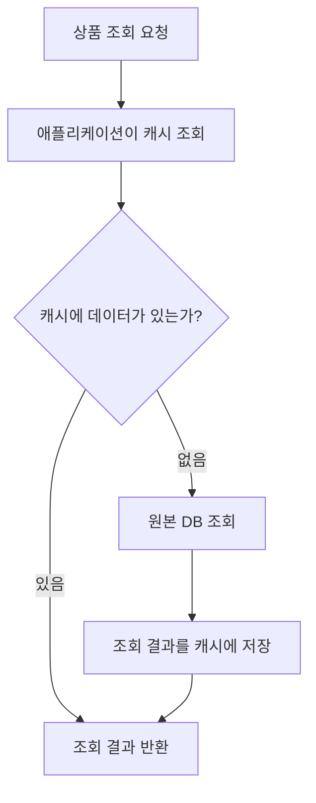

AWS 데이터베이스 서비스는 데이터의 구조와 조회·변경 방식에 맞춰 선택한다. 주문과 결제처럼 여러 데이터의 관계가 중요한 경우도 있고, 특정 키로 빠르게 조회하거나 객체 사이의 관계를 탐색해야 하는 경우도 있다.

이 글에서는 관계형 DB, 키-값·문서 DB, 인메모리 저장소, 그래프 DB, 시계열 DB와 관련 관리 기능을 정리한다. 서비스별로 설명, 사용하기 좋은 상황, 간단한 예시를 포함했다. 사용 예시는 이해를 돕기 위한 가상 상황이다.

**자료 확인 기준: 2026년 10월 30일**

## 데이터 모델과 처리 방식

- **관계형:** 행·열로 구성한 테이블과 데이터 간 관계를 관리한다. 주문·결제·재고처럼 관계와 트랜잭션이 중요한 업무에서 검토한다.
- **키-값:** 키를 이용해 데이터를 조회한다. 사용자별 설정이나 장바구니처럼 접근 기준이 명확한 데이터에 사용한다.
- **문서:** JSON과 유사한 문서 구조로 데이터를 다룬다. 상품 속성이나 사용자 프로필처럼 중첩된 데이터를 표현한다.
- **인메모리:** 메모리 중심으로 데이터를 처리한다. 캐시와 영구 데이터베이스는 데이터 유지 방식과 역할을 구분한다.
- **와이드 컬럼:** 파티션과 클러스터링 키 등을 기준으로 데이터를 구성한다. Cassandra 기반 대규모 데이터 처리에서 접할 수 있다.
- **그래프:** 객체와 관계를 저장하고 연결을 탐색한다. 추천, 부정 사용 분석, 지식 그래프 등에 사용한다.
- **시계열:** 시각에 따라 쌓이는 관측값을 저장·조회한다. 센서값이나 운영 지표가 대표적이다.
- **분석용 데이터 웨어하우스:** 많은 데이터를 집계·분석한다. 개별 주문을 처리하는 운영 DB와 목적이 다르다.

이 구분이 서로 완전히 배타적인 것은 아니다. 하나의 서비스가 여러 데이터 모델을 지원하기도 한다. 또한 NoSQL이라고 트랜잭션이나 강한 일관성을 전혀 지원하지 않는다고 단정하면 안 된다. 서비스별 지원 범위와 조회 방식을 확인해야 한다. [공식 자료: AWS 데이터베이스 선택 가이드](https://docs.aws.amazon.com/decision-guides/latest/decision-guides/databases-on-aws-how-to-choose.html)

## 관계형 데이터베이스

### Amazon RDS — 관계형 데이터베이스 운영 관리

**Amazon Relational Database Service**의 약어다. 데이터베이스 생성, 백업, 패치 등 공통 운영 작업을 관리형으로 제공한다.

RDS는 PostgreSQL, MySQL, MariaDB, Oracle, Microsoft SQL Server, Db2 등의 엔진을 제공한다. 엔진·버전·리전에 따라 지원 기능과 라이선스 조건이 다르다. Aurora는 RDS에 포함되는 관리형 데이터베이스이지만 구조와 기능을 구분해 아래에서 설명한다.

- **사용하기 좋은 상황:** 기존 관계형 엔진을 활용하면서 서버와 DB 운영 부담을 줄이려는 경우.
- **예시:** 쇼핑몰의 주문·상품·결제 테이블을 RDS for PostgreSQL에서 관리한다.
- **구분할 점:** 관리형이어도 테이블 설계, 인덱스, SQL 성능, 권한과 애플리케이션 연결은 사용자가 관리해야 한다.

RDS for Db2나 RDS for MySQL은 제공 엔진의 구분이다. 엔진마다 완전히 별개의 AWS 서비스로 중복해서 세지 않는다. [공식 문서: Amazon RDS](https://docs.aws.amazon.com/AmazonRDS/latest/UserGuide/Welcome.html)

### Amazon Aurora — MySQL·PostgreSQL 호환 관계형 DB

AWS가 설계한 관계형 데이터베이스 엔진이다. MySQL 호환 또는 PostgreSQL 호환 에디션을 사용하며, 데이터베이스 실행 자원과 분산 스토리지를 구분한 구조를 제공한다.

- **사용하기 좋은 상황:** MySQL·PostgreSQL 계열의 애플리케이션에서 관리형 클러스터와 분산 스토리지 구조를 활용하려는 경우.
- **예시:** 주문 변경은 쓰기 인스턴스에서 처리하고, 읽기 조회 일부를 읽기 인스턴스로 분리한다.
- **구분할 점:** RDS for MySQL·PostgreSQL과 같은 제품은 아니다. 호환 엔진을 사용하더라도 지원 버전, 확장 기능, 동작 차이를 확인해야 한다.

[공식 문서: Amazon Aurora](https://docs.aws.amazon.com/AmazonRDS/latest/AuroraUserGuide/CHAP_AuroraOverview.html)

AWS 공식 구조도: Aurora DB 클러스터

_Aurora의 쓰기·읽기 인스턴스와 여러 가용 영역에 걸친 공유 스토리지 구조. 출처: AWS Amazon Aurora 사용자 안내서. 원본 이미지._

[이미지 출처: Amazon Aurora DB clusters](https://docs.aws.amazon.com/AmazonRDS/latest/AuroraUserGuide/Aurora.Overview.html)

그림의 Writer는 읽기·쓰기를 처리하고, Reader는 읽기를 처리한다. 인스턴스들은 공유 클러스터 볼륨을 사용하며, 스토리지는 여러 가용 영역에 걸쳐 데이터를 보관한다. 읽기 인스턴스는 읽기 부하 분산과 장애 시 승격에 활용할 수 있다.

그림은 일반적인 Aurora DB 클러스터의 역할을 설명한다. 모든 배포에서 읽기 인스턴스 두 개를 반드시 만들어야 한다는 뜻은 아니며, 아래의 Aurora DSQL이나 Limitless Database 구조를 설명하는 그림도 아니다.

### Aurora Serverless — 부하에 따른 용량 조정

Aurora의 컴퓨팅 용량을 부하에 따라 조정하는 구성이다. ‘Serverless’라는 이름의 별도 관계형 엔진이 아니라 Aurora의 실행 용량 관리 방식으로 이해하면 된다.

- **사용하기 좋은 상황:** 개발·테스트나 요청량 변화가 큰 애플리케이션에서 용량 조정 작업을 줄이려는 경우.
- **예시:** 이벤트 기간에 조회·주문이 늘어나면 허용 범위 안에서 DB 용량을 조정한다.
- **구분할 점:** 지원 엔진·버전과 최소·최대 용량 설정을 확인한다. 서버리스라는 이유로 항상 0까지 축소되거나 비용이 전혀 발생하지 않는다고 가정하지 않는다.

[공식 문서: Aurora Serverless](https://docs.aws.amazon.com/AmazonRDS/latest/AuroraUserGuide/aurora-serverless-v2.html)

### Amazon Aurora DSQL — 서버리스 분산 SQL 데이터베이스

트랜잭션 처리용 분산 관계형 데이터베이스 서비스다. PostgreSQL 호환 SQL·도구를 활용하고, 단일 리전 또는 다중 리전 구성에서 인프라 운영을 서비스에 맡기는 방식을 제공한다.

- **사용하기 좋은 상황:** 관계형 모델과 트랜잭션이 필요하면서 분산 처리와 리전 간 활성 구성을 검토하는 경우.
- **예시:** 여러 지역에서 접근하는 주문 애플리케이션의 관계형 데이터를 분산 SQL DB에 저장한다.
- **구분할 점:** 일반 Aurora PostgreSQL의 설정 옵션이 아니다. 지원 SQL, 스키마 변경, 트랜잭션과 리전 구성의 제약을 확인해야 한다.

[공식 문서: Aurora DSQL](https://docs.aws.amazon.com/aurora-dsql/latest/userguide/what-is-aurora-dsql.html)

### Aurora PostgreSQL Limitless Database — 샤딩 기반 확장

Aurora PostgreSQL에서 데이터를 여러 샤드로 분산해 처리량과 저장 용량을 확장하는 기능이다. 라우터와 샤드로 구성된 DB shard group을 사용한다.

- **사용하기 좋은 상황:** 단일 인스턴스 중심 구성의 쓰기 처리량이나 데이터 규모를 넘어서는 관계형 처리가 필요한 경우.
- **예시:** 대규모 거래 데이터를 분산 저장하고 라우터를 통해 SQL을 처리한다.
- **구분할 점:** 읽기 복제본을 추가하는 것과 데이터 자체를 샤딩하는 것은 다르다. 일반 Aurora와 동일한 기능을 모두 사용할 수 있다고 가정하지 않는다.

[공식 문서: Limitless Database](https://docs.aws.amazon.com/AmazonRDS/latest/AuroraUserGuide/limitless.html), [구조](https://docs.aws.amazon.com/AmazonRDS/latest/AuroraUserGuide/limitless-architecture.html)

### Lightsail 관리형 데이터베이스 — 단순한 구성의 MySQL·PostgreSQL

Lightsail 환경에서 MySQL 또는 PostgreSQL 관리형 데이터베이스를 사용할 수 있는 기능이다.

- **사용하기 좋은 상황:** 소규모 웹 애플리케이션에서 비교적 단순한 요금제와 구성으로 DB를 운영하려는 경우.
- **예시:** Lightsail 인스턴스의 업무 웹사이트를 Lightsail PostgreSQL DB에 연결한다.
- **구분할 점:** Lightsail 인스턴스에 DB를 직접 설치하는 방식과 관리형 DB는 다르다. RDS와도 기능·구성 범위가 같지 않다.

[공식 문서: Lightsail 데이터베이스 생성](https://docs.aws.amazon.com/lightsail/latest/userguide/amazon-lightsail-creating-a-database.html)

## 키-값·문서·와이드 컬럼 데이터베이스

### Amazon DynamoDB — 키-값·문서 기반 NoSQL DB

서버를 직접 관리하지 않고 키-값·문서 데이터를 저장·조회하는 관리형 데이터베이스다. 트래픽과 접근 방식에 맞춰 테이블과 키·인덱스 등을 설계한다.

- **사용하기 좋은 상황:** 키를 기준으로 데이터를 조회하는 경로가 명확하고 대규모 요청을 처리해야 하는 경우.
- **예시:** 사용자 ID와 상품 ID를 기준으로 장바구니 항목을 저장·조회한다.
- **구분할 점:** 관계형 DB의 조인 중심 설계를 그대로 옮기기보다 조회 패턴에 맞춰 키와 인덱스를 설계한다. 일관성 모드와 트랜잭션 지원도 확인한다.

[공식 문서: Amazon DynamoDB](https://docs.aws.amazon.com/amazondynamodb/latest/developerguide/Introduction.html)

### Amazon DocumentDB — MongoDB 호환 문서 DB

MongoDB 호환 API·드라이버·도구를 활용할 수 있는 관리형 문서 데이터베이스다.

- **사용하기 좋은 상황:** 중첩된 문서 구조를 저장하고 MongoDB 계열 애플리케이션과의 호환성이 필요한 경우.
- **예시:** 상품마다 다른 세부 속성과 옵션을 문서 형태로 저장한다.
- **구분할 점:** MongoDB 자체를 그대로 운영하는 서비스는 아니다. 사용하는 명령, 인덱스, 드라이버·버전의 호환 범위를 검증해야 한다.

[공식 문서: Amazon DocumentDB](https://docs.aws.amazon.com/documentdb/latest/devguide/what-is.html)

### Amazon Keyspaces — Apache Cassandra 호환 DB

**Amazon Keyspaces (for Apache Cassandra)**가 정식 명칭이다. Cassandra 호환 데이터베이스를 서버 관리 없이 사용하도록 지원한다.

- **사용하기 좋은 상황:** Cassandra Query Language(CQL)와 기존 Cassandra 애플리케이션의 접근 방식을 활용하려는 경우.
- **예시:** 장비 ID와 시간 구간을 기준으로 조회하는 대규모 이벤트 데이터를 저장한다.
- **구분할 점:** CQL은 SQL과 비슷하게 보여도 일반적인 관계형 DB의 조인·쿼리 모델과 같지 않다. Cassandra와의 지원 기능 차이도 확인한다.

[공식 문서: Amazon Keyspaces](https://docs.aws.amazon.com/keyspaces/latest/devguide/what-is-keyspaces.html)

## 인메모리 저장소와 캐시

### Amazon ElastiCache — 인메모리 데이터 저장·캐시

Valkey, Redis OSS, Memcached 엔진을 지원하는 관리형 인메모리 서비스다. 서버리스 캐시 또는 노드 기반 구성을 사용할 수 있다.

- **사용하기 좋은 상황:** 반복 조회 결과를 빠르게 제공하거나 세션·랭킹 등 인메모리 자료 구조가 필요한 경우.
- **예시:** 자주 조회하는 상품 정보를 일정 시간 캐시에 보관해 원본 DB 조회를 줄인다.
- **구분할 점:** 엔진과 배포 방식에 따라 기능이 다르다. 캐시 만료, 데이터 변경 시 갱신, 장애 후 재생성 방식을 설계해야 한다.

[공식 문서: Amazon ElastiCache](https://docs.aws.amazon.com/AmazonElastiCache/latest/dg/WhatIs.html)

캐시 조회 흐름 예시

다음은 애플리케이션이 먼저 캐시를 확인하는 cache-aside 방식이다. 직접 작성한 설명용 흐름도이며 AWS 공식 구조도는 아니다.

이 예시에서는 애플리케이션이 캐시와 원본 DB를 각각 조회한다. ElastiCache를 생성하는 것만으로 기존 DB의 모든 조회가 자동으로 캐시되는 것은 아니다. 데이터 변경 시 캐시를 갱신하거나 무효화하는 절차는 그림에서 생략했다.

### Amazon MemoryDB — 내구성을 갖춘 인메모리 DB

Valkey·Redis OSS 호환 인메모리 데이터베이스다. 데이터를 메모리에 두면서 다중 가용 영역의 트랜잭션 로그로 내구성을 제공한다.

- **사용하기 좋은 상황:** 인메모리 접근 성능과 지속적인 데이터 보관을 함께 필요로 하는 경우.
- **예시:** 마이크로서비스의 상태 데이터를 메모리 기반 기본 저장소로 관리한다.
- **구분할 점:** ElastiCache의 일반적인 보조 캐시 사용과 달리 기본 데이터베이스로 사용하는 목적도 고려할 수 있다. 데이터 유지 조건과 복구 방식을 비교한다.

[공식 문서: Amazon MemoryDB](https://docs.aws.amazon.com/memorydb/latest/devguide/what-is-memorydb.html)

### DynamoDB Accelerator(DAX) — DynamoDB 읽기 캐시

DynamoDB용 관리형 인메모리 캐시다. 반복되는 최종적 일관성 읽기의 응답을 줄이는 데 사용한다.

- **사용하기 좋은 상황:** 같은 DynamoDB 데이터를 반복 조회하며 캐시된 읽기를 허용할 수 있는 경우.
- **예시:** 변화가 적고 자주 조회하는 항목을 DAX를 통해 읽는다.
- **구분할 점:** DynamoDB 자체를 대체하지 않는다. 강한 일관성이 필요한 읽기는 DAX 캐시의 이점과 구분해서 검토한다.

[공식 문서: DynamoDB Accelerator](https://docs.aws.amazon.com/amazondynamodb/latest/developerguide/DAX.html)

## 그래프 데이터베이스

### Amazon Neptune Database — 관계 탐색용 그래프 DB

객체와 연결 관계를 저장하고 탐색하는 관리형 그래프 데이터베이스다. Gremlin·openCypher·SPARQL 등 데이터 모델에 맞는 쿼리 언어를 지원한다.

- **사용하기 좋은 상황:** 데이터 사이의 연결을 여러 단계 따라가며 조회해야 하는 경우.
- **예시:** 사용자·기기·계정·거래의 관계를 탐색해 연결된 의심 거래를 분석한다.
- **구분할 점:** 표 형태 데이터의 일반 집계보다 연결 구조와 경로를 탐색하는 요구가 선택 기준이다.

[공식 문서: Amazon Neptune](https://docs.aws.amazon.com/neptune/latest/userguide/intro.html)

### Amazon Neptune Analytics — 그래프 분석 엔진

대규모 그래프 데이터를 메모리 중심으로 처리하고 그래프 알고리즘·분석·벡터 검색 등을 수행하는 엔진이다.

- **사용하기 좋은 상황:** 그래프 전체의 중요도, 연결 집단, 경로 등 분석 작업을 반복하려는 경우.
- **예시:** 거래 그래프를 적재해 서로 강하게 연결된 계정 집단을 찾는다.
- **구분할 점:** 지속적인 그래프 애플리케이션 데이터를 운영하는 Neptune Database와 분석 목적을 구분한다. Database나 S3에서 데이터를 적재해 분석할 수 있다.

[공식 문서: Neptune Analytics](https://docs.aws.amazon.com/neptune-analytics/latest/userguide/what-is-neptune-analytics.html)

## 시계열 데이터베이스

### Amazon Timestream for InfluxDB — InfluxDB 기반 시계열 DB

InfluxDB를 관리형으로 운영하도록 지원한다. 시간에 따라 쌓이는 지표나 관측 데이터를 저장·조회한다.

- **사용하기 좋은 상황:** 센서·애플리케이션 지표를 처리하며 InfluxDB 기반 수집·조회 도구를 활용하려는 경우.
- **예시:** 설비별 온도와 압력 측정값을 시간 정보와 함께 저장하고 추이를 조회한다.
- **구분할 점:** 지원되는 InfluxDB 버전과 쿼리·배포 방식을 확인한다. 아래의 Timestream for LiveAnalytics와 동일한 엔진·API가 아니다.

[공식 문서: Timestream for InfluxDB](https://docs.aws.amazon.com/timestream/latest/developerguide/timestream-for-influxdb.html)

### Amazon Timestream for LiveAnalytics — 신규 이용 제한

서버리스 시계열 저장·분석 서비스다. 예전 자료에서는 센서 데이터나 운영 지표 분석용 Timestream으로 소개되기도 한다.

- **기존 활용 예시:** 장비별 측정값을 적재하고 시간 구간별 통계를 조회한다.
- **현재 상태:** **2025년 6월 20일부터 신규 고객의 접근이 제한됐다.** 기존 이용 고객에 대한 제공은 공식 조건에 따라 계속된다.
- **구분할 점:** 이 제한은 LiveAnalytics에 대한 것이다. Timestream for InfluxDB까지 같은 제한을 받는다는 뜻은 아니다.

[공식 문서: LiveAnalytics](https://docs.aws.amazon.com/timestream/latest/developerguide/what-is-timestream.html), [신규 이용 제한 안내](https://docs.aws.amazon.com/timestream/latest/developerguide/AmazonTimestreamForLiveAnalytics-availability-change.html)

## 분석용 데이터 웨어하우스

### Amazon Redshift — 대규모 집계·분석

많은 데이터를 SQL로 조회·집계하는 관리형 데이터 웨어하우스다. 프로비저닝된 환경과 서버리스 선택지를 제공한다.

- **사용하기 좋은 상황:** 여러 시스템의 데이터를 모아 대규모 보고서와 분석 쿼리를 실행하는 경우.
- **예시:** 주문 데이터를 모아 월별·지역별·상품별 매출을 집계한다.
- **구분할 점:** 개별 주문을 수정하는 운영 DB와 대규모 집계를 수행하는 분석 DB는 부하와 설계 목적이 다르다. 데이터베이스라는 이유로 모두 같은 역할로 보면 안 된다.

[공식 문서: Amazon Redshift](https://docs.aws.amazon.com/redshift/latest/mgmt/welcome.html)

## 데이터베이스 운영 관련 기능

### Amazon RDS Proxy — 연결 풀 관리

애플리케이션의 데이터베이스 연결을 모으고 재사용하도록 지원하는 프록시다.

- **사용하기 좋은 상황:** 많은 짧은 연결이 발생하거나 애플리케이션 수 증가로 연결 관리가 필요한 경우.
- **예시:** 여러 Lambda 실행에서 발생하는 연결을 지원되는 RDS·Aurora DB로 전달한다.
- **구분할 점:** 연결 관리 기능이며 쿼리 결과 캐시가 아니다. 지원 엔진·버전과 네트워크 조건을 확인한다.

[공식 문서: Amazon RDS Proxy](https://docs.aws.amazon.com/AmazonRDS/latest/UserGuide/rds-proxy.html)

### Amazon RDS Custom — 추가 제어가 필요한 관계형 환경

일부 데이터베이스 환경에서 운영체제와 데이터베이스에 대한 추가 접근·사용자 지정을 허용하면서 운영 자동화를 제공한다.

- **사용하기 좋은 상황:** 일반적인 RDS 관리 범위로 충족하기 어려운 소프트웨어 설치나 시스템 설정이 필요한 경우.
- **예시:** 기존 업무 애플리케이션에 필요한 설정을 지원되는 Custom 환경에서 적용한다.
- **구분할 점:** 일반 RDS보다 사용자의 운영 책임이 커질 수 있다. 지원 엔진과 자동화가 유지되는 설정 범위를 확인해야 한다.

[공식 문서: Amazon RDS Custom](https://docs.aws.amazon.com/AmazonRDS/latest/UserGuide/rds-custom.html)

### AWS Database Migration Service — 데이터베이스 이전

**AWS DMS**라고 부른다. 지원되는 원본·대상 사이에서 데이터를 이전하고 변경 사항을 복제하는 작업을 지원한다.

- **사용하기 좋은 상황:** 기존 데이터베이스를 AWS로 옮기거나 엔진 변경을 준비하는 경우.
- **예시:** 기존 DB를 운영하면서 대상 DB에 데이터를 적재하고 이후 변경을 복제한다.
- **구분할 점:** 데이터를 저장하는 최종 업무 DB와 이전 작업 도구는 다르다. 스키마·코드 변환, 데이터 검증과 전환 절차도 별도로 확인한다.

[공식 문서: AWS DMS](https://docs.aws.amazon.com/dms/latest/userguide/Welcome.html)

## 오래된 자료에서 확인할 서비스

- **Amazon QLDB:** 변경 이력을 검증하는 원장 데이터베이스로 소개됐지만, AWS의 종료 서비스 목록에는 **2025년 7월 31일** 지원 종료로 표시돼 있다.
- **Amazon RDS on VMware:** 온프레미스 VMware 환경에서 RDS 운영을 지원하던 서비스다. 공식 목록상 **2022년 5월 1일** 종료됐다.

현재의 RDS Custom이나 다른 하이브리드 제품과 혼동하지 않는다. 서비스 소개 문서에 이름이 남아 있는 것만으로 현재 신규 도입이 가능하다고 판단하면 안 된다. [공식 자료: 종료된 AWS 서비스](https://docs.aws.amazon.com/general/latest/gr/full_shutdown_services.html)

## 가용성·읽기 확장·백업의 차이

관계형 DB를 공부할 때 다음 개념을 구분해야 한다.

- **RDS Multi-AZ DB 인스턴스 배포:** 별도 가용 영역에 대기 복제본을 두는 고가용성 구성이다. 이 대기 복제본은 일반 읽기 트래픽을 처리하는 용도가 아니다.
- **RDS Multi-AZ DB 클러스터:** 쓰기 인스턴스와 읽기가 가능한 두 인스턴스로 구성되는 별도 배포 방식이다. 따라서 ‘Multi-AZ는 무조건 읽기 처리를 못 한다’고 외우면 틀릴 수 있다.
- **읽기 복제본:** 읽기 부하를 분산하는 데 사용한다. 복제 지연과 승격·장애 처리 조건은 엔진·구성에 따라 확인한다.
- **백업·시점 복원:** 삭제나 잘못된 변경 이전 상태를 복구하는 절차다. 가용성 구성이나 읽기 확장만으로 이 역할을 대신할 수는 없다.

[공식 문서: Multi-AZ DB 인스턴스](https://docs.aws.amazon.com/AmazonRDS/latest/UserGuide/Concepts.MultiAZSingleStandby.html), [Multi-AZ DB 클러스터](https://docs.aws.amazon.com/AmazonRDS/latest/UserGuide/multi-az-db-clusters-concepts.html)

## 요구사항별 비교

- **테이블 간 관계·조인·트랜잭션을 활용한다:** RDS·Aurora
- **분산 SQL과 서버리스 리전 구성을 검토한다:** Aurora DSQL
- **Aurora PostgreSQL의 데이터 샤딩이 필요하다:** Limitless Database
- **키를 기준으로 대규모 데이터를 조회한다:** DynamoDB
- **MongoDB 호환 문서 모델이 필요하다:** DocumentDB
- **Cassandra 호환 CQL과 데이터 모델을 활용한다:** Keyspaces
- **반복 조회나 세션 등의 인메모리 처리가 필요하다:** ElastiCache
- **인메모리 접근과 지속적인 데이터 보관을 함께 요구한다:** MemoryDB
- **DynamoDB의 반복 읽기에 캐시를 추가한다:** DAX
- **객체 사이의 연결을 탐색한다:** Neptune Database
- **그래프 알고리즘과 대규모 관계 분석을 수행한다:** Neptune Analytics
- **시간에 따른 관측 데이터를 처리한다:** Timestream for InfluxDB
- **여러 시스템의 데이터를 대규모 집계한다:** Redshift

위 항목은 검토를 시작할 기준이다. 실제 선택에서는 데이터 규모, 조회 패턴, 일관성, 트랜잭션, 복구 목표, 지원 기능과 비용을 함께 확인한다. 한 애플리케이션에 여러 저장소를 조합할 수도 있지만, 동기화와 운영 복잡도도 증가한다. [공식 자료: 데이터베이스 선택 기준](https://docs.aws.amazon.com/decision-guides/latest/decision-guides/databases-on-aws-how-to-choose.html)

## SAA 학습에서 구분할 내용

공식 SAA-C03 시험 범위의 데이터베이스 항목에는 Aurora, Aurora Serverless, DocumentDB, DynamoDB, ElastiCache, Keyspaces, Neptune, RDS, Redshift가 포함된다. AWS DMS는 마이그레이션·전송 분야에 나온다.

목록에 있는 서비스와 새로 추가된 기능을 구분해서 공부한다. 목록은 모든 시험 내용을 빠짐없이 나열한 것이 아니며, 특정 서비스의 출제나 빈도를 보장하지 않는다. [공식 자료: SAA-C03 시험 범위 서비스](https://docs.aws.amazon.com/aws-certification/latest/solutions-architect-associate-03/saa-03-in-scope-services.html)

비교하면서 정리할 항목은 다음과 같다.

- RDS와 Aurora의 관리·저장 구조
- 일반 Aurora, Aurora Serverless, Aurora DSQL, Limitless Database의 역할
- RDS·Aurora와 DynamoDB의 데이터 모델과 조회 방식
- ElastiCache·MemoryDB·DAX의 목적과 데이터 유지 방식
- DocumentDB·Keyspaces의 호환 대상과 지원 범위
- Neptune의 관계 탐색과 Redshift의 대규모 집계
- Multi-AZ, 읽기 복제본, 백업의 목적과 차이
- RDS Proxy의 연결 관리와 캐시의 조회 결과 재사용

서비스 이름을 고르기 전에 데이터가 어떤 구조이고, 어떤 키나 조건으로 읽고 쓰며, 장애 시 어느 상태까지 복구해야 하는지를 먼저 정리하면 된다.

