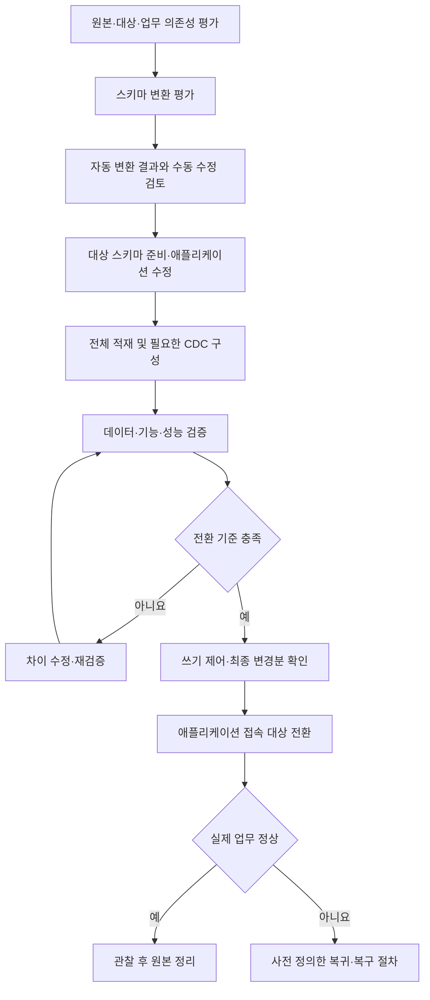

AWS로 시스템을 옮기는 작업에는 현황 조사, 대상 선정, 데이터 복사, 애플리케이션 수정과 실제 사용 전환이 포함된다. 서버를 옮기는 것과 데이터베이스 엔진을 바꾸는 것, 파일을 전송하는 것은 서로 다른 작업이다.

이 글에서는 이전 대상과 작업에 따라 마이그레이션 및 현대화 서비스를 구분한다. 사용 예시는 설명을 위한 가상 상황이다. 명칭과 제공 상태는 2026년 10월 30일에 확인한 AWS 공식 자료를 기준으로 작성했다.

## 먼저 구분할 개념

### 마이그레이션과 현대화

**마이그레이션**은 워크로드와 데이터를 다른 환경으로 이전하는 작업이다. **현대화**는 언어·프레임워크·운영체제·아키텍처 등을 변경해 유지보수와 운영 방식을 개선하는 작업이다.

기존 서버를 EC2로 옮겼다고 애플리케이션이 자동으로 컨테이너나 서버리스 구조가 되는 것은 아니다. 먼저 이전한 뒤 현대화할 수도 있고, 이전 과정에서 일부 구성을 바꿀 수도 있다.

### 7 Rs: 이전 전략

AWS는 이전 전략을 7 Rs로 구분한다.

- **Retire:** 필요 없는 시스템을 종료한다.
- **Retain:** 현재 환경에 유지한다.
- **Rehost:** 애플리케이션 구조를 크게 바꾸지 않고 실행 환경을 옮긴다.
- **Relocate:** 기존 플랫폼 기반의 환경을 다른 위치로 이동한다.
- **Repurchase:** 다른 제품이나 SaaS로 교체한다.
- **Replatform:** 핵심 구조 변경을 줄이면서 플랫폼 일부를 바꾼다.
- **Refactor 또는 Re-architect:** 코드와 구조를 변경해 새로운 운영 방식에 맞춘다.

모든 시스템을 같은 방식으로 옮길 필요는 없다. 업무 중요도, 의존성, 일정과 변경 범위를 고려해 선택한다. 이 분류는 서비스 개수가 아니라 이전 접근 방식이다.

[공식 자료: AWS 마이그레이션 전략](https://docs.aws.amazon.com/prescriptive-guidance/latest/large-migration-guide/migration-strategies.html)

### 동종과 이기종 데이터베이스 이전

**동종 이전**은 같은 엔진을 유지하는 방식이고, **이기종 이전**은 다른 엔진으로 바꾸는 방식이다.

Oracle에서 Oracle로 옮기는 것과 Oracle에서 PostgreSQL 계열로 바꾸는 것은 필요한 변환과 검증 범위가 다르다. 엔진을 바꾸면 데이터 타입, 저장 프로시저와 애플리케이션 SQL의 호환성도 검토해야 한다.

### 복제와 전환

**복제**는 원본의 데이터를 대상으로 복사하거나 변경분을 전달하는 작업이다. **전환(Cutover)**은 실제 사용자와 애플리케이션이 새 환경을 사용하도록 바꾸는 작업이다.

복제가 진행 중이라는 사실과 새 환경으로 전환할 준비가 됐다는 것은 다르다. 최종 변경분과 데이터 일치, 연결 설정과 업무 동작을 확인해야 한다.

## 현황 평가와 계획

### Migration Evaluator

현재 환경의 구성과 사용량을 분석해 AWS 이전의 비용 시나리오와 비즈니스 근거를 평가하는 서비스다.

- **사용하기 좋은 상황:** 이전 전에 자원 규모와 예상 비용, 라이선스 활용 방식을 비교해야 할 때.
- **간단한 예시:** 온프레미스 서버의 구성과 사용률을 바탕으로 EC2·EBS 기반의 이전 비용 시나리오를 검토한다.
- **구분할 점:** 평가 보고서와 실제 이전 실행은 다르다. 평가 결과를 받았다고 서버와 데이터가 AWS로 옮겨진 것은 아니다.

기존 인벤토리를 제공하거나 지원되는 수집 방식을 사용할 수 있다. 예상 비용은 수집 데이터와 가정, 선택한 구성에 따라 달라지므로 실제 청구 금액을 보장하는 것으로 해석하지 않는다.

[공식 자료: Migration Evaluator](https://aws.amazon.com/migration-evaluator/) · [평가 기능](https://aws.amazon.com/migration-evaluator/features/)

### AWS Transform

인프라·애플리케이션·코드의 이전과 현대화 작업을 AI 에이전트 기반 경험으로 지원하는 서비스다.

- **사용하기 좋은 상황:** 발견·평가·이전 계획과 코드 변환 등 여러 단계의 작업을 연결하고 싶을 때.
- **간단한 예시:** 서버 인벤토리와 의존성을 검토해 이전 단위를 정하고, 지원되는 워크로드의 변환 결과를 검토한다.
- **구분할 점:** Transform은 모든 서버와 코드를 동일한 방법으로 자동 이전하는 단일 복사 도구가 아니다. 작업 유형과 지원 대상에 따라 기능이 다르다.

현재 문서는 서버 환경의 조사·계획·리호스트와 컨테이너화, .NET 및 메인프레임 현대화 등을 설명한다. 지원되는 언어·환경과 접근 권한, 산출물의 검토·검증 범위를 확인해야 한다.

AI가 만든 계획과 코드는 검토 대상이다. 변환 명령의 완료와 실제 업무 요구사항 충족을 구분한다.

[공식 자료: AWS Transform 개요](https://docs.aws.amazon.com/transform/latest/userguide/)

## 서버 이전

### AWS Transform MGN

물리·가상·다른 클라우드의 서버를 AWS로 이전하는 서비스다. 원본 서버를 블록 수준으로 복제하고 AWS에서 실행할 수 있도록 변환한다.

- **사용하기 좋은 상황:** 기존 서버 기반 애플리케이션을 큰 구조 변경 없이 EC2로 이전하고 싶을 때.
- **간단한 예시:** 사내 Linux 애플리케이션 서버를 복제하고 테스트 인스턴스에서 확인한 뒤 접속 경로를 새 환경으로 전환한다.
- **구분할 점:** 서버를 옮긴다고 데이터베이스 엔진과 코드 구조까지 자동으로 현대화되는 것은 아니다. 네트워크·라이선스·의존 서비스와 실제 업무 동작을 검증해야 한다.

이전 이름은 **AWS Application Migration Service**다. 현재 이름은 **AWS Transform MGN**이며, AWS Transform은 리호스트 단계에서 MGN의 복제 기술을 사용한다. 두 이름을 각각 독립적인 서버 이전 서비스로 세지 않는다.

직접 MGN 콘솔을 사용하거나 AWS Transform 워크플로와 연결해 사용할 수 있다.

[공식 자료: Transform MGN 개요](https://docs.aws.amazon.com/mgn/latest/ug/what-is-mgn.html) · [이름 변경과 Transform의 관계](https://docs.aws.amazon.com/mgn/latest/ug/General-Questions-FAQ.html)

### 서버 이전에서 확인할 단계

원본 등록과 복제, 테스트 실행, 전환을 구분한다. 서버 여러 대가 하나의 업무를 구성한다면 개별 서버의 복제 상태뿐 아니라 서로의 의존성도 확인해야 한다.

예를 들어 API 서버만 정상으로 실행돼도 인증 서버와 데이터베이스 연결이 끊기면 업무는 동작하지 않는다. 함께 전환할 묶음과 순서, 접속 경로 변경과 전환 실패 시 대응을 정한다.

마이그레이션과 재해 복구도 목적이 다르다. MGN은 이전을, AWS Elastic Disaster Recovery는 지속적인 재해 복구 준비를 중심으로 검토한다. 둘 다 복제 기술을 사용한다는 이유로 같은 운영 절차를 적용하지 않는다.

## 데이터베이스 이전

### AWS Database Migration Service — AWS DMS

지원되는 원본과 대상 데이터 저장소 사이에서 데이터를 이전하고 변경분을 복제하는 서비스다.

- **사용하기 좋은 상황:** 데이터베이스 데이터를 이전하면서 원본의 변경분도 대상으로 전달해야 할 때.
- **간단한 예시:** 지원되는 데이터베이스의 기존 데이터를 새 데이터베이스에 적재하고, 전환 전까지 변경분을 복제한다.
- **구분할 점:** 데이터 이전과 스키마·애플리케이션 변환은 다르다. DMS를 실행했다고 모든 인덱스·제약·프로시저와 애플리케이션 코드가 대상 엔진에 맞게 완성되는 것은 아니다.

같은 엔진 사이와 다른 엔진 사이의 이전에 사용할 수 있지만, 모든 엔진·버전·방향을 지원하는 것은 아니다. 원본·대상 엔드포인트와 기능 제한을 확인해야 한다.

[공식 자료: AWS DMS 개요](https://docs.aws.amazon.com/dms/latest/userguide/Welcome.html)

### 전체 적재와 CDC

**전체 적재(Full Load)**는 기존 데이터를 대상으로 옮기는 과정이다. **CDC(Change Data Capture)**는 원본에서 발생한 변경을 수집해 전달하는 방식이다.

- 전체 적재만 수행할 수 있다.
- 전체 적재와 변경분 복제를 함께 구성할 수 있다.
- 이미 적재한 데이터를 기준으로 변경분만 복제할 수도 있다.

정확한 시작 지점과 로그 보존 조건, 엔진별 권한·설정을 확인해야 한다. CDC를 켜면 모든 변경이 지연 없이 즉시 반영된다고 가정하지 않는다. 공식 문서도 부하·네트워크·복제 자원·대상 처리량 등에 따라 지연이 발생할 수 있다고 설명한다.

전환 시에는 필요한 쓰기 제어와 최종 복제 확인, 일치 검증을 계획해야 한다.

[공식 자료: DMS의 지속 복제와 CDC](https://docs.aws.amazon.com/dms/latest/userguide/CHAP_Task.CDC.html)

### DMS Schema Conversion

원본 데이터베이스의 스키마와 코드 객체를 대상 엔진에 맞는 형태로 평가·변환하는 DMS 기능이다.

- **사용하기 좋은 상황:** 다른 데이터베이스 엔진으로 바꾸기 전에 자동 변환 가능 범위와 수작업 대상을 확인해야 할 때.
- **간단한 예시:** 지원되는 Oracle 스키마를 Aurora PostgreSQL 호환 형태로 평가하고 변환 결과와 수동 수정 항목을 검토한다.
- **구분할 점:** **Schema Conversion은 스키마를 변환하며 데이터를 이전하는 기능이 아니다.** 실제 데이터 이동은 DMS의 데이터 이전 기능 등으로 수행한다.

평가, 변환 결과 검토와 대상 적용을 구분한다. 대상에 변환 코드를 적용했어도 애플리케이션 SQL과 업무 결과, 성능이 검증된 것은 아니다.

[공식 자료: DMS Schema Conversion](https://docs.aws.amazon.com/dms/latest/userguide/CHAP_SchemaConversion.html)

### AWS Schema Conversion Tool — AWS SCT

지원되는 데이터베이스 스키마를 다른 엔진의 형태로 변환하는 도구다.

- **사용하기 좋은 상황:** 로컬 도구를 활용해 스키마 평가와 변환을 수행하고 지원 경로를 검토하고 싶을 때.
- **간단한 예시:** 기존 스키마를 분석해 변환 결과와 추가 작업이 필요한 부분을 확인한다.
- **구분할 점:** AWS SCT와 DMS Schema Conversion의 지원 엔진·변환 경로와 사용 방식이 모두 같다고 가정하지 않는다. 변환과 데이터 복사도 별도 작업이다.

[공식 자료: AWS SCT 개요](https://docs.aws.amazon.com/SchemaConversionTool/latest/userguide/CHAP_Welcome.html)

### AWS DMS Serverless

DMS의 복제 용량 프로비저닝과 확장을 자동화하는 실행 방식이다.

- **사용하기 좋은 상황:** 지원되는 복제 작업에서 복제 인스턴스의 용량 관리 부담을 줄이고 싶을 때.
- **간단한 예시:** 원본·대상 연결과 복제 설정을 정하고 Serverless 방식으로 데이터 이전 작업을 실행한다.
- **구분할 점:** 서버리스여도 네트워크·엔드포인트·권한·테이블 선택과 복제 설정은 필요하다. 다른 실행 방식과 기능 제한이 완전히 같지는 않다.

[공식 자료: DMS Serverless](https://docs.aws.amazon.com/dms/latest/userguide/CHAP_Serverless.html)

### 공식 이미지: DMS의 복제 구성

_원본·대상 엔드포인트와 복제 인스턴스·작업의 관계. AWS 공식 문서의 원본 이미지._

[이미지 출처: What is AWS Database Migration Service?](https://docs.aws.amazon.com/dms/latest/userguide/Welcome.html)

그림에서는 원본 데이터베이스와 대상 데이터베이스 사이에 각각의 엔드포인트가 있고, 복제 인스턴스에서 실행하는 작업이 데이터를 전달한다. 엔드포인트는 접속 정보를 나타내는 구성 요소이며 데이터베이스 자체가 아니다.

이 그림은 복제 인스턴스 기반 구성을 설명한다. DMS Serverless에서는 복제 구성과 용량 관리 방식이 다르다. 그림만으로 모든 DMS 실행 방식이 동일하다고 이해하지 않는다.

데이터가 대상에 전달됐다는 사실과 애플리케이션 전환이 완료됐다는 것도 다르다.

## 파일과 객체 데이터 이전

### AWS DataSync

파일과 객체 데이터를 AWS 스토리지 등 지원되는 위치 사이에서 전송하는 서비스다.

- **사용하기 좋은 상황:** 파일 서버나 객체 저장소의 많은 데이터를 AWS로 옮기거나 반복해서 복사해야 할 때.
- **간단한 예시:** 사내 NFS 파일 서버의 문서를 S3로 이전하고 필요한 변경분을 다시 전송한다.
- **구분할 점:** 파일·객체 전송과 데이터베이스 트랜잭션 로그 복제는 다르다. 운영 중인 데이터베이스의 파일만 복사해 일관된 데이터베이스 이전이 완료됐다고 판단하면 안 된다.

NFS·SMB·객체 저장소와 S3·EFS·FSx 등 지원 조합을 확인한다. 에이전트 필요 여부와 네트워크, 메타데이터 처리와 검증 조건은 전송 위치와 모드에 따라 확인해야 한다.

[공식 자료: DataSync 개요](https://docs.aws.amazon.com/datasync/latest/userguide/what-is-datasync.html)

### AWS Transfer Family

SFTP·FTPS·FTP·AS2와 브라우저 기반 파일 전송을 지원하고 AWS 스토리지와 연결하는 관리형 서비스다.

- **사용하기 좋은 상황:** 고객·협력사가 사용하는 파일 전송 방식과 업무 흐름을 AWS 스토리지에 연결해야 할 때.
- **간단한 예시:** 협력사가 SFTP로 올린 정산 파일을 S3에 저장하도록 구성한다.
- **구분할 점:** DataSync가 저장소 간 데이터 이동을 구성하는 데 사용된다면 Transfer Family는 지원되는 파일 전송 프로토콜과 접근 경로 제공에 초점을 둔다.

모든 프로토콜과 기능에서 같은 저장소와 인증 방식을 지원한다고 가정하지 않는다. 클라이언트 호환성, 인증·경로 권한과 암호화 조건을 확인한다.

[공식 자료: Transfer Family 개요](https://docs.aws.amazon.com/transfer/latest/userguide/what-is-aws-transfer-family.html)

### AWS Data Transfer Terminal

저장 장치를 가져와 고대역폭 연결로 AWS에 데이터를 업로드할 수 있는 물리적 장소를 제공하는 서비스다.

- **사용하기 좋은 상황:** 보유한 회선만으로 대용량 업로드가 어렵고 지원 장소를 이용할 수 있을 때.
- **간단한 예시:** 대용량 미디어가 담긴 장치를 예약한 장소로 가져가 AWS 스토리지에 업로드한다.
- **구분할 점:** AWS가 장치를 보내고 회수하는 방식과 다르다. 이용 가능한 위치와 예약·장비·전송 조건을 확인해야 한다.

장소 방문과 실제 업로드 시간을 포함해 이전 계획을 세운다. 이 서비스가 모든 지역에서 제공된다고 가정하지 않는다.

[공식 자료: Data Transfer Terminal](https://aws.amazon.com/data-transfer-terminal/)

## 애플리케이션과 코드 현대화

### AWS Transform의 워크로드별 기능

Transform은 지원되는 .NET·메인프레임·서버 환경 등에 맞는 작업을 제공한다.

- **사용하기 좋은 상황:** 단순 서버 이동을 넘어 운영체제·프레임워크·구조의 변환을 검토해야 할 때.
- **간단한 예시:** Windows 의존성이 있는 .NET 애플리케이션을 평가하고 지원되는 범위에서 Linux 실행이 가능한 형태로 변환한다.
- **구분할 점:** 모든 Windows 기능과 외부 라이브러리를 자동으로 호환되게 만드는 것은 아니다. 변환 대상과 제외 항목, 빌드·기능·성능 검증을 확인해야 한다.

메인프레임도 데이터 변환, 배치와 온라인 업무, 주변 시스템 연계까지 고려해야 한다. 코드 변환 결과만으로 전체 업무 이전을 완료했다고 판단하지 않는다.

[공식 자료: AWS Transform 개요와 워크로드](https://docs.aws.amazon.com/transform/latest/userguide/)

### AWS Transform custom

언어·라이브러리·프레임워크 업그레이드와 조직별 코드 변환을 정의하고 실행하는 기능이다.

- **사용하기 좋은 상황:** 여러 저장소에 공통된 현대화 작업을 반복 적용해야 할 때.
- **간단한 예시:** 내부 API 사용 방식을 바꾸는 변환 규칙을 정의하고 대상 프로젝트에 적용한 결과를 검토한다.
- **구분할 점:** 자연어로 변환을 정의할 수 있다는 것과 모든 결과가 정확하다는 것은 다르다. 변경 범위와 테스트, 리뷰 기준이 필요하다.

[공식 자료: AWS Transform custom](https://docs.aws.amazon.com/transform/latest/userguide/custom.html)

### AWS Transform continuous modernization

코드 저장소를 대상으로 기술 부채·보안·현대화 기회 등을 분석하고 개선 작업에 연결하는 기능이다.

- **사용하기 좋은 상황:** 일회성 이전 이후에도 여러 저장소의 현대화 대상을 지속적으로 찾고 관리하고 싶을 때.
- **간단한 예시:** 연결한 저장소의 오래된 의존성과 개선 후보를 분석하고 우선순위에 따라 수정안을 검토한다.
- **구분할 점:** 분석과 수정, 배포는 별도 단계다. 실행 위치와 자격 증명, 대상 저장소와 허용한 변경 범위를 확인해야 한다.

[공식 자료: Transform continuous modernization](https://docs.aws.amazon.com/transform/latest/userguide/continuous-modernization.html)

## 기존 자료에서 확인할 서비스와 제공 상태

### AWS Application Discovery Service

서버 구성·사용량·의존성 같은 현황을 수집해 이전 계획에 활용하던 서비스다. 예를 들어 서버 간 연결을 조사해 함께 이전할 대상을 정하는 데 사용했다.

**2025년 11월 7일부터 신규 고객에게 제공되지 않는다.** 기존 프로젝트의 이용과 신규 평가 환경을 구분한다. 공식 문서는 새로운 조사와 평가 작업에 AWS Transform을 안내한다.

[공식 자료: Application Discovery Service 제공 변경](https://docs.aws.amazon.com/application-discovery/latest/userguide/application-discovery-service-availability-change.html)

### AWS Migration Hub

여러 이전 도구의 진행 상태를 모아 관리하고 계획을 지원하던 서비스다.

**2025년 11월 7일부터 신규 고객에게 제공되지 않는다.** 기존 고객의 진행 중 프로젝트 이용과 새 프로젝트의 선택지를 구분한다. 공식 문서는 AWS Transform을 안내한다.

Hub가 진행 상태를 표시하는 것과 각 이전 도구가 실제 데이터를 옮기는 작업은 다르다.

[공식 자료: Migration Hub 제공 변경](https://docs.aws.amazon.com/migrationhub/latest/ug/migrationhub-availability-change.html)

### AWS Mainframe Modernization

메인프레임 워크로드의 리플랫폼·실행·관련 도구를 제공해 온 서비스다.

현재 공식 안내에는 **Managed Runtime Environment와 Self-managed 경험 모두 신규 고객 제한**이 표시된다. 과거 문서에서 Managed의 대안으로 Self-managed를 안내하더라도 최신 Self-managed의 제공 상태를 함께 확인해야 한다. 새 프로젝트는 지원되는 AWS Transform 기능과 공급업체의 직접 제공 옵션 등을 검토한다.

[공식 자료: Mainframe Modernization 제공 변경](https://docs.aws.amazon.com/m2/latest/userguide/mainframe-modernization-availability-change.html)

### AWS Snow Family 관련 항목

예전 자료에서는 Snowball·Snowball Edge 등을 물리 장치를 이용한 대용량 데이터 이전과 엣지 처리의 예로 소개한다.

현재 Snowball Edge 안내는 **신규 고객에게 제공되지 않는다**고 명시한다. 새 데이터 이전 계획에는 지원되는 DataSync, Data Transfer Terminal과 파트너 옵션을 검토하도록 안내한다.

Snow 제품군의 각 장치와 기능 상태는 다를 수 있다. 제품군 이름만으로 모두 현재 주문할 수 있다고 판단하지 않는다.

[공식 자료: Snowball Edge 제공 변경](https://docs.aws.amazon.com/snowball/latest/developer-guide/snowball-edge-availability-change.html)

### 종료된 서비스와 기능

- **AWS DMS Fleet Advisor:** 2026년 5월 20일에 지원이 종료됐다. DMS 개요에 이름이 남아 있어도 신규 평가 작업의 현재 도구로 제시하지 않는다.
- **AWS DataSync Discovery:** 2025년 5월 20일에 종료됐다. DataSync의 데이터 전송 기능 전체 종료를 뜻하지 않는다.
- **Application Discovery Service의 Discovery Connector:** 2025년 11월 17일에 종료됐다. 상위 서비스의 신규 고객 제한과 구분한다.
- **AWS Mainframe Modernization Application Testing:** 2025년 10월 7일에 종료됐다.
- **AWS Server Migration Service:** 2023년 4월 1일에 종료됐다.

[공식 자료: Fleet Advisor 종료 안내](https://docs.aws.amazon.com/dms/latest/userguide/dms_fleet.advisor-end-of-support.html) · [완전 종료된 서비스와 기능 목록](https://docs.aws.amazon.com/general/latest/gr/full_shutdown_services.html)

## 예시: 데이터베이스 엔진을 바꾸며 이전하기

아래는 설명을 위해 작성한 Mermaid 흐름이다. AWS 공식 아키텍처 이미지나 실행 가능한 이전 정의가 아니다. 실제 지원되는 엔진·버전 조합을 확인한 뒤 적용해야 한다.

실제 전체 적재와 CDC의 동작은 선택한 작업 유형에 따라 구성한다. 그림은 필요한 검토 순서를 단순화한 것이며, CDC 설정은 최초 적재 전부터 준비해야 할 수 있다.

스키마 변환과 데이터 이전이 성공해도 애플리케이션 SQL과 연결 설정이 맞지 않으면 업무는 실패할 수 있다. 데이터 일치뿐 아니라 쓰기·조회·배치·외부 연계도 확인해야 한다.

전환 후 새 데이터베이스에 쓰기가 발생했다면 단순히 이전 접속 주소로 되돌리는 것만으로 안전하게 복귀할 수 없을 수 있다. 새로 쓴 데이터의 처리와 복제 방향, 복귀 가능 시점과 조건을 미리 정한다.

데이터 검증 기능도 지원 범위와 원본·대상 부하를 확인한다. 검증 작업의 완료와 전체 업무의 정확성 검증은 같은 범위가 아니다.

[공식 자료: DMS 데이터 검증](https://docs.aws.amazon.com/dms/latest/userguide/CHAP_Validating.html)

## 비슷한 서비스는 무엇을 기준으로 구분할까?

- **Migration Evaluator와 MGN:** 이전 근거·비용을 평가하는지, 서버를 실제로 복제하고 전환하는지 구분한다.
- **Transform과 Transform MGN:** 이전·현대화의 계획과 워크플로를 지원하는 서비스와 서버 리호스트를 수행하는 복제 기능의 관계를 확인한다.
- **MGN과 DMS:** 서버 실행 환경을 옮기는지, 데이터 저장소의 데이터를 이전하는지 확인한다.
- **DMS와 Schema Conversion:** 데이터를 복사하는지, 스키마와 코드 객체를 대상 엔진에 맞추는지 확인한다.
- **DataSync와 DMS:** 파일·객체 데이터 이동인지, 데이터베이스 데이터와 변경분 복제인지 구분한다.
- **DataSync와 Transfer Family:** 저장소 간 이전인지, 기존 파일 전송 프로토콜과 접근 경로를 제공하는지 비교한다.
- **마이그레이션과 재해 복구:** 새로운 운영 환경으로 옮기는 계획인지, 장애에 대비해 복구 환경을 유지하는 계획인지 구분한다.
- **코드 변환과 현대화 완료:** 변환한 코드뿐 아니라 데이터·의존성·운영과 업무 검증까지 충족했는지 확인한다.

Direct Connect나 VPN 같은 네트워크 연결은 전송 경로의 일부다. 연결을 만들었다고 데이터 이전 작업과 검증까지 완료되는 것은 아니다.

## 이전 계획에 포함할 내용

**현황과 의존성:** 서버 수와 용량뿐 아니라 인증, DNS, 파일 공유, 데이터베이스와 외부 연계를 확인한다.

**지원 범위:** 원본·대상 엔진과 버전, OS·드라이버·라이브러리와 라이선스 조건을 확인한다.

**전송 경로와 부하:** 데이터 크기, 변경 속도, 네트워크와 원본·대상 처리량을 고려한다. 평균 전송 속도만으로 최종 전환 시간을 단정하지 않는다.

**전환 기준:** 허용할 중단 시간과 데이터 차이, 최종 복제 상태와 업무 검증 항목을 정한다.

**복귀 조건:** 실패 시 원래 환경을 다시 사용할 수 있는 시점과 새 데이터의 처리 방법을 정한다.

**완료와 정리:** 실제 업무 정상, 모니터링·백업과 비용을 확인한 뒤 임시 자원과 원본을 정리한다. 복사 성공만으로 원본을 바로 삭제하지 않는다.

## SAA 공부와 연결해서 볼 내용

다음은 이 글의 개념 복습 기준이다. 실제 시험의 서비스와 세부 범위는 응시 시점의 공식 시험 안내서를 확인해야 한다.

1. **기존 서버를 큰 구조 변경 없이 EC2로 옮긴다:** Transform MGN과 리호스트를 확인한다.
2. **데이터베이스 데이터를 옮기고 변경분을 전달한다:** DMS의 전체 적재·CDC와 지연을 확인한다.
3. **데이터베이스 엔진을 바꾼다:** 스키마 변환과 애플리케이션 수정 범위를 확인한다.
4. **파일 서버와 객체 데이터를 이전한다:** DataSync의 지원 위치와 전송 조건을 확인한다.
5. **협력사의 SFTP 파일 전송을 AWS 스토리지에 연결한다:** Transfer Family를 확인한다.
6. **코드와 플랫폼을 현대화한다:** Transform의 지원 작업과 검증 범위를 확인한다.
7. **오래된 자료의 서비스가 보인다:** 종료와 신규 고객 제한, 이름 변경을 구분한다.

이전 도구를 고를 때는 무엇을 옮기는지, 무엇을 바꾸는지부터 구분하면 된다. 평가 결과, 복제 상태와 실제 업무 전환 완료는 서로 다른 상태다.

