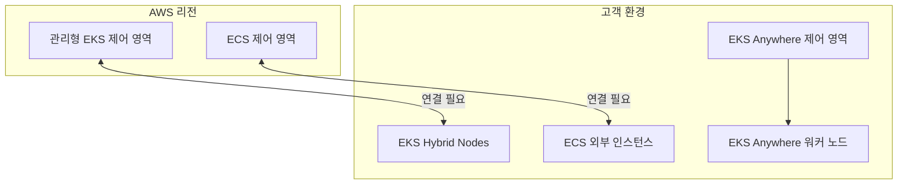
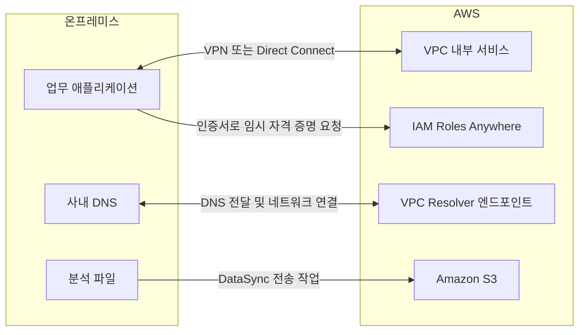

온프레미스 시스템을 유지하면서 AWS를 사용하거나, 여러 클라우드를 함께 운영하는 경우가 있다. 이때 필요한 기능은 서버를 배치할 위치, 환경 간 네트워크 연결, 컨테이너 운영, 데이터 접근, 인증 등으로 나뉜다.

하이브리드 클라우드는 온프레미스와 클라우드를 함께 사용하는 구성을 말한다. 멀티클라우드는 둘 이상의 클라우드를 사용하는 구성이다. 두 방식은 함께 적용할 수 있다. 예를 들어 사내 데이터센터에 제조 시스템을 유지하고, AWS에서 웹 서비스를 운영하며, 다른 클라우드의 분석 서비스를 사용하는 경우이다.

이 글에서는 관련 AWS 서비스의 역할과 사용 예시를 정리한다. 예시는 이해를 위한 가상 상황이다. 제품 이름과 지원 범위는 2026년 10월 30일에 확인한 공식 문서를 기준으로 한다.

## 먼저 구분할 사항

하이브리드·멀티클라우드 구성은 다음 질문으로 나누어 검토한다.

- **실행 위치**: 프로그램과 데이터가 AWS 리전, 고객 데이터센터, 통신사 시설 중 어디에 있어야 하는가?
- **운영 책임**: 하드웨어, 운영체제, Kubernetes 제어 영역, 애플리케이션을 누가 관리하는가?
- **연결 방식**: 인터넷 기반 VPN, 전용 연결, 관리형 클라우드 간 연결 중 무엇이 필요한가?
- **이름 조회와 인증**: 상대 환경의 서버 이름을 어떻게 조회하고 AWS API 호출 권한을 어떻게 얻는가?
- **연결 단절 시 동작**: 기존 작업, 신규 배포, 데이터 저장과 복구가 각각 어떻게 동작해야 하는가?

네트워크가 연결되었다고 데이터 복제와 장애 전환까지 구성되는 것은 아니다. 컨테이너 이미지를 공통으로 사용하더라도 데이터베이스, 스토리지, IAM, 로드 밸런서와 같은 의존성은 따로 검토해야 한다.

## 1. AWS Outposts: 고객 시설에 AWS 인프라 배치

**AWS Outposts**는 AWS가 제공하고 관리하는 인프라를 고객 데이터센터나 시설에 설치하여 AWS 서비스를 사용하는 방식이다. 지원하는 컴퓨팅·스토리지 기능을 현장에 두고, 상위 AWS 리전과 연계한다.

**사용하기 좋은 상황**은 현장 장비와의 짧은 지연 시간이 필요하거나 특정 데이터를 고객 시설에서 처리해야 하는 경우이다.

**예시**: 공장 내부의 생산 장비와 통신하는 애플리케이션을 Outposts에서 실행하고, 처리한 통계 데이터는 AWS 리전의 분석 시스템에 전달한다. 현장 처리와 리전의 기능을 함께 사용하는 구성이다.

**구분할 점**은 AWS 리전의 모든 서비스를 고객 시설에서 제공하는 것은 아니라는 것이다. Outposts의 랙·서버 형태, 세대, 리전과 서비스에 따라 지원 범위가 다르다. 고객은 설치 공간, 전력, 냉각, 네트워크 등 현장 요건을 준비해야 한다. 리전 연결이 끊겨도 모든 기능을 그대로 사용할 수 있는 독립 클라우드로 가정해서는 안 된다.

[공식 자료: AWS Outposts란?](https://docs.aws.amazon.com/outposts/latest/userguide/what-is-outposts.html)

## 2. Amazon EKS Hybrid Nodes: 외부 서버를 EKS 노드로 사용

**Amazon EKS Hybrid Nodes**는 온프레미스나 엣지 환경의 서버를 Amazon EKS 클러스터의 노드로 사용하는 기능이다. Kubernetes 제어 영역은 AWS 리전에서 AWS가 관리하고, 고객이 준비한 서버에서 워크로드를 실행한다.

**사용하기 좋은 상황**은 기존 서버를 활용하면서 Kubernetes 제어 영역 운영 부담을 줄이려는 경우이다.

**예시**: 물류센터의 서버에서 재고 처리용 컨테이너를 실행한다. 현장 서버를 EKS Hybrid Nodes로 등록하고, AWS 리전의 EKS 제어 영역에서 Kubernetes API와 클러스터 관리를 제공받는다.

**구분할 점**은 제어 영역까지 현장에 설치되는 것은 아니라는 것이다. 고객은 노드의 하드웨어·운영체제와 지원 조건을 관리하고, 리전과 노드 사이의 연결을 준비한다. 네트워크 단절 중 기존 컨테이너의 동작과 신규 스케줄링·관리 작업은 구분해서 검증해야 한다.

[공식 자료: EKS Hybrid Nodes 개요](https://docs.aws.amazon.com/eks/latest/userguide/hybrid-nodes-overview.html) · [네트워크 단절 시 고려 사항](https://docs.aws.amazon.com/eks/latest/best-practices/hybrid-nodes-network-disconnections.html)

### 공식 이미지로 확인하는 연결 구조

_AWS 공식 EKS Hybrid Nodes 네트워크 구성도. 왼쪽은 AWS 리전과 VPC, 오른쪽은 온프레미스의 노드·Pod 네트워크이다._

[이미지 출처: EKS Hybrid Nodes 네트워킹 요구 사항](https://docs.aws.amazon.com/eks/latest/userguide/hybrid-nodes-networking.html)

그림은 AWS 리전과 온프레미스 사이의 사설 연결, 양쪽 라우팅 테이블, 노드·Pod 주소 범위를 함께 보여준다. EKS에 노드를 등록하는 것만으로 통신 경로가 만들어지지는 않는다. VPC에서 현장 노드·Pod로 가는 경로와 현장에서 AWS로 돌아오는 경로를 모두 확인해야 한다.

그림에 표시된 IP 주소는 문서의 예시이다. 실제 구성에서는 기존 네트워크와의 주소 중복, 보안 그룹·방화벽, 사용하는 CNI와 Pod 통신 방식을 검토한다.

## 3. Amazon EKS Anywhere: 고객 환경에서 Kubernetes 클러스터 운영

**Amazon EKS Anywhere**는 고객 인프라에서 Kubernetes 클러스터를 생성하고 운영하기 위한 소프트웨어이다. AWS가 제공하는 도구를 사용하지만, 고객이 클러스터와 인프라의 운영 책임을 갖는다.

**사용하기 좋은 상황**은 Kubernetes 제어 영역과 워커 노드를 고객 환경에 두어야 하거나, 외부 연결이 제한된 환경에 클러스터를 운영해야 하는 경우이다. 공식 문서에는 에어갭 환경을 위한 설치·운영 방식도 제공된다.

**예시**: 외부 연결이 제한된 연구 시설에서 로컬 Kubernetes 클러스터를 운영한다. EKS Anywhere의 배포·업그레이드 도구를 사용하고, 내부 저장소와 운영 절차를 준비한다.

**구분할 점**은 EKS Hybrid Nodes와 관리 경계가 다르다는 것이다. Hybrid Nodes는 AWS 리전의 관리형 제어 영역에 외부 노드를 연결한다. EKS Anywhere에서는 고객이 제어 영역을 포함한 클러스터의 수명 주기를 운영한다. AWS에서 EKS라는 이름을 제공한다고 운영 책임까지 동일해지는 것은 아니다.

[공식 자료: EKS Anywhere 개요](https://anywhere.eks.amazonaws.com/docs/overview/)

## 4. Amazon ECS Anywhere: 외부 서버에서 ECS 작업 실행

**Amazon ECS Anywhere**는 고객이 관리하는 외부 서버나 가상 머신을 Amazon ECS에 등록하여 컨테이너 작업을 실행하는 기능이다. ECS의 외부 인스턴스에 해당하며, 작업 실행에는 EXTERNAL 시작 유형을 사용한다.

**사용하기 좋은 상황**은 Kubernetes 대신 ECS를 사용하면서 사내 서버의 배치 작업이나 내부 처리용 컨테이너를 함께 관리하려는 경우이다.

**예시**: 사내 파일 서버에 저장된 대용량 자료를 변환하는 컨테이너를 외부 서버에서 실행한다. ECS로 작업을 배포하고, 처리 결과를 AWS 서비스에 전달한다.

**구분할 점**은 Fargate를 고객 서버에서 실행하는 기능이 아니라는 것이다. 고객은 외부 호스트와 운영체제를 관리해야 하며, 에이전트·IAM·네트워크 설정도 준비한다. 외부 인스턴스에는 Amazon EC2 기반 ECS와 다른 제약이 있다. 예를 들어 공식 문서는 ECS Anywhere에 대한 Elastic Load Balancing 지원 제한을 안내한다. 지원 운영체제와 기능은 현재 문서를 확인한다.

[공식 자료: Amazon ECS Anywhere](https://docs.aws.amazon.com/AmazonECS/latest/developerguide/ecs-anywhere.html)

### 컨테이너 운영 방식 비교

세 기능은 다음과 같이 구분할 수 있다.

- **EKS Hybrid Nodes**: AWS 리전의 EKS 제어 영역과 고객이 운영하는 외부 Kubernetes 노드를 함께 사용한다.
- **EKS Anywhere**: 고객 환경에서 Kubernetes 제어 영역과 노드를 운영한다.
- **ECS Anywhere**: AWS의 ECS 제어 영역으로 외부 서버의 컨테이너 작업을 관리한다.

다음 Mermaid는 운영 책임을 구분하기 위해 작성한 개념도이다. 실제 네트워크나 보안 설정을 모두 표현한 배포 구성도는 아니다.

## 5. Amazon Elastic VMware Service: AWS에서 VMware 환경 운영

**Amazon Elastic VMware Service(EVS)**는 Amazon VPC 안에서 VMware Cloud Foundation 환경을 운영할 수 있게 하는 서비스이다. VMware 소프트웨어 스택을 Amazon EC2 베어 메탈 인프라에서 사용한다.

**사용하기 좋은 상황**은 VMware 기반 운영 방식과 도구를 유지하면서 워크로드를 AWS로 확장하거나 이전하려는 경우이다.

**예시**: 데이터센터 계약 종료에 맞추어 VMware 기반 업무 시스템을 AWS로 이전한다. 애플리케이션을 곧바로 클라우드 네이티브 구조로 바꾸기 어려워 EVS에서 VMware 환경을 운영하고, 필요한 시스템부터 단계적으로 전환한다.

**구분할 점**은 고객 시설에 인프라를 설치하는 Outposts와 실행 위치가 다르다는 것이다. EVS는 AWS의 VPC에서 VMware 환경을 운영한다. 또한 VMware 환경을 사용한다는 것과 모든 운영을 AWS에 위임한다는 것은 다르다. 고객 또는 운영 파트너가 담당할 VCF 관리 범위, 라이선스, 호환성과 지원 조건을 확인해야 한다.

[공식 자료: Amazon EVS란?](https://docs.aws.amazon.com/evs/latest/userguide/what-is-evs.html)

## 6. AWS Direct Connect: 전용 네트워크 연결

**AWS Direct Connect(DX)**는 고객 네트워크와 AWS 사이에 전용 네트워크 연결을 구성하는 서비스이다. Direct Connect 접속 위치와 통신사업자 등의 연결 구성을 통해 AWS 리소스에 접근한다.

**사용하기 좋은 상황**은 사내 시스템과 AWS 사이에 지속적인 데이터 전송이 많거나 인터넷 경로와 구분되는 연결이 필요한 경우이다.

**예시**: 사내 업무 시스템이 AWS에 있는 데이터 처리 애플리케이션과 계속 통신한다. Direct Connect를 사용하고, 요구 가용성에 맞추어 연결 위치와 회선의 중복 구성을 설계한다.

**구분할 점**은 전용 연결과 암호화가 다른 조건이라는 것이다. Direct Connect 자체는 전송 중인 트래픽을 기본으로 암호화하지 않는다. 요구 사항에 따라 지원 연결의 MACsec, Direct Connect와 Site-to-Site VPN 조합, 애플리케이션의 TLS 등을 검토한다. 이 방식들은 암호화 범위가 다르므로 보호해야 할 구간을 먼저 정한다.

전용 연결 하나만으로 종단 간 고가용성이 확보되는 것도 아니다. 고객 라우터, 통신사업자 경로, 접속 위치와 AWS 측 연결을 함께 검토한다.

[공식 자료: Direct Connect란?](https://docs.aws.amazon.com/directconnect/latest/UserGuide/Welcome.html) · [Direct Connect 암호화](https://docs.aws.amazon.com/directconnect/latest/UserGuide/encryption-in-transit.html)

## 7. AWS Site-to-Site VPN: IPsec으로 네트워크 연결

**AWS Site-to-Site VPN**은 고객 네트워크와 AWS 사이에 IPsec VPN 연결을 구성하는 서비스이다. 일반적인 인터넷 기반 연결 외에도 지원되는 Direct Connect 조합을 검토할 수 있다.

**사용하기 좋은 상황**은 전용 회선 구축 전 연결을 준비하거나, 지점 연결·보조 경로에 암호화된 네트워크 연결이 필요한 경우이다.

**예시**: 신규 지점에서 AWS의 내부 업무 시스템에 접근해야 한다. 지점의 고객 게이트웨이 장비와 AWS 사이에 VPN을 구성하고, 대역폭과 가용성 요구 사항이 커지면 다른 연결 방식도 검토한다.

**구분할 점**은 VPN 연결에 두 개의 터널이 제공되더라도 고객 장비와 라우팅을 포함한 전체 구성이 자동으로 이중화되는 것은 아니라는 것이다. 두 터널의 사용과 장애 전환을 확인해야 한다. 사용자 개인 단말을 연결하는 Client VPN과도 구분한다.

VPN은 네트워크 경로를 제공한다. AWS API 호출 권한 부여, 데이터 복제, 애플리케이션 장애 전환은 별도 구성이다.

[공식 자료: AWS Site-to-Site VPN이란?](https://docs.aws.amazon.com/vpn/latest/s2svpn/VPC_VPN.html)

## 8. AWS Transit Gateway: 여러 네트워크의 연결 허브

**AWS Transit Gateway(TGW)**는 여러 VPC와 온프레미스 네트워크의 연결을 모아 라우팅하는 네트워크 허브이다.

**사용하기 좋은 상황**은 연결할 VPC와 계정이 늘어나 개별 연결 관리가 복잡해지는 경우이다.

**예시**: 개발·운영·공통 서비스 VPC와 사내 데이터센터를 연결한다. Transit Gateway 연결과 라우팅 테이블을 구성하고, 개발 환경이 운영 환경에 직접 접근하지 못하도록 경로를 분리한다.

**구분할 점**은 Transit Gateway가 물리적인 전용 회선이나 암호화 터널을 대신하지 않는다는 것이다. 온프레미스에서 AWS까지의 연결에는 VPN이나 Direct Connect 등의 구성이 필요하다. 연결을 추가하는 것과 그 사이의 통신을 허용하는 것도 별개이다. 연결별 라우팅과 보안 정책을 함께 확인한다.

[공식 자료: Transit Gateway란?](https://docs.aws.amazon.com/vpc/latest/tgw/what-is-transit-gateway.html)

## 9. AWS Cloud WAN: 여러 지역의 네트워크를 정책으로 관리

**AWS Cloud WAN**은 여러 리전의 VPC, 지점과 데이터센터 등을 연결하는 글로벌 네트워크를 중앙 정책으로 관리하는 서비스이다. 코어 네트워크와 세그먼트 등을 사용하여 연결 구조와 분리 정책을 정의한다.

**사용하기 좋은 상황**은 여러 국가·리전에 분산된 환경에서 네트워크 정책을 일관되게 적용해야 하는 경우이다.

**예시**: 한국·미국·유럽의 AWS 환경과 지점을 연결한다. 운영용과 개발용 세그먼트를 분리하고, 각 지역의 연결을 공통 정책에 따라 관리한다.

**구분할 점**은 Transit Gateway보다 무조건 상위 제품이라는 식으로 선택하지 않는다는 것이다. 특정 리전의 연결 허브가 필요한지, 여러 지역에 걸친 네트워크와 정책을 중앙에서 관리할 필요가 있는지를 기준으로 검토한다. 실제 접속 회선, 지원 연결 방식, 라우팅과 비용도 함께 확인한다.

[공식 자료: AWS Cloud WAN이란?](https://docs.aws.amazon.com/network-manager/latest/cloudwan/what-is-cloudwan.html)

## 10. AWS Interconnect: 관리형 사설 연결

**AWS Interconnect**는 AWS와 다른 클라우드 또는 고객 위치 사이의 사설 연결을 관리형 방식으로 제공하는 서비스군이다. AWS 측 연결 지점에는 Direct Connect Gateway를 사용한다.

- **Interconnect – multicloud**: AWS VPC와 다른 퍼블릭 클라우드의 VPC를 연결하는 용도이다.
- **Interconnect – last mile**: 지원하는 파트너의 네트워크를 통해 지점·데이터센터 등을 AWS에 연결하는 용도이다.

**사용하기 좋은 상황**은 지원하는 클라우드나 파트너 사이에서 사설 연결 구성과 운영을 단순화하려는 경우이다.

**예시**: AWS에서 실행하는 애플리케이션이 다른 클라우드의 데이터 처리 시스템과 통신한다. 지원하는 multicloud 연결을 구성하여 두 환경 사이의 사설 네트워크 경로를 사용한다.

**구분할 점**은 Direct Connect의 일반적인 연결을 모두 같은 이름으로 부르는 것이 아니라는 것이다. Interconnect는 AWS와 공급자가 기반 연결을 관리하는 별도의 제공 방식이다. 지원 클라우드, 파트너, 리전과 제공 단계는 도입 시 확인한다.

연결이 만들어져도 양쪽 클라우드의 권한, DNS, 데이터 복제와 애플리케이션 호환성이 통합되지는 않는다. 공식 문서의 기본 암호화 설명도 AWS 장비와 인접 파트너 장비 사이의 연결을 대상으로 하므로, 이를 애플리케이션 전체 구간의 암호화로 확대해 해석하지 않는다.

[공식 자료: AWS Interconnect란?](https://docs.aws.amazon.com/interconnect/latest/userguide/what-is-interconnect.html)

## 11. Amazon Route 53 VPC Resolver: 환경 간 DNS 조회

**Amazon Route 53 VPC Resolver**는 VPC의 DNS 조회를 처리하고, 엔드포인트와 전달 규칙으로 온프레미스 DNS와 연계할 수 있는 기능이다. 이전 문서의 Route 53 Resolver는 현재 Route 53 VPC Resolver라는 이름으로 안내된다.

**사용하기 좋은 상황**은 AWS 애플리케이션이 사내 도메인 이름을 조회하거나, 사내 시스템이 AWS의 프라이빗 도메인 이름을 조회해야 하는 경우이다.

**예시**: AWS의 애플리케이션이 사내 DNS에 등록된 재고 서버 이름을 조회한다. 해당 도메인의 쿼리를 아웃바운드 엔드포인트를 통해 사내 DNS로 전달한다.

방향은 AWS VPC를 기준으로 구분한다.

- **인바운드 엔드포인트**: 온프레미스 등에서 VPC로 들어오는 DNS 쿼리를 받는다.
- **아웃바운드 엔드포인트**: VPC의 DNS 쿼리를 온프레미스 등의 DNS 서버로 전달한다.

**구분할 점**은 DNS 응답을 받는 것과 애플리케이션 통신이 가능한 것이 다르다는 것이다. VPN·Direct Connect 등의 네트워크 경로와 방화벽도 필요하다. 도메인 이름이 IP 주소로 바뀌어도 해당 서버에 대한 접근이 허용되는 것은 아니다.

[공식 자료: Route 53 VPC Resolver란?](https://docs.aws.amazon.com/Route53/latest/DeveloperGuide/resolver.html)

## 12. AWS IAM Roles Anywhere: 외부 워크로드의 임시 AWS 자격 증명

**AWS IAM Roles Anywhere**는 AWS 외부 워크로드가 X.509 인증서를 사용해 IAM 역할의 임시 보안 자격 증명을 얻도록 하는 서비스이다.

**사용하기 좋은 상황**은 사내 서버나 다른 클라우드의 애플리케이션이 장기 액세스 키를 저장하는 방식을 줄이고 AWS API를 호출해야 하는 경우이다.

**예시**: 사내 배치 서버가 매일 결과 파일을 S3에 업로드한다. 신뢰할 인증 기관과 역할을 구성하고, 서버는 인증서를 사용하여 필요한 범위의 임시 자격 증명을 발급받는다.

**구분할 점**은 인증서 기반이라고 비밀 정보 관리가 없어지는 것은 아니라는 것이다. 인증서 개인 키 보호, 발급·갱신·폐기와 신뢰 앵커·프로파일·역할의 권한을 관리해야 한다. 역할을 수임해도 IAM 정책과 리소스 정책이 허용하는 작업만 수행할 수 있다.

이 서비스는 네트워크 터널을 만들지 않는다. 사람의 SSO를 제공하는 IAM Identity Center와도 목적이 다르다.

[공식 자료: IAM Roles Anywhere란?](https://docs.aws.amazon.com/rolesanywhere/latest/userguide/introduction.html)

## 13. AWS Storage Gateway: 기존 저장 인터페이스와 AWS 스토리지 연결

**AWS Storage Gateway**는 온프레미스 애플리케이션이 사용하는 저장 인터페이스와 AWS 스토리지를 연결하는 서비스이다. 필요한 인터페이스에 따라 게이트웨이 유형을 선택한다.

- **Amazon S3 File Gateway**: NFS·SMB 파일 인터페이스를 통해 S3에 데이터를 저장하고 접근하는 용도이다.
- **Volume Gateway**: iSCSI 블록 볼륨을 제공하며, 캐시형·저장형 방식과 스냅샷 등을 검토한다.
- **Tape Gateway**: 기존 백업 소프트웨어의 가상 테이프 방식과 클라우드 보관을 연결하는 용도이다.

**사용하기 좋은 상황**은 기존 애플리케이션의 파일·볼륨·테이프 사용 방식을 유지하면서 AWS 스토리지를 활용하려는 경우이다.

**예시**: 업무 프로그램이 SMB 공유 폴더에 보고서를 저장한다. S3 File Gateway를 사용하여 프로그램의 파일 접근 방식을 유지하면서 데이터를 S3에 저장한다.

**구분할 점**은 게이트웨이를 통한 지속적인 접근과 파일을 옮기는 작업이 다르다는 것이다. 별도 데이터 이동 작업이 목적이면 DataSync를 검토한다. 파일 잠금·메타데이터·캐시·갱신 반영 방식은 기존 파일 서버와 같다고 가정하지 않고 유형별 문서를 확인한다.

[공식 자료: Storage Gateway 문서](https://docs.aws.amazon.com/storagegateway/) · [S3 File Gateway 문서](https://docs.aws.amazon.com/filegateway/latest/files3/) · [Volume Gateway 문서](https://docs.aws.amazon.com/storagegateway/latest/vgw/)

## 14. AWS DataSync: 환경 사이의 데이터 전송

**AWS DataSync**는 온프레미스, AWS와 지원하는 다른 클라우드의 스토리지 사이에서 데이터를 전송하는 서비스이다. 지원 스토리지 조합에 따라 에이전트와 연결 구성이 달라진다.

**사용하기 좋은 상황**은 파일·객체 데이터를 AWS로 옮기거나, 정해진 주기에 데이터를 복사해야 하는 경우이다.

**예시**: 사내 분석 장비가 하루 동안 생성한 파일을 야간에 S3로 전송한다. DataSync 작업으로 전송 범위와 일정을 정하고, 결과를 확인한다.

**구분할 점**은 DataSync가 애플리케이션에 실시간 파일 공유 인터페이스를 제공하는 것은 아니라는 것이다. 또한 데이터 전송만으로 애플리케이션과 데이터베이스의 일관성까지 보장되는 것은 아니다. 운영 중인 데이터를 복사한다면 쓰기 시점과 최종 전환 절차를 따로 설계한다.

[공식 자료: AWS DataSync란?](https://docs.aws.amazon.com/datasync/latest/userguide/what-is-datasync.html)

## 15. AWS Systems Manager와 CloudWatch Agent: 외부 서버 운영과 관측

**AWS Systems Manager**는 지원하는 온프레미스 서버와 다른 클라우드의 가상 머신을 관리형 노드로 등록하여 운영에 사용할 수 있다. **Amazon CloudWatch Agent**는 서버의 지표와 로그를 수집해 CloudWatch로 전달하는 데 사용한다.

두 도구는 목적이 다르다. SSM Agent 설치가 곧 CloudWatch의 애플리케이션 로그 수집 설정을 의미하지는 않는다.

**사용하기 좋은 상황**은 AWS와 외부 서버의 운영 절차·관측 데이터를 함께 관리하려는 경우이다.

**예시**: 사내 서버에는 Systems Manager의 관리 연결을 구성하여 필요한 운영 작업을 수행하고, CloudWatch Agent로 애플리케이션 로그와 메모리 지표를 수집한다. 각 기능에 필요한 IAM 권한과 외부 통신 경로를 구분해 준비한다.

**구분할 점**은 에이전트가 관리·관측 범위를 제공하더라도 고객 서버의 하드웨어와 모든 소프트웨어 운영 책임이 이전되는 것은 아니라는 것이다. 지원 운영체제, 사용하는 Systems Manager 기능의 조건, 로그 보존과 전송 비용을 확인한다.

[공식 자료: Systems Manager란?](https://docs.aws.amazon.com/systems-manager/latest/userguide/what-is-systems-manager.html) · [CloudWatch Agent 설치](https://docs.aws.amazon.com/AmazonCloudWatch/latest/monitoring/Install-CloudWatch-Agent.html)

## 16. AWS IoT Greengrass V2: 현장 장치에서 데이터 처리

**AWS IoT Greengrass V2**는 장치에서 IoT 애플리케이션을 실행하고 관리하는 엣지 런타임과 클라우드 서비스이다. 현장에서 데이터 필터링·집계·추론 등을 수행하고 AWS IoT Core 등과 연계할 수 있다.

**사용하기 좋은 상황**은 센서 데이터를 모두 클라우드로 보내기 전에 현장에서 처리하거나, 로컬 이벤트에 빠르게 대응해야 하는 경우이다.

**예시**: 공장 게이트웨이가 여러 센서의 값을 모아 이상 징후를 판단하고, 요약 데이터와 이벤트를 AWS로 전달한다. 처리 코드는 Greengrass 컴포넌트로 배포한다.

**구분할 점**은 일반 서버 전체를 AWS 리전처럼 운영하는 기능이 아니라는 것이다. 로컬 처리의 범위와 외부 서비스 의존성을 구분해야 한다. 연결이 끊긴 동안의 저장 용량, 재전송, 중복 처리도 애플리케이션에서 설계한다.

공식 문서는 Greengrass V1의 지원 종료일을 2026년 10월 7일로 안내한다. 이 글은 V2를 대상으로 한다.

[공식 자료: AWS IoT Greengrass란?](https://docs.aws.amazon.com/greengrass/v2/developerguide/what-is-iot-greengrass.html)

## 17. AWS Local Zones와 Wavelength: 실행 위치를 가까이 배치

두 서비스는 하이브리드 구성을 검토할 때 함께 비교할 수 있지만, 고객 데이터센터에 서버를 설치하는 방식과는 다르다.

**AWS Local Zones**는 특정 도시 등 사용자와 가까운 위치에서 지원하는 AWS 리소스를 실행할 수 있게 하는 인프라이다.

**사용 상황과 예시**: 사용자가 모인 지역에서 짧은 지연 시간이 필요한 애플리케이션을 운영한다. 해당 Local Zone에서 지원하는 컴퓨팅·스토리지 등을 확인하여 배치한다.

**AWS Wavelength**는 통신사업자 네트워크의 엣지에서 지원하는 AWS 리소스를 실행하는 방식이다.

**사용 상황과 예시**: 통신망에 연결된 장치와 짧은 지연 시간으로 통신해야 하는 애플리케이션의 일부를 지원 Wavelength Zone에 배치한다.

**구분할 점**은 가까운 위치에 있다는 이유만으로 모든 사용자·장치에서 낮은 지연 시간이 보장되는 것은 아니라는 것이다. 지원 위치, 통신사업자와 접근 경로, 상위 리전 의존성, 제공 서비스를 함께 확인한다. 고객 시설에 AWS 인프라를 설치해야 한다면 Outposts와 비교한다.

[공식 자료: AWS Local Zones란?](https://docs.aws.amazon.com/local-zones/latest/ug/what-is-aws-local-zones.html) · [AWS Wavelength란?](https://docs.aws.amazon.com/wavelength/latest/developerguide/what-is-wavelength.html)

## 구성 예시: 사내 시스템을 유지하면서 AWS 사용

다음은 사내 업무 시스템을 유지하고 AWS에서 분석·웹 애플리케이션을 실행하는 가상 예시이다. 특정 서비스 조합을 반드시 사용해야 한다는 의미는 아니다.

1. 사내 시스템과 AWS 사이의 연결에 Site-to-Site VPN 또는 Direct Connect를 검토한다.
2. VPC가 여러 개라면 Transit Gateway 등의 연결 허브 필요성을 판단한다.
3. 사내·AWS의 프라이빗 도메인 조회에 VPC Resolver 엔드포인트와 전달 규칙을 구성한다.
4. 사내 애플리케이션의 AWS API 호출에는 IAM Roles Anywhere 등 적합한 인증 방식을 사용한다.
5. 분석용 파일은 DataSync로 전달한다. 기존 파일 인터페이스가 필요하면 Storage Gateway를 별도로 검토한다.
6. 외부 서버의 운영 관리와 로그 수집을 각각 구성한다.

아래 Mermaid는 각 기능이 담당하는 역할을 구분한 개념도이다. 실제 구현에서 서비스별 지원 연결과 보안 조건을 확인해야 한다.

네트워크 연결, DNS, API 인증과 데이터 전송을 서로 다른 기능으로 표시했다. 예를 들어 VPN이 정상이어도 DNS 전달 규칙이 없으면 내부 서버 이름을 조회하지 못할 수 있다. 반대로 이름 조회가 성공해도 방화벽이나 IAM 정책 때문에 요청이 실패할 수 있다. 장애를 확인할 때도 기능을 나누어 점검한다.

## 서비스 선택 기준

서비스 이름보다 요구 사항을 먼저 정리하면 선택 범위를 줄일 수 있다.

- **고객 시설에서 AWS 인프라를 사용해야 한다**: Outposts의 설치 요건과 지원 서비스를 확인한다.
- **외부 서버를 관리형 EKS에 연결하려 한다**: EKS Hybrid Nodes를 검토한다.
- **제어 영역까지 고객 환경에서 운영해야 한다**: EKS Anywhere의 운영 책임과 지원 환경을 확인한다.
- **외부 서버의 컨테이너를 ECS로 관리하려 한다**: ECS Anywhere의 지원 기능을 확인한다.
- **VMware 기반 운영 환경을 AWS로 이전하려 한다**: EVS와 기존 환경의 호환성·라이선스를 확인한다.
- **온프레미스와 AWS의 연결이 필요하다**: VPN·Direct Connect와 경로 중복 구성을 검토한다.
- **여러 VPC·지역의 연결을 관리해야 한다**: Transit Gateway·Cloud WAN의 관리 범위를 비교한다.
- **다른 클라우드와 관리형 사설 연결이 필요하다**: Interconnect의 지원 공급자와 제공 조건을 확인한다.
- **내부 도메인 이름을 양방향으로 조회해야 한다**: VPC Resolver의 방향과 전달 규칙을 확인한다.
- **외부 애플리케이션이 AWS API를 호출해야 한다**: Roles Anywhere 등 임시 자격 증명 방식을 검토한다.
- **기존 저장 인터페이스를 유지해야 한다**: Storage Gateway의 유형을 고른다.
- **파일·객체를 다른 위치로 옮겨야 한다**: DataSync의 전송 조합을 확인한다.
- **현장 장치에서 데이터를 처리해야 한다**: Greengrass V2와 장치 운영 조건을 검토한다.

여러 클라우드를 사용한다고 자동으로 장애에 강해지는 것은 아니다. 복제 지연, 데이터 충돌, 애플리케이션 전환, 비밀 정보와 인증서 관리, 환경 간 전송 비용을 함께 검토해야 한다. 연결 장애뿐 아니라 한쪽 클라우드의 서비스 장애가 발생했을 때도 업무가 어떻게 동작해야 하는지 정한다.

## SAA 공부에서 구분할 내용

SAA 학습에서는 연결·저장·인증과 책임 범위를 함께 비교하면 이해하기 쉽다. 이 글에 소개한 모든 제품이 동일한 비중으로 시험에 출제된다는 의미는 아니다.

- **Direct Connect와 Site-to-Site VPN**: 전용 연결과 IPsec 암호화의 차이를 구분한다.
- **Transit Gateway와 Cloud WAN**: 연결 허브와 여러 지역의 네트워크 정책 관리 요구를 비교한다.
- **Storage Gateway와 DataSync**: 저장 인터페이스 제공과 데이터 전송을 구분한다.
- **VPC Resolver 인바운드·아웃바운드**: AWS VPC를 기준으로 쿼리 방향을 판단한다.
- **IAM 역할과 네트워크 연결**: API 권한과 통신 경로가 별도 조건임을 이해한다.
- **Outposts·Local Zones·Wavelength**: 고객 시설, 도시 인접 인프라, 통신사 엣지라는 배치 위치를 구분한다.
- **EKS Hybrid Nodes와 EKS Anywhere**: 제어 영역의 위치와 운영 책임을 구분한다.

실제 구축과 시험 준비 모두 요구 사항을 먼저 읽어야 한다. 지연 시간 문제인지, 규정상 실행 위치의 제약인지, 연결 문제인지, 운영 책임을 줄이려는 것인지에 따라 적합한 서비스가 달라진다.

