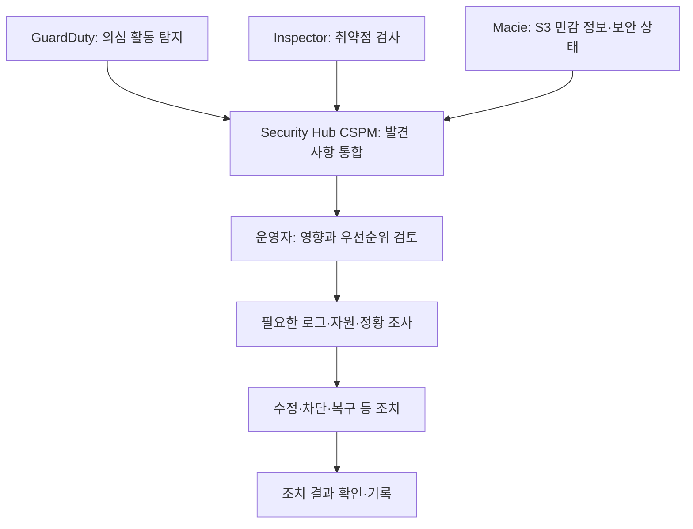

AWS 보안 서비스는 하나의 제품으로 모든 문제를 처리하는 구조가 아니다. 사용자 인증, 접근 권한, 암호화 키, 인증서, 비밀 정보, 위협 탐지와 감사 기록은 각각 다른 역할이다.

이 글에서는 주요 보안 및 자격 증명 서비스를 용도별로 정리한다. 각 항목에는 설명, 사용하기 좋은 상황, 간단한 예시를 포함했다. 사용 예시는 이해를 돕기 위한 가상 상황이다.

**자료 확인 기준: 2026년 10월 30일**

## 기본 개념

- **인증:** 사용자나 프로그램이 누구인지 확인하는 과정.
- **인가:** 확인된 주체가 어떤 작업을 할 수 있는지 판단하는 과정.
- **정책:** 허용·거부할 작업과 자원, 조건 등을 정의한 규칙.
- **역할:** 신뢰한 주체가 맡아 사용할 수 있는 AWS 권한의 구성 단위.
- **임시 자격 증명:** 유효 기간이 있는 접근 자격 정보.
- **암호화 키:** 데이터 암호화·복호화 등에 사용하는 키.
- **인증서:** 공개 키와 주체의 관계를 증명하는 정보.
- **시크릿:** DB 비밀번호·API 키 같은 비밀 정보.
- **발견 사항(Finding):** 서비스가 탐지·검사한 문제나 의심 정황에 대한 결과.

AWS와 사용자의 보안 책임은 이용 서비스에 따라 나뉜다. 예를 들어 일반적인 EC2 환경에서는 사용자가 게스트 운영체제와 애플리케이션을 관리하고, 관리형 서비스에서는 그 범위가 달라진다. 접근 권한과 데이터·구성 관리까지 모두 AWS에 맡겨지는 것은 아니다. [공식 자료: 공동 책임 모델](https://aws.amazon.com/compliance/shared-responsibility-model/)

## 사용자와 프로그램의 접근 권한

### AWS IAM — AWS 자원 접근 권한 관리

**AWS Identity and Access Management**의 약어다. 사용자·역할과 정책을 통해 AWS 자원 접근을 관리한다.

- **사용하기 좋은 상황:** 사람이나 애플리케이션에 필요한 AWS 작업 권한을 부여하는 경우.
- **예시:** Lambda 실행 역할에 특정 S3 경로를 읽는 권한만 부여한다.
- **구분할 점:** 사용자 로그인과 권한 부여는 다른 단계다. 루트 사용자는 일상 업무용 계정으로 사용하지 않는다.

[공식 문서: IAM](https://docs.aws.amazon.com/IAM/latest/UserGuide/introduction.html)

### AWS STS — 임시 자격 증명 발급

**AWS Security Token Service**의 약어다. 신뢰한 주체가 역할을 맡거나 연동 인증을 활용할 때 임시 자격 증명을 발급한다.

- **사용하기 좋은 상황:** 장기 액세스 키를 계속 배포하지 않고 기간이 정해진 AWS 접근을 제공하려는 경우.
- **예시:** 운영자가 다른 계정의 역할을 맡아 정해진 권한으로 작업한다.
- **구분할 점:** 임시 자격 증명도 권한과 만료 조건을 가진다. 발급받았다는 이유로 모든 AWS 작업이 허용되는 것은 아니다.

[공식 문서: 임시 자격 증명과 권한](https://docs.aws.amazon.com/IAM/latest/UserGuide/id_credentials_temp_control-access.html)

### AWS IAM Identity Center — 직원의 계정·애플리케이션 접근 관리

조직의 직원 신원을 여러 AWS 계정과 지원 애플리케이션의 접근에 연결한다. 외부 신원 공급자를 연계하거나 자체 사용자를 관리할 수 있다.

- **사용하기 좋은 상황:** 직원이 여러 AWS 계정에 접근하고 그룹별 권한을 통합 관리해야 하는 경우.
- **예시:** 개발팀은 개발 계정에, 운영팀은 운영 계정의 지정 권한으로 로그인하게 한다.
- **구분할 점:** 일반 고객용 웹 서비스의 회원 가입 기능과 직원의 AWS 업무 접근을 구분한다. 예전 이름인 AWS Single Sign-On(AWS SSO)으로 나오는 자료도 있다.

[공식 문서: IAM Identity Center](https://docs.aws.amazon.com/singlesignon/latest/userguide/what-is.html)

### Amazon Cognito — 웹·모바일 앱 사용자 인증

애플리케이션의 회원 디렉터리, 로그인과 연동 인증 등을 제공한다.

- **사용하기 좋은 상황:** 고객용 앱의 회원 가입·로그인과 토큰 기반 인증이 필요한 경우.
- **예시:** 쇼핑몰 고객이 로그인한 뒤 발급받은 토큰으로 API에 접근한다.
- **구분할 점:** **User Pool**은 사용자 인증과 토큰 발급, **Identity Pool**은 인증 정보 등을 바탕으로 AWS 자원 접근용 자격 증명을 제공하는 역할이다. 두 기능을 반드시 함께 써야 하는 것은 아니다.

[공식 문서: Amazon Cognito](https://docs.aws.amazon.com/cognito/latest/developerguide/what-is-amazon-cognito.html)

### AWS Directory Service — 디렉터리와 Active Directory 연계

Microsoft Active Directory 등의 디렉터리를 AWS 서비스·애플리케이션과 활용하도록 지원한다.

- **사용하기 좋은 상황:** 기존 AD 기반 사용자·그룹과 업무 애플리케이션을 사용해야 하는 경우.
- **예시:** Windows 업무 환경을 AWS Managed Microsoft AD와 연계한다.
- **구분할 점:** Managed Microsoft AD와 기존 디렉터리 연결 등 제공 방식의 차이를 확인한다. 모든 디렉터리 옵션이 동일한 기능을 제공하지는 않는다.

[공식 문서: AWS Directory Service](https://docs.aws.amazon.com/directoryservice/latest/admin-guide/what_is.html)

### IAM Roles Anywhere — AWS 외부 작업의 역할 기반 접근

AWS 밖의 서버·컨테이너 등이 X.509 인증서로 신뢰를 확인받고 임시 AWS 자격 증명을 얻도록 지원한다.

- **사용하기 좋은 상황:** 온프레미스 프로그램에 장기 AWS 키를 배포하는 방식을 줄이려는 경우.
- **예시:** 사내 배치 서버가 인증서를 이용해 역할의 임시 권한으로 S3에 파일을 올린다.
- **구분할 점:** 인증서·신뢰 앵커·역할과 해당 인증서의 수명 관리가 필요하다.

[공식 문서: IAM Roles Anywhere](https://docs.aws.amazon.com/rolesanywhere/latest/userguide/introduction.html)

### Amazon Verified Permissions — 애플리케이션의 세부 권한 판단

Cedar 정책 언어를 사용해 자체 애플리케이션의 권한 판단을 외부화한다.

- **사용하기 좋은 상황:** 서비스 안에서 사용자·역할·대상·조건에 따른 접근 규칙을 통합하려는 경우.
- **예시:** 로그인한 사용자가 특정 프로젝트의 문서를 수정할 수 있는지 판단한다.
- **구분할 점:** 인증은 다른 시스템에서 수행한 뒤 권한을 판단한다. AWS 자원의 IAM 권한이나 네트워크 접근 서비스인 Verified Access와 역할이 다르다.

[공식 문서: Amazon Verified Permissions](https://docs.aws.amazon.com/verifiedpermissions/latest/userguide/what-is-avp.html)

### AWS Resource Access Manager — 지원 자원의 계정 간 공유

**AWS RAM**이라고 부른다. 지원되는 자원을 여러 계정이나 조직 단위와 공유한다.

- **사용하기 좋은 상황:** 계정별로 같은 자원을 중복 생성하지 않고 공동 사용하려는 경우.
- **예시:** 조직의 네트워크 자원을 여러 업무 계정에 공유한다.
- **구분할 점:** 모든 AWS 자원을 동일한 방식으로 공유할 수 있는 것은 아니다. 공유 가능한 자원 유형과 권한 범위를 확인한다.

[공식 문서: AWS RAM](https://docs.aws.amazon.com/ram/latest/userguide/what-is.html)

### IAM Access Analyzer — 접근 경로·정책 분석

외부·내부 접근과 미사용 권한 등을 분석하고 정책 검증·생성을 지원하는 IAM 기능이다.

- **사용하기 좋은 상황:** 의도하지 않은 외부 공유나 과도한 권한을 검토하는 경우.
- **예시:** S3 버킷 정책이 조직 밖의 주체에게 접근을 허용하는지 확인한다.
- **구분할 점:** 실제 공격 활동 탐지와 권한 정책 분석은 다르다. 분석 유형별 대상과 범위를 확인한다.

[공식 문서: IAM Access Analyzer](https://docs.aws.amazon.com/IAM/latest/UserGuide/what-is-access-analyzer.html)

## 암호화 키·인증서·비밀 정보

### AWS KMS — 암호화 키와 암호 연산 관리

**AWS Key Management Service**의 약어다. 암호화·서명 등에 사용할 KMS 키와 사용 권한을 관리하고 지원 암호 연산을 제공한다.

- **사용하기 좋은 상황:** S3·EBS·데이터베이스 등의 암호화 키를 통제하거나 애플리케이션의 암호화 기능에 연계하는 경우.
- **예시:** 고객 관리형 KMS 키를 지정해 데이터 암호화와 키 사용 권한을 관리한다.
- **구분할 점:** KMS는 DB 비밀번호를 저장·교체하는 Secrets Manager와 역할이 다르다. 암호화된 데이터 접근에는 키 사용 권한도 필요할 수 있다.

[공식 문서: AWS KMS](https://docs.aws.amazon.com/kms/latest/developerguide/overview.html)

#### AWS 공식 그림: 데이터 키 생성

_KMS 키로 데이터 키의 암호화된 사본을 생성하는 과정. 출처: AWS KMS 개발자 안내서. 원본 이미지._

[이미지 출처: Generate data keys](https://docs.aws.amazon.com/kms/latest/developerguide/data-keys.html)

GenerateDataKey는 일반적으로 즉시 사용할 평문 데이터 키와 KMS 키로 암호화한 데이터 키 사본을 반환한다. 애플리케이션은 데이터 키로 데이터를 암호화하고, 암호화된 키 사본을 암호문과 함께 보관할 수 있다. 평문 데이터 키를 장기 보관하는 구조는 아니다.

이 과정에서 **KMS 키와 데이터 키는 다른 키**다. 데이터 키를 실제 데이터 암호화에 사용하는 작업과 데이터 키를 보호하는 작업을 구분한다. 그림은 KMS로 데이터 키를 생성하는 예시이며 모든 AWS 서비스의 내부 처리 순서가 동일하다는 뜻은 아니다.

### AWS CloudHSM — 전용 HSM 사용

암호화 키 저장과 연산에 사용할 단일 테넌트 HSM 환경을 제공한다. HSM은 암호화 키와 연산을 보호하는 하드웨어 보안 모듈이다.

- **사용하기 좋은 상황:** 전용 HSM과 암호화 인터페이스·키 관리에 대한 추가 제어가 필요한 경우.
- **예시:** 기존 HSM 연계 애플리케이션을 AWS의 HSM 클러스터에 연결한다.
- **구분할 점:** KMS와 관리 책임·사용 방식이 다르다. 사용자·키·클러스터 가용성 등 운영 요구를 함께 확인한다.

[공식 문서: AWS CloudHSM](https://docs.aws.amazon.com/cloudhsm/latest/userguide/introduction.html)

### AWS Secrets Manager — 비밀 정보의 보관·조회·교체

DB 자격 정보, API 키와 토큰 등의 수명 주기를 관리한다.

- **사용하기 좋은 상황:** 소스 코드나 설정 파일에 비밀번호를 고정하지 않고 실행 시 조회하려는 경우.
- **예시:** 애플리케이션이 DB 비밀번호를 조회하고 설정된 교체 절차로 비밀번호를 갱신한다.
- **구분할 점:** 자동 교체는 대상 시스템과 연동·설정이 필요하다. 값을 저장한 것만으로 모든 자격 정보가 자동 교체되지는 않는다.

[공식 문서: AWS Secrets Manager](https://docs.aws.amazon.com/secretsmanager/latest/userguide/intro.html)

### AWS Systems Manager Parameter Store — 설정값·보안 문자열 관리

계층형 이름으로 애플리케이션 설정과 값을 관리하는 Systems Manager 기능이다. SecureString은 KMS와 연계해 암호화한다.

- **사용하기 좋은 상황:** 여러 환경의 설정값과 일부 보안 문자열을 관리하려는 경우.
- **예시:** 개발·운영 환경별 설정 경로를 나눠 실행 시 조회한다.
- **구분할 점:** Secrets Manager의 비밀 정보 수명 주기·교체 기능과 필요한 수준을 비교한다.

[공식 문서: Parameter Store](https://docs.aws.amazon.com/systems-manager/latest/userguide/systems-manager-parameter-store.html)

### AWS Certificate Manager — TLS 인증서 관리

**ACM**이라고 부른다. TLS 인증서의 발급·저장·가져오기·갱신 등 관리를 지원한다.

- **사용하기 좋은 상황:** 지원되는 서비스나 서버에 HTTPS용 인증서를 제공하려는 경우.
- **예시:** ALB의 HTTPS 연결에 사용할 인증서를 구성한다.
- **구분할 점:** 공개·사설·가져온 인증서, 내보내기와 갱신 방식은 조건이 다르다. 모든 인증서가 같은 방식으로 자동 배포·갱신된다고 가정하지 않는다.

[공식 문서: AWS Certificate Manager](https://docs.aws.amazon.com/acm/latest/userguide/acm-overview.html)

### AWS Private CA — 사설 인증 기관 운영

사설 루트·하위 인증 기관을 구성하고 내부 인증서를 발급하도록 지원한다.

- **사용하기 좋은 상황:** 내부 서비스·장치에 조직이 신뢰하는 인증서를 발급하려는 경우.
- **예시:** 내부 서비스 간 상호 TLS에 사용할 인증서를 발급한다.
- **구분할 점:** 조직의 신뢰 체계로 사용하는 사설 인증서와 공개 브라우저가 기본 신뢰하는 인증서는 다르다.

[공식 문서: AWS Private CA](https://docs.aws.amazon.com/privateca/latest/userguide/PcaWelcome.html)

### AWS Payment Cryptography — 결제용 암호 연산

결제 처리에 필요한 암호 연산과 키 관리 기능을 제공한다.

- **사용하기 좋은 상황:** 결제 시스템의 PIN·키 등 결제 특화 암호 기능을 클라우드에서 처리하려는 경우.
- **예시:** 결제 처리 애플리케이션이 지원되는 결제 암호 API를 호출한다.
- **구분할 점:** 일반 데이터 암호화용 KMS와 결제 HSM 기능의 요구사항을 구분한다. 사용 자체가 전체 결제 시스템의 규정 준수를 보장하지는 않는다.

[공식 문서: AWS Payment Cryptography](https://docs.aws.amazon.com/payment-cryptography/latest/userguide/what-is.html)

### AWS Signer — 코드 서명

배포 코드의 출처와 무결성을 확인할 디지털 서명을 관리한다.

- **사용하기 좋은 상황:** 신뢰한 게시자가 서명한 배포물인지 확인해야 하는 경우.
- **예시:** Lambda 배포 패키지에 서명하고 배포 시 서명 검증을 적용한다.
- **구분할 점:** 서명은 출처·변조 여부 확인에 사용한다. 코드의 취약점이 없다는 뜻은 아니다.

[공식 문서: AWS Signer](https://docs.aws.amazon.com/signer/latest/developerguide/Welcome.html)

## 위협 탐지·취약점·민감 정보

### Amazon GuardDuty — 의심 활동 탐지

AWS의 지원 데이터 소스·로그와 위협 정보 등을 분석해 악의적이거나 의심스러운 활동을 탐지한다.

- **사용하기 좋은 상황:** 계정·워크로드의 비정상 활동을 지속적으로 탐지하려는 경우.
- **예시:** 유출된 자격 증명의 의심 사용이나 비정상 실행 활동에 대한 발견 사항을 확인한다.
- **구분할 점:** 탐지 기능별 지원 범위와 활성화 조건이 다르다. 탐지 결과가 나왔다고 모든 위협이 자동 차단·복구되는 것은 아니다.

[공식 문서: Amazon GuardDuty](https://docs.aws.amazon.com/guardduty/latest/ug/what-is-guardduty.html)

### Amazon Inspector — 취약점과 의도하지 않은 노출 검사

지원되는 EC2, ECR 이미지, Lambda 등에 대해 소프트웨어 취약점과 네트워크 노출을 검사한다.

- **사용하기 좋은 상황:** 배포된 소프트웨어의 취약 패키지와 지원 대상의 노출 문제를 관리하려는 경우.
- **예시:** 컨테이너 이미지에서 발견된 취약 라이브러리를 확인하고 수정 버전을 배포한다.
- **구분할 점:** 취약점 검사와 공격 활동 탐지는 다르다. 검사 대상과 유형에 따라 지원 범위를 확인한다.

[공식 문서: Amazon Inspector](https://docs.aws.amazon.com/inspector/latest/user/what-is-inspector.html)

### Amazon Macie — S3 민감 데이터 검색

S3 데이터의 민감 정보와 보안 상태를 파악하도록 지원한다.

- **사용하기 좋은 상황:** S3에 개인정보 등 민감 정보가 저장돼 있는지 확인하려는 경우.
- **예시:** 지원되는 문서 형식에서 민감 정보 패턴을 찾아 보관·접근 정책 검토에 활용한다.
- **구분할 점:** 모든 데이터베이스와 모든 파일을 무조건 검사하는 서비스는 아니다. 대상 버킷·객체·형식·검사 범위를 확인한다.

[공식 문서: Amazon Macie](https://docs.aws.amazon.com/macie/latest/user/what-is-macie.html)

### Amazon Detective — 보안 정황 조사

로그와 관계 정보를 모아 발견 사항이나 의심 활동의 맥락을 조사하도록 지원한다.

- **사용하기 좋은 상황:** 탐지된 사건과 관련된 주체·자원·활동을 함께 확인하려는 경우.
- **예시:** GuardDuty 발견 사항에서 관련 계정과 접속 활동을 조사한다.
- **구분할 점:** 자동 차단 제품이 아니라 조사·분석을 지원하는 서비스다.

[공식 문서: Amazon Detective](https://docs.aws.amazon.com/detective/latest/userguide/what-is-detective.html)

### AWS Security Hub CSPM — 보안 상태 검사·발견 사항 통합

보안 기준에 따른 구성 검사를 수행하고 여러 계정·서비스·지원 제품의 발견 사항을 통합한다. CSPM은 Cloud Security Posture Management의 약어다.

- **사용하기 좋은 상황:** 여러 서비스의 보안 문제와 기준 준수 상태를 한곳에서 검토하려는 경우.
- **예시:** GuardDuty·Inspector·Macie 결과와 보안 구성 검사 결과를 모아 우선순위를 정한다.
- **구분할 점:** 통합된 발견 사항과 각 탐지 서비스의 원본 데이터·검사 기능은 구분한다.

[공식 문서: Security Hub CSPM](https://docs.aws.amazon.com/securityhub/latest/userguide/what-is-securityhub.html)

현재 **AWS Security Hub** 제품 소개는 보안 신호를 통합·연관 분석해 주요 위험의 우선순위를 정하고 대응 흐름을 지원하는 범위를 안내한다. 오래된 자료의 Security Hub 명칭과 현재의 Security Hub·CSPM 표기를 확인하고 필요한 기능·플랜을 구분한다. [공식 제품 소개: AWS Security Hub](https://aws.amazon.com/security-hub/)

### Amazon Security Lake — 보안 데이터 레이크

AWS·다른 환경·지원 제품의 보안 데이터를 S3 기반 데이터 레이크로 모으고 표준화한다.

- **사용하기 좋은 상황:** 여러 보안 데이터 소스를 통합 보관하고 분석 도구에 제공하려는 경우.
- **예시:** 지원 로그를 OCSF 형식으로 정규화해 보안 분석에 활용한다.
- **구분할 점:** 발견 사항을 통합하는 Security Hub CSPM과 로그·이벤트 데이터를 모으는 데이터 레이크의 역할은 다르다.

[공식 문서: Amazon Security Lake](https://docs.aws.amazon.com/security-lake/latest/userguide/what-is-security-lake.html)

### AWS Security Incident Response — 보안 사고 대응 지원

기존 탐지 소스의 결과를 분류·조사하고 사고 대응 과정의 지원과 안내를 제공하는 관리형 서비스다.

- **사용하기 좋은 상황:** 사고 분류·조사·대응 과정에서 관리형 지원이 필요한 경우.
- **예시:** 탐지 결과에 대한 조사와 대응 권고를 받아 담당자가 후속 조치를 수행한다.
- **구분할 점:** 서비스 이용 범위와 고객의 조치 책임을 확인한다. 모든 복구 작업을 대신 실행하는 서비스로 가정하지 않는다.

[공식 문서: AWS Security Incident Response](https://docs.aws.amazon.com/security-ir/latest/userguide/)

### 탐지 결과 처리 흐름 예시

직접 작성한 Mermaid다. 검사·탐지, 결과 통합, 조사·조치의 역할을 구분하기 위한 예시이며 AWS 공식 구조도는 아니다.

연결은 지원되는 연동과 설정을 전제로 한다. 발견 사항이 생성되었다는 사실과 실제 사고인지 판단하는 일, 운영 자원을 변경하는 일은 서로 다른 단계다.

## 네트워크·웹 접근 보호

네트워크 글에서 다룬 서비스도 보안 목적에 따라 구분할 수 있다.

- **AWS WAF:** 지원 웹 서비스의 요청을 규칙으로 검사한다. 예: ALB에 웹 ACL을 연결해 공격 패턴을 필터링한다.
- **AWS Shield:** DDoS 보호 기능이다. 예: 공개 서비스에 필요한 Standard·Advanced 보호 범위를 비교한다.
- **AWS Firewall Manager:** 여러 계정의 지원 보안 정책을 통합 관리한다. 예: 조직에 공통 WAF 정책을 적용한다.

웹 요청 검사, DDoS 대응, 정책 통합은 서로 다른 역할이다. [공식 문서: WAF·Shield·Firewall Manager](https://docs.aws.amazon.com/waf/latest/developerguide/what-is-aws-waf.html)

**AWS Network Firewall**은 VPC 네트워크 트래픽 검사 기능이다. 예를 들어 외부 통신이 방화벽을 지나도록 라우팅하고 규칙을 적용한다. 방화벽을 생성하는 것 외에 실제 통신 경로 구성도 필요하다. [공식 문서: Network Firewall](https://docs.aws.amazon.com/network-firewall/latest/developerguide/what-is-aws-network-firewall.html)

## 감사·기록·계정 관리

### AWS CloudTrail — API 활동 기록

AWS 계정의 지원 활동과 API 사용을 기록한다.

- **사용하기 좋은 상황:** 누가 어떤 자원에 어떤 작업을 수행했는지 조사하려는 경우.
- **예시:** 보안 그룹 변경 시점과 요청 주체를 확인한다.
- **구분할 점:** 기록할 이벤트 종류·대상과 보관 구성을 확인한다. 모든 데이터 접근이 기본 설정으로 장기 보관되는 것은 아니다.

[공식 문서: AWS CloudTrail](https://docs.aws.amazon.com/awscloudtrail/latest/userguide/cloudtrail-user-guide.html)

### AWS Config — 자원 구성 이력과 규칙 평가

지원 자원의 구성 상태·변경 관계를 기록하고 규칙 등으로 평가한다.

- **사용하기 좋은 상황:** 자원의 설정이 조직 기준에 맞는지 지속 확인하려는 경우.
- **예시:** 특정 자원의 암호화 설정이나 허용된 구성 여부를 평가한다.
- **구분할 점:** API 활동 기록과 자원 구성 상태 평가는 다르다. 평가 결과를 확인하는 것과 수정 실행도 구분한다.

[공식 문서: AWS Config](https://docs.aws.amazon.com/config/latest/developerguide/WhatIsConfig.html)

### AWS Artifact — 보안·규정 준수 문서 확인

AWS의 보안·규정 준수 보고서와 관련 계약 등을 확인하도록 지원한다.

- **사용하기 좋은 상황:** AWS 측 통제와 보고 자료를 확인해야 하는 경우.
- **예시:** 내부 검토를 위해 필요한 AWS 보고서를 내려받는다.
- **구분할 점:** 사용자의 자원 설정을 직접 스캔하거나 인증을 자동 취득하는 서비스는 아니다.

[공식 문서: AWS Artifact](https://docs.aws.amazon.com/artifact/latest/ug/what-is-aws-artifact.html)

### AWS Audit Manager — 신규 이용 제한이 있는 감사 지원

AWS 사용과 통제 기준에 대한 증거 수집·검토·보고를 지원한다.

- **기존 활용 예시:** 통제별 증거를 모아 감사 평가와 보고서 작성에 활용한다.
- **현재 상태:** **2026년 4월 30일부터 신규 계정 설정이 제한된 유지 관리 모드**다.
- **구분할 점:** 기존 이용도 단일 계정·조직 구성에 따라 추가 계정·리전 확대 조건이 다르다. 현재 신규 도입 가능한 서비스처럼 소개하지 않는다.

[공식 문서: Audit Manager](https://docs.aws.amazon.com/audit-manager/latest/userguide/what-is.html), [제공 상태 변경](https://docs.aws.amazon.com/audit-manager/latest/userguide/audit-manager-availability-change.html)

### AWS Organizations — 여러 AWS 계정 관리

계정을 조직과 조직 단위로 구성하고 정책·결제 등을 관리한다.

- **사용하기 좋은 상황:** 개발·운영·보안 등의 계정을 나눠 통합 관리하려는 경우.
- **예시:** 조직 단위별로 사용 가능한 작업의 경계를 정책으로 제한한다.
- **구분할 점:** 조직 정책과 개별 사용자·역할에 권한을 부여하는 IAM 정책은 역할이 다르다.

[공식 문서: AWS Organizations](https://docs.aws.amazon.com/organizations/latest/userguide/orgs_introduction.html)

### AWS Control Tower — 다중 계정 환경 구성과 통제

여러 AWS 계정의 기본 환경과 통제를 설정·관리하도록 지원한다.

- **사용하기 좋은 상황:** 조직의 계정 생성과 기준 설정을 일관되게 관리하려는 경우.
- **예시:** 신규 업무 계정을 정해진 기준으로 생성하고 통제를 적용한다.
- **구분할 점:** Organizations를 포함한 여러 서비스를 활용하는 환경 관리 기능이다. 모든 보안 운영과 애플리케이션 설정을 자동 완성하는 것은 아니다.

[공식 문서: AWS Control Tower](https://docs.aws.amazon.com/controltower/latest/userguide/what-is-control-tower.html)

## 권한 정책을 읽을 때 구분할 항목

- **신원 기반 정책:** 사용자·역할 등에 연결해 작업 권한을 정의한다.
- **자원 기반 정책:** 지원 자원에 연결해 접근 주체와 조건을 정의한다.
- **역할 신뢰 정책:** 누가 해당 역할을 맡을 수 있는지 정의한다.
- **권한 경계(Permissions Boundary):** 해당 IAM 주체의 신원 기반 정책으로 부여할 수 있는 권한 상한을 정한다.
- **SCP:** 조직의 적용 대상 계정·주체에 사용할 수 있는 권한의 경계를 정한다.

권한 경계나 SCP에 작업을 허용했다고 그 자체로 실행 권한이 부여되지는 않는다. 실제 허용 여부는 적용되는 정책과 명시적 거부, 자원 정책·세션 조건 등을 함께 평가한다. 단순히 정책 하나의 Allow만 읽고 판단하지 않는다. [공식 문서: IAM 정책과 권한](https://docs.aws.amazon.com/IAM/latest/UserGuide/access_policies.html), [SCP](https://docs.aws.amazon.com/organizations/latest/userguide/orgs_manage_policies_scps.html)

## 오래된 자료에서 확인할 항목

**Amazon Inspector Classic**은 현재의 Amazon Inspector와 구분한다. 공식 종료 목록에는 Inspector Classic이 **2026년 5월 20일** 종료된 것으로 표시돼 있다. 현재 Inspector까지 종료됐다는 뜻은 아니다. [공식 자료: 종료된 AWS 서비스](https://docs.aws.amazon.com/general/latest/gr/full_shutdown_services.html)

앞의 Audit Manager처럼 신규 이용 제한과 서비스 전체 종료도 구분해야 한다.

## 요구사항별 비교

- **AWS 자원 권한 관리:** IAM
- **기간이 정해진 AWS 자격 증명:** STS
- **직원의 여러 계정·업무 앱 접근:** IAM Identity Center
- **고객용 앱 로그인·인증:** Cognito
- **기존 AD 디렉터리 활용:** Directory Service
- **AWS 외부 작업의 인증서 기반 역할 접근:** Roles Anywhere
- **앱 내부의 세부 권한 판단:** Verified Permissions
- **지원 자원의 계정 간 공유:** RAM
- **정책·접근 범위 분석:** IAM Access Analyzer
- **암호화 키 관리·연산:** KMS
- **전용 HSM:** CloudHSM
- **비밀번호·API 키 관리:** Secrets Manager
- **TLS 인증서 관리·사설 발급 기관:** ACM·Private CA
- **의심 활동·취약점·S3 민감 정보 확인:** GuardDuty·Inspector·Macie
- **발견 사항 통합·조사·데이터 통합:** Security Hub CSPM·Detective·Security Lake
- **활동 기록·구성 평가·문서 확인:** CloudTrail·Config·Artifact

보호하려는 대상과 필요한 기능을 먼저 정한 뒤 지원 범위, 활성화 조건, 리전, 연동·보관 정책과 비용을 확인한다. 검사를 활성화한 것과 발견 사항을 실제로 해결한 것은 다른 상태다.

## SAA 학습에서 구분할 내용

공식 SAA-C03 시험 범위에는 IAM, IAM Identity Center, Cognito, Directory Service, KMS, CloudHSM, ACM, Secrets Manager, GuardDuty, Inspector, Macie, Detective, Security Hub, RAM, Artifact와 네트워크 보호 서비스 등이 포함된다. CloudTrail·Config·Organizations·Control Tower는 관리·거버넌스 분야에도 나온다.

시험 목록은 모든 기능을 빠짐없이 나열한 자료나 출제 빈도 순위가 아니다. 최신 서비스 명칭·제공 상태와 시험 범위 표기를 함께 확인한다. [공식 자료: SAA-C03 시험 범위](https://docs.aws.amazon.com/aws-certification/latest/solutions-architect-associate-03/saa-03-in-scope-services.html)

비교하면서 정리할 항목은 다음과 같다.

- 인증과 인가, 사람과 프로그램의 접근
- IAM 사용자·역할·STS 임시 자격 증명
- Identity Center와 Cognito, User Pool과 Identity Pool
- KMS·CloudHSM·Secrets Manager·ACM의 역할
- KMS 키와 데이터 키, 키 정책과 자원 접근 권한
- GuardDuty·Inspector·Macie의 검사 대상
- Security Hub CSPM·Detective·Security Lake의 역할
- CloudTrail·Config·Artifact의 기록·평가·문서 차이
- IAM 정책·자원 정책·역할 신뢰 정책·SCP의 적용 목적

서비스를 선택할 때는 누가 어떤 자원에 어떤 작업을 해야 하는지, 무엇을 보호·탐지·기록해야 하는지부터 구분하면 된다.

