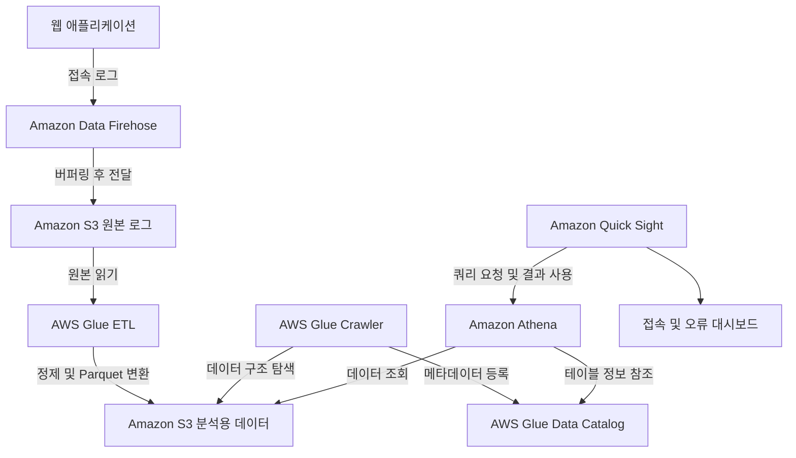

AWS의 분석 서비스는 데이터를 모으고, 가공하고, 조회하고, 결과를 공유하는 데 사용한다. 이름이 비슷해도 맡는 작업은 다르다. Kinesis Data Streams는 이벤트를 전달하는 스트림이고, Athena는 데이터를 SQL로 조회하는 서비스이며, Quick Sight는 조회 결과를 대시보드로 보여주는 BI 기능이다.

이 글에서는 분석 과정에 따라 서비스의 역할과 사용 예시를 정리한다. 예시는 설명을 위한 가상 상황이다. 서비스 명칭과 제공 상태는 2026년 10월 30일에 확인한 AWS 공식 문서를 기준으로 작성했다.

## 분석에서 구분할 기본 개념

### 배치 처리와 스트림 처리

**배치 처리**는 일정 기간의 데이터를 모아서 처리하는 방식이다. 하루치 주문 파일을 새벽에 정리해 일별 매출을 계산하는 작업이 해당한다.

**스트림 처리**는 계속 들어오는 이벤트를 지속적으로 처리하는 방식이다. 주문 이벤트를 받아 최근 5분 동안의 결제 실패 비율을 계산하는 작업이 해당한다.

스트림을 사용한다고 전체 결과가 항상 즉시 반영되는 것은 아니다. 수집, 버퍼링, 처리, 저장, 대시보드 갱신 단계마다 지연이 발생할 수 있다.

### ETL과 ELT

**ETL**은 데이터를 추출하고 변환한 뒤 목적지에 적재하는 방식이다. 원본 CSV에서 잘못된 값을 정리하고 Parquet 파일로 바꿔 S3에 저장하는 작업을 예로 들 수 있다.

**ELT**는 먼저 데이터를 적재하고, 적재한 시스템의 연산 기능으로 변환하는 방식이다. 원본 데이터를 Redshift에 넣은 뒤 SQL로 분석용 테이블을 만드는 작업이 해당한다.

어느 방식이 더 좋은지는 원본의 형태, 처리량, 필요한 변환, 사용하는 분석 엔진에 따라 달라진다.

### 데이터 레이크, 데이터 웨어하우스, 레이크하우스

**데이터 레이크**는 다양한 형태의 데이터를 저장하고 여러 분석 도구에서 사용하는 구성이다. AWS에서는 S3가 저장 계층으로 자주 사용된다.

**데이터 웨어하우스**는 여러 출처의 데이터를 분석 목적에 맞게 구성하고 SQL로 집계하는 시스템이다. Redshift가 대표적이다.

**레이크하우스**는 데이터 레이크와 웨어하우스의 특성을 결합하는 아키텍처다. AWS의 SageMaker 레이크하우스 아키텍처는 S3와 Redshift 데이터에 대한 접근을 통합하고 Apache Iceberg와 공통 카탈로그를 활용한다. 모든 데이터를 하나의 새 저장소로 복사한다는 뜻은 아니다. [공식 자료: SageMaker 레이크하우스 아키텍처](https://docs.aws.amazon.com/sagemaker-lakehouse-architecture/latest/userguide/what-is-smlh.html)

## 데이터 수집과 전달

### Amazon Kinesis Data Streams

많은 생산자가 보내는 이벤트를 수집하고, 이를 소비하는 애플리케이션으로 전달하는 관리형 데이터 스트리밍 서비스다.

- **사용하기 좋은 상황:** 클릭, 주문, 센서 이벤트를 계속 수집하고 여러 처리 애플리케이션에서 사용해야 할 때.
- **간단한 예시:** 쇼핑몰의 주문 이벤트를 스트림에 기록한다. 한 소비자는 실시간 매출을 계산하고, 다른 소비자는 이상 주문을 탐지한다.
- **구분할 점:** 스트림 자체가 업무 분석 코드를 대신 작성하지는 않는다. Lambda, Flink 또는 직접 만든 소비자가 처리 로직을 실행한다. 재처리는 스트림에 데이터가 보존되는 기간 안에서 설계한다.

[공식 자료: Kinesis Data Streams 개요](https://docs.aws.amazon.com/streams/latest/dev/introduction.html)

### Amazon Managed Streaming for Apache Kafka — Amazon MSK

Apache Kafka 기반의 이벤트 스트리밍 환경을 AWS에서 운영하는 관리형 서비스다. Kafka의 토픽, 생산자, 소비자와 기존 생태계를 활용한다.

- **사용하기 좋은 상황:** 기존 시스템이 Kafka를 사용하거나 Kafka API와 도구의 호환성이 중요할 때.
- **간단한 예시:** 주문·재고·배송 시스템이 Kafka 토픽으로 이벤트를 주고받는다. 자체 운영하던 Kafka를 MSK로 옮겨 인프라 운영 부담을 줄인다.
- **구분할 점:** Kinesis Data Streams와 모두 스트리밍에 사용하지만 API와 운영 방식은 다르다. MSK에는 Provisioned와 Serverless 옵션이 있으며, 애플리케이션의 토픽 설계와 소비자 처리까지 자동으로 해결되는 것은 아니다.

MSK Connect는 Kafka Connect 기반 연결을, MSK Replicator는 지원되는 MSK 클러스터 간 복제를 제공하는 관련 기능이다. 각각 별도 분석 엔진으로 세지 않는다.

[공식 자료: Amazon MSK 개요](https://docs.aws.amazon.com/msk/latest/developerguide/what-is-msk.html)

### Amazon Data Firehose

들어오는 스트리밍 데이터를 S3, Redshift, OpenSearch 등 지원되는 목적지로 전달하는 관리형 서비스다. 이전 자료에서는 Kinesis Data Firehose라는 이름이 사용된다.

- **사용하기 좋은 상황:** 이벤트를 저장소나 분석 시스템에 전달하고 싶고, 전용 전달 애플리케이션의 운영을 줄이고 싶을 때.
- **간단한 예시:** 웹 애플리케이션에서 발생하는 접속 로그를 Firehose로 보내고 S3에 모아 둔다.
- **구분할 점:** 일반적으로 크기나 시간 기준으로 데이터를 버퍼링해 전달하므로, 이벤트마다 즉시 실행되는 처리와 구분한다. 지원되는 변환 기능은 있지만 복잡한 상태 기반 스트림 연산은 Flink 같은 처리 엔진의 역할이다.

[공식 자료: Amazon Data Firehose 개요와 데이터 흐름](https://docs.aws.amazon.com/firehose/latest/dev/what-is-this-service.html)

### 공식 이미지: Firehose에서 Redshift로 전달하는 과정

_Amazon Data Firehose의 Redshift 전달 구조. AWS 공식 문서의 원본 이미지._

[이미지 출처: Amazon Data Firehose — Understand data flow](https://docs.aws.amazon.com/firehose/latest/dev/what-is-this-service.html)

이 그림에서 확인할 부분은 **중간 S3 버킷**이다. Firehose가 Redshift 목적지로 데이터를 전달할 때는 먼저 S3에 저장한 뒤 Redshift의 COPY 명령으로 적재한다. 목적지가 Redshift라고 해서 S3를 거치지 않는 것은 아니다.

점선은 선택적 구성이나 데이터 흐름을 나타낸다. 변환을 활성화한 경우 원본 데이터를 별도 S3 버킷에 백업할 수 있다. 중간 적재 버킷과 원본 백업 버킷은 목적이 다르다.

## 데이터 가공과 실행 관리

### AWS Glue

데이터를 찾아 카탈로그에 등록하고, 분석에 맞게 변환하는 데이터 통합 서비스다. ETL 작업과 메타데이터 관리를 함께 제공한다.

- **사용하기 좋은 상황:** 여러 출처의 데이터를 정리하고 공통 형식으로 변환하는 작업을 반복해야 할 때.
- **간단한 예시:** S3에 쌓인 주문 CSV에서 중복과 잘못된 값을 처리한 뒤 날짜별 Parquet 파일로 저장한다.
- **구분할 점:** Glue의 구성 요소마다 역할이 다르다. 크롤러는 데이터 구조를 탐색하고, Data Catalog는 메타데이터를 관리하며, ETL 작업은 실제 변환을 수행한다.

**Glue Data Catalog**에는 테이블의 스키마, 데이터 위치, 파티션 같은 정보가 들어간다. 원본 데이터 전체를 카탈로그에 저장하는 구조가 아니다. 크롤러로 테이블을 등록했다고 CSV가 자동으로 Parquet로 바뀌는 것도 아니다.

Glue는 배치 ETL뿐 아니라 지원되는 스트림 소스를 사용하는 Streaming ETL도 제공한다. [공식 자료: AWS Glue 구성 요소](https://docs.aws.amazon.com/glue/latest/dg/components-overview.html)

### AWS Glue DataBrew

코드를 작성하지 않고 화면에서 데이터를 정리하고 표준화하는 데이터 준비 도구다. 변환 단계를 레시피로 저장해 다시 사용할 수 있다.

- **사용하기 좋은 상황:** 분석 담당자가 결측값, 날짜 형식, 잘못된 값 등을 시각적으로 확인하며 정리하고 싶을 때.
- **간단한 예시:** 부서마다 다르게 작성한 고객 CSV의 날짜 표기와 국가 코드를 통일한다. 변환 레시피를 저장해 다음 달 파일에도 적용한다.
- **구분할 점:** 화면에서 확인하는 미리보기와 전체 데이터에 실행하는 작업을 구분해야 한다. 준비된 결과 데이터는 S3에 저장해 후속 분석에 사용한다.

[공식 자료: AWS Glue DataBrew 개요](https://docs.aws.amazon.com/databrew/latest/dg/what-is.html)

### Amazon EMR

Apache Spark, Hadoop 등 오픈 소스 프레임워크로 대규모 데이터를 처리하는 서비스다.

- **사용하기 좋은 상황:** 기존 Spark·Hadoop 작업을 AWS에서 실행하거나, 프레임워크와 실행 환경의 선택이 중요할 때.
- **간단한 예시:** 수개월치 서비스 로그를 Spark로 처리해 사용자별 이용 패턴을 계산하고 결과를 S3에 저장한다.
- **구분할 점:** EMR이 항상 EC2 클러스터를 직접 관리해야 하는 형태인 것은 아니다. EMR on EC2, EMR on EKS, EMR Serverless 같은 실행 옵션을 작업과 운영 조건에 맞춰 선택한다.

Glue와 EMR은 모두 Spark 기반 처리에 사용할 수 있다. 데이터 통합 기능과 카탈로그 중심의 ETL을 우선하면 Glue를, 기존 오픈 소스 작업과 실행 환경 요구가 중요하면 EMR을 비교할 수 있다. 어느 한쪽만 ETL이 가능한 것은 아니다.

[공식 자료: Amazon EMR 개요](https://docs.aws.amazon.com/emr/latest/ManagementGuide/emr-what-is-emr.html) · [EMR on EKS](https://docs.aws.amazon.com/emr/latest/EMR-on-EKS-DevelopmentGuide/emr-eks.html) · [EMR Serverless](https://docs.aws.amazon.com/emr/latest/EMR-Serverless-UserGuide/)

### Amazon Managed Service for Apache Flink

Apache Flink 애플리케이션을 실행해 지속적으로 들어오는 데이터를 처리하는 관리형 서비스다. 시간 구간별 집계나 상태를 유지하는 처리에 사용한다.

- **사용하기 좋은 상황:** 최근 몇 분간의 지표를 계속 갱신하거나, 여러 이벤트를 연결해 실시간 조건을 판단해야 할 때.
- **간단한 예시:** Kinesis Data Streams로 수집한 결제 이벤트에서 최근 5분간의 실패율을 계산한다.
- **구분할 점:** Kinesis Data Streams나 MSK는 이벤트를 담고 전달하며, Flink는 이벤트를 읽어 연산한다. 운영 인프라가 관리형이어도 이벤트 시간, 지연 도착, 체크포인트와 처리 로직은 설계해야 한다.

오래된 자료의 Kinesis Data Analytics 명칭만 보고 SQL 전용 서비스와 현재 Flink 서비스를 동일하게 보면 안 된다. 종료된 SQL 서비스의 상태는 글 하단에서 따로 구분한다.

[공식 자료: Managed Service for Apache Flink 개요](https://docs.aws.amazon.com/managed-flink/latest/java/what-is.html)

### Amazon Managed Workflows for Apache Airflow — Amazon MWAA

Apache Airflow 워크플로를 실행하고 관리하는 서비스다. Python으로 작업 간 의존성과 실행 일정을 정의한다.

- **사용하기 좋은 상황:** 데이터 수집, 변환, 적재, 품질 확인을 순서에 맞게 실행하고 실패한 단계를 관리해야 할 때.
- **간단한 예시:** 원본 파일 도착을 확인한 뒤 Glue 작업을 실행하고, 성공하면 분석용 테이블을 갱신한다.
- **구분할 점:** MWAA는 작업의 실행 순서를 조정하는 역할이다. 대규모 데이터 변환은 Glue나 EMR 같은 서비스에 맡길 수 있다. 작업을 예약하는 도구와 데이터를 처리하는 엔진을 구분하면 된다.

[공식 자료: Amazon MWAA 개요](https://docs.aws.amazon.com/mwaa/latest/userguide/what-is-mwaa.html)

## 데이터 조회와 시각화

### Amazon Athena

S3 등에 있는 데이터를 SQL로 조회하는 서버리스 분석 서비스다. 별도의 상시 SQL 서버를 구성하지 않고 필요한 조회를 실행할 수 있다.

- **사용하기 좋은 상황:** S3에 저장한 로그나 파일을 수시로 조회하고 싶을 때.
- **간단한 예시:** S3의 접속 로그에서 특정 날짜에 오류가 많이 발생한 URL을 SQL로 집계한다.
- **구분할 점:** Athena는 조회 엔진이고 S3는 저장 계층이다. S3의 데이터를 Athena 내부 데이터베이스로 모두 복사해야만 조회할 수 있는 것은 아니다. Athena는 SQL 외에 Apache Spark 실행 기능도 제공한다.

파일 형식과 데이터 배치도 중요하다. 날짜 파티션을 조건에 맞게 사용하고 Parquet·ORC 같은 열 형식으로 저장하면 불필요하게 읽는 데이터를 줄일 수 있다. 크롤러 등록만으로 이 최적화가 완료되지는 않는다.

[공식 자료: Amazon Athena 개요](https://docs.aws.amazon.com/athena/latest/ug/what-is.html) · [데이터 최적화](https://docs.aws.amazon.com/athena/latest/ug/performance-tuning-data-optimization-techniques.html)

### Amazon Redshift

여러 출처의 데이터를 모아 SQL로 분석하는 관리형 데이터 웨어하우스 서비스다. Provisioned와 Serverless 옵션을 제공한다.

- **사용하기 좋은 상황:** 여러 시스템의 데이터를 결합해 반복적인 집계와 BI 분석을 수행해야 할 때.
- **간단한 예시:** 주문, 상품, 광고비 데이터를 분석용 테이블로 구성하고 상품군별 매출과 광고 효율을 계산한다.
- **구분할 점:** 주문 한 건의 결제를 처리하는 트랜잭션 데이터베이스와 분석용 웨어하우스는 주된 목적이 다르다. Redshift는 대량 데이터의 집계·분석 관점에서 검토한다.

Athena와 Redshift를 데이터 크기 하나만으로 선택하면 부족하다. 조회 빈도, 동시 사용자, 데이터 모델, 변환 위치, 운영 방식과 비용을 함께 비교해야 한다. Redshift도 외부 데이터를 조회할 수 있으므로 단순히 파일 조회와 내부 데이터 조회로만 나누지는 않는다.

[공식 자료: Amazon Redshift 개요](https://docs.aws.amazon.com/redshift/latest/mgmt/welcome.html)

### Amazon OpenSearch Service

OpenSearch 기반 검색과 분석 환경을 제공하는 관리형 서비스다. 로그 분석, 애플리케이션 모니터링, 검색 등에 사용한다.

- **사용하기 좋은 상황:** 로그 메시지를 검색하고 시간대·서비스별로 집계하거나 검색 기능을 제공해야 할 때.
- **간단한 예시:** 여러 애플리케이션의 오류 로그를 인덱싱하고 오류 코드, 발생 시각, 서버별로 검색한다.
- **구분할 점:** S3에 파일을 보관하는 구성과 검색 인덱스를 유지하는 구성은 비용과 목적이 다르다. 장기 원본 보관과 빠른 검색을 위해 두 계층을 함께 사용할 수도 있다.

분석 목적으로 사용하더라도 인덱스 설계와 보존 기간은 중요하다. 모든 원본 데이터를 같은 검색 계층에 무기한 유지할 필요는 없다.

[공식 자료: Amazon OpenSearch Service 개요](https://docs.aws.amazon.com/opensearch-service/latest/developerguide/what-is.html)

### Amazon Quick Sight — Amazon Quick의 BI 기능

데이터를 시각화하고 대시보드로 공유하는 BI 기능이다. 기존 Amazon QuickSight는 현재 공식 문서에서 **Amazon Quick 안의 Amazon Quick Sight**로 안내된다. 기존 QuickSight API와 SDK, 연동은 유지된다.

- **사용하기 좋은 상황:** 분석 결과를 차트와 지표로 제공하고 여러 사용자가 같은 기준으로 조회하게 하고 싶을 때.
- **간단한 예시:** Athena나 Redshift의 매출 데이터를 연결해 날짜·상품군별 대시보드를 제공한다.
- **구분할 점:** Quick Sight는 데이터를 수집하는 스트림이나 범용 ETL 엔진을 대신하는 것이 아니다. 원본 데이터와 분석용 데이터셋을 준비하고 적절한 접근 권한을 설정해야 한다.

Amazon Quick은 BI 외에도 연구, 자동화, 에이전트 등으로 범위가 확장된 서비스다. 이 글에서는 분석 결과의 시각화와 공유에 해당하는 Quick Sight를 다룬다. 자료에서 QuickSight, Quick Suite, Quick이라는 이름이 보이면 문서 시점과 기능 범위를 확인하는 편이 좋다.

[공식 자료: Amazon Quick 개요와 Quick Sight 명칭](https://docs.aws.amazon.com/quick/latest/userguide/what-is.html) · [Quick Sight FAQ](https://aws.amazon.com/quick/quicksight/faqs/)

## 데이터 권한, 검색, 공유

### AWS Lake Formation

데이터 레이크의 데이터와 Glue Data Catalog 메타데이터에 대한 접근 권한을 중앙에서 관리하는 서비스다.

- **사용하기 좋은 상황:** 여러 팀이 같은 데이터 레이크를 사용하지만 볼 수 있는 테이블·열·행의 범위를 다르게 관리해야 할 때.
- **간단한 예시:** 분석팀에는 주문 금액을 조회하도록 허용하고, 고객 식별 정보가 담긴 열은 제한한다.
- **구분할 점:** Lake Formation은 실제 파일을 저장하는 S3나 쿼리를 실행하는 Athena를 대체하지 않는다. 지원되는 서비스 통합을 통해 세분화한 권한을 적용한다. IAM, S3, KMS 권한도 함께 고려해야 한다.

[공식 자료: AWS Lake Formation 개요](https://docs.aws.amazon.com/lake-formation/latest/dg/what-is-lake-formation.html)

### Amazon DataZone

조직의 데이터를 카탈로그로 정리하고, 검색·공유·접근 요청을 관리하는 데이터 관리 서비스다. 기술적인 테이블 정보에 업무 용어와 설명을 더해 데이터를 찾기 쉽게 한다.

- **사용하기 좋은 상황:** 데이터가 여러 부서에 나뉘어 있고, 사용자가 필요한 데이터를 찾고 승인받는 절차를 정리해야 할 때.
- **간단한 예시:** 마케팅 담당자가 매출 데이터를 검색하고 소유 부서에 사용을 요청한다. 승인된 데이터로 분석 작업을 진행한다.
- **구분할 점:** 데이터를 찾고 요청하는 업무 흐름과 저장소의 실제 권한 적용을 구분해야 한다. DataZone은 Lake Formation 등과 연동해 데이터 공유를 관리한다.

[공식 자료: Amazon DataZone 개요](https://docs.aws.amazon.com/datazone/latest/userguide/what-is-datazone.html)

### AWS Data Exchange

다른 조직과 데이터 사용 권한을 주고받고 관리하는 서비스다. AWS Marketplace 데이터 상품의 구독과 데이터 그랜트를 지원한다.

- **사용하기 좋은 상황:** 외부 기관의 데이터셋을 구독하거나 자체 데이터를 다른 조직에 제공해야 할 때.
- **간단한 예시:** 외부에서 제공하는 지역별 통계 데이터셋의 사용 권한을 확보해 내부 매출 분석에 결합한다.
- **구분할 점:** 데이터 교환과 사용 권한 관리가 중심이다. 제공받은 데이터의 계산·분석은 Athena나 Redshift 등 적합한 도구에서 수행한다. 사용할 수 있는 형식과 권리는 각 데이터 상품·그랜트의 조건을 확인한다.

[공식 자료: AWS Data Exchange 개요](https://docs.aws.amazon.com/data-exchange/latest/userguide/what-is.html)

### AWS Clean Rooms

여러 조직이 원본 데이터를 서로 공개하는 범위를 제한하면서 공동 분석을 수행하도록 돕는 서비스다. 참여자와 분석 규칙, 결과 제한을 구성한다.

- **사용하기 좋은 상황:** 협력사와 데이터를 함께 분석해야 하지만 원본 데이터 전체를 서로 전달하고 싶지 않을 때.
- **간단한 예시:** 광고사와 판매사가 허용된 집계 규칙 안에서 광고 노출 고객의 구매 결과를 분석한다.
- **구분할 점:** 서비스를 사용한다는 사실만으로 모든 식별 위험이 사라지는 것은 아니다. 허용할 쿼리, 출력 범위와 개인정보 보호 제어를 목적에 맞게 설정해야 한다.

Data Exchange가 데이터 제공과 사용 권한 관리에 중점을 둔다면, Clean Rooms는 통제된 공동 분석에 중점을 둔다.

[공식 자료: AWS Clean Rooms 개요](https://docs.aws.amazon.com/clean-rooms/latest/userguide/what-is.html)

## 분석과 AI를 함께 사용하는 환경

### Amazon SageMaker Unified Studio와 레이크하우스 아키텍처

SageMaker Unified Studio는 데이터 처리, 분석, AI·ML 도구를 하나의 개발 환경에서 사용하는 통합 경험이다. 프로젝트 안에서 데이터와 작업을 공유하며 협업할 수 있다.

- **사용하기 좋은 상황:** 데이터 엔지니어, 분석가, ML 담당자가 공통 데이터와 도구를 사용하며 협업해야 할 때.
- **간단한 예시:** 엔지니어가 준비한 판매 데이터를 분석가가 SQL로 확인하고, ML 담당자가 같은 승인된 데이터에 접근해 수요 예측 작업을 진행한다.
- **구분할 점:** Unified Studio는 단일 분석 엔진이나 저장소를 뜻하지 않는다. 실제 저장, 쿼리, 변환은 연결된 서비스가 수행한다.

SageMaker의 레이크하우스 아키텍처는 S3 데이터 레이크와 Redshift 웨어하우스의 데이터 접근을 통합한다. **SageMaker AI**는 모델 개발·학습·배포를 위한 서비스이므로 Unified Studio와 같은 뜻으로 사용하지 않는다.

[공식 자료: SageMaker Unified Studio 개요](https://docs.aws.amazon.com/sagemaker-unified-studio/latest/userguide/what-is-sagemaker-unified-studio.html) · [SageMaker 레이크하우스](https://docs.aws.amazon.com/sagemaker-unified-studio/latest/userguide/lakehouse.html)

## 예시: 접속 로그를 수집하고 분석하는 구성

아래는 이 글의 설명을 위해 작성한 Mermaid 구성도다. AWS 공식 아키텍처 이미지는 아니다. 로그를 S3에 모은 뒤 가공하고 SQL로 조회하는 간단한 가상 구성이다.

Firehose는 로그를 전달하고, S3는 데이터를 저장한다. Glue ETL은 데이터를 가공하며, 크롤러는 결과 데이터의 구조를 카탈로그에 등록한다. Athena는 카탈로그의 테이블 정보를 참고해 S3 데이터를 조회하고, Quick Sight는 결과를 시각화한다.

화살표에는 데이터 전달 외에 읽기·조회 요청도 포함되어 있어 방향별 설명을 표시했다. 특히 카탈로그를 거쳐 원본 파일이 이동하는 구조가 아니다.

여기서는 역할을 설명하기 위해 원본과 분석용 데이터를 구분했다. 단순한 요구라면 가공 없이 원본을 Athena로 조회할 수도 있다. 실제로는 갱신 주기, 스키마 변경, 실패 처리, 데이터 품질, IAM과 암호화 권한을 추가로 설계한다.

실시간 계산이 필요하면 Kinesis Data Streams 또는 MSK에 이벤트를 기록하고 Flink로 집계하는 구성을 검토할 수 있다. 모든 분석에 이 스트리밍 계층이 필요한 것은 아니다.

## 비슷한 서비스는 무엇을 기준으로 구분할까?

- **Kinesis Data Streams와 MSK:** 둘 다 이벤트 스트리밍에 사용한다. AWS 네이티브 스트림 API를 사용할지, Kafka 생태계와 호환성을 유지할지가 주요 비교 기준이다.
- **Kinesis Data Streams와 Firehose:** 여러 소비자가 이벤트를 읽고 처리해야 하는 스트림이 필요한지, 지원되는 목적지에 데이터를 전달하는 구성이 필요한지 구분한다. 두 서비스를 연결할 수도 있다.
- **Glue와 EMR:** 데이터 통합 기능 중심인지, 오픈 소스 처리 환경과 실행 방식의 선택이 중요한지 비교한다.
- **Athena와 Redshift:** S3 데이터의 수시 조회인지, 반복적인 웨어하우스 분석인지부터 확인하고 쿼리 패턴과 비용까지 비교한다.
- **OpenSearch와 Athena:** 검색 인덱스 기반 탐색이 필요한지, 저장된 파일을 SQL로 조회하면 되는지 확인한다.
- **Glue Data Catalog, Lake Formation, DataZone:** 각각 기술 메타데이터, 세분화한 접근 권한, 업무 관점의 데이터 검색·공유 절차에 중점을 둔다.
- **MWAA와 Glue ETL:** 작업 순서를 관리하는 역할과 실제 데이터 변환 역할을 구분한다.
- **Quick Sight와 Athena·Redshift:** 결과를 보여주는 BI 기능과 데이터를 조회하는 분석 엔진을 구분한다.

이는 기능을 완전히 분리한 분류는 아니다. 서비스의 기능이 겹치거나 서로 연동되므로, 해결해야 할 작업을 먼저 정한 뒤 조합을 선택한다.

## 오래된 자료에서 확인할 서비스 상태

예전 강의나 블로그에는 현재 신규 구성에 그대로 적용하기 어려운 서비스가 포함되어 있을 수 있다.

- **Amazon Kinesis Data Analytics for SQL:** 2026년 1월 27일에 종료됐다. 현재의 Managed Service for Apache Flink와 구분한다.
- **Amazon FinSpace:** 2026년 10월 7일에 종료됐다.
- **AWS IoT Analytics:** 2025년 12월 15일에 종료됐다.
- **AWS Data Pipeline:** 신규 고객에게 제공되지 않는다. 기존 고객의 서비스 이용 가능 여부와 신규 프로젝트의 선택지를 구분한다.

종료 서비스의 이름은 현재 사용하는 서비스 수에 포함하거나 신규 사용 예시로 제시하지 않는다. [공식 자료: 완전 종료된 서비스 목록](https://docs.aws.amazon.com/general/latest/gr/full_shutdown_services.html) · [AWS Data Pipeline 신규 고객 제한 안내](https://docs.aws.amazon.com/AWSCloudFormation/latest/UserGuide/aws-resource-datapipeline-pipeline.html)

## SAA 공부와 연결해서 볼 내용

서비스 이름을 외우기 전에 요구사항을 작업으로 구분하면 비교하기 쉽다.

1. **S3의 로그를 SQL로 조회한다:** Athena와 Glue Data Catalog의 관계를 확인한다.
2. **파일을 분석용 형식으로 변환한다:** Glue ETL의 역할을 확인한다. 크롤러와 변환 작업을 혼동하지 않는다.
3. **이벤트를 지속적으로 수집한다:** Kinesis Data Streams나 MSK와 소비자 애플리케이션의 관계를 확인한다.
4. **수집한 이벤트를 저장소로 전달한다:** Firehose의 목적지와 버퍼링을 확인한다.
5. **최근 시간 구간의 지표를 계속 계산한다:** Flink 같은 스트림 처리 엔진을 확인한다.
6. **여러 시스템의 데이터를 SQL로 집계한다:** Redshift의 웨어하우스 용도를 확인한다.
7. **분석 결과를 대시보드로 공유한다:** Quick Sight와 데이터 조회 엔진의 역할을 구분한다.
8. **팀마다 데이터 접근 범위를 제한한다:** IAM·S3·KMS 권한과 Lake Formation의 통합을 함께 확인한다.

이 목록은 이 글의 개념 복습 기준이다. 시험에 포함되는 서비스와 세부 범위는 응시 시점의 공식 시험 안내서를 확인해야 한다.

S3, Glue, Athena만 보더라도 저장, 변환, 메타데이터, 조회는 서로 다른 작업이다. 서비스 선택 시에는 데이터의 위치, 갱신 주기, 필요한 지연, 쿼리 형태와 접근 권한을 함께 확인한다.

