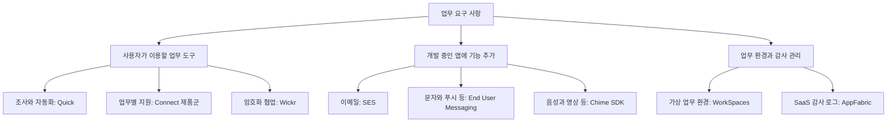
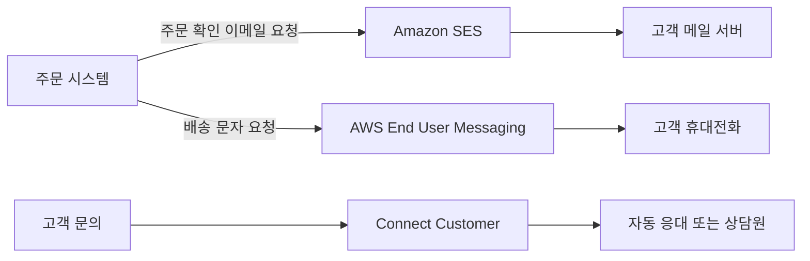

AWS에는 서버와 데이터베이스 외에도 문서 조사, 업무 자동화, 고객 상담, 메시지 전송과 협업에 사용하는 서비스가 있다. 이 분야에서는 사용자가 바로 이용하는 업무 애플리케이션과 개발자가 자기 서비스에 통합하는 API·SDK를 구분해야 한다.

예를 들어 직원이 업무 자료를 조사하는 도구와 쇼핑몰에서 주문 확인 이메일을 보내는 기능은 모두 업무에 필요하지만, 구축 방식과 운영 책임이 다르다.

이 글에서는 비즈니스 애플리케이션과 관련 서비스의 역할, 사용 상황과 예시를 정리한다. 예시는 이해를 위한 가상 상황이며, 서비스 이름과 제공 상태는 2026년 10월 30일에 확인한 AWS 공식 자료를 기준으로 한다.

## 현재 제품 목록을 확인해야 하는 이유

현재 AWS 비즈니스 애플리케이션 페이지는 Amazon Quick, Amazon Connect 제품군, Amazon WorkSpaces를 안내한다. 반면 AWS 개요 백서에는 SES, AppFabric, Chime, WorkDocs, WorkMail 등의 설명도 남아 있다.

이 목록들을 모두 신규 도입 가능한 제품 목록으로 해석해서는 안 된다. 제품 분류와 개별 서비스의 수명 주기는 별도로 확인해야 한다. 이 글은 현재 업무용 제품과 관련 API를 먼저 설명하고, 종료·제한이 있는 서비스는 뒤에서 구분한다.

[공식 자료: AWS 비즈니스 애플리케이션](https://aws.amazon.com/business-applications/) · [AWS 개요의 비즈니스 애플리케이션 분류](https://docs.aws.amazon.com/whitepapers/latest/aws-overview/business-applications.html)

## 1. Amazon Quick: 업무 자료 조사와 작업 자동화

**Amazon Quick**은 업무 데이터와 애플리케이션을 연결해 질문에 답하고, 조사·분석·결과물 작성·작업 자동화를 돕는 AI 업무 도구이다.

**사용하기 좋은 상황**은 여러 문서와 업무 도구에 흩어진 정보를 찾아 정리하거나, 반복되는 업무 흐름을 구성해야 하는 경우이다.

**예시**: 영업 담당자가 연결된 문서와 데이터를 바탕으로 특정 고객의 계약 현황과 최근 변경 사항을 조사하고, 회의 준비 자료를 만든다. 반복되는 보고 작업은 지원하는 자동화 기능으로 구성한다.

Quick에는 데이터 시각화용 **Quick Sight**, 조사용 **Quick Research**, 업무 흐름용 **Flows**, 복잡한 프로세스 자동화를 위한 **Automate**, 지식과 자료를 모으는 **Spaces**, 애플리케이션 작성 기능 등이 있다. 각각을 별개의 AWS 서비스 개수로 중복해서 세기보다는 Quick 안의 기능으로 구분한다.

**구분할 점**은 Amazon Bedrock처럼 모델과 도구를 조합해 직접 애플리케이션을 개발하는 기반 서비스와 목적이 다르다는 것이다. Quick은 업무 사용자가 이용하는 도구와 경험을 제공한다. 연결할 데이터, 실행 가능한 작업, 사용자 권한과 요금제에 따라 사용 범위가 달라진다.

AI가 작성한 보고서나 실행 계획은 원문·수치와 대조한다. 외부 시스템을 변경하는 자동화는 대상과 권한, 사람의 검토가 필요한 단계를 정해 구성한다.

[공식 자료: Amazon Quick](https://aws.amazon.com/quick/) · [Quick 기능과 Q Business 이전 안내](https://docs.aws.amazon.com/amazonq/latest/qbusiness-ug/qbusiness-availability-change.html)

## 2. Amazon Connect 제품군: 업무별 AI 애플리케이션

현재 공식 페이지에서 **Amazon Connect**는 고객 응대뿐 아니라 공급망·의료·채용 업무를 위한 제품군으로 안내된다. 예전 자료에서 Amazon Connect를 상담센터 서비스 하나로만 설명하는 경우와 범위가 다르다.

제품 이름이 같거나 비슷하더라도 해결하는 업무는 구분해서 확인한다.

[공식 자료: Amazon Connect 제품군](https://aws.amazon.com/products/connect/)

### Amazon Connect Customer: 고객 응대

**Amazon Connect Customer**는 전화·채팅 등 고객 접점의 상담과 자동 응대를 구성하는 서비스이다.

**사용하기 좋은 상황**은 고객 문의를 분류해 담당자에게 연결하고, 상담 흐름과 관련 정보를 함께 관리하려는 경우이다.

**예시**: 쇼핑몰에서 배송 문의를 자동으로 분류하고, 주문 조회로 해결되지 않는 문의를 상담원에게 연결한다.

**구분할 점**은 웹 애플리케이션에 음성·영상을 추가하는 SDK와 다르다는 것이다. 고객 응대 흐름과 상담 운영을 위한 기능이 필요할 때 검토한다. 채널, 전화번호, 외부 시스템 연동과 AI 기능별 제공 조건을 확인한다.

[공식 자료: Amazon Connect Customer](https://aws.amazon.com/products/connect/customer/)

### Amazon Connect Decisions: 공급망 계획과 의사결정

**Amazon Connect Decisions**는 수요 신호, 공급 제약과 운영 데이터를 바탕으로 공급망 계획·예외 탐지·의사결정을 지원하는 제품이다. 공식 페이지는 AWS Supply Chain의 다음 세대로 소개한다.

**사용하기 좋은 상황**은 수요와 재고·공급 상황의 변화를 확인하고 계획을 조정해야 하는 경우이다.

**예시**: 특정 상품의 판매량이 증가하고 공급이 지연되는 상황에서 관련 신호를 모아 검토한다. 담당자는 제안된 대응과 근거를 확인하고 공급 계획을 조정한다.

**구분할 점**은 이메일이나 채팅을 전달하는 도구가 아니라 공급망 업무를 위한 제품이라는 것이다. 기존 ERP 등과의 데이터 연결, 품목·거래처 데이터의 품질과 업무 규칙이 중요하다. 제품 소개의 자동화 기능을 조직의 모든 의사결정이 자동으로 처리된다는 의미로 해석하지 않는다.

[공식 자료: Amazon Connect Decisions](https://aws.amazon.com/products/connect/decisions/)

### Amazon Connect Health: 의료 업무 지원

**Amazon Connect Health**는 환자 확인, 예약, 진료 기록 작성과 의료 코딩 등 의료 업무를 지원하는 기능을 제공한다. 전자건강기록(EHR) 등 기존 시스템과의 통합을 전제로 검토할 수 있다.

**사용하기 좋은 상황**은 지원하는 의료 환경에서 반복적인 행정·기록 업무를 줄이려는 경우이다.

**예시**: 지원 환경에서 의료진과 환자의 대화를 바탕으로 진료 기록 초안을 만들고, 의료진이 내용을 검토한다. 예약 업무도 해당 기능의 제공 조건과 연동 가능 여부를 확인하여 구성한다.

**구분할 점**은 기능별 제공 단계가 다르다는 것이다. 확인한 제품 페이지는 환자 확인과 진료 기록 작성을 정식 제공, 예약 관리와 환자 인사이트를 프리뷰, 의료 코딩을 제한된 프리뷰로 안내한다. 한국어·한국 의료기관·국내 청구 체계 지원을 이 설명만으로 가정해서는 안 된다.

의료진의 진단·판단을 대신하는 도구로 설명하지 않으며, 실제 도입 시 지원 지역·언어와 개인정보 처리 조건을 확인한다.

[공식 자료: Amazon Connect Health와 기능별 제공 상태](https://aws.amazon.com/products/connect/health/)

### Amazon Connect Talent: 채용 평가와 면접 지원

**Amazon Connect Talent**는 지원자 평가와 AI 면접 등을 통해 대규모 채용 업무를 지원하는 제품이다.

**사용하기 좋은 상황**은 지원자가 많은 채용에서 평가·면접 절차를 일관되게 운영하고, 채용 담당자가 기록과 근거를 검토하려는 경우이다.

**예시**: 동일 직무의 지원자에게 구성된 평가와 면접 절차를 제공하고, 채용 담당자가 점수·면접 기록·평가 근거를 확인하여 다음 단계를 결정한다.

**구분할 점**은 평가 결과가 최종 채용 결정을 뜻하지 않는다는 것이다. 공식 페이지도 채용 담당자가 최종 결정을 관리하는 방식으로 설명한다. 직무에 적합한 평가 기준, 지원자 안내, 접근성, 기록 보관과 지원 지역·언어를 검토해야 한다. 제품을 사용한다는 이유만으로 평가의 편향이나 오류가 없어지는 것은 아니다.

[공식 자료: Amazon Connect Talent](https://aws.amazon.com/products/connect/talent/)

## 3. Amazon WorkSpaces: 직원용 가상 업무 환경

**Amazon WorkSpaces**는 직원이 원격에서 사용할 클라우드 기반 데스크톱과 관련 업무 환경을 제공하는 제품군이다.

**사용하기 좋은 상황**은 직원 단말마다 업무 환경을 설치하기보다 중앙에서 관리하는 가상 환경을 제공해야 하는 경우이다.

**예시**: 외부 협력 직원에게 프로젝트에 필요한 데스크톱 환경을 제공하고, 업무 애플리케이션과 접근 정책을 중앙에서 관리한다.

**구분할 점**은 Quick처럼 업무 내용을 조사하거나 결과물을 만드는 도구와 다르다는 것이다. WorkSpaces는 사용자가 업무 도구를 실행하는 환경을 제공한다. 데스크톱·애플리케이션 제공 방식, 사용자 수와 사용 시간, 네트워크·인증·라이선스 요구 사항에 맞게 제품을 고른다.

[공식 자료: Amazon WorkSpaces](https://aws.amazon.com/workspaces/)

## 4. Amazon SES: 애플리케이션의 이메일 송수신

**Amazon Simple Email Service(SES)**는 애플리케이션에서 이메일을 보내고, 지원하는 구성으로 수신 이메일을 처리할 수 있는 서비스이다. API나 SMTP 인터페이스 등을 사용한다.

**사용하기 좋은 상황**은 회원 가입 안내, 주문 확인, 비밀번호 재설정, 뉴스레터 등 이메일 기능을 애플리케이션에 통합해야 하는 경우이다.

**예시**: 쇼핑몰에서 결제가 완료되면 애플리케이션이 SES로 주문 확인 이메일을 요청한다. 수신한 문의 메일을 별도 처리 흐름으로 연결하는 구성도 검토할 수 있다.

**구분할 점**은 직원용 메일함과 일정·연락처를 제공하는 업무용 이메일 애플리케이션과 다르다는 것이다. SES가 직원용 메일 화면과 협업 환경을 모두 제공하는 것은 아니다. 이메일을 수신하는 경우에도 저장·분류·답장 등 필요한 처리 흐름을 구성한다.

[공식 자료: Amazon SES란?](https://docs.aws.amazon.com/ses/latest/dg/Welcome.html)

### 발송 요청 성공과 최종 전달은 다르다

SES가 발송 요청을 받아들인 것과 수신자가 이메일을 받은 것은 다르다. 수신 측 서버에서 반송되거나, 수신자가 스팸으로 신고하는 경우가 있다.

_AWS 공식 SES 이메일 전송 흐름. 발송 요청, 수신 측 서버로의 전달, 반송과 스팸 신고의 피드백 경로를 보여준다._

[이미지 출처: SES 이메일 전송 과정](https://docs.aws.amazon.com/ses/latest/dg/send-email-concepts-process.html)

그림의 발신자는 SES에 요청을 보내고, SES는 수신 측 메일 서버로 전달을 시도한다. 점선과 되돌아오는 화살표는 반송·신고 등의 후속 결과를 표현한다. 수신 측 서버가 메시지를 수락했다고 사용자가 읽었거나 받은편지함에 표시되었다고 단정해서는 안 된다.

**운영 예시**: 존재하지 않는 주소로 반복해서 발송하지 않도록 반송 결과를 기록한다. 스팸 신고와 발송 평판을 확인하고, 오류 발생 시 무조건 재시도하여 같은 메일이 중복 발송되지 않도록 업무 식별자와 전송 이력을 관리한다.

[공식 자료: SES 요청 결과와 전송 후 결과](https://docs.aws.amazon.com/ses/latest/dg/send-email-concepts-process.html)

신규 계정에는 리전별 샌드박스 제한이 적용된다. 발신자 검증과 프로덕션 액세스 신청을 구분하고, 운영 전 해당 리전의 상태와 발송 할당량을 확인한다. 샌드박스를 벗어나더라도 사용하는 발신 이메일 주소·도메인은 검증해야 한다.

[공식 자료: SES 프로덕션 액세스 요청](https://docs.aws.amazon.com/ses/latest/dg/request-production-access.html)

## 5. AWS End User Messaging: 문자·푸시 등 메시지 전송

**AWS End User Messaging**은 애플리케이션에서 문자, 음성, 푸시, WhatsApp 등 지원하는 채널로 메시지를 전달하는 기능을 제공한다. 채널별 구성과 API를 확인해야 한다.

**사용하기 좋은 상황**은 로그인 인증번호, 배송 상태, 예약 알림 등 사용자가 필요한 시점에 받는 메시지 기능을 구현하는 경우이다.

**예시**: 사용자가 예약 시간을 변경하면 애플리케이션이 문자 알림을 보낸다. 모바일 앱에서는 지원하는 푸시 전송 기능을 사용해 변경 내용을 안내한다.

**구분할 점**은 메시지 전송 API와 고객 세그먼트·캠페인·여정 관리가 다른 기능이라는 것이다. 과거 Pinpoint에서 제공하던 일부 메시징 기능이 이 이름으로 안내되지만, Pinpoint의 모든 기능을 그대로 이어받았다는 뜻은 아니다.

국가와 채널에 따라 발신 번호·발신자 ID, 등록 절차, 수신 동의와 요금 조건이 다르다. API 호출을 만들었다고 모든 국가와 채널로 바로 발송할 수 있다고 가정하지 않는다.

[공식 자료: AWS End User Messaging 개요](https://docs.aws.amazon.com/end-user-messaging/latest/userguide/nx-overview.html) · [SMS 서비스 개요](https://docs.aws.amazon.com/sms-voice/latest/userguide/)

## 6. AWS Wickr: 암호화된 업무 협업

**AWS Wickr**는 조직의 메시지, 음성·영상 통화, 파일·화면 공유 등을 위한 종단 간 암호화 협업 서비스이다.

**사용하기 좋은 상황**은 민감한 업무 내용을 주고받는 조직에서 사용자와 협업 정책을 관리해야 하는 경우이다.

**예시**: 현장 담당자와 본사 대응팀이 제한된 인원으로 구성된 대화방에서 업무 정보를 교환한다. 조직은 사용자 관리와 메시지 보관 정책 등을 요구 사항에 맞추어 검토한다.

**구분할 점**은 이메일 발송 서비스나 고객 대상 문자 전송 API와 다르다는 것이다. 조직 구성원이 사용하는 협업 애플리케이션에 해당한다. 또한 종단 간 암호화와 조직의 기록 보관·감사는 별도로 검토할 항목이다. 단말 관리, 참여자 권한, 보관 설정과 감사 요구를 함께 확인한다.

[공식 자료: AWS Wickr란?](https://docs.aws.amazon.com/wickr/latest/userguide/what-is-wickr.html)

## 7. Amazon Chime SDK: 자체 앱에 실시간 통신 추가

**Amazon Chime SDK**는 웹·모바일 애플리케이션에 음성·영상·메시징·화면 공유 등의 실시간 통신 기능을 추가하는 구성 요소이다.

**사용하기 좋은 상황**은 직접 개발한 서비스 안에 통화나 공동 작업 기능을 통합해야 하는 경우이다.

**예시**: 교육 플랫폼에서 강사와 수강생이 플랫폼을 벗어나지 않고 영상 통화와 화면 공유를 사용하도록 구성한다. 개발팀은 SDK를 사용하고, 사용자 인증·참여 권한·화면과 업무 로직을 구현한다.

**구분할 점**은 완성된 회의 애플리케이션이었던 Amazon Chime과 다르다는 것이다. SDK를 사용하면 애플리케이션의 사용자 경험과 통신 기능을 통합할 수 있지만, 제품 전체가 자동으로 완성되지는 않는다.

[공식 자료: Amazon Chime SDK란?](https://docs.aws.amazon.com/chime-sdk/latest/dg/what-is-chime-sdk.html)

기능별 수명 주기도 구분한다. 공식 문서는 SIP media applications와 관련된 **PSTN Audio**를 2026년 9월 29일부터 유지 관리 단계로 전환하고, 10월 29일부터 신규 고객에게 제공하지 않는다고 안내한다. 기존 고객 지원과 일부 예외 절차도 별도로 설명한다. 이 제한을 Chime SDK의 모든 기능 종료로 확대해서 해석해서는 안 된다.

[공식 자료: Chime SDK SIP media applications 제공 변경](https://docs.aws.amazon.com/chime-sdk/latest/ag/sip-applications-maintenance-mode.html)

## 8. AWS AppFabric: SaaS 감사 로그 수집과 정규화

**AWS AppFabric**은 여러 SaaS 애플리케이션을 연결하는 서비스이다. 보안 용도에서는 지원 애플리케이션의 감사 로그를 수집하고 공통 형식으로 정규화하여 보안 분석에 활용한다.

**사용하기 좋은 상황**은 여러 업무용 SaaS의 감사 이벤트를 공통 형식으로 확인하려는 경우이다.

**예시**: 조직에서 사용하는 지원 SaaS들의 사용자 활동 로그를 수집하고, 보안 담당자가 여러 도구의 이벤트를 함께 분석하도록 구성한다.

**구분할 점**은 업무 데이터 동기화와 보안 감사 로그 정규화가 다르다는 것이다. AppFabric의 보안 기능을 사용한다고 모든 SaaS 데이터가 양방향으로 동기화되거나 각 SaaS의 권한·정책이 자동으로 변경되지는 않는다. 지원 애플리케이션, 수집 이벤트, 연결에 필요한 권한과 로그 전달 대상을 확인한다.

공식 문서가 안내하는 **AppFabric for productivity**는 프리뷰로 구분된다. 보안 기능과 생성형 AI 생산성 기능의 제공 상태를 동일하게 설명하지 않는다.

[공식 자료: AppFabric 보안 기능](https://docs.aws.amazon.com/appfabric/latest/adminguide/what-is-appfabric-security.html) · [AppFabric 제품과 프리뷰 안내](https://docs.aws.amazon.com/appfabric/latest/adminguide/what-is-appfabric.html)

## 종료·신규 가입 제한이 있는 서비스

예전 AWS 자료를 읽을 때는 아래 서비스의 설명과 현재 제공 상태를 함께 확인한다. 종료된 서비스를 신규 구축 후보처럼 소개하지 않는다.

### Amazon Chime

온라인 회의, 통화, 채팅 등을 제공하던 업무 애플리케이션이다. 예전에는 팀 회의 같은 상황에서 사용하였다.

**현재 상태**: Business Calling을 포함한 Amazon Chime 서비스의 지원 종료일은 2026년 2월 20일이다. Chime 앱의 종료와 Chime SDK의 개별 기능 상태는 구분한다.

[공식 자료: Amazon Chime 지원 종료 안내](https://docs.aws.amazon.com/chime/latest/ag/amazon-chime-transition-features.html)

### Amazon WorkDocs

파일 저장·공유·피드백 등 문서 협업에 사용하던 서비스이다. 예전에는 직원들이 파일을 공유하고 새 버전에 의견을 남기는 용도로 사용하였다.

**현재 상태**: 공식 종료 목록의 지원 종료일은 2025년 4월 25일이다. 지금 새 문서 협업 시스템을 구축하는 예시로 권장하지 않는다.

[공식 자료: AWS 종료 서비스 목록의 Amazon WorkDocs](https://docs.aws.amazon.com/general/latest/gr/full_shutdown_services.html)

### Amazon WorkMail

직원용 이메일, 일정과 연락처를 제공하는 관리형 업무 이메일 서비스이다. 애플리케이션의 이메일 발송 API인 SES와 목적이 다르다.

**현재 상태**: 2026년 4월 30일부터 신규 고객을 받지 않으며, 지원 종료일은 2027년 3월 31일이다. 기존 고객의 이전 검토와 신규 도입을 구분한다. SES를 직원용 메일함의 일대일 대체재로 설명해서는 안 된다.

[공식 자료: WorkMail 지원 종료 안내](https://docs.aws.amazon.com/workmail/latest/adminguide/workmail-end-of-support.html)

### Amazon Pinpoint

고객 세그먼트, 캠페인, 여정과 분석 등을 제공하던 고객 참여 서비스이다. 과거에는 특정 고객군을 대상으로 예약된 메시지 캠페인을 운영하는 데 사용하였다.

**현재 상태**: 공식 지원 종료일은 이 글의 확인일과 같은 **2026년 10월 30일**이다. 신규 구축 후보로 다루지 않는다.

이 종료를 AWS의 모든 문자·푸시 전송 기능 종료로 해석해서는 안 된다. 공식 안내는 관련 메시징 API가 AWS End User Messaging에서 지원되며, 영향을 받지 않는 API 범위를 별도로 설명한다. 이메일 발송은 SES, 고객 참여 기능은 Connect Customer의 관련 기능 등을 검토하도록 안내하지만, 캠페인·데이터·API를 점검하는 이전 작업이 필요하다.

[공식 자료: Pinpoint 종료와 기능별 이전 안내](https://docs.aws.amazon.com/pinpoint/latest/userguide/migrate.html)

### Amazon Q Business

업무 자료를 기반으로 질문에 답하는 생성형 AI 애플리케이션이다. 기존 사내 지식 검색·질의응답 구성을 이해할 때 접할 수 있다.

**현재 상태**: 신규 고객에게 제공되지 않으며, 기존 고객에 대한 버그 수정과 보안 업데이트는 계속하지만 새 기능 요청은 받지 않는다고 안내한다. AWS는 Amazon Quick으로의 이전을 권장한다.

기존 인덱스를 연결하는 방식과 사용자·권한 이전 등의 절차가 제공된다. 기능 차이와 이전 검증이 필요하므로 Q Business의 이름만 바꾸면 Quick 구성이 완성된다고 이해해서는 안 된다.

[공식 자료: Q Business 제공 변경과 Quick 이전](https://docs.aws.amazon.com/amazonq/latest/qbusiness-ug/qbusiness-availability-change.html)

## 요구 사항에 따라 고르는 방법

서비스를 선택할 때는 사용자가 직접 쓸 도구가 필요한지, 개발 중인 애플리케이션에 기능을 추가할 것인지 먼저 구분한다.

- **업무 자료를 조사하고 결과물을 작성한다**: Amazon Quick을 검토한다.
- **고객 상담 흐름과 상담 운영을 구성한다**: Connect Customer를 검토한다.
- **공급망의 계획·예외 처리를 지원한다**: Connect Decisions를 검토한다.
- **지원 의료 환경의 기록·행정 업무를 돕는다**: Connect Health의 기능별 제공 조건을 확인한다.
- **채용 평가·면접 업무를 지원한다**: Connect Talent를 검토한다.
- **직원에게 가상 업무 환경을 제공한다**: WorkSpaces를 검토한다.
- **앱에서 이메일을 보낸다**: SES를 검토한다.
- **앱에서 문자·푸시 등 메시지를 보낸다**: End User Messaging의 해당 채널을 검토한다.
- **조직 구성원이 암호화된 협업 도구를 사용한다**: Wickr를 검토한다.
- **자체 앱에 음성·영상 기능을 추가한다**: Chime SDK의 필요한 기능과 제공 상태를 확인한다.
- **여러 SaaS의 감사 로그를 공통 형식으로 모은다**: AppFabric의 보안 기능을 검토한다.

아래 Mermaid는 요구 사항과 서비스의 관계를 정리하기 위해 작성한 개념도이다. 서비스 간 실제 연결이나 필수 구성 요소를 나타내는 아키텍처는 아니다.

## 예시: 쇼핑몰 주문 알림과 고객 문의

쇼핑몰에서 주문이 완료되면 고객에게 확인 이메일을 보내고, 배송 상태를 문자로 알리며, 문의를 상담원에게 연결한다고 가정한다.

이 요구는 하나의 메시지 서비스로 전부 처리하는 것보다 업무별로 나누어 검토할 수 있다.

1. 주문 시스템은 주문 완료 상태와 알림 대상을 기록한다.
2. 이메일 전송에는 SES를 사용한다.
3. 문자 전송에는 End User Messaging의 지원 채널을 사용한다.
4. 고객 문의는 Connect Customer의 상담 흐름으로 처리한다.
5. 전송·상담 결과는 필요한 업무 기록과 연결한다.

다음 Mermaid는 직접 작성한 역할 구분 예시이다. 주문 시스템의 내부 구현과 각 서비스 연동 방식은 생략하였다.

이 구성에서도 주문 성공, 알림 요청 성공, 최종 전달과 상담 완료는 다른 상태이다. 알림 실패가 주문 취소로 이어져야 하는지, 재시도는 언제 해야 하는지, 같은 알림이 두 번 전달되지 않게 어떻게 관리할지 업무 규칙으로 정한다.

## SAA 공부에서 구분할 내용

이 분야의 모든 제품이 SAA에서 같은 비중으로 다뤄진다는 의미는 아니다. 서비스별 세부 기능을 모두 외우기보다 다음 차이를 먼저 구분하면 좋다.

- **업무용 애플리케이션과 개발용 API·SDK**: 사용자가 바로 이용하는 도구와 직접 개발해 통합할 구성 요소를 구분한다.
- **SES와 직원용 이메일**: 애플리케이션 이메일 송수신과 직원 메일함·일정 제공을 구분한다.
- **SES와 알림·이벤트 전달 서비스**: 고객에게 보낼 이메일 기능과 애플리케이션 구성 요소 사이의 메시지·이벤트 전달 요구를 구분한다.
- **Chime과 Chime SDK**: 회의 애플리케이션과 자체 앱에 넣는 통신 구성 요소를 구분한다.
- **캠페인 관리와 전송 채널**: 고객군·일정·여정 관리와 실제 이메일·문자 전달을 구분한다.
- **요청 성공과 업무 완료**: API가 요청을 받았다는 사실만으로 최종 전달이나 처리 완료를 판단하지 않는다.
- **서비스 목록과 제공 상태**: 개요 문서에 이름이 남아 있더라도 신규 가입 제한·기능별 종료 여부를 확인한다.

업무용 서비스를 도입할 때도 데이터 연결, 사용자 권한, 제공 지역·언어, 비용과 외부 시스템 연동이 필요하다. 완성형 기능을 사용하는 범위와 직접 구현·관리해야 하는 범위를 정한 뒤 적합한 서비스를 선택한다.

