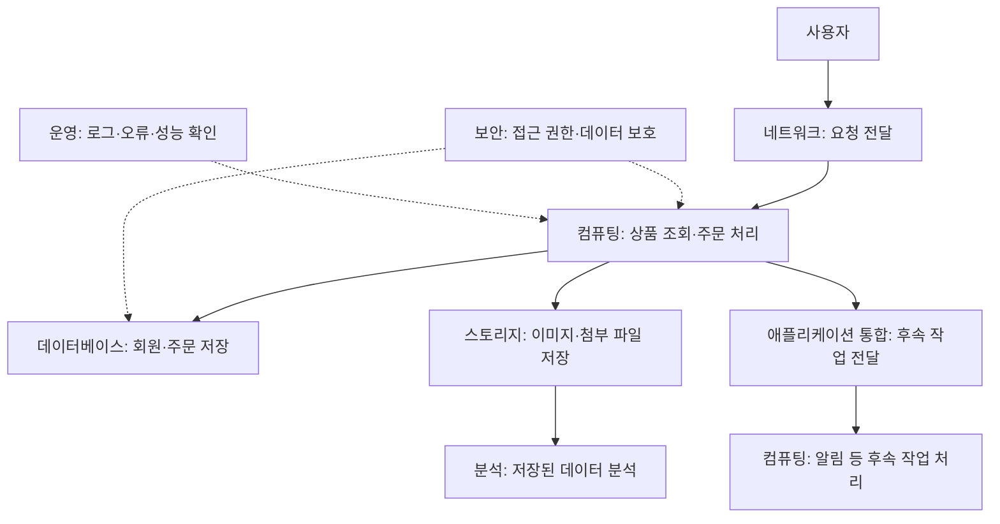

AWS SAA 시험을 준비하면서 AWS 서비스의 종류와 용도를 정리했다.

이 글에서는 AWS 제품 페이지의 19개 분야를 기준으로 각 분야의 역할, 대표 서비스, 사용 예시를 소개한다. 개별 서비스의 기능과 차이는 분야별 글에서 설명한다.

## AWS 서비스는 몇 개일까?

Amazon 공식 소개는 AWS가 **240개 이상의 서비스**를 제공한다고 안내한다. 다만 이 숫자는 고정된 전체 목록의 개수와 같지는 않다. 새로운 서비스가 추가되고, 이름이나 제공 방식이 바뀌기도 하기 때문이다. [출처: Amazon의 AWS 소개](https://www.aboutamazon.com/what-we-do/amazon-web-services)

이 글에서는 **AWS 제품 페이지 상단 메뉴의 19개 분야**를 분야 구분의 기준으로 사용한다. ‘Featured Products’는 분야가 아닌 추천 제품 메뉴이므로 제외했다. 확인 기준일은 **2026년 10월 30일**이다. [출처: AWS 제품 페이지](https://aws.amazon.com/products/)

**19개는 AWS의 모든 공식 자료에 공통으로 적용되는 분류 개수가 아니다.** AWS 개요 백서는 컨테이너, IoT, 비용 관리, 양자 기술, 위성 등을 별도 분야로 소개한다. 이 글의 19개 분야는 제품 페이지 메뉴를 기준으로 정리한 것이다. [출처: AWS 서비스 분야별 개요](https://docs.aws.amazon.com/whitepapers/latest/aws-overview/amazon-web-services-cloud-platform.html)

## 서비스별 정리 항목

분야별 글에서는 각 서비스를 다음 순서로 정리한다.

- **서비스 이름:** 정식 명칭과 자주 쓰는 약어
- **한 줄 설명:** 무엇을 해주는 서비스인지
- **사용하기 좋은 상황:** 어떤 요구사항에 어울리는지
- **간단한 예시:** 실제 상황을 가정하면 어떻게 사용하는지
- **SAA 연결점:** 공식 시험 범위에 포함되는지, 함께 비교할 개념은 무엇인지
- **공식 자료:** 설명을 확인한 제품 페이지나 개발자 문서

본문의 활용 예시는 이해를 돕기 위해 만든 가상 상황이다. 실제 기업의 도입 사례를 옮긴 내용은 아니다.

## AWS의 19개 분야 살펴보기

### 1. 컴퓨팅 — 프로그램을 어디에서 실행할까?

웹 서버, API, 배치 작업처럼 프로그램을 실행할 자원을 제공하는 분야다. 가상 서버를 직접 구성하는 방식도 있고, 서버 운영 부담을 줄여 코드나 컨테이너를 실행하는 방식도 있다.

- **대표 서비스:** Amazon EC2, AWS Lambda, Amazon ECS, Amazon EKS, AWS Fargate
- **예시:** 쇼핑몰 API를 EC2에서 실행하거나, 이미지가 업로드될 때 Lambda로 썸네일을 만든다.
- **살펴볼 질문:** 서버 설정을 직접 제어해야 할까? 요청이 들어올 때만 코드를 실행하면 될까?

컨테이너는 공식 문서에서 독립 분야로도 다루지만, 실행 환경을 비교하기 위해 컴퓨팅 편에 포함한다. [공식 문서: 컴퓨팅](https://docs.aws.amazon.com/whitepapers/latest/aws-overview/compute-services.html)

### 2. 스토리지 — 파일과 데이터를 어디에 보관할까?

이미지, 문서, 서버 디스크, 공유 파일, 백업 등을 저장한다. 같은 저장 공간이라도 객체·블록·파일 방식은 접근 방법과 사용 목적이 다르다.

- **대표 서비스:** Amazon S3, Amazon EBS, Amazon EFS, Amazon FSx, AWS Backup
- **예시:** 사용자 사진은 S3에 보관하고, EC2의 디스크는 EBS를 사용한다.
- **살펴볼 질문:** 파일을 API로 읽으면 될까? 서버에 디스크로 연결해야 할까? 여러 서버가 함께 접근해야 할까?

[공식 문서: 스토리지](https://docs.aws.amazon.com/whitepapers/latest/aws-overview/storage-services.html)

### 3. 데이터베이스 — 데이터를 어떤 구조로 관리할까?

회원, 주문, 상품처럼 애플리케이션이 조회하고 변경하는 데이터를 관리한다. 관계형 데이터베이스, 키-값 데이터베이스, 캐시 등 목적에 맞는 선택지가 있다.

- **대표 서비스:** Amazon RDS, Amazon Aurora, Amazon DynamoDB, Amazon ElastiCache
- **예시:** 주문과 결제 내역은 관계형 데이터베이스에 저장하고, 반복 조회 결과는 캐시에 보관한다.
- **살펴볼 질문:** 데이터 관계와 트랜잭션이 중요할까? 정해진 키로 빠르게 조회하는 것이 중요할까?

[공식 문서: 데이터베이스](https://docs.aws.amazon.com/whitepapers/latest/aws-overview/database.html)

### 4. 네트워킹 및 콘텐츠 전송 — 서비스까지 어떻게 연결할까?

클라우드 안의 네트워크, 도메인, 트래픽 분산, 콘텐츠 전송, 회사와 AWS 사이의 연결을 다룬다.

- **대표 서비스:** Amazon VPC, Amazon Route 53, Elastic Load Balancing, Amazon CloudFront, AWS Direct Connect
- **예시:** 웹 서버와 데이터베이스의 네트워크를 분리하고, 정적 콘텐츠를 CloudFront로 배포한다.
- **살펴볼 질문:** 인터넷에 공개할 자원과 내부에서만 접근할 자원은 무엇일까?

[공식 문서: 네트워킹 및 콘텐츠 전송](https://docs.aws.amazon.com/whitepapers/latest/aws-overview/networking-services.html)

### 5. 보안 및 자격 증명 — 누가 무엇에 접근할 수 있을까?

접근 권한, 사용자 인증, 암호화 키, 비밀 정보, 위협 탐지와 보호를 다룬다. 홈페이지 메뉴는 Security & Identity이며, 개요 문서는 규정 준수까지 함께 분류한다.

- **대표 서비스:** AWS Identity and Access Management(IAM), AWS KMS, AWS Secrets Manager, Amazon Cognito, AWS WAF
- **예시:** 애플리케이션에 필요한 S3 접근 권한만 부여하고, 데이터베이스 비밀번호를 별도로 관리한다.
- **살펴볼 질문:** 사람이 로그인하는 권한과 프로그램이 사용하는 권한을 어떻게 나눌까?

[공식 문서: 보안, 자격 증명 및 규정 준수](https://docs.aws.amazon.com/whitepapers/latest/aws-overview/security-services.html)

### 6. 분석 — 쌓인 데이터에서 무엇을 알아낼까?

로그나 업무 데이터를 모으고, 가공하고, 검색하고, 분석하는 분야다. 애플리케이션의 개별 주문을 처리하는 데이터베이스와는 질문의 크기와 처리 방식이 다를 수 있다.

- **대표 서비스:** Amazon Athena, AWS Glue, Amazon Redshift, Amazon OpenSearch Service
- **예시:** S3에 저장된 접속 로그를 Athena로 조회해 날짜별 요청 수를 집계한다.
- **살펴볼 질문:** 파일에 SQL을 실행하면 될까? 대규모 분석용 저장소나 검색 기능이 필요할까?

[공식 문서: 분석](https://docs.aws.amazon.com/whitepapers/latest/aws-overview/analytics.html)

### 7. 인공지능 — 학습·예측·생성 기능을 어떻게 붙일까?

머신러닝 모델 개발부터 기존 AI 기능 활용, 생성형 AI 애플리케이션 구축까지 포함한다.

- **대표 서비스:** Amazon Bedrock, Amazon SageMaker AI, Amazon Rekognition, Amazon Textract
- **예시:** 문서 이미지에서 글자를 추출하거나, 생성형 AI 모델을 이용해 문서를 요약한다.
- **살펴볼 질문:** 모델을 직접 학습해야 할까? 제공되는 모델이나 기능을 호출하면 될까?

[공식 문서: 머신러닝 및 인공지능](https://docs.aws.amazon.com/whitepapers/latest/aws-overview/machine-learning.html)

### 8. 애플리케이션 통합 — 여러 기능을 어떻게 이어 붙일까?

메시지, 이벤트, 워크플로를 이용해 서비스 사이의 작업을 연결한다. 요청을 받은 순간 모든 후속 작업을 한꺼번에 끝내지 않아도 되는 구조를 만들 때 살펴볼 분야다.

- **대표 서비스:** Amazon SQS, Amazon SNS, Amazon EventBridge, AWS Step Functions
- **예시:** 주문을 큐에 넣고 별도 작업자가 처리하도록 하거나, 주문 완료 이벤트를 여러 시스템에 전달한다.
- **살펴볼 질문:** 작업을 잠시 보관할까? 여러 곳에 알릴까? 처리 순서를 관리할까?

[공식 문서: 애플리케이션 통합](https://docs.aws.amazon.com/whitepapers/latest/aws-overview/application-integration.html)

### 9. 개발자 도구 — 코드를 어떻게 만들고 배포할까?

빌드, 테스트, 배포 흐름을 구성하고 개발 작업을 지원한다.

- **대표 서비스:** AWS CodeBuild, AWS CodePipeline, AWS CodeDeploy
- **예시:** 소스 변경을 계기로 테스트와 빌드를 실행하고, 통과한 결과를 배포한다.
- **살펴볼 질문:** 코드가 운영 환경에 도달하기까지 반복하는 작업 중 무엇을 자동화할까?

[공식 문서: 개발자 도구](https://docs.aws.amazon.com/whitepapers/latest/aws-overview/developer-tools.html)

### 10. 관리 도구 — 자원과 계정을 일관되게 관리할까?

인프라 구성, 계정 체계, 설정 규칙과 관리 기준을 다룬다.

- **대표 서비스:** AWS CloudFormation, AWS Organizations, AWS Config, AWS Control Tower
- **예시:** 개발·운영 계정을 분리하고, 같은 인프라 구성을 코드로 재현한다.
- **살펴볼 질문:** 누가 만들어도 같은 구조와 규칙이 적용되게 할 수 있을까?

[공식 문서: 관리 및 거버넌스](https://docs.aws.amazon.com/whitepapers/latest/aws-overview/management-governance.html)

### 11. 운영 — 실행 중인 시스템의 상태를 어떻게 확인할까?

모니터링, 작업 수행, 장애 조사 등 일상적인 운영을 다룬다. 관리 도구와 겹치는 서비스가 많으므로, 여기서는 구성·정책 관리와 모니터링·운영 작업으로 나누어 설명한다.

- **대표 서비스:** Amazon CloudWatch, AWS CloudTrail, AWS Systems Manager
- **예시:** 오류 지표에 알람을 설정하고, 자원 변경이 발생하면 API 활동 기록을 확인한다.
- **살펴볼 질문:** 무엇이 느려졌는지, 어떤 변경이 있었는지 각각 어디에서 확인할까?

이 구분은 학습을 위한 편집 기준이다. [공식 문서: 관리 및 거버넌스](https://docs.aws.amazon.com/whitepapers/latest/aws-overview/management-governance.html)

### 12. 마이그레이션 및 현대화 — 기존 시스템을 어떻게 옮기고 바꿀까?

기존 서버와 데이터베이스, 파일을 AWS로 이동하거나 애플리케이션 구조를 개선하는 분야다.

- **대표 서비스:** AWS Application Migration Service, AWS Database Migration Service(AWS DMS), AWS DataSync
- **예시:** 기존 서버를 AWS로 옮기거나, 운영 데이터베이스의 데이터를 복제하며 이전을 준비한다.
- **살펴볼 질문:** 그대로 옮길까? 일부를 관리형 서비스로 바꿀까? 허용 가능한 중단 시간은 얼마일까?

[공식 문서: 마이그레이션 및 전송](https://docs.aws.amazon.com/whitepapers/latest/aws-overview/migration-services.html)

### 13. 멀티클라우드 및 하이브리드 — 서로 다른 환경을 어떻게 함께 사용할까?

회사 내부 환경과 AWS, 또는 여러 클라우드를 연결하고 관리하는 분야다. 멀티클라우드와 하이브리드는 겹칠 수 있지만 같은 뜻은 아니다.

- **대표 사례:** AWS Outposts를 활용한 온프레미스와 AWS의 하이브리드 구성
- **예시:** 현장에 남겨야 하는 처리는 로컬에서 수행하고, 다른 기능은 AWS 리전과 연결한다.
- **살펴볼 질문:** 데이터 위치, 응답 지연, 기존 시스템 의존성 때문에 현장에 남겨야 하는 것은 무엇일까?

Outposts는 하이브리드의 예시이며, 이것만으로 모든 멀티클라우드 요구를 해결하는 것은 아니다. [공식 문서: AWS Outposts](https://docs.aws.amazon.com/outposts/latest/server-userguide/what-is-outposts.html)

### 14. 비즈니스 애플리케이션 — 업무 기능을 직접 개발해야 할까?

메일과 커뮤니케이션 등 업무 목적의 애플리케이션·기능을 제공한다.

- **대표 서비스:** Amazon Simple Email Service(Amazon SES)
- **예시:** 웹 서비스에서 회원 가입 확인 메일과 주문 안내 메일을 발송한다.
- **살펴볼 질문:** 기반 시스템을 직접 구축하기보다 제공되는 업무 기능을 이용할 수 있을까?

[공식 문서: 비즈니스 애플리케이션](https://docs.aws.amazon.com/whitepapers/latest/aws-overview/business-applications.html)

### 15. 고객 경험 — 고객 문의를 어떻게 응대할까?

음성·채팅 등 고객 접점과 상담 업무를 지원하는 분야다.

- **대표 제품:** Amazon Connect Customer
- **예시:** 전화나 채팅 문의를 적절한 상담 흐름으로 연결한다.
- **살펴볼 질문:** 고객이 어느 채널로 문의하든 필요한 정보와 담당자에게 연결될 수 있을까?

[공식 소개: Amazon Connect](https://aws.amazon.com/products/connect/)

### 16. 최종 사용자 컴퓨팅 — 직원의 업무 환경을 어떻게 제공할까?

사용자에게 원격 데스크톱이나 애플리케이션 접근 환경을 제공한다.

- **대표 서비스:** Amazon WorkSpaces
- **예시:** 프로젝트 참여자가 각자의 기기에서 회사의 가상 데스크톱에 접속해 업무를 수행한다.
- **살펴볼 질문:** 사용자 기기마다 업무 환경을 설치하고 관리해야 할까?

[공식 문서: 최종 사용자 컴퓨팅](https://docs.aws.amazon.com/whitepapers/latest/aws-overview/end-user-computing.html)

### 17. 게임 기술 — 게임 전용 서버를 어떻게 운영할까?

게임 서버 배포와 운영처럼 게임 특유의 요구사항을 지원한다.

- **대표 서비스:** Amazon GameLift Servers
- **예시:** 멀티플레이 게임의 전용 서버를 운영하고 이용자 수 변화에 맞춰 용량을 조정한다.
- **살펴볼 질문:** 게임 세션과 서버 수요를 어떤 방식으로 관리할까?

[공식 문서: 게임 기술](https://docs.aws.amazon.com/whitepapers/latest/aws-overview/game-tech.html)

### 18. 미디어 서비스 — 영상을 어떻게 가공하고 전달할까?

영상 인코딩과 라이브 스트리밍 등 미디어 처리 흐름을 지원한다.

- **대표 서비스:** AWS Elemental MediaConvert, AWS Elemental MediaLive
- **예시:** 업로드한 영상을 여러 해상도로 변환하거나 라이브 방송용 영상을 인코딩한다.
- **살펴볼 질문:** 녹화 파일을 처리하는 작업일까? 실시간 방송을 처리하는 작업일까?

[공식 문서: 미디어](https://docs.aws.amazon.com/whitepapers/latest/aws-overview/media-services.html)

### 19. 공급망 — 수요·재고·공급 계획을 어떻게 연결할까?

수요와 재고, 공급 정보를 바탕으로 계획과 의사결정을 지원한다.

- **대표 제품:** Amazon Connect Decisions
- **예시:** 수요 예측과 재고 상황을 함께 살펴보고, 부족이 예상되는 품목의 공급 계획을 검토한다.
- **살펴볼 질문:** 여러 시스템에 나뉜 정보를 연결하면 어떤 문제를 더 일찍 발견할 수 있을까?

현재 공식 페이지는 Amazon Connect Decisions를 AWS Supply Chain의 다음 세대 제품으로 소개한다. 이름이 바뀐 제품은 예전 이름과 현재 이름을 함께 확인해야 자료를 찾기 쉽다. [공식 소개: Amazon Connect Decisions](https://aws.amazon.com/products/connect/decisions/)

## 쇼핑몰 구성 예시

쇼핑몰을 예로 들어 각 분야의 역할을 정리하면 다음과 같다.

본문의 역할을 설명하기 위해 작성한 예시다. 실선은 요청·데이터 처리 관계를, 점선은 관리·관찰 관계를 나타낸다. 실제 배포 구조나 모든 연결을 표시한 AWS 공식 구조도는 아니다.

각 분야에는 여러 서비스 선택지가 있으며, 모든 서비스를 함께 사용해야 한다는 의미는 아니다.

1. **컴퓨팅:** 상품 조회와 주문을 처리하는 API를 실행한다.
2. **스토리지:** 상품 이미지와 첨부 파일을 저장한다.
3. **데이터베이스:** 회원·상품·주문 정보를 관리한다.
4. **네트워크:** 사용자의 요청을 애플리케이션으로 전달한다.
5. **보안:** 애플리케이션과 운영자에게 필요한 권한을 부여한다.
6. **통합:** 주문 이후의 알림 같은 작업을 분리해 처리한다.
7. **운영:** 오류와 응답 시간을 관찰한다.
8. **분석:** 어떤 상품과 페이지에 관심이 모이는지 살펴본다.

같은 요구사항에도 여러 구성이 가능하다. 중요한 것은 서비스 이름을 많이 나열하는 것보다, 요구사항을 작은 문제로 나누고 각 문제에 맞는 선택지를 비교하는 일이다.

## SAA 공부와는 어떻게 연결할까?

SAA-C03 공식 시험 안내의 네 영역은 다음과 같다.

- 안전한 아키텍처 설계: **30%**
- 복원력 있는 아키텍처 설계: **26%**
- 고성능 아키텍처 설계: **24%**
- 비용에 최적화된 아키텍처 설계: **20%**

이 비중은 채점 대상 시험 내용에 대한 비중이다. 이 글의 19개 분야와 시험 영역은 서로 다른 분류다. 예를 들어 스토리지를 공부하더라도 접근 제어, 장애 대응, 성능, 비용을 함께 생각할 수 있다. [출처: SAA-C03 공식 시험 안내](https://docs.aws.amazon.com/aws-certification/latest/solutions-architect-associate-03/solutions-architect-associate-03.html)

앞으로 서비스에 **‘SAA 범위’**라고 표시할 때는 공식 In-Scope AWS Services 목록에 이름이 있는지 확인한다. 이 표시는 출제 빈도나 중요도 순위를 뜻하지 않는다. 공식 목록 자체도 모든 내용을 빠짐없이 나열한 목록은 아니며 변경될 수 있다고 안내한다. [출처: SAA-C03 시험 범위 서비스](https://docs.aws.amazon.com/aws-certification/latest/solutions-architect-associate-03/saa-03-in-scope-services.html)

학습 순서는 우선 컴퓨팅·스토리지·데이터베이스·네트워크·보안의 관계부터 잡는 것으로 정했다. AWS가 지정한 필수 학습 순서는 아니다.

## 분야별 글

아래는 분야별 글에서 다루는 내용이다. 제품 페이지의 19개 분야를 기준으로 구분했으며, AWS 전체 서비스의 빠짐없는 목록을 뜻하지는 않는다.

1. **AWS 서비스 종류와 분야별 용도** — 현재 글
2. 컴퓨팅: EC2부터 Lambda와 컨테이너까지
3. 스토리지: 객체·블록·파일 저장소 구분하기
4. 데이터베이스: 관계형·NoSQL·캐시의 역할
5. 네트워킹 및 콘텐츠 전송: VPC부터 CloudFront까지
6. 보안 및 자격 증명: 권한·암호화·보호의 기본
7. 분석: 수집한 데이터를 검색하고 분석하기
8. 인공지능: AI 기능 활용부터 모델 개발까지
9. 애플리케이션 통합: 메시지·이벤트·워크플로
10. 개발자 도구: 빌드·테스트·배포 자동화
11. 관리 도구: 인프라·계정·설정 관리
12. 운영: 관측·변경 기록·운영 작업
13. 마이그레이션 및 현대화: 기존 시스템 옮기고 바꾸기
14. 멀티클라우드 및 하이브리드: 여러 환경 연결하기
15. 비즈니스 애플리케이션: 업무에 필요한 기능 활용하기
16. 고객 경험: 고객 문의와 상담 흐름 구성하기
17. 최종 사용자 컴퓨팅: 가상 업무 환경 제공하기
18. 게임 기술: 게임 서버 운영 이해하기
19. 미디어 서비스: 영상 가공과 실시간 방송
20. 공급망: 수요·재고·공급 계획 연결하기

19개 메뉴를 기준으로 정리한 글만으로 AWS 전체 서비스를 빠짐없이 다뤘다고 볼 수는 없다. 비용 관리와 고객 지원은 관련 글에서 일부 다루지만, 프런트엔드·모바일, IoT, 블록체인, 양자 기술, 위성 등 별도로 분류되는 영역에는 설명이 빠진 서비스가 있다. 추가 설명이 필요한 서비스는 공식 목록과 제공 상태를 확인해 보완한다.

각 편은 공식 자료를 확인한 시점을 적고, 제품명 변경이나 신규 고객 이용 제한·종료 안내가 있으면 함께 기록한다. 서비스 개수를 맞추기 위해 하위 기능을 별도 서비스처럼 중복해서 세지는 않는다.

