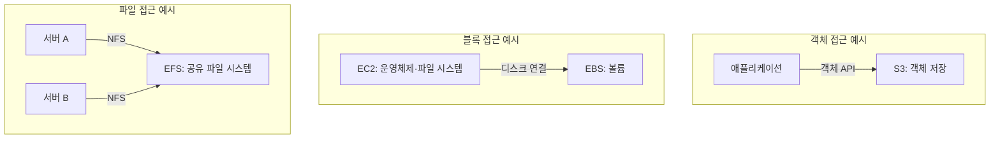

AWS 스토리지 서비스는 데이터를 저장하거나, 기존 데이터에 접근하고 백업·복구·전송하는 기능을 제공한다.

같은 파일이라도 애플리케이션에서 API로 가져올지, 서버의 디스크로 사용할지, 여러 서버가 공유 폴더로 접근할지에 따라 적합한 서비스가 달라진다. 용량뿐 아니라 **접근 방식, 성능, 보관 기간, 장애 시 복구 조건**을 함께 확인해야 한다.

이 글에서는 주요 스토리지 서비스의 설명과 사용 상황, 간단한 예시를 정리한다. 전송·백업 서비스와 S3의 하위 기능도 역할을 구분해 포함했다. 사용 예시는 이해를 돕기 위한 가상 상황이다.

**자료 확인 기준: 2026년 10월 30일**

## 객체·블록·파일 스토리지의 차이

다음은 접근 방식별 대표적인 구성이다. 세 구성을 동시에 사용해야 한다는 의미는 아니다.

S3는 객체 API 접근, EBS는 EC2의 디스크 연결, EFS는 여러 서버의 NFS 파일 공유를 예로 들었다. FSx의 프로토콜은 제품별로 다르고, S3 Files 같은 별도의 파일 접근 기능도 있으므로 모든 접근 방식을 이 그림으로 제한하지 않는다.

### 객체 스토리지

데이터를 객체 단위로 저장하고, 객체의 이름인 키를 이용해 API로 접근한다. 이미지, 로그, 백업 파일, 분석용 원본 데이터 등에 사용한다.

대표 서비스는 **Amazon S3**다. 일반적인 S3 객체 API는 서버의 로컬 디스크나 공유 폴더와 접근 방식이 다르다. 파일 방식의 접근이 필요하면 S3 Files 등 관련 기능을 별도로 검토한다.

### 블록 스토리지

컴퓨팅 자원에 연결해 디스크처럼 사용하는 저장소다. 운영체제나 데이터베이스가 파일 시스템을 구성해 사용한다.

대표 서비스는 **Amazon EBS**다. EC2에 직접 연결된 임시 저장소인 인스턴스 스토어도 블록 단위로 접근하지만, 데이터 유지 조건은 다르다.

### 파일 스토리지

파일과 디렉터리 구조를 제공하고, NFS·SMB 같은 프로토콜로 접근한다. 여러 서버가 같은 파일을 공유해야 할 때 검토한다.

대표 서비스는 **Amazon EFS**와 **Amazon FSx**다.

이 구분은 저장소에 접근하는 방법의 차이다. ‘파일을 저장한다’는 이유만으로 모두 파일 스토리지가 되는 것은 아니다. 예를 들어 이미지 파일을 S3에 업로드하면 객체 스토리지를 사용하는 것이다. [공식 자료: AWS 스토리지 선택 가이드](https://docs.aws.amazon.com/decision-guides/latest/decision-guides/choosing-aws-storage-service.html)

## 객체 스토리지

### Amazon S3 — 객체 저장

**Amazon Simple Storage Service**의 약어다. 버킷에 객체를 저장하고 키를 지정해 읽거나 쓴다. 웹 콘텐츠, 데이터 레이크, 로그, 백업, 아카이브 등 다양한 용도로 사용한다.

- **사용하기 좋은 상황:** 애플리케이션이 API를 통해 파일이나 대규모 데이터를 저장·조회하는 경우.
- **예시:** 사용자가 올린 상품 이미지를 S3에 저장하고, 애플리케이션이 필요한 객체를 조회한다.
- **구분할 점:** S3를 사용한다고 객체가 자동으로 인터넷에 공개되는 것은 아니다. IAM 정책, 버킷 정책, 퍼블릭 액세스 차단 등 접근 설정을 관리해야 한다.

[공식 문서: Amazon S3](https://docs.aws.amazon.com/AmazonS3/latest/userguide/Welcome.html)

### S3 스토리지 클래스 — 접근 빈도와 복구 조건에 따른 저장 방식

다음은 S3 안에서 선택하는 스토리지 클래스다. 각각을 별도 서비스로 중복해서 세지 않는다.

- **S3 Standard:** 자주 접근하는 데이터. 예: 서비스에서 계속 조회하는 이미지.
- **S3 Intelligent-Tiering:** 접근 빈도가 변하거나 예측하기 어려운 데이터. 예: 이용량이 달라지는 문서.
- **S3 Standard-IA:** 드물게 읽지만 즉시 접근해야 하는 데이터. 예: 가끔 조회하는 보관 파일.
- **S3 One Zone-IA:** 단일 가용 영역에 저장하는 저빈도 접근 데이터. 예: 재생성 가능한 복사본.
- **S3 Express One Zone:** 단일 가용 영역에서 낮은 접근 지연이 필요한 데이터. 예: 반복해서 읽는 처리용 데이터.
- **S3 Glacier Instant Retrieval:** 드물게 읽되 즉시 조회해야 하는 아카이브.
- **S3 Glacier Flexible Retrieval:** 조회 전 복원을 기다릴 수 있는 아카이브.
- **S3 Glacier Deep Archive:** 거의 읽지 않고 복원 대기를 허용하는 장기 보관 데이터.

Glacier 계열이라고 모두 조회 전에 복원을 기다리는 것은 아니다. Instant Retrieval은 즉시 접근용이고, Flexible Retrieval과 Deep Archive는 복원 절차가 필요하다. One Zone 계열은 가용 영역 전체 손실에 대한 복원력도 구분해야 한다.

클래스별 최소 보관 기간, 조회 비용, 최소 과금 크기와 자동 계층화 조건이 다르므로 저장 단가만 비교하지 않는다. 예전 자료의 **Reduced Redundancy Storage(RRS)**는 현재 공식 문서에서 사용을 권장하지 않는다. [공식 문서: S3 스토리지 클래스](https://docs.aws.amazon.com/AmazonS3/latest/userguide/storage-class-intro.html)

### S3 관련 파일·테이블·벡터 기능

S3는 일반 객체 저장 외에도 목적별 기능을 제공한다. 기존 객체 버킷에 파일을 업로드하는 작업과 구분해 이해하면 된다.

**Amazon S3 Files**

S3 데이터에 파일·디렉터리 방식으로 접근하도록 연결하는 공유 파일 시스템이다. EFS 기술을 기반으로 파일 시스템과 버킷 사이의 변경 동기화를 관리한다.

- **사용하기 좋은 상황:** S3 데이터를 파일 경로로 읽고 쓰는 애플리케이션과 연결하려는 경우.
- **예시:** 분석 프로그램이 S3의 데이터를 마운트된 경로에서 파일처럼 처리한다.
- **구분할 점:** 파일 접근과 객체 접근 사이의 동기화 규칙, 지원 기능, 비용을 확인해야 한다. EFS나 Storage Gateway와 동일한 제품은 아니다.

[공식 문서: S3 Files](https://docs.aws.amazon.com/AmazonS3/latest/userguide/s3-files.html)

**Amazon S3 Tables**

분석용 테이블 데이터에 최적화된 저장 기능이다. 테이블 버킷에 Apache Iceberg 형식의 테이블을 저장하고 지원되는 쿼리 엔진으로 조회한다.

- **사용하기 좋은 상황:** 분석용 데이터를 테이블 단위로 저장·관리하려는 경우.
- **예시:** 일별 구매 내역을 테이블로 보관하고 Athena 같은 쿼리 엔진으로 집계한다.
- **구분할 점:** 테이블 저장·관리 기능과 실제 쿼리를 실행하는 엔진은 구분된다. 일반적인 주문 처리용 관계형 데이터베이스와도 역할이 다르다.

[공식 문서: S3 Tables](https://docs.aws.amazon.com/AmazonS3/latest/userguide/s3-tables.html)

**Amazon S3 Vectors**

벡터 데이터를 저장하고 유사도 검색을 수행하는 기능이다. 벡터 버킷과 인덱스를 사용한다.

- **사용하기 좋은 상황:** 문서나 이미지의 임베딩을 저장하고 의미가 비슷한 데이터를 찾으려는 경우.
- **예시:** 사내 문서에서 생성한 임베딩을 저장하고 질문과 관련된 문서를 검색한다.
- **구분할 점:** 원본 문서의 임베딩을 생성하는 AI 모델과, 벡터를 저장·검색하는 기능은 별개다.

[공식 문서: S3 Vectors](https://docs.aws.amazon.com/AmazonS3/latest/userguide/s3-vectors.html)

## 블록 스토리지

### Amazon EBS — EC2용 영구 블록 스토리지

**Amazon Elastic Block Store**의 약어다. EC2에 볼륨을 연결해 디스크처럼 사용한다. 스냅샷을 생성해 특정 시점의 데이터를 보관하고 새 볼륨으로 복원할 수도 있다.

- **사용하기 좋은 상황:** 운영체제 디스크나 데이터베이스 등 지속적으로 데이터를 읽고 쓰는 디스크가 필요한 경우.
- **예시:** EC2에서 실행하는 데이터베이스의 데이터를 EBS 볼륨에 저장한다.
- **구분할 점:** 볼륨과 연결할 EC2는 같은 가용 영역에 있어야 한다. 지원되는 일부 구성의 Multi-Attach를 일반적인 공유 파일 시스템과 동일하게 보면 안 된다.

볼륨 유형에는 범용 SSD, 프로비저닝된 IOPS SSD, 처리량 중심 HDD 등이 있다. 필요한 IOPS·처리량·지연 시간에 맞춰 선택한다. [공식 문서: Amazon EBS](https://docs.aws.amazon.com/ebs/latest/userguide/what-is-ebs.html), [EBS 볼륨](https://docs.aws.amazon.com/ebs/latest/userguide/ebs-volumes.html)

### EC2 인스턴스 스토어 — 호스트에 연결된 임시 저장소

EC2가 실행되는 호스트의 디스크를 사용하는 임시 블록 스토리지다. 모든 인스턴스 유형이 제공하는 것은 아니다.

- **사용하기 좋은 상황:** 다시 생성할 수 있는 캐시, 임시 계산 파일, 중간 결과를 보관하는 경우.
- **예시:** 대용량 데이터를 처리하는 동안 중간 파일을 저장하고, 최종 결과는 S3에 보관한다.
- **구분할 점:** 일반적인 재부팅에서는 데이터가 유지되지만 인스턴스 중지·최대 절전·종료 시에는 유지되지 않는다. 장기 보관할 데이터의 유일한 저장 위치로 사용하면 안 된다.

EC2의 저장 기능이며 EBS와 별개의 독립 실행 서비스는 아니다. [공식 문서: 인스턴스 스토어](https://docs.aws.amazon.com/AWSEC2/latest/UserGuide/InstanceStorage.html), [데이터 유지 조건](https://docs.aws.amazon.com/AWSEC2/latest/UserGuide/instance-store-lifetime.html)

## 파일 스토리지

### Amazon EFS — NFS 기반 공유 파일 스토리지

**Amazon Elastic File System**의 약어다. NFS 프로토콜로 접근하며, 파일을 추가·삭제하면 사용 용량에 맞춰 확장·축소된다.

- **사용하기 좋은 상황:** 여러 Linux 서버나 컨테이너가 같은 파일 경로를 공유해야 하는 경우.
- **예시:** 여러 웹 서버가 업로드 디렉터리를 함께 사용한다.
- **구분할 점:** Regional과 One Zone은 데이터 저장 범위와 가용 영역 장애에 대한 보호 조건이 다르다. Windows EC2에서 사용하는 Windows 파일 공유 서비스로 보면 안 된다.

[공식 문서: Amazon EFS](https://docs.aws.amazon.com/efs/latest/ug/whatisefs.html)

### Amazon FSx for Windows File Server — Windows 공유 파일 서버

Windows Server 기반의 관리형 파일 스토리지다. SMB와 Windows 파일 시스템 기능, Active Directory 연계 등을 지원한다.

- **사용하기 좋은 상황:** Windows 애플리케이션이 기존 SMB 공유 폴더와 사용자 인증 체계를 사용하는 경우.
- **예시:** 사내 Windows 업무 프로그램이 접근하는 공용 폴더를 AWS에서 운영한다.
- **구분할 점:** EFS의 NFS 기반 공유와 프로토콜·권한 모델이 다르다.

[공식 문서: FSx for Windows File Server](https://docs.aws.amazon.com/fsx/latest/WindowsGuide/what-is.html)

### Amazon FSx for Lustre — 계산 작업용 고성능 파일 시스템

Lustre 파일 시스템을 관리형으로 제공한다. 머신러닝, HPC, 영상 처리처럼 많은 데이터를 빠르게 읽고 쓰는 작업에 사용한다.

- **사용하기 좋은 상황:** 여러 계산 노드가 대규모 데이터셋을 병렬 처리하는 경우.
- **예시:** S3 데이터셋을 연계해 여러 학습 노드에서 읽고 처리한다.
- **구분할 점:** 배포 옵션과 저장 방식에 따라 내구성·성능·비용 조건이 다르다. 모든 Lustre 구성을 단순한 임시 저장소라고 보면 안 된다.

[공식 문서: FSx for Lustre](https://docs.aws.amazon.com/fsx/latest/LustreGuide/what-is.html)

### Amazon FSx for NetApp ONTAP — ONTAP 기반 저장소

NetApp ONTAP 기반의 관리형 저장소다. 파일 공유, 스냅샷, 복제, 계층화 등 ONTAP 기능을 활용할 수 있다.

- **사용하기 좋은 상황:** 기존 ONTAP 환경을 AWS로 확장하거나 NFS·SMB 등 여러 접근 방식을 사용해야 하는 경우.
- **예시:** 사내 NetApp 저장소의 데이터를 AWS의 ONTAP 환경으로 복제해 애플리케이션 이전을 준비한다.
- **구분할 점:** 파일 접근뿐 아니라 지원되는 블록 접근도 있으므로 필요한 프로토콜과 기능을 구체적으로 확인한다.

[공식 문서: FSx for NetApp ONTAP](https://docs.aws.amazon.com/fsx/latest/ONTAPGuide/what-is-fsx-ontap.html)

### Amazon FSx for OpenZFS — OpenZFS 기반 파일 스토리지

OpenZFS 기반의 관리형 파일 스토리지다. NFS 접근과 스냅샷·데이터 복제 등의 기능을 제공한다.

- **사용하기 좋은 상황:** 기존 ZFS나 Linux 파일 서버의 데이터와 운영 방식을 활용하려는 경우.
- **예시:** 개발용 데이터를 스냅샷·클론으로 구성해 여러 테스트 환경에서 사용한다.
- **구분할 점:** Windows File Server, ONTAP, Lustre와 이름은 비슷하지만 기반 파일 시스템과 지원 기능이 다르다.

[공식 문서: FSx for OpenZFS](https://docs.aws.amazon.com/fsx/latest/OpenZFSGuide/what-is-fsx.html)

### Amazon File Cache — 분산된 데이터의 임시 고성능 캐시

온프레미스 파일 시스템이나 S3 등에 있는 데이터를 AWS의 파일 기반 애플리케이션에서 빠르게 처리하도록 지원하는 캐시다.

- **사용하기 좋은 상황:** 원본 데이터가 다른 위치에 있지만 AWS 계산 작업에서 빠르게 접근해야 하는 경우.
- **예시:** 외부 NFS 저장소의 데이터를 AWS에서 분석하며 필요한 데이터를 캐시에 적재한다.
- **구분할 점:** 원본의 장기 보관 저장소와 캐시의 역할을 구분한다. 변경 데이터를 원본에 반영하는 절차도 확인해야 한다.

[공식 문서: Amazon File Cache](https://docs.aws.amazon.com/fsx/latest/FileCacheGuide/what-is.html)

## 온프레미스와 AWS 저장소 연결

### AWS Storage Gateway — 기존 접근 방식으로 AWS 저장소 사용

회사 내부 애플리케이션을 AWS 저장소와 연결하는 하이브리드 스토리지 서비스다. 게이트웨이 유형에 따라 파일·볼륨·가상 테이프 방식으로 접근한다.

**Amazon S3 File Gateway**

NFS·SMB 파일 공유를 통해 데이터를 S3 객체로 저장·조회하고 로컬 캐시를 사용한다.

- **상황·예시:** 기존 프로그램이 공유 폴더에 보고서를 쓰면 S3에 저장되도록 구성한다.
- **구분할 점:** 파일 공유로 접근한다고 일반 파일 서버의 모든 동작을 동일하게 지원하는 것은 아니다.

[공식 문서: S3 File Gateway](https://docs.aws.amazon.com/filegateway/latest/files3/what-is-file-s3.html)

#### AWS 공식 구조도: S3 File Gateway 연결

_온프레미스 애플리케이션 서버와 S3를 연결하는 File Gateway 구성. 출처: AWS Storage Gateway 사용자 안내서. 원본 이미지._

[이미지 출처: How Amazon S3 File Gateway works](https://docs.aws.amazon.com/filegateway/latest/files3/file-gateway-concepts.html)

왼쪽 서버는 NFS·SMB로 게이트웨이에 접근하고, 게이트웨이는 파일을 S3 객체로 저장한다. 로컬 캐시는 자주 사용하는 데이터에 대한 접근을 지원한다. 기존 프로그램의 파일 접근 방식과 AWS의 객체 저장 방식을 연결하는 구조다.

그림의 S3-IA·S3 Glacier는 원본 표기다. 현재 스토리지 클래스별 즉시 접근·복원 조건은 이 글의 S3 스토리지 클래스 설명을 기준으로 구분한다. 오른쪽 버킷 아이콘은 저장 방식의 예시이며, 세 개의 버킷을 반드시 함께 구성해야 한다는 의미는 아니다.

**Volume Gateway**

온프레미스 애플리케이션이 iSCSI 볼륨으로 접근한다. Cached Volumes는 주요 데이터를 AWS에 두고 자주 사용하는 데이터를 로컬에 캐시한다. Stored Volumes는 전체 데이터를 로컬에 두고 시점별 백업을 AWS에 보관한다.

- **상황·예시:** 기존 서버가 사용하던 디스크 접근 방식을 유지하면서 AWS에 데이터를 보관한다.
- **구분할 점:** 두 구성의 원본 데이터 위치가 다르다.

[공식 문서: Volume Gateway](https://docs.aws.amazon.com/storagegateway/latest/vgw/WhatIsStorageGateway.html)

**Tape Gateway**

기존 백업 소프트웨어가 가상 테이프 장치로 인식하는 저장 환경을 제공한다.

- **상황·예시:** 물리 테이프를 교체·보관하는 대신 가상 테이프로 백업하고 AWS에 아카이브한다.
- **구분할 점:** 복구 절차와 대기 시간은 가상 테이프의 상태와 보관 위치 등에 따라 달라진다.

[공식 문서: Tape Gateway](https://docs.aws.amazon.com/storagegateway/latest/tgw/WhatIsStorageGateway.html)

**Amazon FSx File Gateway의 현재 상태**

FSx for Windows File Server에 대한 온프레미스 접근을 지원하던 게이트웨이다. **2024년 10월 28일부터 신규 고객이 이용할 수 없으며 기존 고객은 계속 사용할 수 있다.** 이 제한은 FSx File Gateway에 대한 것으로, FSx for Windows File Server 자체의 신규 이용 제한을 뜻하지 않는다. [공식 안내: FSx File Gateway 문서 이력](https://docs.aws.amazon.com/filegateway/latest/filefsxw/DocumentHistory.html)

## 백업과 재해 복구

### AWS Backup — 백업 정책과 작업 통합 관리

여러 지원 서비스의 백업을 정책에 따라 생성하고 보관·관리하는 서비스다.

- **사용하기 좋은 상황:** 자원마다 따로 관리하던 백업 일정과 보관 정책을 통합하려는 경우.
- **예시:** 지원되는 EBS·EFS·RDS 자원에 정기 백업과 보관 정책을 적용한다.
- **구분할 점:** 자원 유형·리전별로 지원되는 기능이 다르다. 백업 생성 성공과 애플리케이션 복구 성공은 별개이므로 복원도 확인해야 한다.

[공식 문서: AWS Backup](https://docs.aws.amazon.com/aws-backup/latest/devguide/whatisbackup.html)

### AWS Elastic Disaster Recovery — 서버 복제 기반 복구

**AWS DRS**라고 부른다. 온프레미스나 클라우드 서버의 데이터를 AWS에 복제하고, 장애나 훈련 시 복구 인스턴스를 실행하도록 지원한다.

- **사용하기 좋은 상황:** 원본 서버를 사용할 수 없을 때 AWS에서 애플리케이션을 복구하려는 경우.
- **예시:** 회사 서버의 데이터를 AWS로 지속 복제하고 장애 훈련 때 복구 인스턴스를 실행한다.
- **구분할 점:** 복제 설정만으로 모든 업무가 자동 복구되는 것은 아니다. 네트워크, 의존 시스템, 실행 순서와 전환 절차를 함께 확인해야 한다.

AWS Backup은 백업 관리, DRS는 서버 복제와 복구 실행에 초점을 둔다. [공식 문서: AWS DRS](https://docs.aws.amazon.com/drs/latest/userguide/what-is-drs.html)

## 데이터 전송 관련 서비스

다음은 데이터를 보관하는 저장소 자체가 아니라 데이터를 이동하거나 주고받는 서비스다.

### AWS DataSync — 파일·객체 데이터 전송

온프레미스·다른 클라우드·AWS 저장소 사이에서 지원되는 파일·객체 데이터의 전송을 자동화한다.

- **사용하기 좋은 상황:** 많은 데이터를 이전하거나 정해진 작업으로 동기화하려는 경우.
- **예시:** 사내 NFS 서버의 파일을 S3로 옮기고 전송 결과를 검증한다.
- **구분할 점:** 애플리케이션에 공유 디스크를 제공하는 서비스나, 관계형 데이터베이스의 변경 데이터를 복제하는 서비스와 다르다.

[공식 문서: AWS DataSync](https://docs.aws.amazon.com/datasync/latest/userguide/what-is-datasync.html)

### AWS Transfer Family — 파일 송수신 환경 제공

SFTP·FTPS·FTP·AS2 및 브라우저 기반 파일 전송 등을 지원한다. 사용하는 기능과 프로토콜에 따라 지원 저장소·구성 조건이 다르다.

- **사용하기 좋은 상황:** 고객이나 협력사가 기존 파일 전송 방식을 사용해야 하는 경우.
- **예시:** 협력사가 SFTP로 정산 파일을 올리고, 해당 파일을 S3에 저장한다.
- **구분할 점:** DataSync가 데이터 이동 작업 관리에 초점을 둔다면 Transfer Family는 외부·내부 사용자와의 파일 송수신 환경에 초점을 둔다.

[공식 문서: AWS Transfer Family](https://docs.aws.amazon.com/transfer/latest/userguide/what-is-aws-transfer-family.html)

### AWS Data Transfer Terminal — 물리 장소에서 대용량 데이터 전송

저장 장치를 AWS가 제공하는 물리 장소로 가져가 고속 네트워크로 데이터를 전송하는 서비스다.

- **사용하기 좋은 상황:** 보유 네트워크로 대용량 데이터를 전송하기 어려운 경우.
- **예시:** 현장에서 수집한 데이터가 담긴 장치를 예약한 시설로 가져가 AWS에 업로드한다.
- **구분할 점:** AWS가 장치를 배송해 주는 방식과 다르다. 현재 공식 문서는 Enterprise Support 고객을 대상으로 안내하므로 이용 조건과 시설을 확인해야 한다.

[공식 문서: AWS Data Transfer Terminal](https://docs.aws.amazon.com/datatransferterminal/latest/userguide/what-is-dtt.html)

### AWS Snow Family의 현재 상태

Snowball Edge 등은 물리 장치를 이용한 데이터 이동과 엣지 처리 자료에서 등장한다. 예를 들어 네트워크 전송이 어려운 현장에서 데이터를 장치에 모아 이전하는 용도로 사용됐다.

현재 공식 안내에 따르면 **신규 고객은 AWS Snow Family 장치를 주문할 수 없다.** Snowball Edge 신규 고객 제한은 2025년 11월 7일부터 적용됐다. 기존 고객의 이용은 별도로 안내한다. 신규 도입에서는 DataSync, Data Transfer Terminal, 파트너 솔루션 등의 조건을 비교한다. [공식 안내: Snowball Edge 제공 상태 변경](https://docs.aws.amazon.com/snowball/latest/developer-guide/snowball-edge-availability-change.html), [문서 이력](https://docs.aws.amazon.com/snowball/latest/developer-guide/doc-history.html)

## 저장소와 구분할 데이터 관리 기능

스토리지 서비스와 아래 기능을 별개의 서비스처럼 섞어 세지 않도록 구분한다.

- **S3 Versioning:** 객체의 여러 버전을 보관한다. 예: 실수로 덮어쓴 파일의 이전 버전을 확인한다.
- **S3 Lifecycle:** 규칙에 따라 객체를 다른 스토리지 클래스로 전환하거나 만료시킨다. 예: 일정 기간이 지난 로그의 보관 방식을 변경한다.
- **S3 Replication:** 설정한 대상 버킷으로 객체를 복제한다. 예: 다른 리전에 사본을 유지한다. 기존 객체와 신규 객체의 적용 조건은 별도로 확인한다.
- **EBS Snapshot:** 특정 시점의 볼륨 데이터를 보관한다. 예: 변경 작업 전에 스냅샷을 생성하고 새 볼륨 복원에 사용한다.

복제, 버전 보관, 백업은 목적과 적용 범위가 다르다. 어떤 기능 하나만 켜면 모든 삭제·변경·장애 상황에 대응한다고 보면 안 된다. [공식 문서: S3 기능](https://docs.aws.amazon.com/AmazonS3/latest/userguide/Welcome.html), [EBS 스냅샷 개요](https://docs.aws.amazon.com/ebs/latest/userguide/what-is-ebs.html)

**S3 Object Lock**은 객체 버전에 보관 기간이나 법적 보존을 적용해 삭제·덮어쓰기를 제한하는 기능이다. 예를 들어 정해진 기간 동안 보관해야 하는 문서의 버전을 보호한다. 버전 관리를 사용하며, 보호 대상은 지정한 객체 버전이다. 새로운 버전 생성이나 삭제 마커 추가까지 모두 막는다는 뜻은 아니다. [공식 문서: S3 Object Lock](https://docs.aws.amazon.com/AmazonS3/latest/userguide/object-lock.html)

## 요구사항별 비교

- **이미지·로그·분석 원본을 객체로 저장한다:** S3
- **EC2에서 디스크처럼 사용한다:** EBS
- **재생성 가능한 임시 데이터를 로컬에 둔다:** EC2 인스턴스 스토어
- **여러 Linux 서버가 NFS 파일을 공유한다:** EFS
- **Windows SMB 공유와 AD 연계가 필요하다:** FSx for Windows File Server
- **병렬 계산 작업의 파일 처리 성능이 중요하다:** FSx for Lustre
- **기존 ONTAP 기능과 데이터 관리 방식을 활용한다:** FSx for NetApp ONTAP
- **OpenZFS 기반 파일 시스템이 필요하다:** FSx for OpenZFS
- **원격 원본 데이터에 대한 임시 고성능 접근이 필요하다:** File Cache
- **기존 온프레미스 접근 방식을 AWS 저장소에 연결한다:** Storage Gateway
- **여러 자원의 백업 정책을 관리한다:** AWS Backup
- **서버 복제와 복구 인스턴스 실행을 준비한다:** AWS DRS
- **대규모 파일·객체 데이터를 이동한다:** DataSync
- **SFTP 등으로 사용자·협력사와 파일을 주고받는다:** Transfer Family

서비스를 선택한 뒤에도 용량, IOPS, 처리량, 지연 시간, 가용 영역 구성, 암호화·접근 권한, 복구 시간을 확인해야 한다. 비용은 저장 용량 외에 요청·조회·전송·백업·프로비저닝 성능 등의 항목도 포함될 수 있다. [공식 자료: 스토리지 선택 기준](https://docs.aws.amazon.com/decision-guides/latest/decision-guides/choosing-aws-storage-service.html)

## SAA 학습에서 구분할 내용

공식 SAA-C03 시험 범위 목록에는 **AWS Backup, EBS, EFS, FSx, S3, S3 Glacier, Storage Gateway**가 스토리지 분야에 포함된다. DataSync와 Transfer Family, Snow Family도 마이그레이션·전송 분야에 나온다.

공식 목록은 모든 내용을 빠짐없이 나열한 자료가 아니며 변경될 수 있다. 시험 범위 목록에 이름이 남아 있는 것과 현재 신규 고객이 이용 가능한지는 별개의 문제다. [공식 자료: SAA-C03 시험 범위 서비스](https://docs.aws.amazon.com/aws-certification/latest/solutions-architect-associate-03/saa-03-in-scope-services.html)

비교하면서 정리할 항목은 다음과 같다.

- **S3·EBS·EFS:** 객체·블록·파일 접근의 차이
- **EBS와 인스턴스 스토어:** 데이터 유지 조건과 사용 목적
- **EFS와 FSx:** 프로토콜, 기존 환경과의 호환성, 성능 요구
- **S3 클래스:** 접근 빈도, 즉시 접근 여부, 가용 영역, 조회 비용
- **Storage Gateway·DataSync·Transfer Family:** 저장소 연결, 데이터 이동 작업, 파일 송수신의 차이
- **백업과 재해 복구:** 보관된 데이터를 되돌리는 절차와 업무 시스템을 다시 실행하는 절차
- **단일 가용 영역과 다중 가용 영역:** 보호하려는 장애 범위의 차이

데이터를 어디에 보관할지만 정하기보다, 어떻게 읽고 쓰고 언제 복구해야 하는지까지 함께 정리하면 서비스 간 차이를 이해하기 쉽다.

