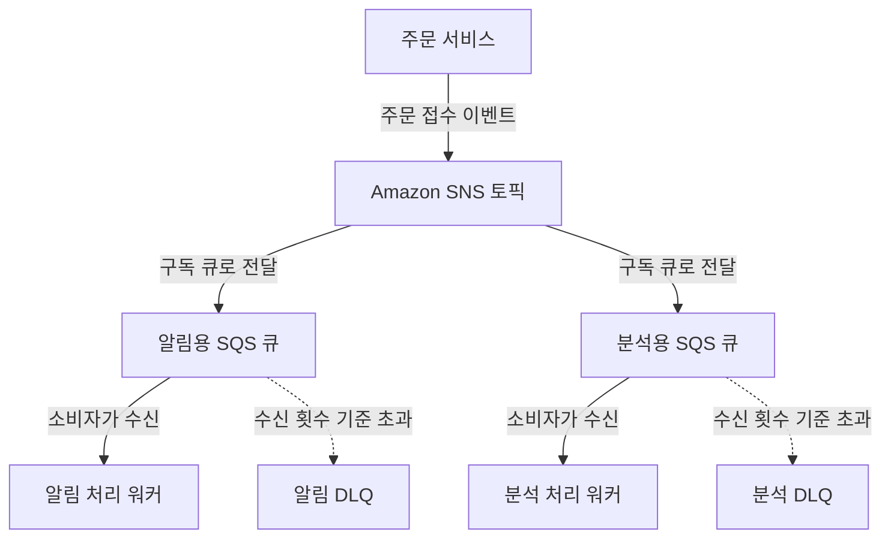
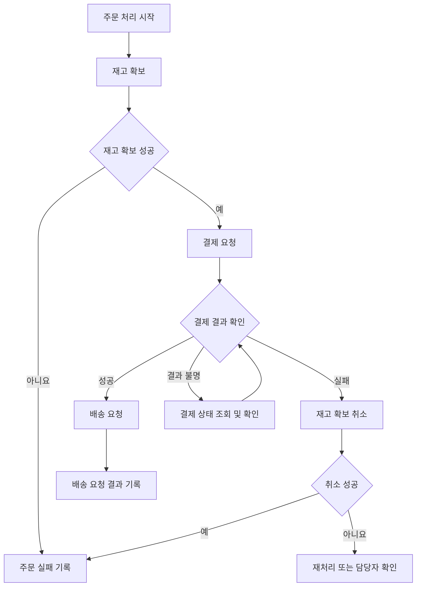

애플리케이션이 여러 서비스로 나뉘면 서비스 사이의 통신 방식도 설계해야 한다. 주문 API가 결제, 재고, 알림 서비스를 모두 직접 호출하면 한 서비스의 지연이나 장애가 전체 요청에 영향을 줄 수 있다.

AWS의 애플리케이션 통합 서비스는 메시지를 보관하고 전달하거나, 이벤트를 조건에 맞게 라우팅하거나, 여러 작업의 실행 순서를 관리한다. 이 글에서는 각 서비스의 역할과 사용 상황을 구분한다. 예시는 설명을 위한 가상 상황이며, 명칭과 기능은 2026년 10월 30일에 확인한 AWS 공식 문서를 기준으로 작성했다.

## 먼저 구분할 개념

### 동기 호출과 비동기 처리

**동기 호출**에서는 호출한 쪽이 상대의 응답을 기다린다. 사용자가 상품 상세 정보를 요청하고 API가 조회 결과를 반환하는 방식이 해당한다.

**비동기 처리**에서는 요청을 메시지나 이벤트로 전달하고, 실제 작업은 다른 구성 요소가 나중에 처리할 수 있다. 주문 접수 후 알림 발송 작업을 큐에 넣는 방식을 예로 들 수 있다.

비동기로 바꾸면 요청을 받았다는 응답과 업무가 완료됐다는 결과를 구분해야 한다. 큐에 메시지가 들어갔다고 이메일 발송까지 완료된 것은 아니다.

### 메시지, 명령, 이벤트

**메시지**는 구성 요소 사이에 전달하는 데이터다. 그 내용이 특정 작업을 요구하는 **명령**일 수도 있고, 이미 발생한 사실을 알리는 **이벤트**일 수도 있다.

“주문 확인 메일을 보내라”는 명령이고, “주문이 접수됐다”는 이벤트다. 이벤트를 받은 배송·알림·분석 서비스는 각자의 필요에 따라 반응할 수 있다.

제품마다 사용하는 용어가 다르지만, 메시지의 내용과 전달 수단을 구분하면 설계 의도를 이해하기 쉽다.

### 큐와 발행·구독

**큐**는 처리할 메시지를 보관하고 소비자가 가져가도록 한다. 같은 작업을 여러 워커가 나눠 처리할 때 사용한다.

**발행·구독(Publish/Subscribe)**은 생산자가 주제에 메시지를 발행하면 여러 구독자가 받는 방식이다. 같은 주문 이벤트를 알림과 분석 시스템이 각각 사용해야 할 때 적합하다.

하나의 큐에 여러 소비자가 연결된 것과, 여러 구독자가 각각 메시지를 받는 것은 다르다. 각 기능이 독립적으로 처리해야 한다면 기능별 큐로 나눌 수 있다.

### 라우팅과 오케스트레이션

**라우팅**은 이벤트의 내용을 보고 어디로 보낼지 결정하는 작업이다. **오케스트레이션**은 여러 작업을 어떤 순서와 조건으로 실행할지 관리하는 작업이다.

주문 이벤트를 알림 서비스와 분석 서비스에 전달하는 것은 라우팅이고, 재고 확보 후 결제하고 실패 시 보상 작업을 수행하도록 조정하는 것은 오케스트레이션이다.

## 메시지 보관과 전달

### Amazon Simple Queue Service — Amazon SQS

분산된 구성 요소 사이에서 메시지를 보관하고 전달하는 관리형 큐 서비스다.

- **사용하기 좋은 상황:** 요청량과 처리 속도를 분리하고, 작업을 여러 소비자가 나눠 수행해야 할 때.
- **간단한 예시:** 사용자가 올린 이미지의 변환 요청을 큐에 넣는다. 워커는 처리 가능한 만큼 메시지를 가져와 썸네일을 만든다.
- **구분할 점:** SQS가 업무 코드를 실행하는 것은 아니다. Lambda나 컨테이너, EC2 등에서 동작하는 소비자가 메시지를 읽고 실제 작업을 수행한다.

큐는 일시적인 부하를 흡수하는 데 도움이 되지만 처리 능력을 무한히 만들어 주지는 않는다. 메시지가 들어오는 속도가 소비자의 처리 속도보다 계속 빠르면 적체와 처리 지연이 늘어난다.

[공식 자료: Amazon SQS 개요](https://docs.aws.amazon.com/AWSSimpleQueueService/latest/SQSDeveloperGuide/welcome.html)

### SQS Standard와 FIFO

**Standard 큐**는 적어도 한 번 전달하는 방식이다. 중복 전달 가능성을 고려해야 하며 순서가 엄격하게 보장되는 큐로 가정하지 않는다.

**FIFO 큐**는 메시지 그룹 안에서 순서를 유지하고 발행 시 중복 제거 기능을 제공한다. 서로 다른 그룹은 병렬로 처리할 수 있으며, 그룹 사이의 전체 순서가 하나로 유지되는 것은 아니다.

예를 들어 주문 ID를 메시지 그룹으로 사용하면 같은 주문의 변경을 순서대로 처리하면서 다른 주문은 병렬로 처리할 수 있다. 그룹을 어떻게 나누는지가 처리량과 순서 범위에 영향을 준다.

FIFO의 중복 제거와 업무 코드의 정확히 한 번 실행은 구분해야 한다. 소비자가 결제를 완료했지만 메시지를 삭제하기 전에 실패하면 재처리에 대비해야 한다. 주문 ID나 별도 요청 ID로 **멱등성**을 구현하면 같은 요청이 다시 처리돼도 결제 같은 효과가 중복 발생하지 않도록 관리할 수 있다.

[공식 자료: Standard의 재전달과 멱등성](https://docs.aws.amazon.com/AWSSimpleQueueService/latest/SQSDeveloperGuide/standard-queues-at-least-once-delivery.html) · [FIFO 순서 처리](https://docs.aws.amazon.com/AWSSimpleQueueService/latest/SQSDeveloperGuide/FIFO-queues-understanding-logic.html) · [FIFO 중복 제거](https://docs.aws.amazon.com/AWSSimpleQueueService/latest/SQSDeveloperGuide/FIFO-queues-exactly-once-processing.html)

### Visibility Timeout과 메시지 삭제

SQS에서 메시지를 받으면 즉시 큐에서 삭제되는 것이 아니다. **Visibility Timeout** 동안 다른 수신 요청에서 일시적으로 보이지 않도록 처리한다. 소비자는 작업 성공 후 메시지를 삭제해야 한다. SDK나 서비스 연동이 삭제를 수행하는 경우도 있다.

처리와 삭제가 끝나기 전에 시간이 지나면 메시지가 다시 조회될 수 있다. 작업 시간에 맞는 값을 설정하고, 오래 걸리면 필요한 경우 시간을 연장한다. 이 설정을 중복 처리를 완전히 막는 잠금으로 이해하지는 않는다.

### 공식 이미지: SQS Visibility Timeout

_메시지 수신과 Visibility Timeout의 관계. AWS 공식 문서의 원본 이미지._

[이미지 출처: Amazon SQS visibility timeout](https://docs.aws.amazon.com/AWSSimpleQueueService/latest/SQSDeveloperGuide/sqs-visibility-timeout.html)

그림의 첫 ReceiveMessage 요청은 메시지를 반환한다. 파란 구간에서는 해당 메시지가 일반적인 수신 대상에서 제외된다. 삭제하지 않은 채 구간이 끝나면 이후 수신 요청에서 다시 반환될 수 있다.

이 그림은 **수신, 처리, 삭제가 별도 단계**라는 점을 보여준다. 실제 작업은 성공했어도 삭제가 실패할 수 있으므로, 재전달과 업무 중복 방지는 별도로 고려한다.

### Dead-letter Queue — DLQ

DLQ는 처리가 반복해서 실패하는 메시지를 따로 모아 조사하도록 하는 큐다. 별도 독립 서비스가 아니라 큐 구성 방식이다.

- **사용하기 좋은 상황:** 잘못된 입력이나 지속적인 오류가 정상 작업을 방해하지 않도록 분리하고 싶을 때.
- **간단한 예시:** 존재하지 않는 이미지 주소 때문에 처리할 수 없는 메시지를 DLQ로 이동시키고 원인을 확인한다.
- **구분할 점:** DLQ에 들어갔다고 원인이 해결되거나 자동으로 업무가 완료되는 것은 아니다. 알림, 원인 조사, 수정과 재처리 절차가 필요하다.

SQS에서는 redrive 정책의 수신 횟수 기준을 설정한다. FIFO 메시지를 DLQ로 분리하면 업무상 필요한 순서가 깨질 수 있으므로 순서가 중요한 경우 영향도 확인한다.

[공식 자료: SQS Dead-letter queues](https://docs.aws.amazon.com/AWSSimpleQueueService/latest/SQSDeveloperGuide/sqs-dead-letter-queues.html)

### Amazon Simple Notification Service — Amazon SNS

발행자가 토픽에 메시지를 보내면 연결된 구독자에게 전달하는 관리형 발행·구독 서비스다.

- **사용하기 좋은 상황:** 하나의 메시지를 여러 독립적인 소비자에게 전달해야 할 때.
- **간단한 예시:** 주문 접수 이벤트를 SNS 토픽에 발행하고 알림용 SQS 큐와 분석용 SQS 큐에서 각각 받는다.
- **구분할 점:** 하나의 큐에서 작업을 나눠 처리하는 것과 다르게, 여러 구독자가 각자 메시지를 받도록 구성한다. 이를 팬아웃(Fanout)이라고 한다.

지원되는 구독 유형에는 SQS, Lambda, HTTP(S), 이메일 등이 있다. 토픽 유형과 구독 대상별 제약을 확인해야 하며, SNS를 사용자 이메일 발송 제품이나 모든 종류의 큐와 같은 것으로 취급하지 않는다.

SNS와 SQS를 함께 사용하면 여러 구독자에 대한 전달과 각 소비자의 메시지 보관을 조합할 수 있다. SNS에도 메시지 필터링이 있으므로 필터 기능의 유무만으로 EventBridge와 구분하지 않는다.

[공식 자료: Amazon SNS 개요](https://docs.aws.amazon.com/sns/latest/dg/welcome.html) · [SNS와 SQS 연동](https://docs.aws.amazon.com/sns/latest/dg/sns-sqs-as-subscriber.html)

### Amazon MQ

Apache ActiveMQ Classic과 RabbitMQ 메시지 브로커를 운영하는 관리형 서비스다.

- **사용하기 좋은 상황:** 기존 애플리케이션의 메시징 프로토콜과 브로커 호환성을 유지하며 AWS로 이전해야 할 때.
- **간단한 예시:** 사내 RabbitMQ 기반 주문 시스템의 클라이언트 구조를 유지하며 브로커 운영을 Amazon MQ로 옮긴다.
- **구분할 점:** SQS API로 애플리케이션을 구성하는 방식과 기존 브로커·프로토콜을 유지하는 방식은 다르다. Amazon MQ가 Kafka를 제공하는 서비스인 것도 아니다. Kafka의 관리형 서비스는 Amazon MSK다.

관리형이어도 브로커 엔진과 버전, 배포 구성, 연결과 용량을 선택해야 한다. 기존 설정이 모든 면에서 그대로 호환된다고 가정하지 않고 기능과 제한을 확인한다.

[공식 자료: Amazon MQ 개요](https://docs.aws.amazon.com/amazon-mq/latest/developer-guide/welcome.html)

## 이벤트 연결과 예약 실행

### Amazon EventBridge

AWS 서비스, 자체 애플리케이션과 외부 시스템의 이벤트를 받아 조건에 맞는 대상으로 전달하는 서버리스 이벤트 통합 서비스다.

- **사용하기 좋은 상황:** 여러 출처의 이벤트를 공통 방식으로 연결하고 이벤트 내용에 따라 처리 대상을 나누고 싶을 때.
- **간단한 예시:** 주문 이벤트 중 해외 배송 건을 배송 처리 시스템으로 보내고, 모든 주문의 이벤트는 분석 대상으로 전달한다.
- **구분할 점:** 이벤트가 대상에 전달됐다는 것과 대상의 업무가 완료됐다는 것은 다르다. 재시도와 실패 처리는 실제 연결 방식과 대상 서비스에 맞춰 확인한다.

EventBridge에는 이벤트 버스, Pipes, Scheduler 같은 기능이 있다. 각각을 모두 같은 메시지 큐로 이해하면 안 된다.

[공식 자료: Amazon EventBridge 개요](https://docs.aws.amazon.com/eventbridge/latest/userguide/eb-what-is.html)

### EventBridge 이벤트 버스: 현재 문서의 구분

현재 공식 문서는 **Custom Event Bus**와 **기본 이벤트 버스 및 Custom Event Bus - Classic**을 구분한다.

**Custom Event Bus**는 소비자가 생성한 구독자를 통해 필터링·변환·전달을 구성하고, 정해진 기간 이벤트를 보관한다. 구독자 유형과 설정에 따라 그룹 내 순서 전달과 과거 이벤트 재처리를 지원한다.

**기본 이벤트 버스와 Classic**은 규칙과 대상을 사용해 라우팅한다. 예를 들어 기본 버스에 들어오는 EC2 상태 변경 이벤트를 규칙으로 걸러 Lambda에 전달할 수 있다. Classic이라는 명칭이 붙었다고 종료된 것으로 해석하지 않는다. 현재 문서는 두 방식을 모두 제공하며, 신규 애플리케이션에는 Custom Event Bus를 먼저 검토하도록 안내한다.

따라서 EventBridge는 항상 순서가 없거나 데이터를 보관하지 않는다고 일괄적으로 설명하면 부정확하다. 어떤 이벤트 버스와 전달 구성을 사용하는지 확인해야 한다.

[공식 자료: Custom Event Bus](https://docs.aws.amazon.com/eventbridge/latest/userguide/eb-custom-bus.html) · [기본 버스와 Classic](https://docs.aws.amazon.com/eventbridge/latest/userguide/eb-event-bus.html) · [Custom Event Bus의 순서와 중복 제거](https://docs.aws.amazon.com/eventbridge/latest/userguide/eb-custom-bus-ordering.html)

### EventBridge Pipes

지원되는 하나의 소스와 하나의 대상을 연결하고, 중간에 필터링·변환·정보 보강을 적용하는 기능이다.

- **사용하기 좋은 상황:** 큐나 스트림의 데이터를 다른 서비스에 전달하기 위한 연결 코드를 줄이고 싶을 때.
- **간단한 예시:** SQS의 주문 메시지를 필터링하고 필요한 정보를 보강한 뒤 Step Functions 실행으로 전달한다.
- **구분할 점:** 이벤트 버스가 여러 출처와 여러 대상의 라우팅에 사용된다면, 하나의 Pipe는 하나의 소스와 하나의 대상을 연결한다. 대상이 다시 이벤트 버스일 수도 있다.

[공식 자료: EventBridge Pipes](https://docs.aws.amazon.com/eventbridge/latest/userguide/eb-pipes.html)

### EventBridge Scheduler

정해진 시각이나 주기에 대상 API를 호출하는 관리형 스케줄러다. 반복 일정과 한 번만 실행하는 일정을 구성할 수 있다.

- **사용하기 좋은 상황:** 매일 정산을 시작하거나 특정 시각에 작업을 실행해야 할 때.
- **간단한 예시:** 한국 시간 새벽 2시에 Step Functions의 일별 집계 워크플로를 시작한다.
- **구분할 점:** 일정을 시작하는 기능과 시작된 여러 작업의 순서를 관리하는 기능은 다르다. Scheduler로 시작하고 Step Functions에서 후속 단계를 관리할 수 있다.

시간대를 지정할 수 있으며, 이전 방식인 EventBridge 예약 규칙과 제공 조건이 다르다. 공식 문서는 예약 API 호출에 Scheduler 사용을 권장한다. 초 단위의 정확한 실시간 실행을 보장하는 도구로 생각하지 않는다.

[공식 자료: EventBridge Scheduler](https://docs.aws.amazon.com/eventbridge/latest/userguide/using-eventbridge-scheduler.html) · [일정 유형과 시간대](https://docs.aws.amazon.com/scheduler/latest/UserGuide/schedule-types.html)

### EventBridge API Destinations

EventBridge에서 외부 또는 내부 애플리케이션의 HTTPS API를 호출하는 연결 기능이다.

- **사용하기 좋은 상황:** 이벤트를 받은 뒤 별도 전달 코드를 줄이며 다른 시스템의 API를 호출하고 싶을 때.
- **간단한 예시:** 주문 이벤트를 업무 시스템의 HTTPS 엔드포인트로 전달한다.
- **구분할 점:** 요청 형식과 인증, 네트워크 연결, 호출 제한과 응답 시간 조건을 확인해야 한다. 오랜 업무 처리를 API 응답이 끝날 때까지 무제한 기다리는 구조로 설계하지 않는다.

API 호출을 받아들였다는 응답과 상대 시스템의 최종 업무 완료도 구분한다. [공식 자료: EventBridge API Destinations](https://docs.aws.amazon.com/eventbridge/latest/userguide/eb-api-destinations.html)

## 여러 작업의 실행 순서 관리

### AWS Step Functions

상태 머신으로 여러 작업의 순서, 조건 분기, 병렬 실행과 오류 처리를 구성하는 워크플로 서비스다.

- **사용하기 좋은 상황:** 여러 서비스의 작업을 정해진 흐름으로 실행하고 각 단계의 상태를 추적해야 할 때.
- **간단한 예시:** 재고 확보 후 결제를 수행하고, 결제 성공 시 배송을 요청한다. 결제가 실패하면 재고 확보를 취소하는 단계를 실행한다.
- **구분할 점:** 워크플로가 실제 업무 코드를 모두 실행하는 것은 아니다. Task 상태에서 Lambda나 다른 AWS 서비스 등을 호출한다. 모든 단계에 Lambda가 반드시 필요한 것도 아니다.

재시도와 오류 분기를 정의할 수 있지만 **여러 시스템의 변경을 하나의 데이터베이스 트랜잭션으로 만드는 것은 아니다.** 이미 완료된 외부 작업을 되돌려야 한다면 취소·환불 같은 보상 작업을 별도로 설계한다.

[공식 자료: AWS Step Functions 개요](https://docs.aws.amazon.com/step-functions/latest/dg/welcome.html)

### Standard와 Express 워크플로

**Standard**는 장시간 실행과 실행 이력 확인이 필요한 작업에 적합하며 최대 1년까지 실행할 수 있다. **Express**는 대량의 짧은 실행에 적합하며 최대 실행 시간은 5분이다.

실행 보장도 구분해야 한다.

- Standard는 정확히 한 번의 워크플로 실행 모델을 제공한다. 명시적으로 Retry를 구성한 작업은 다시 실행될 수 있다.
- 비동기 Express는 적어도 한 번의 실행 모델이다.
- 동기 Express는 최대 한 번의 실행 모델이며, 결과를 기다린 뒤 응답한다.

이 보장은 워크플로 서비스의 실행 모델이다. 사용자가 같은 업무를 두 번 요청하거나 작업에 재시도를 설정하는 상황까지 포함해 모든 외부 효과가 중복되지 않는다는 뜻은 아니다.

[공식 자료: 워크플로 유형과 실행 보장](https://docs.aws.amazon.com/step-functions/latest/dg/choosing-workflow-type.html)

### Amazon Managed Workflows for Apache Airflow — Amazon MWAA

Apache Airflow 기반의 워크플로를 작성·예약·모니터링하는 관리형 서비스다. Python으로 작업 간 의존성을 정의한다.

- **사용하기 좋은 상황:** 기존 Airflow 작업과 생태계를 활용하거나 데이터 파이프라인의 일정과 의존성을 관리해야 할 때.
- **간단한 예시:** 원본 파일을 확인하고 Glue 변환을 실행한 뒤 분석용 테이블을 갱신한다.
- **구분할 점:** MWAA 자체를 대규모 데이터 변환 엔진으로 보지 않는다. 실제 변환은 Glue나 EMR 등에 맡길 수 있다.

Step Functions와 모두 작업 흐름을 관리할 수 있다. AWS 서비스의 상태 머신 기반 통합이 필요한지, Python과 Airflow DAG·오퍼레이터를 중심으로 구성할지 비교한다.

[공식 자료: Amazon MWAA 개요](https://docs.aws.amazon.com/mwaa/latest/userguide/what-is-mwaa.html)

### Amazon Simple Workflow Service — Amazon SWF

여러 워커가 수행하는 작업의 상태와 순서를 조정하는 워크플로 서비스다. 워커와 다음 작업을 결정하는 조정 코드를 구현하는 방식이다.

- **사용하기 좋은 상황:** 기존 SWF 애플리케이션을 운영하거나 워커 기반 조정 코드를 유지해야 할 때.
- **간단한 예시:** 클라우드와 사내 환경의 워커가 작업을 수행하고 SWF에 상태를 기록하면서 후속 작업을 진행한다.
- **구분할 점:** Step Functions의 상태 머신을 정의하는 방식과 SWF의 워커·조정 코드를 구현하는 방식은 다르다.

현재 공식 문서는 대부분의 워크플로 요구에 Step Functions를 검토하도록 권장한다. 이 안내를 SWF가 종료됐다는 뜻으로 확대하지 않는다.

[공식 자료: Amazon SWF 개요](https://docs.aws.amazon.com/amazonswf/latest/developerguide/welcome.html)

## SaaS와 기업 간 데이터 연결

### Amazon AppFlow

SaaS 애플리케이션과 AWS 서비스 사이에서 데이터를 전달하는 관리형 통합 서비스다.

- **사용하기 좋은 상황:** 지원되는 업무 SaaS의 데이터를 S3나 Redshift 등으로 옮겨 활용하고 싶을 때.
- **간단한 예시:** Salesforce의 고객 데이터를 S3로 가져와 내부 분석 데이터와 함께 사용한다.
- **구분할 점:** 모든 SaaS와 모든 방향의 전송을 지원한다고 가정하지 않는다. 커넥터별 소스·목적지, 실행 조건과 인증 범위를 확인해야 한다.

일정이나 요청에 따라 데이터 흐름을 실행할 수 있지만, 여러 작업의 복잡한 순서 관리나 일반 메시징 큐를 대신하는 서비스로 이해하지 않는다. [공식 자료: Amazon AppFlow 개요](https://docs.aws.amazon.com/appflow/latest/userguide/what-is-appflow.html)

### AWS B2B Data Interchange

기업 간 거래에 사용하는 EDI 문서를 JSON·XML로 변환하거나 반대 방향으로 생성하는 서비스다. EDI는 거래 정보를 공통 형식으로 교환하는 방식이다.

- **사용하기 좋은 상황:** 협력사와 주고받는 주문·송장 등의 표준 거래 문서를 업무 시스템의 데이터 형식으로 변환해야 할 때.
- **간단한 예시:** 협력사가 보낸 X12 주문 문서를 변환해 내부 시스템에서 처리할 JSON 데이터로 만든다.
- **구분할 점:** EDI에는 여러 표준이 있지만 이 서비스가 모든 표준을 지원한다는 뜻은 아니다. 현재 API 문서의 지원 형식과 X12 버전·거래 유형을 확인한다.

문서 형식을 변환하는 기능과 협력사에서 파일을 수신·전송하는 기능도 구분한다. 공식 시작 안내에서는 Transfer Family와 함께 구성하는 예시를 제공한다.

[공식 자료: AWS B2B Data Interchange 개요](https://docs.aws.amazon.com/b2bi/latest/userguide/what-is-b2bi.html) · [지원 X12 거래 유형](https://docs.aws.amazon.com/b2bi/latest/userguide/x12-transaction-sets.html) · [출력 변환 형식](https://docs.aws.amazon.com/b2bi/latest/APIReference/API_OutputConversion.html)

## 예시: 주문 이벤트를 여러 기능에서 처리하기

아래는 설명을 위해 작성한 Mermaid 구성도다. AWS 공식 아키텍처 이미지는 아니다. 하나의 주문 이벤트를 알림과 분석 기능이 각각 받아 처리하는 예시다.

각 기능이 자기 큐를 사용하므로 분석 처리가 지연돼도 알림 큐의 소비자는 별도로 작업할 수 있다. SNS의 큐 전달 권한, 각 소비자의 큐 접근 권한과 재시도 정책이 필요하다.

각 큐 안에서는 여러 워커가 작업을 나눠 수행할 수 있다. 하나의 큐에 알림 워커와 분석 워커를 함께 연결하고 양쪽이 모든 주문 메시지를 받는다고 기대하면 안 된다.

그림의 큐에서 워커로 향하는 화살표는 처리 흐름을 표현한다. SQS가 워커로 직접 푸시한다는 뜻이 아니라 소비자가 수신 API를 사용해 읽는 방식이다. Lambda 연동을 사용하면 이벤트 소스 매핑이 큐를 폴링한다. [공식 자료: Lambda의 SQS 처리](https://docs.aws.amazon.com/lambda/latest/dg/with-sqs.html)

DLQ도 기능별로 분리해 실패 원인과 재처리를 관리할 수 있다. 큐를 분리하더라도 공유 데이터베이스나 외부 API에 대한 부하는 별도로 제어해야 한다.

[공식 자료: SNS와 SQS 팬아웃](https://docs.aws.amazon.com/sns/latest/dg/sns-sqs-as-subscriber.html)

## 예시: 작업 순서와 실패 후 처리를 관리하기

아래 Mermaid는 가상의 주문 처리에서 필요한 업무 흐름을 보여준다. 그대로 배포할 수 있는 Step Functions 정의는 아니다.

중요한 부분은 실패와 결과 불명을 구분하는 것이다. 결제 요청이 타임아웃됐어도 상대 시스템에서는 결제가 성공했을 수 있다. 같은 요청을 바로 반복하기보다 요청 ID로 상태를 확인하고 중복 방지 정책에 따라 처리한다.

보상 작업도 실패할 수 있다. 재고 취소를 호출하는 단계만 추가했다고 모든 실패가 자동으로 복구되는 것은 아니다. 결과 확인의 횟수와 시간, 장기 미확정 건의 처리와 알림을 정해야 한다.

위 흐름은 결제 결과가 확정된 경우에만 성공·실패 후속 작업을 선택하는 개념 예시다. 실제 구현에서는 배송 요청 실패와 중복 요청, 상태 저장도 구체적으로 설계한다.

## 비슷한 서비스는 무엇을 기준으로 고를까?

- **SQS와 SNS:** 작업을 여러 소비자가 나눠 처리할 큐가 필요한지, 여러 구독자가 각각 메시지를 받아야 하는지 구분한다.
- **SNS와 EventBridge:** 토픽 중심의 발행·구독인지, 여러 출처의 이벤트를 조건에 따라 통합·라우팅할지 비교한다. 둘 다 필터링과 여러 대상 전달에 사용할 수 있다.
- **EventBridge 버스와 Pipes:** 여러 출처·대상 사이의 라우팅인지, 하나의 소스와 하나의 대상을 연결하는지 확인한다.
- **Scheduler와 Step Functions:** 언제 시작할지 정하는지, 시작한 후 어떤 순서로 실행할지 관리하는지 구분한다.
- **SQS와 Amazon MQ:** AWS 큐 API로 구성할지, 기존 메시지 브로커와 프로토콜 호환성을 유지할지 비교한다.
- **Step Functions와 MWAA:** 상태 머신과 AWS 서비스 통합 중심인지, Airflow와 Python DAG 중심인지 비교한다.
- **AppFlow와 B2B Data Interchange:** SaaS 데이터 전달인지, 표준 거래 문서의 형식 변환인지 확인한다.

항상 한 서비스만 선택해야 하는 것은 아니다. SNS와 SQS, Scheduler와 Step Functions처럼 역할에 맞춰 함께 사용할 수 있다.

## 구현할 때 확인할 사항

**재전달과 멱등성:** 메시지·작업 ID를 정하고 같은 요청이 다시 들어와도 업무 효과가 중복되지 않도록 한다.

**발행과 저장의 일관성:** 주문을 데이터베이스에 저장한 뒤 이벤트 발행에 실패할 수 있다. 저장과 발행 사이에 누락이 발생하지 않도록 실패 복구 방식을 정한다.

**시간 제한과 재시도:** 처리 시간, 수신 대기, 대상 API 시간 제한과 재시도 횟수를 구분한다. 재시도만 늘리면 대상 시스템의 장애를 악화시킬 수 있다.

**실패 메시지의 운영:** DLQ와 오류 기록은 확인할 담당자와 재처리 절차가 있어야 한다. 실패가 보관된 것과 해결된 것은 다르다.

**순서의 범위:** 전체 순서가 필요한지, 주문·고객 같은 그룹 안에서만 순서가 필요한지 결정한다.

**권한과 민감정보:** 생산자·전달 서비스·소비자에게 필요한 권한을 각각 부여한다. 메시지에 불필요한 개인정보나 비밀 값을 넣지 않는다.

**관측:** 큐의 적체, 오래된 메시지, 전달 실패와 워크플로 실패를 확인한다. 이벤트 ID와 업무 ID로 처리 경로를 연결하면 원인을 찾기 쉽다.

## SAA 공부와 연결해서 볼 내용

다음은 이 글의 개념 복습 기준이다. 실제 시험의 서비스와 세부 범위는 응시 시점의 공식 안내서를 확인해야 한다.

1. **급증한 요청을 저장하고 나중에 처리한다:** SQS와 소비자의 확장 방식을 확인한다.
2. **하나의 메시지를 여러 기능에서 각각 받는다:** SNS 팬아웃과 기능별 SQS 큐를 확인한다.
3. **기존 ActiveMQ·RabbitMQ 호환성이 중요하다:** Amazon MQ를 확인한다.
4. **이벤트 내용에 따라 대상을 선택한다:** EventBridge의 버스와 라우팅 구성을 확인한다.
5. **지원되는 큐·스트림과 대상을 연결한다:** EventBridge Pipes를 확인한다.
6. **특정 시각에 작업을 시작한다:** Scheduler의 시간대와 일정 설정을 확인한다.
7. **여러 작업의 분기·재시도·실행 이력을 관리한다:** Step Functions를 확인한다.
8. **Airflow 작업의 일정과 의존성을 유지한다:** MWAA를 확인한다.

메시지를 전달하는 것, 작업을 실행하는 것, 결과를 확인하는 것은 서로 다른 단계다. 각 단계의 책임과 실패 처리 방식을 구분하면 서비스 조합을 선택하기 쉽다.

