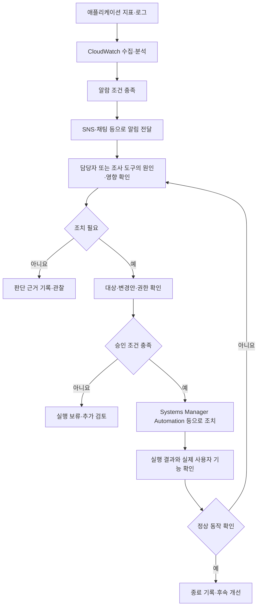

AWS 운영에서는 서비스가 정상적으로 동작하는지 관찰하고, 이상이 생기면 원인을 조사하고 조치한 뒤 결과를 확인해야 한다. 모니터링 화면이 있다는 것과 실제 복구 절차가 준비돼 있다는 것은 다르다.

이 글에서는 관측 데이터 수집, 알림과 조사, 서버 관리, 설정 배포, 백업과 복구에 사용하는 서비스를 정리한다. 예시는 설명을 위한 가상 상황이다. 서비스 명칭과 제공 상태는 2026년 10월 30일에 확인한 AWS 공식 자료를 기준으로 작성했다.

## 먼저 구분할 개념

### 메트릭, 로그, 트레이스

**메트릭**은 시간에 따라 측정하는 수치다. CPU 사용률, 요청 수, 오류율 등을 예로 들 수 있다.

**로그**는 애플리케이션과 시스템이 남긴 개별 기록이다. 오류 메시지와 처리 결과, 요청 ID 등을 확인할 수 있다.

**트레이스**는 하나의 요청이 여러 구성 요소를 거치는 경로와 각 구간의 시간을 연결한 정보다.

요청이 느리다는 메트릭을 보고, 관련 오류 로그를 확인하고, 트레이스로 느린 호출 구간을 찾는 식으로 함께 사용할 수 있다.

### 모니터링과 관측 가능성

**모니터링**은 정한 지표와 상태를 확인하는 활동이다. **관측 가능성(Observability)**은 수집한 데이터를 바탕으로 시스템 내부에서 무슨 일이 일어나는지 파악할 수 있는 능력이다.

CPU 지표 하나만으로 사용자의 로그인 실패 원인을 모두 설명할 수는 없다. 업무 지표와 로그, 요청 경로를 함께 준비해야 한다.

### 알림, 조사, 조치, 검증

알림은 문제가 의심되는 상태를 알려준다. 조사는 원인과 영향을 파악하는 과정이고, 조치는 설정 변경이나 복구 작업을 수행하는 과정이다.

명령이 성공했다고 사용자 기능도 정상으로 돌아왔다고 단정하지 않는다. 조치 후 지표와 실제 요청을 확인하는 검증 단계가 필요하다.

### RTO와 RPO

**RTO(Recovery Time Objective)**는 업무를 복구하는 데 허용하는 시간 목표다. **RPO(Recovery Point Objective)**는 복구 시 허용하는 데이터 손실의 시간 범위다.

예를 들어 RTO 1시간, RPO 15분이라는 가상 목표는 한 시간 안에 업무를 복구하고 데이터 손실은 최대 15분 범위로 관리하려는 기준이다. 서비스를 도입했다는 사실만으로 이 목표가 자동 보장되지는 않는다.

## 운영 데이터 수집과 분석

### Amazon CloudWatch

AWS 리소스와 애플리케이션의 상태를 관찰하는 서비스다. 메트릭, 로그, 알람, 대시보드와 애플리케이션 관측 기능을 제공한다.

- **사용하기 좋은 상황:** 요청 지연과 오류, 자원 사용량을 확인하고 이상 상태에 대응해야 할 때.
- **간단한 예시:** API의 오류율과 응답 시간을 대시보드에 표시하고 임계값을 넘으면 알림을 받는다.
- **구분할 점:** 모든 필요한 데이터가 설정 없이 자동으로 수집되는 것은 아니다. 서비스 기본 지표, 사용자 정의 지표와 애플리케이션 계측을 구분한다.

현재 문서는 OpenTelemetry 메트릭과 기존 CloudWatch 메트릭을 구분한다. 사용하는 수집 방식에 맞는 조회와 알람 기능을 확인해야 한다.

[공식 자료: CloudWatch 개요](https://docs.aws.amazon.com/AmazonCloudWatch/latest/monitoring/WhatIsCloudWatch.html)

### CloudWatch Logs와 Logs Insights

로그를 수집·보관하고 검색·분석하는 CloudWatch 기능이다.

- **사용하기 좋은 상황:** 여러 서버와 애플리케이션의 로그를 모아 장애 시점과 요청별 기록을 찾고 싶을 때.
- **간단한 예시:** 요청 ID로 관련 로그를 검색해 어느 단계에서 오류가 났는지 확인한다.
- **구분할 점:** 로그를 저장한 것과 필요한 필드를 쉽게 검색할 수 있도록 정리한 것은 다르다. 시간, 서비스, 환경과 요청 ID 같은 필드를 일관되게 기록하면 조사에 도움이 된다.

보관 기간, 로그 유형과 수집량에 따른 비용을 확인한다. 필요한 기록을 남기면서 개인정보와 비밀 값은 불필요하게 수집하지 않는다.

[공식 자료: CloudWatch Logs 개요](https://docs.aws.amazon.com/AmazonCloudWatch/latest/logs/WhatIsCloudWatchLogs.html)

### CloudWatch Alarms

관측 데이터와 정한 조건을 평가해 알림이나 지원되는 액션을 실행하는 기능이다.

- **사용하기 좋은 상황:** 담당자가 화면을 계속 보고 있지 않아도 중요한 이상을 알 수 있어야 할 때.
- **간단한 예시:** 오류율이 일정 기간 기준을 넘으면 SNS로 알림을 전달한다.
- **구분할 점:** 알람 상태와 업무 장애는 일대일 관계가 아닐 수 있다. 데이터 누락, 평가 기간과 조건, 실제 사용자 영향을 함께 확인한다.

메트릭 알람과 복합 알람 등 필요한 유형을 선택한다. 현재 문서에는 PromQL과 로그 쿼리 기반 알람도 안내되므로 적용 데이터와 지원 범위를 확인한다.

알람을 만든 것과 실제 수신·대응 경로를 검증한 것은 다르다. 조치 액션을 연결하는 경우에는 실행 권한과 영향을 별도로 검토한다.

[공식 자료: CloudWatch 알람](https://docs.aws.amazon.com/AmazonCloudWatch/latest/monitoring/CloudWatch_Alarms.html)

### CloudWatch Agent와 OpenTelemetry

CloudWatch Agent는 서버와 컨테이너 환경에서 메트릭·로그·트레이스를 수집하는 소프트웨어다. OpenTelemetry는 관측 데이터를 생성·수집·전달하는 데 사용하는 표준과 도구 생태계다.

- **사용하기 좋은 상황:** 기본 서비스 지표만으로 부족해 OS 내부 지표와 애플리케이션 데이터를 추가로 수집해야 할 때.
- **간단한 예시:** EC2의 메모리 관련 지표와 애플리케이션 로그를 수집하고 요청 추적을 연결한다.
- **구분할 점:** Agent를 설치했다는 사실만으로 필요한 수집과 전송이 모두 완료되는 것은 아니다. 설정, 권한, 네트워크와 실제 데이터 도착을 확인한다.

서버를 관리하는 SSM Agent와 관측 데이터를 수집하는 CloudWatch Agent도 역할이 다르다.

[공식 자료: CloudWatch Agent](https://docs.aws.amazon.com/AmazonCloudWatch/latest/monitoring/Install-CloudWatch-Agent.html)

### Application Signals, Synthetics, RUM

애플리케이션의 상태를 서로 다른 관점에서 확인하는 CloudWatch 기능이다.

- **Application Signals:** 서비스의 요청량·오류·지연 등 애플리케이션 성능과 의존성을 파악하는 데 사용한다.
- **Synthetics:** 정기 실행하는 스크립트인 canary로 API와 사용자 흐름을 시험한다. 실제 사용자가 없어도 로그인 페이지나 조회 경로를 점검할 수 있다.
- **RUM(Real User Monitoring):** 실제 사용자의 웹 세션에서 성능과 오류 정보를 수집한다. 실제 접속 환경에서 생기는 문제를 확인할 때 사용한다.

가상 사용자의 정기 점검이 성공해도 모든 실제 사용자의 경험이 정상이라는 뜻은 아니다. 수집 목적과 대상, 사용자 데이터 처리 조건을 정해 함께 활용한다.

[공식 자료: CloudWatch의 애플리케이션 관측 기능](https://docs.aws.amazon.com/AmazonCloudWatch/latest/monitoring/WhatIsCloudWatch.html) · [Synthetics](https://docs.aws.amazon.com/AmazonCloudWatch/latest/monitoring/CloudWatch_Synthetics_Canaries.html) · [RUM](https://docs.aws.amazon.com/AmazonCloudWatch/latest/monitoring/CloudWatch-RUM.html)

### Amazon Managed Service for Prometheus

Prometheus 데이터 모델과 PromQL을 활용해 메트릭을 수집·보관·조회하는 관리형 서비스다.

- **사용하기 좋은 상황:** Kubernetes와 컨테이너 환경에서 기존 Prometheus 생태계를 유지하며 메트릭 저장·조회 운영을 줄이고 싶을 때.
- **간단한 예시:** EKS 애플리케이션의 메트릭을 전송하고 PromQL로 오류율과 요청 지연을 조회한다.
- **구분할 점:** 메트릭 저장·조회 계층과 화면 시각화 계층은 다르다. Grafana와 연결해 사용할 수 있다.

[공식 자료: Managed Service for Prometheus 개요](https://docs.aws.amazon.com/prometheus/latest/userguide/what-is-Amazon-Managed-Service-Prometheus.html)

### Amazon Managed Grafana

여러 데이터 소스의 메트릭·로그·트레이스를 조회하고 시각화하는 관리형 Grafana 서비스다.

- **사용하기 좋은 상황:** 여러 관측 데이터 소스를 공통 대시보드에서 보고 싶을 때.
- **간단한 예시:** CloudWatch와 Prometheus 데이터를 연결해 서비스별 운영 대시보드를 만든다.
- **구분할 점:** Grafana를 만들었다고 모든 원본 데이터가 Grafana에 자동으로 수집·보관되는 것은 아니다. 데이터 소스와 조회 권한을 구성해야 한다.

[공식 자료: Managed Grafana 개요](https://docs.aws.amazon.com/grafana/latest/userguide/what-is-Amazon-Managed-Service-Grafana.html)

## 서비스 영향 확인과 알림, 조사

### AWS Health

AWS 서비스와 계정·리소스에 영향을 줄 수 있는 이벤트와 예정된 활동을 확인하는 서비스다.

- **사용하기 좋은 상황:** AWS 측의 서비스 이벤트나 유지보수가 현재 환경에 영향을 주는지 확인해야 할 때.
- **간단한 예시:** 리소스 관련 예정 작업을 확인하고 대응 일정을 정한다.
- **구분할 점:** AWS Health의 이벤트와 자체 애플리케이션의 오류는 다르다. Health에 문제가 표시되지 않아도 코드나 설정 때문에 장애가 발생할 수 있다.

Health Dashboard와 EventBridge 이벤트, API의 이용 조건을 구분한다. API 사용에는 지원 플랜 조건이 있으므로 모든 계정에서 같은 기능을 사용할 수 있다고 가정하지 않는다.

[공식 자료: AWS Health 개요](https://docs.aws.amazon.com/health/latest/ug/what-is-aws-health.html)

### AWS User Notifications

AWS 알림을 모아 확인하고 전달 채널을 관리하는 서비스다.

- **사용하기 좋은 상황:** 서비스·계정·리전별 알림을 정리하고 필요한 채널로 받고 싶을 때.
- **간단한 예시:** CloudWatch 알람이나 지원 사례 관련 이벤트를 조건에 맞춰 이메일과 알림 센터에서 확인한다.
- **구분할 점:** 알림을 모으고 전달하는 기능이 원본 서비스의 탐지나 장애 복구를 대신하지는 않는다.

기본적으로 생성되는 AWS 관리 알림과 사용자가 조건을 정하는 알림을 구분한다.

[공식 자료: User Notifications 개요](https://docs.aws.amazon.com/notifications/latest/userguide/what-is-service.html)

### Amazon Q Developer in chat applications

운영 알림을 채팅 채널로 전달하고 지원되는 명령과 조사를 연결하는 기능이다. 이전 이름은 AWS Chatbot이다.

- **사용하기 좋은 상황:** 운영팀이 사용하는 채팅 공간에서 알림을 확인하고 함께 대응하고 싶을 때.
- **간단한 예시:** SNS의 운영 알림을 Slack 채널에서 확인하고 관련 리소스를 조사한다.
- **구분할 점:** 알림 열람 권한과 명령 실행 권한을 구분해야 한다. 채널에 참여했다고 모든 AWS 변경 권한이 생기는 것은 아니다.

연결 채널과 IAM 역할, 명령 제한을 목적에 맞게 구성한다.

[공식 자료: Q Developer in chat applications](https://docs.aws.amazon.com/chatbot/latest/adminguide/what-is.html)

### AWS DevOps Agent

관측 데이터와 시스템 맥락을 연결해 운영 문제의 원인 조사와 대응안 검토를 지원하는 AI 에이전트 서비스다.

- **사용하기 좋은 상황:** 메트릭·로그·트레이스와 최근 변경을 함께 살펴보고 원인 후보를 조사하고 싶을 때.
- **간단한 예시:** 배포 후 오류가 증가하면 연결된 데이터와 변경 이력을 바탕으로 원인 가설과 대응 후보를 검토한다.
- **구분할 점:** AI의 원인 가설과 확인된 원인은 다르다. 데이터 연결 범위와 접근 권한, 실제 조치의 실행 조건을 확인해야 한다.

현재 제품 페이지에서는 릴리스 관리의 일부 기능을 프리뷰로 구분한다. 조사·권고·실행의 기능 범위를 한꺼번에 동일하게 취급하지 않는다.

[공식 자료: AWS DevOps Agent](https://aws.amazon.com/devops-agent/)

## 서버 접근과 운영 작업

### AWS Systems Manager

AWS와 하이브리드 환경의 관리 대상 노드를 확인하고 운영 작업을 수행하는 서비스다. 아래 기능들은 Systems Manager 안의 도구이며 각각 독립적인 상위 서비스로 중복 계산하지 않는다.

노드 관리에는 SSM Agent와 필요한 권한, 서비스 통신이 준비돼 있어야 한다. 리소스 목록에 보이는 것과 명령을 실행할 수 있는 상태를 구분한다.

[공식 자료: Systems Manager 개요](https://docs.aws.amazon.com/systems-manager/latest/userguide/what-is-systems-manager.html)

### Session Manager

관리 대상 노드에 대화형 세션으로 접속하는 도구다.

- **사용하기 좋은 상황:** 인바운드 SSH 포트나 별도 배스천을 열지 않고 관리 접근을 구성하고 싶을 때.
- **간단한 예시:** 권한이 있는 운영자가 관리 대상 EC2에 접속해 상태를 조사한다.
- **구분할 점:** 인바운드 포트가 필요 없다는 것이 네트워크 연결과 인증이 전혀 필요 없다는 뜻은 아니다. 에이전트·통신·권한 조건과 세션 기록 설정을 확인한다.

현재 문서는 기존 Session Manager 페이지가 2026년 12월 31일에 종료될 예정이며 기능은 Systems Manager 통합 콘솔에서 계속 제공된다고 안내한다. 화면 변경을 Session Manager 기능 전체 종료로 해석하지 않는다.

[공식 자료: Session Manager](https://docs.aws.amazon.com/systems-manager/latest/userguide/session-manager.html)

### Run Command

관리 대상 노드에 명령과 구성 작업을 원격 실행하는 도구다.

- **사용하기 좋은 상황:** 여러 서버에 같은 점검이나 일회성 작업을 수행해야 할 때.
- **간단한 예시:** 지정한 검증 서버들에서 애플리케이션 상태 확인 명령을 실행하고 결과를 수집한다.
- **구분할 점:** 명령 접수, 각 노드의 실행 성공과 업무 정상 상태를 구분한다. 일부 대상의 성공만 보고 전체 완료로 판단하지 않는다.

[공식 자료: Run Command](https://docs.aws.amazon.com/systems-manager/latest/userguide/run-command.html)

### Automation

런북으로 여러 관리·유지보수·수정 단계를 구성하고 실행하는 도구다.

- **사용하기 좋은 상황:** 반복되는 대응 절차를 일정한 순서와 조건으로 실행하고 싶을 때.
- **간단한 예시:** 대상 확인, 승인, 설정 변경과 결과 점검을 런북 단계로 구성한다.
- **구분할 점:** Run Command가 노드의 명령 실행에 사용된다면 Automation은 AWS API 작업과 명령 등을 포함한 절차를 조정할 수 있다.

실행 역할, 대상과 동시 실행 범위, 오류 허용 조건을 정한다. 모든 런북이 자동으로 승인을 요구하는 것은 아니므로 필요한 승인 단계를 명시해야 한다.

[공식 자료: Systems Manager Automation](https://docs.aws.amazon.com/systems-manager/latest/userguide/systems-manager-automation.html)

### Patch Manager

관리 대상 노드의 패치 검사와 적용을 자동화하는 도구다.

- **사용하기 좋은 상황:** 여러 서버의 업데이트 기준과 적용 일정을 관리해야 할 때.
- **간단한 예시:** 검증 서버를 먼저 점검·업데이트하고 결과를 확인한 뒤 운영 적용을 계획한다.
- **구분할 점:** 패치 검사와 설치, 재부팅과 애플리케이션 정상 확인은 다른 작업이다. OS와 애플리케이션별 지원 범위도 확인한다.

[공식 자료: Patch Manager](https://docs.aws.amazon.com/systems-manager/latest/userguide/patch-manager.html)

## 설정 저장과 점진적 배포

### Systems Manager Parameter Store

이름을 가진 파라미터로 설정 값을 저장·조회하는 기능이다.

- **사용하기 좋은 상황:** 환경별 엔드포인트나 리소스 ID를 코드에서 분리하고 싶을 때.
- **간단한 예시:** 개발·운영 환경의 API 주소를 별도 경로의 파라미터로 관리한다.
- **구분할 점:** 설정 저장과 점진적 배포는 다르다. 값이 바뀌었다고 모든 실행 중 애플리케이션이 즉시 새 값을 사용한다고 가정하지 않는다.

암호화한 값에는 SecureString을 사용할 수 있다. 자격 증명의 자동 교체 등 비밀 관리가 목적이면 Secrets Manager의 전용 기능과 비교한다.

[공식 자료: Parameter Store](https://docs.aws.amazon.com/systems-manager/latest/userguide/systems-manager-parameter-store.html)

### AWS AppConfig

기능 플래그와 동적 설정을 검증하고 배포해 코드 재배포 없이 애플리케이션 동작을 변경하도록 돕는 서비스다.

- **사용하기 좋은 상황:** 새 기능을 일부 대상부터 점진적으로 활성화하거나 운영 설정의 변경 영향을 줄이고 싶을 때.
- **간단한 예시:** 신규 추천 기능을 기능 플래그로 제어하고 지표를 보면서 적용 범위를 확대한다.
- **구분할 점:** 설정을 저장하는 것과 애플리케이션에 검증·배포하는 것은 다르다. 애플리케이션도 설정을 조회하고 해당 값에 따라 동작하도록 구현돼 있어야 한다.

검증기와 배포 전략, CloudWatch 알람을 연결한 롤백을 구성할 수 있다. 설정 롤백이 이미 처리한 주문이나 외부 시스템의 결과까지 되돌리는 것은 아니다.

[공식 자료: AWS AppConfig 개요](https://docs.aws.amazon.com/appconfig/latest/userguide/what-is-appconfig.html)

### 공식 이미지: AppConfig의 설정 배포와 조회

_설정 프로필 생성, 배포와 애플리케이션 조회 흐름. AWS 공식 문서의 원본 이미지._

[이미지 출처: What is AWS AppConfig?](https://docs.aws.amazon.com/appconfig/latest/userguide/what-is-appconfig.html)

그림에서는 관리할 설정을 정하고 프로필을 만든 뒤 배포한다. 애플리케이션은 Agent를 통해 배포된 설정을 조회한다.

핵심은 **관리자가 설정을 변경하는 경로와 애플리케이션이 설정을 읽는 경로가 다르다**는 점이다. 프로필을 생성한 것만으로 설정 배포와 애플리케이션 반영이 끝난 것은 아니다. Agent 대신 지원되는 API로 직접 조회하는 방식도 있다.

## 백업과 복구, 복원력 검증

### AWS Backup

지원되는 리소스의 백업 정책·일정과 작업을 중앙에서 관리하는 서비스다.

- **사용하기 좋은 상황:** 여러 서비스의 백업 기준과 보관을 공통으로 관리해야 할 때.
- **간단한 예시:** 중요 리소스에 백업 계획을 적용하고 작업 성공과 복원 가능 여부를 점검한다.
- **구분할 점:** 백업 생성 성공과 업무 복구 성공은 다르다. 복원 후 데이터, 권한과 애플리케이션 동작을 확인해야 한다.

리소스별 백업·복원·복사 지원과 보관 조건을 확인한다. AWS Backup 밖에서 만든 백업까지 모두 같은 정책으로 자동 관리된다고 가정하지 않는다.

[공식 자료: AWS Backup 개요](https://docs.aws.amazon.com/aws-backup/latest/devguide/whatisbackup.html)

### AWS Elastic Disaster Recovery — AWS DRS

지원되는 서버의 데이터를 복제하고 재해 시 AWS에서 복구 인스턴스를 실행하도록 돕는 서비스다.

- **사용하기 좋은 상황:** 온프레미스나 클라우드의 서버를 AWS로 복구하는 재해 복구 구성이 필요할 때.
- **간단한 예시:** 원본 서버의 데이터를 스테이징 영역에 복제하고 정기 훈련으로 복구 인스턴스와 업무 기능을 확인한다.
- **구분할 점:** 복제 설정만으로 전체 애플리케이션 전환이 완성되는 것은 아니다. 네트워크, 의존 서비스, 접속 경로와 원래 환경으로의 복귀 절차도 필요하다.

백업과 지속적인 복제는 목적과 복구 방식이 다르며 요구사항에 따라 함께 사용할 수 있다.

[공식 자료: Elastic Disaster Recovery 개요](https://docs.aws.amazon.com/drs/latest/userguide/what-is-drs.html)

### Amazon Application Recovery Controller — ARC

가용 영역이나 리전의 문제에 대응해 트래픽과 복구 전환을 관리하는 기능을 제공한다.

- **사용하기 좋은 상황:** 지원되는 리소스에서 문제가 있는 가용 영역을 피하거나 준비된 리전 전환 절차를 관리해야 할 때.
- **간단한 예시:** 한 가용 영역에 문제가 생기면 지원 리소스의 트래픽을 다른 정상 영역으로 이동한다.
- **구분할 점:** 트래픽 전환과 데이터 복제·일관성 확보는 다른 작업이다. 대체 영역의 처리 용량과 의존성도 준비돼 있어야 한다.

zonal shift, zonal autoshift와 리전 복구 관련 기능의 지원 대상·동작을 구분한다. Readiness Check의 신규 고객 제한을 ARC 전체 종료로 해석하지 않는다.

[공식 자료: ARC 개요](https://docs.aws.amazon.com/r53recovery/latest/dg/what-is-route53-recovery.html) · [개별 기능의 유지보수 상태](https://docs.aws.amazon.com/general/latest/gr/maintenance_services.html)

### AWS Resilience Hub

복원력 목표를 정하고 애플리케이션 구성을 평가해 개선 권고를 관리하는 서비스다.

- **사용하기 좋은 상황:** 복구 목표와 실제 구성 사이의 차이를 점검하고 싶을 때.
- **간단한 예시:** 정한 RTO·RPO 목표에 맞춰 애플리케이션을 평가하고 개선 항목을 정리한다.
- **구분할 점:** 평가 결과가 실제 장애 상황의 복구 시간을 보증하는 것은 아니다. 권고 적용과 복구 훈련으로 확인해야 한다.

[공식 자료: Resilience Hub 개요](https://docs.aws.amazon.com/resilience-hub/latest/userguide/what-is.html)

### AWS Fault Injection Service — AWS FIS

실제 AWS 리소스에 장애 조건을 적용해 시스템의 대응을 관찰하는 실험 서비스다.

- **사용하기 좋은 상황:** 재시도·알림·복구 절차가 장애 상황에서도 동작하는지 검증해야 할 때.
- **간단한 예시:** 사전 운영 환경에서 정한 장애 실험을 수행하고 감지·대응 시간을 측정한다.
- **구분할 점:** 단순한 시뮬레이션 화면이 아니라 실제 영향을 주는 액션을 실행한다. 대상과 중지 조건, 복구 동작을 확인해야 한다.

[공식 자료: AWS FIS 개요](https://docs.aws.amazon.com/fis/latest/userguide/what-is.html)

## 운영 지원과 관리 서비스

### AWS Support와 AWS Unified Operations

Support는 플랜에 따라 기술 지원과 도구·전문가 지원을 제공한다. Unified Operations는 중요한 워크로드의 운영·보안 위험과 문제 대응을 지원하는 플랜이다.

- **사용하기 좋은 상황:** AWS 기술 문제와 중요 워크로드의 운영 검토에 전문가 지원이 필요할 때.
- **간단한 예시:** 수집한 증상과 영향을 지원 사례로 전달하고 원인 조사와 대응을 진행한다.
- **구분할 점:** 지원 응답 시간과 장애 해결 시간의 보장은 다르다. 지원 플랜이 모든 일상 운영 작업을 자동 수행하는 것도 아니다.

[공식 자료: AWS Support](https://docs.aws.amazon.com/awssupport/latest/user/getting-started.html) · [Unified Operations](https://docs.aws.amazon.com/awssupport/latest/user/unified-operations-intro.html)

### AWS Managed Services — AMS Accelerate

AWS 서비스와 운영 절차를 활용해 모니터링·인시던트·패치·백업 등 인프라 운영을 지원하는 관리 서비스다.

- **사용하기 좋은 상황:** 자체 운영팀을 보완하거나 정한 범위의 운영을 관리 서비스와 함께 수행하고 싶을 때.
- **간단한 예시:** 합의한 리소스와 기준에 따라 모니터링과 패치·백업 운영을 지원받는다.
- **구분할 점:** 도구를 직접 사용하는 방식과 운영 서비스를 이용하는 방식은 다르다. 지원 범위와 책임, 접근 방식과 변경 절차를 확인해야 한다.

[공식 자료: AMS Accelerate](https://docs.aws.amazon.com/managedservices/latest/accelerate-guide/what-is-acc.html)

## 예시: 알람부터 정상 동작 확인까지

아래는 설명을 위해 작성한 Mermaid 흐름이다. AWS 공식 아키텍처 이미지나 그대로 실행 가능한 자동화 정의가 아니다.

알람에서 조치로 바로 연결되는 선을 의도적으로 생략했다. 모든 알람이 같은 원인인 것은 아니며, 조사 결과와 실행 대상을 확인해야 한다. 사전에 검증된 자동 대응을 구성하는 경우에도 권한과 실행 조건, 결과 확인을 정의한다.

실행 성공과 사용자 기능 정상은 다른 결과다. 재시작 명령이 성공해도 의존 데이터베이스 때문에 요청이 계속 실패할 수 있다. 조치 후 알람 상태와 실제 기능을 함께 확인해야 한다.

알림 전달 경로는 한 가지 예시다. EventBridge, User Notifications와 지원되는 채널 등 목적에 맞는 방식을 선택할 수 있다.

## 기존 자료에서 확인할 제공 상태

- **Amazon DevOps Guru:** 2026년 10월 29일부터 신규 고객을 받지 않으며, 2027년 9월 30일에 지원 종료가 예정돼 있다. 기존 사용자는 제공 기간과 이전 계획을 확인한다.
- **Systems Manager Incident Manager·Change Manager·Application Manager:** 신규 고객 제한이 있는 개별 기능이다. Session Manager·Run Command·Automation 등 상위 서비스의 다른 기능과 구분한다.
- **ARC Readiness Check:** 유지보수 단계로 안내되는 기능이다. 다른 ARC 기능의 제공 상태와 구분한다.
- **Q Developer in chat applications:** 이전 AWS Chatbot 명칭과 같은 기능의 이름 변경이다. 개발 IDE 플러그인 등 다른 제공 경로의 지원 안내와 섞지 않는다.
- **AMS Advanced:** 2027년 6월 30일 지원 종료가 예정돼 있다. AMS Accelerate와 관리 범위·책임·전환 절차를 구분한다.
- **Developer Support·Business Support·Enterprise On-Ramp:** 일반 리전에서는 2027년 1월 1일 종료 안내가 있다. GovCloud 예외와 현재 플랜별 조건은 공식 안내를 확인한다.

[공식 자료: DevOps Guru 전환 안내](https://docs.aws.amazon.com/devops-guru/latest/userguide/devops-guru-transition.html) · [유지보수 단계 목록](https://docs.aws.amazon.com/general/latest/gr/maintenance_services.html) · [AMS Advanced 전환 안내](https://docs.aws.amazon.com/managedservices/latest/userguide/transition-to-accelerate.html) · [Support 플랜 안내](https://docs.aws.amazon.com/awssupport/latest/user/getting-started.html)

## SAA 공부와 연결해서 볼 내용

다음은 이 글의 개념 복습 기준이다. 실제 시험에 포함되는 서비스와 세부 범위는 응시 시점의 공식 시험 안내서를 확인해야 한다.

1. **지표와 로그를 수집하고 알람을 만든다:** CloudWatch와 수집 설정을 확인한다.
2. **AWS 측 이벤트와 예정 작업을 확인한다:** Health와 자체 애플리케이션 모니터링을 구분한다.
3. **메트릭을 저장하고 대시보드로 본다:** Prometheus와 Grafana의 역할을 구분한다.
4. **관리 서버에 접속하고 명령을 실행한다:** Session Manager와 Run Command를 구분한다.
5. **반복 대응 절차를 구성한다:** Automation과 실행 권한·승인 조건을 확인한다.
6. **환경 설정을 분리하고 점진적으로 배포한다:** Parameter Store와 AppConfig를 비교한다.
7. **백업과 재해 복구를 준비한다:** Backup과 DRS, RTO·RPO를 구분한다.
8. **장애 영역을 피하고 복원력을 검증한다:** ARC, Resilience Hub와 FIS의 역할을 비교한다.

운영 도구를 선택할 때는 관찰, 알림, 조사, 실행과 검증을 나눠 생각하면 된다. 데이터를 모으는 구성과 대응 절차, 복구 후 정상 상태의 확인까지 연결해야 운영 요구사항을 충족할 수 있다.

