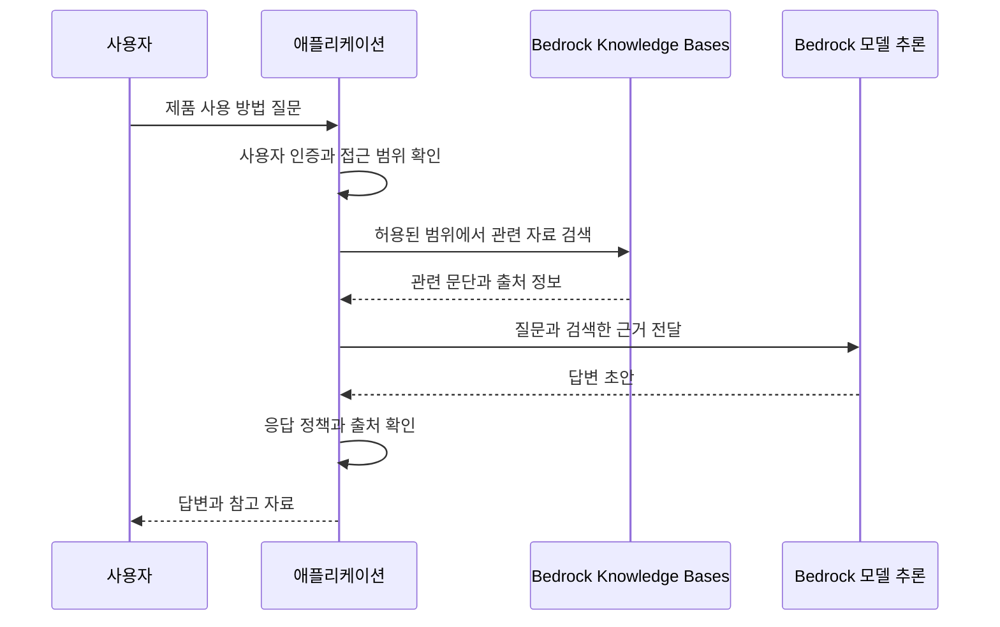

AWS의 인공지능 서비스는 모델을 직접 학습하는 도구부터 음성 인식, 문서 분석, 생성형 AI 애플리케이션까지 범위가 넓다. 같은 AI 서비스라도 입력 데이터와 결과, 직접 개발해야 하는 부분이 다르다.

이 글에서는 생성형 AI, 모델 개발, 텍스트·음성·이미지 처리, 업무 도구와 산업별 기능으로 나눠 이름과 용도를 정리한다. 사용 예시는 이해를 위한 가상 상황이다. 명칭과 제공 상태는 2026년 10월 30일에 확인한 공식 자료를 기준으로 작성했다.

## 먼저 구분할 개념

### AI, 머신러닝, 생성형 AI

**인공지능(AI)**은 인식, 예측, 생성, 의사결정 지원 같은 작업을 수행하는 기술을 포괄한다. **머신러닝(ML)**은 데이터를 통해 패턴을 학습하는 접근이다. **생성형 AI**는 학습한 패턴을 바탕으로 텍스트, 이미지, 음성 등의 결과를 생성한다.

상품 추천과 이상 탐지를 구현한다고 반드시 대화형 언어 모델이 필요한 것은 아니다. 반대로 문서 요약 기능을 만들기 위해 항상 모델을 처음부터 학습해야 하는 것도 아니다.

### 학습과 추론

**학습**은 데이터를 사용해 모델의 파라미터를 조정하는 과정이다. **추론**은 준비된 모델에 입력을 주고 결과를 얻는 과정이다.

과거 구매 이력으로 추천 모델을 만드는 것은 학습이고, 현재 사용자에게 추천 상품을 요청하는 것은 추론이다. 서비스마다 사전 학습된 모델을 호출하는지, 사용자 데이터로 학습하는지, 두 방식을 모두 제공하는지가 다르다.

### RAG와 파인튜닝

**RAG(Retrieval Augmented Generation)**는 질문과 관련된 자료를 검색해 모델이 답변할 때 참고하도록 하는 구성이다. 사내 규정처럼 근거 자료를 찾아 답해야 하는 경우에 사용한다.

**파인튜닝**은 추가 학습으로 모델을 특정 작업이나 형식에 맞게 조정하는 방법이다. 지원되는 모델과 학습 방식에 따라 사용할 수 있는 범위가 다르다.

문서를 검색해 프롬프트에 넣는 것과 모델의 파라미터를 바꾸는 학습은 다른 작업이다. RAG를 사용해도 검색 누락이나 잘못된 답변이 발생할 수 있으므로 근거와 결과를 함께 확인해야 한다. [공식 자료: Bedrock Knowledge Bases와 RAG](https://docs.aws.amazon.com/bedrock/latest/userguide/knowledge-base.html)

## 생성형 AI 애플리케이션과 에이전트

### Amazon Bedrock

여러 공급자의 파운데이션 모델을 API로 사용하고 생성형 AI 애플리케이션을 구성하는 관리형 서비스다.

- **사용하기 좋은 상황:** 모델의 기본 인프라 운영을 줄이면서 요약, 질의응답, 콘텐츠 생성 기능을 애플리케이션에 넣고 싶을 때.
- **간단한 예시:** 고객이 남긴 긴 문의를 모델에 전달해 담당자가 확인할 요약과 분류 초안을 생성한다.
- **구분할 점:** Bedrock은 특정 모델 하나의 이름이 아니다. 사용할 모델, 입력 형식, 지원 기능, 리전, 지연과 비용을 선택해야 한다.

모델마다 텍스트·이미지·음성 지원과 도구 호출, 사용자 정의 기능이 다르다. 모델을 교체할 수 있다는 것과 모든 모델이 동일하게 동작한다는 것은 다른 의미다.

[공식 자료: Amazon Bedrock 개요](https://docs.aws.amazon.com/bedrock/latest/userguide/what-is-bedrock.html)

### Amazon Nova

Amazon이 제공하는 파운데이션 모델 제품군이다. 모델에 따라 텍스트, 이미지, 영상, 문서, 음성 같은 입력과 생성 작업을 처리한다.

- **사용하기 좋은 상황:** Bedrock에서 사용할 모델 후보를 비교하면서 Amazon의 모델 제품군을 검토할 때.
- **간단한 예시:** 제품 안내 문서를 읽고 답변하는 애플리케이션에 적합한 Nova 모델을 선택해 호출한다.
- **구분할 점:** Nova는 모델 제품군이고 Bedrock은 모델을 사용하는 서비스다. Nova의 모델과 세대를 각각 독립적인 AWS 서비스로 세지는 않는다.

모든 Nova 모델이 모든 입력과 출력 형태를 지원하는 것은 아니다. 모델별 지원 범위를 확인한 뒤 선택한다. [공식 자료: Amazon Nova 문서](https://docs.aws.amazon.com/nova/) · [Nova 2 개요](https://docs.aws.amazon.com/nova/latest/nova2-userguide/what-is-nova-2.html)

### Amazon Bedrock Knowledge Bases

조직의 데이터를 검색하고 생성형 AI 응답에 연결하는 Bedrock 기능이다.

- **사용하기 좋은 상황:** 일반적인 모델 지식에 더해 사내 문서나 제품 자료를 근거로 답변해야 할 때.
- **간단한 예시:** 제품 매뉴얼에서 질문과 관련된 내용을 검색해 답변과 참고 자료를 제공한다.
- **구분할 점:** 문서를 등록했다고 모델이 해당 문서를 영구적으로 학습한 것은 아니다. 검색 시점에 관련 정보를 찾아 사용하는 RAG와 모델 학습을 구분한다.

현재 문서는 기반 수집·색인·검색 인프라를 서비스가 관리하는 **Managed Knowledge Base**와 사용자가 RAG 구성 요소를 관리하는 **Customer-managed Knowledge Base**를 구분한다. 연결 데이터 소스와 권한 필터링 같은 지원 범위도 구성에 따라 확인해야 한다.

[공식 자료: Bedrock Knowledge Bases](https://docs.aws.amazon.com/bedrock/latest/userguide/knowledge-base.html)

### Amazon Bedrock Guardrails

생성형 AI의 입력과 출력에 적용할 콘텐츠 정책과 필터를 구성하는 기능이다.

- **사용하기 좋은 상황:** 애플리케이션에서 허용하지 않는 주제나 민감정보를 다루는 방식을 일관되게 적용해야 할 때.
- **간단한 예시:** 상담 요약 결과에서 지원되는 개인정보 항목을 마스킹하도록 설정한다.
- **구분할 점:** Guardrails는 IAM 권한, 데이터 소스 접근 통제, 업무 실행 승인을 대신하지 않는다. 답변의 정확성을 완전히 보장하는 기능도 아니다.

필터와 언어, 모델, 적용 방식별 지원 범위를 확인해야 한다. 모델 호출만 구현했다고 필요한 정책이 자동으로 모두 적용되는 것은 아니다. [공식 자료: Bedrock Guardrails](https://docs.aws.amazon.com/bedrock/latest/userguide/guardrails.html)

### Amazon Bedrock AgentCore

에이전트를 구축·배포·운영하는 데 필요한 관리형 기능을 제공하는 플랫폼이다. 프레임워크와 모델 선택의 유연성을 유지하며 실행, 도구 연결, 메모리와 관측 기능을 사용할 수 있다.

- **사용하기 좋은 상황:** 직접 만든 에이전트를 운영 환경에 배포하고 실행 환경과 도구 접근을 관리해야 할 때.
- **간단한 예시:** LangGraph로 작성한 사내 문의 에이전트를 실행하고, 승인된 조회 API에 연결하며 요청별 실행 기록을 확인한다.
- **구분할 점:** 모델이 답변을 생성하는 기능과 에이전트가 실행되는 환경은 구분한다. AgentCore를 사용해도 업무별 권한과 승인 조건, 실패 처리는 설계해야 한다.

주요 구성에는 실행 환경인 **Runtime**, 도구 연결을 위한 **Gateway**, 대화 맥락을 관리하는 **Memory**, 실행을 추적하는 **Observability** 등이 있다. 필요에 따라 개별 기능을 조합할 수 있다.

오래된 자료의 **Amazon Bedrock Agents**는 현재 **Agents Classic**으로 구분되며 신규 고객에게 제공되지 않는다. 기존 고객은 계속 사용할 수 있지만, 새 구성을 검토할 때는 Classic과 AgentCore를 같은 기능으로 취급하지 않는다.

[공식 자료: AgentCore 개요](https://docs.aws.amazon.com/bedrock-agentcore/latest/devguide/what-is-bedrock-agentcore.html) · [Agents Classic 안내](https://docs.aws.amazon.com/bedrock/latest/userguide/agents.html)

### Amazon Nova Act

브라우저에서 수행하는 반복적인 UI 작업을 AI 에이전트로 자동화하고 운영하는 서비스다.

- **사용하기 좋은 상황:** 웹 화면에서 정보를 조회하거나 입력하는 반복 작업을 자동화해야 할 때.
- **간단한 예시:** 담당자가 접근할 수 있는 공급사 포털에서 주문 진행 상태를 조회해 정리한다.
- **구분할 점:** Nova 파운데이션 모델 제품군과 Nova Act 서비스를 구분한다. UI 작업 자동화에는 로그인과 접근 권한, 제출 조건, 실패 시 처리도 포함해야 한다.

AgentCore가 에이전트의 실행과 도구 연결 등 운영 기반을 제공한다면, Nova Act는 브라우저 UI 작업 자동화에 초점을 둔다. [공식 자료: Amazon Nova Act 개요](https://docs.aws.amazon.com/nova-act/latest/userguide/what-is-nova-act.html)

## 모델 개발과 학습

### Amazon SageMaker AI

데이터 준비부터 모델 개발, 학습, 배포까지 머신러닝 작업을 수행하는 관리형 서비스다. 자체 알고리즘과 프레임워크를 사용하는 작업도 지원한다.

- **사용하기 좋은 상황:** 자체 데이터로 예측 모델을 만들거나 학습과 배포 과정을 세부적으로 제어해야 할 때.
- **간단한 예시:** 과거 주문, 가격, 재고 데이터를 사용해 수요 예측 모델을 학습하고 예측 API로 배포한다.
- **구분할 점:** 모델의 데이터 품질, 평가 방법과 운영 중 성능 관리는 사용자 작업에 포함된다. 관리형 서비스라는 이유만으로 적절한 모델이 자동으로 완성되는 것은 아니다.

기존 Amazon SageMaker의 모델 개발·학습·배포 서비스는 **SageMaker AI**라는 명칭을 사용한다. 현재 **Amazon SageMaker**는 데이터·분석·AI를 통합하는 더 넓은 플랫폼 이름이기도 하므로 문맥을 구분해야 한다.

**SageMaker Unified Studio**는 여러 분석·AI 도구를 함께 사용하는 개발 환경이다. 이를 학습 서비스나 단일 모델과 같은 뜻으로 사용하지 않는다. [공식 자료: SageMaker AI 개요와 명칭 구분](https://docs.aws.amazon.com/sagemaker/latest/dg/whatis.html)

### Bedrock과 SageMaker AI는 어떻게 비교할까?

준비된 파운데이션 모델을 호출해 생성형 AI 기능을 구성하려면 Bedrock을 먼저 검토할 수 있다. 자체 모델의 학습과 배포, 실행 환경과 프레임워크 제어가 중요하면 SageMaker AI를 검토할 수 있다.

다만 Bedrock에도 지원되는 모델 사용자 정의 기능이 있고 SageMaker AI에서도 파운데이션 모델을 사용할 수 있다. 두 서비스를 단순히 모델 사용과 모델 학습으로만 나누기보다는 필요한 제어 범위를 비교하는 편이 정확하다.

## 텍스트, 음성, 대화 처리

### Amazon Comprehend

텍스트에서 언어, 개체, 핵심 구문, 감정 등의 정보를 추출하는 자연어 처리 서비스다. 사용자 정의 분류와 개체 인식도 지원한다.

- **사용하기 좋은 상황:** 많은 텍스트를 분류하고 특정 정보나 표현을 추출해야 할 때.
- **간단한 예시:** 지원되는 언어로 작성된 고객 후기를 분석해 제품명과 감정 분포를 집계한다.
- **구분할 점:** 텍스트를 분석해 구조화된 정보를 얻는 작업과 자유로운 문장을 생성하는 작업을 구분한다. 언어 감지 기능이 지원하는 언어와 감정 분석 기능이 지원하는 언어는 같지 않을 수 있다.

[공식 자료: Amazon Comprehend 개요](https://docs.aws.amazon.com/comprehend/latest/dg/what-is.html)

### Amazon Transcribe

음성을 텍스트로 바꾸는 자동 음성 인식 서비스다. S3의 녹음 파일을 처리하는 배치 방식과 스트리밍 방식을 제공한다.

- **사용하기 좋은 상황:** 회의나 상담 녹음을 검색 가능한 텍스트로 만들거나 실시간 자막을 제공할 때.
- **간단한 예시:** 녹음된 교육 자료를 텍스트로 변환해 자막 제작의 입력으로 사용한다.
- **구분할 점:** 음성을 인식하는 것과 내용을 요약하거나 번역하는 것은 다른 작업이다. 전사 결과를 요약 모델이나 번역 서비스에 추가로 연결할 수 있다.

화자 구분이나 개인정보 처리 같은 기능은 언어와 처리 방식별 지원 조건을 확인한다. [공식 자료: Amazon Transcribe 개요](https://docs.aws.amazon.com/transcribe/latest/dg/what-is.html)

### Amazon Polly

텍스트를 음성으로 합성하는 서비스다.

- **사용하기 좋은 상황:** 안내 문구를 읽어 주거나 교육 콘텐츠와 접근성 기능에 음성을 추가할 때.
- **간단한 예시:** 앱의 공지 문장을 음성 파일로 만들어 사용자가 들을 수 있게 제공한다.
- **구분할 점:** Transcribe가 음성을 텍스트로 바꾼다면 Polly는 텍스트를 음성으로 바꾼다. 음성 종류와 언어별 지원을 확인해야 한다.

[공식 자료: Amazon Polly 개요](https://docs.aws.amazon.com/polly/latest/dg/what-is.html)

### Amazon Translate

텍스트를 다른 언어로 번역하는 관리형 서비스다.

- **사용하기 좋은 상황:** 문서와 고객 문의, 애플리케이션의 텍스트를 여러 언어로 제공해야 할 때.
- **간단한 예시:** 해외 고객의 문의를 담당자가 사용하는 언어로 번역하고 원문과 함께 표시한다.
- **구분할 점:** Translate에 음성을 직접 전달해 전체 통역 과정을 해결하는 구조로 생각하면 안 된다. 음성 인식, 번역, 음성 합성을 연결하면 각각 Transcribe, Translate, Polly가 맡는 작업이 된다.

[공식 자료: Amazon Translate 개요](https://docs.aws.amazon.com/translate/latest/dg/what-is.html)

### Amazon Lex V2

음성과 텍스트로 대화하는 인터페이스를 만드는 서비스다. 사용자의 의도를 파악하고 필요한 입력값을 모으는 대화 흐름을 구성한다.

- **사용하기 좋은 상황:** 예약, 주문 확인처럼 정해진 업무 흐름에 필요한 정보를 대화로 받고 싶을 때.
- **간단한 예시:** 예약 봇이 날짜와 시간을 차례로 확인하고 Lambda를 통해 예약 가능 여부를 조회한다.
- **구분할 점:** Lex는 의도와 슬롯, 대화 흐름을 구성하는 서비스다. 임의의 모델을 호출하는 Bedrock과 역할이 다르다. 생성형 AI 기능을 연동할 수 있어도 업무 흐름 설계는 필요하다.

[공식 자료: Amazon Lex V2 개요](https://docs.aws.amazon.com/lexv2/latest/dg/what-is.html)

## 이미지와 문서 처리

### Amazon Rekognition

이미지와 영상에서 사물, 장면, 텍스트 등의 정보를 분석하는 컴퓨터 비전 서비스다.

- **사용하기 좋은 상황:** 이미지의 객체나 콘텐츠 유형을 분류하고 애플리케이션에서 활용해야 할 때.
- **간단한 예시:** 업로드된 사진에서 사물 라벨을 추출해 이미지 검색용 메타데이터로 저장한다.
- **구분할 점:** 이미지 전반을 분석하는 기능과 문서의 표·양식을 구조적으로 추출하는 기능은 다르다. 문서 구조가 중요하면 Textract와 비교한다.

특정 영상 기능의 종료가 Rekognition 전체 종료를 뜻하지는 않는다. 예를 들어 Person Pathing은 종료된 기능이므로 오래된 예제를 그대로 적용하지 않는다. [공식 자료: Amazon Rekognition 개요](https://docs.aws.amazon.com/rekognition/latest/dg/what-is.html) · [종료 기능 목록](https://docs.aws.amazon.com/general/latest/gr/full_shutdown_services.html)

### Amazon Textract

문서 이미지와 PDF 등에서 텍스트를 감지하고 표, 양식, 키와 값 같은 구조를 추출하는 서비스다.

- **사용하기 좋은 상황:** 지원되는 언어의 문서에서 항목과 값을 읽어 후속 업무에 사용해야 할 때.
- **간단한 예시:** 영어 영수증에서 판매처와 금액을 추출해 담당자가 확인할 입력 초안을 만든다.
- **구분할 점:** 텍스트를 추출하는 것과 추출한 값의 업무상 정확성을 검증하는 것은 다른 작업이다. 결과를 바로 확정하지 않고 신뢰도와 검증 규칙을 적용할 수 있다.

한국어 사용 환경에서는 **언어 지원을 먼저 확인해야 한다.** 현재 공식 제한 문서의 텍스트 감지 지원 언어는 영어, 프랑스어, 독일어, 이탈리아어, 포르투갈어, 스페인어이며 한국어는 포함되지 않는다. 필기와 Queries 기능에도 별도 언어 제한이 있다.

[공식 자료: Amazon Textract 개요](https://docs.aws.amazon.com/textract/latest/dg/what-is.html) · [지원 언어와 문서 제한](https://docs.aws.amazon.com/textract/latest/dg/limits-document.html)

### 공식 이미지: Textract의 비동기 문서 처리

_Amazon Textract의 비동기 문서 처리 흐름. AWS 공식 문서의 원본 이미지._

[이미지 출처: Calling Amazon Textract Asynchronous Operations](https://docs.aws.amazon.com/textract/latest/dg/api-async.html)

이 그림에서는 문서를 S3에 저장하고 Start API를 호출해 작업 ID를 받는다. Textract는 문서를 처리한 뒤 완료 상태를 SNS에 게시하고, 애플리케이션은 SQS에 전달된 알림을 확인한다. 성공한 작업의 ID로 Get API를 호출해 분석 결과를 가져온다.

**완료 알림과 분석 결과는 다르다.** SNS·SQS가 알림을 전달했다고 문서의 전체 분석 결과까지 그 알림에 포함된 것은 아니다. 그림의 SQS 경로 대신 SNS에 Lambda를 구독하는 구성도 사용할 수 있다.

문서 처리 API를 호출하는 동안 웹 요청을 계속 기다리게 하는 방식과, 작업 ID를 저장하고 완료 후 결과를 가져오는 비동기 방식을 구분하는 데 도움이 되는 구조다.

### Amazon Bedrock Data Automation

문서, 이미지, 영상, 음성 같은 비정형 콘텐츠에서 정보를 추출하고 구조화하는 Bedrock 기능이다.

- **사용하기 좋은 상황:** 여러 종류의 콘텐츠를 분석해 업무에 필요한 구조화된 결과를 얻고 싶을 때.
- **간단한 예시:** 지원되는 문서에서 필요한 필드를 추출하고 결과 형식을 업무 시스템에 맞춘다.
- **구분할 점:** Textract와 문서 추출 기능이 겹칠 수 있지만 입력 콘텐츠, 추출 목표와 사용자 정의 방식이 다르다. 파일 형식과 언어별 지원을 확인해 비교한다.

[공식 자료: Bedrock Data Automation 개요](https://docs.aws.amazon.com/bedrock/latest/userguide/bda.html)

## 검색, 추천과 업무 도구

### Amazon Kendra

여러 데이터 저장소의 문서를 수집해 의미와 문맥을 고려한 검색을 제공하는 관리형 정보 검색 서비스다.

**제공 상태:** 2026년 6월 30일부터 유지보수 모드이며, 2026년 7월 30일부터 신규 고객에게 제공되지 않는다. 기존 고객에게는 버그 수정과 보안 업데이트를 제공하지만 새 기능은 개발하지 않는다. 아래 사용 상황과 예시는 기존 고객의 구성을 이해하기 위한 것이다. 공식 문서는 새 검색 애플리케이션에 Amazon Bedrock Managed Knowledge Base를 검토하도록 안내한다. 기능과 연결 대상이 모두 같지는 않으므로 지원 범위를 비교해야 한다. [공식 자료: Kendra 제공 변경](https://docs.aws.amazon.com/kendra/latest/dg/kendra-availability-change.html)

- **사용하기 좋은 상황:** 여러 시스템에 흩어진 문서에서 관련 자료를 찾는 검색 기능을 구현할 때.
- **간단한 예시:** 제품 매뉴얼과 운영 지침을 인덱싱하고 자연어 질문으로 관련 문서와 문단을 검색한다.
- **구분할 점:** 관련 정보를 검색하는 기능과 검색 결과를 이용해 새 답변을 생성하는 기능은 구분한다. Kendra의 검색 결과를 생성형 AI 구성에 연결할 수도 있다.

Kendra는 Bedrock Knowledge Bases나 Q Business와 연동될 수 있으므로 제품 이름만 보고 서로 완전히 대체한다고 판단하지 않는다. [공식 자료: Amazon Kendra 개요](https://docs.aws.amazon.com/kendra/latest/dg/what-is-kendra.html)

### Amazon Personalize

사용자의 행동과 상품·콘텐츠 데이터를 사용해 개인화 추천을 만드는 머신러닝 서비스다.

- **사용하기 좋은 상황:** 사용자별 상품·영상 추천이나 개인화한 순위가 필요할 때.
- **간단한 예시:** 쇼핑몰의 클릭과 구매 이력을 사용해 사용자별 추천 상품 목록을 제공한다.
- **구분할 점:** 추천 문장을 생성하는 것과 실제 행동 데이터를 기반으로 상품을 추천하는 것은 다르다. 입력 이력의 품질과 신규 사용자·신규 상품의 처리, 추천 결과 평가가 필요하다.

[공식 자료: Amazon Personalize 개요](https://docs.aws.amazon.com/personalize/latest/dg/what-is-personalize.html)

### Amazon Q Business

기업 데이터에 기반한 질의응답, 요약과 업무 처리를 구성하는 생성형 AI 어시스턴트 서비스다.

**제공 상태:** 2026년 7월 31일부터 신규 고객에게 제공되지 않는다. 아래 사용 상황과 예시는 기존 고객의 구성을 이해하기 위한 것이다. 신규 고객을 위한 유사 기능의 선택지로 공식 문서는 Amazon Quick을 안내한다. 제품별 지원 기능과 데이터 연결·권한 조건을 확인해야 한다. [공식 자료: Q Business 제공 변경 이력](https://docs.aws.amazon.com/amazonq/latest/qbusiness-ug/doc-history.html)

- **사용하기 좋은 상황:** 직원이 내부 규정과 업무 자료를 질문하고 접근 권한에 맞는 답변을 받게 하고 싶을 때.
- **간단한 예시:** 사내 IT 지침을 연결해 장비 신청 절차를 질문하면 관련 자료와 출처를 제공한다.
- **구분할 점:** 검색 대상의 연결과 색인, 사용자 식별과 권한 구성을 확인해야 한다. 모든 직원이 모든 연결 문서를 조회하도록 만드는 구조와 구분한다.

[공식 자료: Amazon Q Business 개요](https://docs.aws.amazon.com/amazonq/latest/qbusiness-ug/what-is.html)

### Amazon Quick

업무 자료를 활용한 연구, 분석, 자동화와 앱 구성을 지원하는 AI 서비스다. 기존 QuickSight의 BI 기능은 Quick 안의 **Quick Sight**로 제공된다.

- **사용하기 좋은 상황:** 업무 자료와 데이터를 바탕으로 조사·분석하고 반복 업무를 자동화하는 도구가 필요할 때.
- **간단한 예시:** 연결된 자료를 조사해 출처가 있는 보고서를 작성하고 분석 결과를 대시보드와 함께 활용한다.
- **구분할 점:** Bedrock API로 직접 애플리케이션을 개발하는 방식과 완성된 업무 도구를 구성해 사용하는 방식을 구분한다. Q Business와 기능이 겹치는 부분이 있어도 동일한 제품명으로 사용하지 않는다.

[공식 자료: Amazon Quick 개요](https://docs.aws.amazon.com/quick/latest/userguide/what-is.html)

### Amazon Q Developer

AWS 애플리케이션의 이해, 개발과 운영을 지원하는 생성형 AI 어시스턴트다.

- **사용하기 좋은 상황:** AWS 구성과 개발 과정에서 문서 설명, 코드 이해와 개선 지원이 필요할 때.
- **간단한 예시:** AWS 구성의 의미를 질문하고, 애플리케이션 코드의 수정 초안을 검토한다.
- **구분할 점:** Q Business는 기업 업무 데이터 활용에, Q Developer는 개발과 AWS 작업 지원에 초점을 둔다.

현재 공식 문서에는 **Q Developer IDE 플러그인의 지원이 2027년 4월 30일에 종료될 예정**이라고 안내되어 있다. 이 안내를 Q Developer 전체 서비스의 종료로 확대해서 이해하지 않는다. [공식 자료: Amazon Q Developer 개요와 IDE 플러그인 안내](https://docs.aws.amazon.com/amazonq/latest/qdeveloper-ug/what-is.html)

### Kiro

요구사항과 설계, 구현 작업을 연결해 소프트웨어 개발을 지원하는 AI 개발 도구다.

- **사용하기 좋은 상황:** 자연어 요청을 코드 수정으로 연결하면서 요구사항과 구현 계획도 함께 관리하고 싶을 때.
- **간단한 예시:** 로그인 기능의 요구사항을 정리하고 설계와 작업 목록을 만든 뒤 구현을 진행한다.
- **구분할 점:** 모델 API를 제공하는 Bedrock과 개발자가 직접 사용하는 Kiro는 사용 계층이 다르다. 개발 도구의 기능과 사용 방식은 개발 도구 분야에서 추가로 비교할 수 있다.

[공식 자료: Kiro 문서](https://kiro.dev/docs/)

### Amazon PartyRock

코드를 작성하지 않고 생성형 AI 앱을 만들며 기능을 실험하는 도구다. Bedrock의 모델을 활용한다.

- **사용하기 좋은 상황:** 프롬프트와 생성형 AI 앱의 동작을 학습하거나 간단한 아이디어를 시험하고 싶을 때.
- **간단한 예시:** 입력한 주제에서 학습용 퀴즈를 만드는 작은 앱을 구성한다.
- **구분할 점:** 간단한 실험이 동작하는 것과 인증·권한·데이터 처리·운영을 갖춘 서비스가 완성되는 것은 다르다.

[공식 자료: AWS AI 서비스 개요의 PartyRock 설명](https://docs.aws.amazon.com/whitepapers/latest/aws-overview/machine-learning.html)

## 의료 데이터 관련 기능

### Amazon Comprehend Medical

비정형 의료 텍스트에서 질환, 약물, 의료정보에 해당하는 개체와 관계를 추출하는 자연어 처리 서비스다.

- **사용하기 좋은 상황:** 지원되는 언어의 의료 기록에서 항목을 추출하고 구조화해야 할 때.
- **간단한 예시:** 영어 진료 기록에서 약물명과 용량 표현을 찾아 검토할 목록을 만든다.
- **구분할 점:** 현재 의료 개체 감지는 미국 영어 텍스트를 지원한다. 일반 Comprehend의 언어 지원을 그대로 적용하면 안 된다.

진료에 활용하는 경우에는 훈련된 의료 전문가의 정확성 검토가 필요하다. 추출 결과는 진단이나 치료 판단을 대신하지 않는다. [공식 자료: Amazon Comprehend Medical 개요](https://docs.aws.amazon.com/comprehend-medical/latest/dev/comprehendmedical-welcome.html)

### AWS HealthLake

FHIR R4 표준으로 의료 데이터를 저장하고 조회·공유하는 관리형 서비스다. 의료 텍스트의 정보 추출 기능도 제공한다.

- **사용하기 좋은 상황:** 여러 시스템의 의료 데이터를 공통 표준으로 관리하고 상호운용성을 확보해야 할 때.
- **간단한 예시:** 서로 다른 출처의 환자·진료 데이터를 FHIR R4 리소스로 정리해 권한이 있는 애플리케이션에서 조회한다.
- **구분할 점:** HealthLake는 의료 데이터 저장과 표준 기반 교환이 중심이다. 문장에서 의료 개체를 추출하는 Comprehend Medical과 같은 역할로 보면 안 된다.

[공식 자료: AWS HealthLake 개요](https://docs.aws.amazon.com/healthlake/latest/devguide/what-is.html)

### AWS HealthScribe

환자와 의료진의 대화를 텍스트로 변환하고 검토할 수 있는 임상 기록 초안을 생성하는 기능이다. 현재 문서는 Transcribe 개발자 안내서에서 제공된다.

- **사용하기 좋은 상황:** 의료 소프트웨어에서 상담 기록 작성의 초안을 지원해야 할 때.
- **간단한 예시:** 지원되는 영어 진료 녹음에서 전사문과 기록 초안을 생성하고 의료진이 검토·수정한다.
- **구분할 점:** 일반 음성 인식과 달리 의료 대화에 필요한 정보 추출과 기록 초안에 초점을 둔다. 현재 공식 문서는 미국 영어와 버지니아 북부 리전의 제공 조건을 안내한다.

출력은 검토용 초안이며 실제 진료 활용에는 의료 전문가의 확인이 필요하다. [공식 자료: AWS HealthScribe](https://docs.aws.amazon.com/transcribe/latest/dg/health-scribe.html)

## 예시: 제품 매뉴얼을 검색해 답변하는 구성

아래는 설명을 위해 작성한 Mermaid 흐름이다. AWS 공식 아키텍처 이미지가 아니다. 문서 수집과 색인을 미리 구성한 뒤, 질문 시 검색 결과를 모델에 전달하는 RAG의 요청 흐름을 단순화했다.

이 구성은 검색과 생성을 분리한 예시다. Knowledge Bases에서 관련 자료를 조회한 뒤 애플리케이션이 프롬프트를 구성해 모델을 호출한다. 검색과 생성을 결합한 API를 사용하는 구성도 가능하다.

문서를 연결하는 준비 단계와 질문에 답하는 실행 단계는 다르다. 자료를 수정했다면 색인과 동기화 상태를 확인해야 한다. 검색 결과에 필요한 근거가 없을 때의 응답 방식도 정해야 한다.

답변에 출처를 표시할 수 있도록 검색 결과의 메타데이터를 보존하고, 해당 출처가 실제 응답을 뒷받침하는지 확인한다. 출처가 붙어 있다는 사실만으로 답변이 정확하다고 판단하지 않는다.

사용자가 접근할 수 있는 자료의 범위는 실제 검색 단계에 적용해야 한다. 모든 자료를 검색한 후 모델에게 비공개 내용을 말하지 말라고 지시하는 것만으로 권한을 구현하지 않는다.

## 비슷한 이름과 기능을 구분하는 기준

- **Bedrock과 Nova:** 모델을 사용하는 플랫폼과 모델 제품군을 구분한다.
- **Bedrock과 SageMaker AI:** 사용할 모델과 직접 제어해야 하는 학습·배포 범위를 비교한다.
- **Bedrock Agents Classic과 AgentCore:** 기존 에이전트 기능의 신규 고객 제한과 현재 에이전트 운영 플랫폼을 구분한다.
- **RAG와 파인튜닝:** 검색한 자료를 참조하는지, 추가 학습으로 모델을 조정하는지 구분한다.
- **Kendra와 Knowledge Bases:** 검색 인덱스와 검색 경험을 구성할지, RAG 기능을 중심으로 구성할지 비교한다. 둘을 연결하는 구성도 가능하다.
- **Transcribe와 Polly:** 음성에서 텍스트로 바꾸는지, 텍스트에서 음성으로 바꾸는지 확인한다.
- **Textract와 Comprehend:** 문서에서 텍스트·구조를 추출하는지, 텍스트의 의미 정보를 분석하는지 확인한다.
- **Rekognition과 Textract:** 이미지·영상 분석이 필요한지, 문서의 표·양식 추출이 필요한지 확인한다.
- **Q Business, Quick, Q Developer, Kiro:** 기업 데이터 활용, 업무 연구·자동화, AWS 개발 지원, 소프트웨어 개발 작업 중 어떤 목적이 중심인지 확인한다.

일부 기능은 겹친다. 서비스 이름만으로 고르기보다는 입력 형태, 원하는 결과와 직접 구현할 부분을 정한 뒤 비교한다.

## 신규 고객 제한과 종료된 항목

공식 개요에 이름이 남아 있어도 신규 구성을 그대로 진행할 수 있는 것은 아니다. 일반 개요보다 개별 서비스의 제공 상태와 종료 공지를 함께 확인해야 한다.

### 신규 고객 제한

- **Amazon Kendra:** 2026년 7월 30일부터 신규 고객에게 제공되지 않는다. 유지보수 모드와 새 검색 구성의 선택지는 앞의 서비스 설명에서 확인한다. [공식 안내](https://docs.aws.amazon.com/kendra/latest/dg/kendra-availability-change.html)
- **Amazon Q Business:** 2026년 7월 31일부터 신규 고객에게 제공되지 않는다. 신규 고객의 유사 기능 선택지로 Amazon Quick을 안내한다. [공식 변경 이력](https://docs.aws.amazon.com/amazonq/latest/qbusiness-ug/doc-history.html)
- **Amazon Forecast:** 시계열 예측 서비스다. 2024년 7월 25일부터 신규 고객에게 제공되지 않는다. 수요 예측을 위한 새로운 구성을 검토한다면 이 제한을 먼저 반영해야 한다. [공식 변경 이력](https://docs.aws.amazon.com/forecast/latest/dg/doc-history.html)
- **Amazon Fraud Detector:** 거래나 가입 등의 부정 행위 위험을 평가하는 서비스다. 2025년 11월 7일부터 신규 고객에게 제공되지 않는다. [공식 변경 이력](https://docs.aws.amazon.com/frauddetector/latest/ug/doc-history.html)
- **Amazon Monitron:** 센서와 게이트웨이를 포함한 설비 상태 모니터링 시스템이다. 2024년 10월 31일부터 신규 고객에게 제공되지 않는다. [공식 변경 이력](https://docs.aws.amazon.com/Monitron/latest/getting-started-guide/doc-history.html)
- **Amazon Augmented AI — A2I:** 모델 결과의 사람 검토 워크플로를 구성하는 기능이다. 현재 신규 고객에게 제공되지 않으며 기존 고객은 계속 사용할 수 있다. 모델 결과를 사람이 검토한다는 개념 자체가 A2I 서비스에만 한정되는 것은 아니다. [공식 안내](https://docs.aws.amazon.com/sagemaker/latest/dg/a2i-getting-started.html)
- **Amazon Bedrock Agents Classic:** 신규 고객에게 제공되지 않는다. 기존 고객 이용과 신규 AgentCore 구성을 구분한다. [공식 안내](https://docs.aws.amazon.com/bedrock/latest/userguide/agents.html)

### 종료된 서비스와 기능

- **Amazon Lookout for Equipment:** 2026년 10월 7일에 지원이 종료됐다. 설비 이상 감지의 신규 서비스 예시로 제시하지 않는다. [공식 종료 안내](https://aws.amazon.com/lookout-for-equipment/)
- **Amazon Lookout for Metrics:** 2025년 10월 10일에 종료됐다.
- **Amazon Lookout for Vision:** 2025년 10월 31일에 종료됐다.
- **AWS DeepComposer:** 2025년 9월 17일에 종료됐다.
- **AWS DeepLens:** 2024년 1월 31일에 종료됐다.
- **AWS Panorama:** 2026년 5월 20일에 종료됐다.
- **SageMaker AI Ground Truth Plus:** 2026년 6월 30일에 종료됐다. 이 기능의 종료를 SageMaker AI 전체 종료로 이해하지 않는다.

[공식 자료: 완전 종료된 서비스와 기능 목록](https://docs.aws.amazon.com/general/latest/gr/full_shutdown_services.html)

코드 검토·성능 분석이나 운영 이상 분석처럼 AI를 내부에 사용하는 도구는 개발 도구와 운영 분야에서도 다룰 수 있다. AI를 사용한다는 이유로 모든 제품을 이 글에서 별도 서비스로 중복 계산하지 않는다.

## SAA 공부와 연결해서 볼 내용

다음은 이 글의 개념을 복습하기 위한 구분이다. 실제 출제 서비스와 세부 범위는 응시 시점의 공식 시험 안내서를 확인해야 한다.

1. **이미지와 영상을 분석한다:** Rekognition의 입력과 결과를 확인한다.
2. **문서에서 표와 양식을 추출한다:** Textract의 역할과 지원 언어를 확인한다.
3. **음성을 텍스트로 바꾼다:** Transcribe와 배치·스트리밍 방식을 구분한다.
4. **텍스트를 음성으로 바꾼다:** Polly를 확인한다.
5. **텍스트를 다른 언어로 번역한다:** Translate를 확인한다.
6. **텍스트에서 개체와 감정을 분석한다:** Comprehend의 기능별 언어 지원을 확인한다.
7. **의도와 입력값을 대화로 수집한다:** Lex의 의도·슬롯·업무 함수 관계를 확인한다.
8. **자체 데이터로 모델을 학습·배포한다:** SageMaker AI를 확인한다.
9. **파운데이션 모델을 호출하고 조직 자료를 연결한다:** Bedrock과 Knowledge Bases의 역할을 구분한다.

AI 서비스의 선택 기준은 이름보다 작업이다. 무엇을 입력하고 어떤 결과가 필요한지, 준비된 API로 해결할지 자체 모델이 필요한지, 지원 언어와 리전은 맞는지를 먼저 확인한다.

