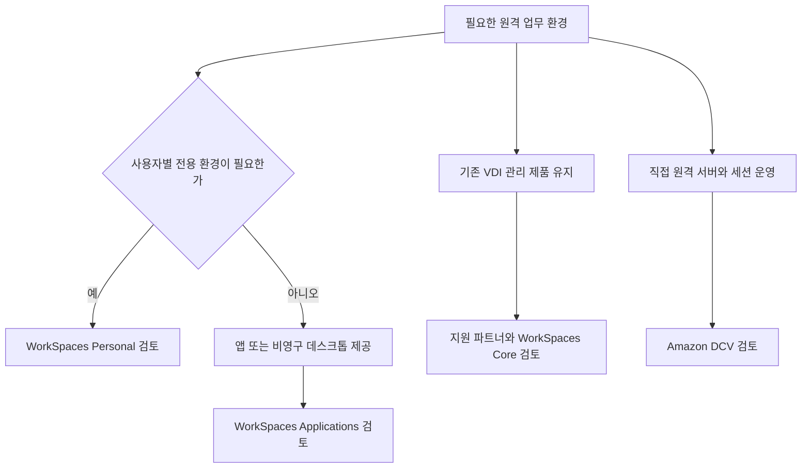
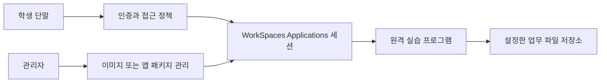

직원이나 외부 협력자가 업무 프로그램을 사용하려면 실행 환경이 필요하다. 모든 단말에 프로그램과 데이터를 설치하는 대신, 클라우드에서 실행하고 화면을 원격으로 전달하는 방식을 사용할 수 있다.

AWS의 최종 사용자 컴퓨팅(End User Computing, EUC) 분야는 이러한 데스크톱·애플리케이션 제공에 사용한다. 개인별 업무 환경, 교육용 프로그램, 기존 VDI 연동과 고성능 원격 작업은 요구 사항이 다르므로 구분해서 검토해야 한다.

이 글에서는 관련 제품의 역할과 사용 예시를 정리한다. 예시는 가상 상황이며, 이름과 제공 상태는 2026년 10월 30일에 확인한 AWS 공식 자료를 기준으로 한다.

## 먼저 구분할 개념

- **VDI(Virtual Desktop Infrastructure)**: 사용자에게 가상 데스크톱을 제공하는 인프라이다.
- **DaaS(Desktop as a Service)**: 데스크톱 제공에 필요한 기능을 서비스 형태로 이용하는 방식이다.
- **애플리케이션 스트리밍**: 원격 환경에서 프로그램을 실행하고 화면을 사용자에게 전달하는 방식이다.
- **영구 데스크톱**: 사용자에게 지속적으로 할당하여 개인 설정과 데이터를 유지하는 환경이다.
- **비영구 데스크톱**: 세션마다 표준 환경을 제공하고 실행 환경 자체에 개인 상태를 계속 유지하지 않는 방식이다.

비영구 환경에서도 사용자 파일과 설정을 별도 저장소에 보관할 수 있다. 실행 환경의 수명과 업무 데이터의 보관 기간은 구분해야 한다.

현재 AWS는 WorkSpaces를 가상 데스크톱과 애플리케이션 제공을 위한 제품군으로 소개한다. 예전 자료의 AppStream 2.0은 현재 WorkSpaces Applications라는 이름으로 안내된다. 제품 이름과 세부 기능을 모두 별개의 서비스 개수로 세지 않는다.

[공식 자료: Amazon WorkSpaces](https://aws.amazon.com/workspaces/) · [AppStream 클라이언트 이름 변경 안내](https://docs.aws.amazon.com/appstream2/latest/developerguide/client-application-windows-installation-user.html)

## 1. Amazon WorkSpaces Personal: 개인별 영구 데스크톱

**Amazon WorkSpaces Personal**은 사용자에게 전용으로 할당하는 영구 가상 데스크톱을 제공한다. 개인에게 배정된 업무용 PC와 비슷한 사용 방식이다.

**사용하기 좋은 상황**은 직원이 지속적으로 같은 데스크톱과 개인 설정을 사용해야 하는 경우이다.

**예시**: 재택근무 직원에게 업무 프로그램을 설치한 가상 데스크톱을 배정한다. 직원은 지원하는 단말이나 브라우저로 접속하고, 조직은 이미지와 접근 정책 등을 관리한다.

**구분할 점**은 WorkSpaces를 사용해도 애플리케이션과 사용자 환경의 관리가 없어지는 것은 아니라는 것이다. 지원 운영체제, 번들, 이미지, 소프트웨어 설치·업데이트와 인증 방식을 검토한다.

디렉터리와 인증 방식은 운영체제·라이선스·구성에 따라 확인한다. 모든 환경에서 같은 디렉터리 구성이 필수이거나 동일한 기능을 제공한다고 단정하지 않는다. 지원되는 구성에서는 Microsoft Entra ID 등의 연동도 검토할 수 있다.

[공식 자료: WorkSpaces와 Personal 개요](https://docs.aws.amazon.com/workspaces/latest/adminguide/amazon-workspaces.html)

## 2. Amazon WorkSpaces Applications: 프로그램과 비영구 데스크톱 제공

**Amazon WorkSpaces Applications**는 데스크톱 애플리케이션을 AWS에서 실행하고 사용자에게 스트리밍하는 관리형 서비스이다. 이전 이름은 **Amazon AppStream 2.0**이다.

**사용하기 좋은 상황**은 모든 단말에 프로그램을 설치하기 어렵거나, 일정 시간 동안 동일한 실행 환경을 여러 사용자에게 제공해야 하는 경우이다.

**예시**: 학교가 실습용 프로그램을 준비하고 학생들이 지원 브라우저나 클라이언트에서 접속하도록 한다. 학생 단말의 설치 환경을 개별 관리하는 대신 중앙에서 제공할 애플리케이션을 구성한다.

**구분할 점**은 웹사이트로 새로 개발하는 것과 다르다는 것이다. 기존 데스크톱 프로그램은 원격 컴퓨팅 자원에서 실행되고, 사용자는 화면과 입력을 통해 이용한다. 프로그램의 라이선스와 원격 실행 지원 여부는 별도로 확인해야 한다.

이름이 Applications라고 애플리케이션 창만 제공하는 것은 아니다. 비영구 가상 데스크톱 제공에도 사용할 수 있다. WorkSpaces Personal의 개인별 영구 데스크톱과 비교할 때는 사용자 상태를 어디에 저장하고 세션 종료 후 무엇을 유지할지 먼저 정한다.

[공식 자료: WorkSpaces Applications란?](https://docs.aws.amazon.com/appstream2/latest/developerguide/what-is-appstream.html) · [비영구 데스크톱 제공 안내](https://docs.aws.amazon.com/workspaces/latest/adminguide/wsp-pools-end-of-support.html)

### Image·Fleet·Stack의 역할

구축할 때는 다음 구성 요소를 구분한다.

- **Image**: 제공할 애플리케이션과 기본 설정을 포함하는 이미지이다.
- **Image builder**: 애플리케이션을 설치하고 시험하여 이미지를 만드는 환경이다.
- **App block**: 지원하는 구성에서 애플리케이션 파일과 설정을 패키징하는 단위이다.
- **Fleet**: 애플리케이션과 데스크톱을 실행할 스트리밍 인스턴스의 집합이다.
- **Stack**: 연결된 Fleet, 사용자 접근 정책과 저장 설정 등을 묶는 구성이다.

**구성 예시**: 실습 프로그램을 설치한 이미지를 만들고 Fleet에 적용한다. Stack에서 접근·저장 정책을 설정하여 학생에게 제공한다. 모든 Fleet 유형이 같은 이미지·App block 방식을 사용하는 것은 아니므로 유형별 요구 사항을 확인한다.

이미지를 바꿨다고 기존 사용자 파일이 자동으로 이전되는 것은 아니다. 실행 환경 배포와 개인 데이터 보관은 별도 절차로 설계한다.

[공식 자료: WorkSpaces Applications 주요 개념](https://docs.aws.amazon.com/appstream2/latest/developerguide/what-is-concepts.html)

## 3. Amazon WorkSpaces Core: 기존 VDI 관리 제품과 연동

**Amazon WorkSpaces Core**는 타사 VDI 관리 솔루션과 통합하는 관리형 가상 데스크톱 인프라이다. 고객은 지원하는 파트너 제품의 관리 기능과 AWS 인프라를 함께 사용할 수 있다.

**사용하기 좋은 상황**은 기존 VDI 관리 도구와 운영 방식을 활용하면서 실행 인프라를 AWS로 옮기거나 확장하려는 경우이다.

**예시**: 기업이 사용 중인 지원 VDI 솔루션으로 사용자·데스크톱·세션을 관리하고, AWS의 WorkSpaces Core 인프라를 연결해 운영한다.

**구분할 점**은 Core만 선택하면 사용자용 데스크톱 제품 전체가 완성되는 것은 아니라는 것이다. 타사 관리 계층과 연동하는 방식이므로 파트너 솔루션의 기능·라이선스·지원 범위를 함께 확인한다.

공식 문서는 미리 구성된 **Core bundle**과 **Core Managed Instances**를 구분한다. 두 제공 방식의 리소스 위치·관리 방식·구성 개념이 같지는 않다.

[공식 자료: WorkSpaces Core 소개](https://docs.aws.amazon.com/workspaces-core/latest/pg/intro.html) · [WorkSpaces VDI 파트너](https://aws.amazon.com/workspaces/vdi-partners/)

### Core Managed Instances의 리소스 위치

**WorkSpaces Core Managed Instances**는 고객 AWS 계정에 EC2 인스턴스를 배치하는 방식이다. 기존 Core 번들과 동일한 구조로 이해하면 안 된다.

_AWS 공식 WorkSpaces Core Managed Instances 구성도. 파트너 소프트웨어와 WorkSpaces 관리 API, 고객 AWS 계정의 VDI 인스턴스 관계를 보여준다._

그림의 오른쪽에는 고객 AWS 계정의 EC2 인스턴스와 게이트웨이가 표시된다. 왼쪽 파트너 소프트웨어는 WorkSpaces API를 통해 관리 기능을 연동한다.

조회와 같은 EC2 API 호출과 인스턴스 생성·종료 같은 변경 작업의 경로도 구분된다. 공식 문서는 생성·종료 등에는 WorkSpaces Core SDK를 사용하도록 안내한다. 고객 계정의 EC2라고 해서 관리되는 리소스를 일반 EC2와 같은 방식으로 임의 변경하는 것은 아니다.

이 그림은 Core Managed Instances에 해당한다. WorkSpaces Personal이나 모든 Core 제공 방식의 공통 구조를 나타내는 그림이 아니다.

[공식 자료 및 이미지 출처: Core Managed Instances 아키텍처](https://docs.aws.amazon.com/workspaces-core/latest/pg/instance-architecture.html)

## 4. Amazon DCV: 원격 화면 전송 프로토콜

**Amazon DCV**는 원격 데스크톱과 애플리케이션의 화면을 전달하는 고성능 원격 디스플레이 프로토콜이다. 이전 이름은 **NICE DCV**이다.

**사용하기 좋은 상황**은 원격 서버에서 그래픽·연산 작업을 실행하고, 사용자는 상대적으로 가벼운 단말에서 결과를 보며 작업해야 하는 경우이다.

**예시**: 엔지니어가 EC2의 고성능 인스턴스에서 설계 프로그램을 실행하고, 노트북에서 DCV 세션으로 화면을 확인하며 조작한다.

**구분할 점**은 전송 기술과 관리형 데스크톱 제품이 다르다는 것이다. 직접 DCV 서버를 운영한다면 서버·세션·인증·네트워크·애플리케이션 관리가 필요하다. WorkSpaces가 제공하는 관리 기능 전체를 DCV만으로 자동 제공받는 것은 아니다.

DCV 서버는 애플리케이션의 시각적 출력을 압축해 암호화된 픽셀 스트림으로 전송한다. 그래픽 작업을 원격에서 수행할 수 있지만 실제 사용성은 네트워크 지연, 대역폭, 인스턴스 성능과 클라이언트 조건에 영향을 받는다.

[공식 자료: Amazon DCV란?](https://docs.aws.amazon.com/dcv/latest/adminguide/what-is-dcv.html)

## 5. WorkSpaces Applications의 AI 에이전트 접근

WorkSpaces Applications는 사람이 접속하는 용도 외에 **AI 에이전트가 데스크톱 애플리케이션을 조작하도록 하는 기능**도 제공한다. 별도 제품 개수로 세기보다 Applications의 접근 기능으로 구분한다.

**사용하기 좋은 상황**은 API가 없거나 화면 중심으로 운영되는 기존 프로그램을 에이전트와 연결하려는 경우이다.

**예시**: 준비된 원격 환경의 업무 프로그램에서 AI 에이전트가 자료를 조회하고, 필요한 값을 입력하는 흐름을 구성한다. 실제 제출·변경은 업무 권한과 검토 기준에 따라 제한한다.

**구분할 점**은 에이전트 모델 자체를 제공하는 기능과 다르다는 것이다. 에이전트가 사용할 모델·로직을 준비하고, 접근이 활성화된 Stack과 세션을 관리형 MCP 서비스에 연결한다. 에이전트는 IAM 자격 증명으로 인증하며 허용된 도구를 사용한다.

세션 생성 성공과 업무 처리 성공은 다르다. 화면 조작 후 실제 저장 결과를 검증하고, 필요한 감사 기록과 스크린샷의 보관 범위를 정한다. 사람용 접근 정책을 그대로 복사하기보다 에이전트가 필요한 기능만 사용할 수 있도록 설계한다.

[공식 자료: WorkSpaces Applications 에이전트 접근 설정](https://docs.aws.amazon.com/appstream2/latest/developerguide/getting-started-agent-access.html)

## 기존 환경에서 확인할 제공 제한

예전 강의와 제품 소개에는 아래 기능이 신규 구축 후보로 설명될 수 있다. 현재는 개별 제공 변경 안내를 함께 읽어야 한다.

### WorkSpaces Pools

공유 인프라에서 표준화된 비영구 데스크톱을 제공하는 방식이다. 과거에는 교대근무나 단기 교육처럼 개인 전용 데스크톱이 필요하지 않은 상황에 사용할 수 있었다.

**현재 상태**: 개별 종료 안내는 2026년 7월 31일부터 신규 고객을 받지 않으며, 지원 종료일을 **2027년 12월 31일**로 안내한다. AWS는 WorkSpaces Applications로의 이전을 권장한다.

이미지 이전 가능 여부와 함께 VPC, Fleet, Stack과 사용자 접근을 새 환경에 맞게 구성해야 한다. 제품 이름을 바꾸는 것만으로 이전이 완료되는 것은 아니다.

[공식 자료: WorkSpaces Pools 지원 종료](https://docs.aws.amazon.com/workspaces/latest/adminguide/wsp-pools-end-of-support.html)

### WorkSpaces Secure Browser

사용자에게 원격 브라우저 세션을 제공하는 방식이다. 전체 데스크톱 대신 사내 웹 애플리케이션에 접근하는 용도로 이해할 수 있다.

**현재 상태**: 2026년 10월 29일부터 신규 고객에게 제공하지 않는다. 기존 고객은 계속 사용할 수 있다고 안내한다.

대안으로 WorkSpaces Applications에 자체 관리 Chrome 이미지를 구성하는 방식 등이 안내된다. 원격 렌더링이 가능하더라도 SSO, 브라우저 정책 배포, 통합 감사와 데이터 보호 기능이 동일하게 제공되는 것은 아니다. 필요한 기능별 차이를 확인한다.

[공식 자료: Secure Browser 제공 변경과 대안](https://docs.aws.amazon.com/workspaces-web/latest/adminguide/workspaces-secure-browser-maintenance-mode.html)

### WorkSpaces Thin Client

WorkSpaces 등의 원격 업무 환경에 접속하기 위한 단말과 관리 서비스이다. 가상 데스크톱이 실행되는 서버 자체와 구분한다.

**현재 상태**: 신규 고객 도입이 제한되어 있으며, 지원 종료일은 **2027년 3월 31일**이다. 기존 사용자는 지원 단말·클라이언트 등 대체 접속 방식으로의 전환을 준비해야 한다.

이 종료를 WorkSpaces 데스크톱 전체의 종료로 해석해서는 안 된다. 공식 안내는 다른 지원 단말을 통해 기존 WorkSpaces를 계속 사용할 수 있다고 설명한다.

[공식 자료: WorkSpaces Thin Client 지원 종료](https://docs.aws.amazon.com/workspaces-thin-client/latest/ug/workspacesthinclient-end-of-support.html)

### PCoIP 기반 WorkSpaces Personal

PCoIP는 기존 WorkSpaces Personal에서 사용하던 화면 전송 방식이다.

**현재 상태**: 개별 종료 안내는 신규 고객 제한과 함께 지원 종료일을 **2027년 10월 31일**로 안내한다. AWS는 DCV로의 이전을 안내한다. 이 변경은 DCV 기반 WorkSpaces Personal의 종료를 의미하지 않는다.

전송 프로토콜만 바꾸는 작업과 운영체제·번들까지 바꾸는 작업은 데이터 보존 범위가 다를 수 있다. 클라이언트, 방화벽, 주변 장치와 애플리케이션을 시험한 뒤 이전한다. PCoIP 전용 Zero Client 하드웨어도 별도 점검 대상이다.

[공식 자료: PCoIP 기반 WorkSpaces Personal 지원 종료](https://docs.aws.amazon.com/workspaces/latest/adminguide/workspaces-pcoip-end-of-support.html)

공통 수명 주기 목록과 개별 안내의 종료일이 다르게 표시되는 경우에는 개별 제품 안내의 날짜를 기준으로 확인하였다. 실제 이전 일정은 계정의 AWS Health 알림과 지원 안내를 함께 확인한다.

## 요구 사항에 따라 선택하는 방법

아래 Mermaid는 직접 작성한 선택 기준이다. 모든 제품의 기능과 조건을 표현한 것은 아니다.

**개인별 영구 환경**이 필요하다면 Personal을 먼저 검토한다. **표준 프로그램이나 비영구 데스크톱**을 제공한다면 Applications를 검토한다. **기존 VDI 관리 계층**을 유지하려면 지원 파트너와 Core의 통합 범위를 확인한다.

단순히 사용자 수만으로 선택하지 않는다. 사용 시간, 개인 설정 유지, 운영체제·프로그램 라이선스, 그래픽 요구와 주변 장치 지원을 함께 비교한다.

## 구성 예시: 교육용 애플리케이션 제공

학교에서 학생에게 일정 기간 같은 실습 프로그램을 제공한다고 가정한다.

1. 라이선스와 지원 운영체제를 확인한다.
2. 프로그램이 포함된 실행 환경을 준비하고 시험한다.
3. Applications의 적합한 Fleet 유형을 선택한다.
4. Stack과 사용자 인증·접근 정책을 구성한다.
5. 학생의 작업 파일을 저장할 위치를 정한다.
6. 수업 전 동시 접속, 시작 시간과 주변 장치 사용을 확인한다.
7. 수업 종료 후 불필요한 실행 자원을 정리하되 필요한 파일은 보관한다.

이 그림은 역할을 설명하는 개념도이다. 인증 서비스와 저장소가 모두 서비스에 기본 포함된다는 의미는 아니다. 실제 구성에서는 Fleet 유형과 지원 저장·인증 방식을 확인한다.

사용자가 로그아웃해도 파일이 남아야 한다면 저장 위치를 명확히 해야 한다. 세션 종료 후 로컬 임시 파일이 사라지는 동작을 데이터 백업과 혼동해서는 안 된다.

## 도입 전에 확인할 사항

**네트워크와 접속 품질**을 확인한다. 서버 성능이 높아도 지연과 패킷 손실이 크면 사용성이 나빠질 수 있다. 사용자 위치, 리전과 네트워크 경로를 기준으로 검증한다.

**데이터 반출 정책**을 설정한다. 원격에서 실행한다고 클립보드·파일 다운로드·인쇄·화면 촬영까지 모두 차단되는 것은 아니다. 지원하는 제어와 단말 정책을 함께 검토한다.

**저장과 복구**를 분리해 설계한다. 영구 데스크톱도 실수로 삭제한 파일과 장애에 대비할 보호가 필요하다. 비영구 환경도 업무 파일의 별도 보관이 필요할 수 있다.

**라이선스와 비용**을 확인한다. 관리형 서비스 요금 외에 운영체제·애플리케이션·파트너 솔루션·저장소·네트워크 관련 비용이 발생할 수 있다. 사용자가 접속하지 않는 시간에도 어떤 자원에 요금이 부과되는지 확인한다.

**운영 책임**을 정한다. AWS 관리 인프라를 사용하더라도 고객의 사용자 계정, 업무 프로그램, 권한과 데이터 정책은 관리가 필요하다. 파트너 제품을 사용하면 각 조직의 지원·업데이트 책임도 구분한다.

## SAA 공부에서 구분할 내용

모든 EUC 제품과 기능이 SAA에서 같은 비중으로 다뤄진다는 의미는 아니다. 요구 사항을 읽고 적절한 제공 방식을 구분하는 데 중점을 둔다.

- **WorkSpaces Personal과 Applications**: 개인별 영구 환경과 애플리케이션·비영구 환경 제공을 구분한다.
- **WorkSpaces Applications와 AppStream 2.0**: 이전 이름과 현재 이름의 관계를 이해한다.
- **WorkSpaces Core와 완성형 데스크톱**: 타사 VDI 관리 계층과 통합할 인프라의 역할을 구분한다.
- **DCV와 관리형 서비스**: 화면 전송 기술과 사용자·데스크톱 관리 제품을 구분한다.
- **인증과 접근 권한**: 서비스에 로그인하는 것과 업무 시스템의 데이터를 사용할 권한은 별도 조건이다.
- **영구 환경과 백업**: 상태를 유지하는 것과 데이터 복구를 보장하는 것은 다르다.
- **단말과 실행 환경**: Thin Client의 제공 변경을 WorkSpaces 전체의 종료와 혼동하지 않는다.

최종 사용자 컴퓨팅은 업무 프로그램의 실행 위치와 사용자 단말을 분리하는 데 사용한다. 어떤 상태를 유지해야 하는지, 필요한 프로그램과 데이터를 누가 관리할지 정한 뒤 제품을 선택해야 한다.

