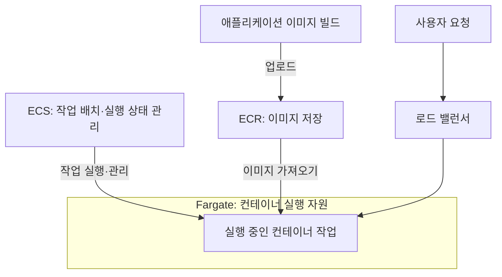

AWS 컴퓨팅 서비스는 애플리케이션을 실행할 CPU·메모리 등의 자원을 제공하거나, 실행 환경의 배포·확장·관리를 지원한다.

같은 웹 애플리케이션이라도 가상 서버에 직접 설치할 수 있고, 컨테이너로 배포할 수도 있으며, 요청이나 이벤트에 따라 코드를 실행할 수도 있다. 서비스 이름보다 **실행 방식과 직접 관리해야 하는 범위**를 구분하면 차이를 이해하기 쉽다.

이 글에서는 컴퓨팅과 관련된 서비스의 설명, 사용하기 좋은 상황, 간단한 예시를 정리한다. 컨테이너 서비스와 실행 위치, 관리 도구도 함께 다루되 서로 다른 역할임을 구분했다. 설명은 AWS 공식 문서를 기준으로 작성했으며, 사용 예시는 이해를 돕기 위한 가상 상황이다.

**자료 확인 기준: 2026년 10월 30일**

## 기본 용어

- **인스턴스:** EC2 등에서 사용하는 가상 서버.
- **컨테이너:** 애플리케이션과 실행에 필요한 구성 요소를 묶어 실행하는 방식.
- **컨테이너 이미지:** 컨테이너 실행에 사용하는 코드·라이브러리 등의 묶음.
- **클러스터:** 여러 실행 자원이나 작업을 묶어 관리하는 단위. 구체적인 의미는 서비스마다 다르다.
- **오케스트레이션:** 컨테이너 배치, 실행 상태 유지, 확장 등을 관리하는 작업.
- **서버리스:** 기반 서버의 준비와 운영을 서비스 제공자가 관리하는 방식. 애플리케이션 코드, 권한, 데이터, 네트워크 설정까지 모두 자동으로 관리된다는 뜻은 아니다.
- **배치 작업:** 데이터를 모아서 처리한 뒤 종료하는 작업. 보고서 생성, 파일 변환, 시뮬레이션 등이 해당한다.
- **HPC:** High Performance Computing. 대규모 계산 자원을 사용하는 과학·공학 계산 등을 뜻한다.

AWS의 컴퓨팅 선택 가이드는 가상 서버, 컨테이너, 서버리스, 배치 처리, 엣지·하이브리드 등을 함께 비교한다. 아래 구분은 이를 바탕으로 정리한 것이다. [공식 자료: 컴퓨팅 서비스 선택 가이드](https://docs.aws.amazon.com/decision-guides/latest/decision-guides/choosing-aws-compute-service.html)

## 가상 서버와 애플리케이션 배포

### Amazon EC2 — 가상 서버 실행

**Amazon Elastic Compute Cloud**의 약어다. 운영체제와 인스턴스 유형을 선택해 가상 서버를 실행한다. CPU, 메모리, 네트워크 등 필요한 자원에 맞춰 유형을 선택할 수 있다.

- **사용하기 좋은 상황:** 운영체제 설정이나 설치 소프트웨어를 직접 제어해야 하는 경우.
- **예시:** Linux 서버에 Java와 웹 서버를 설치해 사내 업무 애플리케이션을 운영한다.
- **구분할 점:** AWS가 물리 인프라를 관리하더라도, 일반적인 EC2 구성에서는 사용자가 운영체제와 애플리케이션을 관리한다.

[공식 문서: Amazon EC2](https://docs.aws.amazon.com/AWSEC2/latest/UserGuide/concepts.html)

### Amazon Lightsail — 간단한 구성으로 서버와 관련 자원 사용

가상 서버, 스토리지, 네트워크 전송량 등을 묶은 요금제와 관리 기능을 제공한다. 데이터베이스, 컨테이너, 로드 밸런서 등도 지원한다. 모든 자원이 하나의 요금제에 무제한 포함되는 방식은 아니다.

- **사용하기 좋은 상황:** 작은 웹사이트나 개인 프로젝트를 비교적 단순한 구성으로 운영하려는 경우.
- **예시:** WordPress가 설치된 인스턴스를 생성해 소규모 홈페이지를 운영한다.
- **구분할 점:** Lightsail을 사용해도 애플리케이션 업데이트와 데이터 관리는 필요하다. EC2와는 기능 범위와 구성 방식이 다르다.

[공식 문서: Amazon Lightsail](https://docs.aws.amazon.com/lightsail/latest/userguide/what-is-amazon-lightsail.html)

### AWS Elastic Beanstalk — 애플리케이션 배포 환경 관리

지원 플랫폼에 애플리케이션을 배포하면 실행 자원 구성, 상태 모니터링, 확장 등 배포 환경 관리를 지원한다.

현재 문서는 EC2에 애플리케이션을 실행하는 **Standard** 모드와 EKS를 사용하는 **Cluster** 모드를 구분한다.

- **사용하기 좋은 상황:** 지원되는 웹 애플리케이션을 배포하면서 기반 환경 구성 작업을 줄이려는 경우.
- **예시:** 웹 애플리케이션을 업로드하고, 환경 설정에 따라 실행 자원과 확장 구성을 관리한다.
- **구분할 점:** 배포를 지원하는 서비스다. 기반 자원이 없어지는 것은 아니며, 애플리케이션과 환경 설정에 대한 관리가 필요하다.

[공식 문서: AWS Elastic Beanstalk](https://docs.aws.amazon.com/elasticbeanstalk/latest/dg/Welcome.html)

## 서버리스 코드 실행

### AWS Lambda — 서버 관리 없이 코드 실행

서버를 직접 준비하지 않고 코드를 실행하는 서비스다. 기반 인프라의 용량, 패치, 실행 환경 관리를 AWS가 담당한다.

- **사용하기 좋은 상황:** 파일 업로드, API 요청, 메시지 도착 등과 연계해 코드를 실행하려는 경우.
- **예시:** S3에 이미지가 업로드되면 코드를 실행해 썸네일을 생성한다.
- **구분할 점:** 실행 방식에 따라 시간 제한, 동시 처리, 상태 유지 방식이 다르다. ‘Lambda는 모두 같은 실행 모델’이라고 생각하면 안 된다.

현재 공식 문서는 다음 세 가지 실행 유형을 소개한다.

- **Event Functions:** 이벤트나 API 호출로 함수 핸들러를 실행한다. 기존에 Lambda 함수라고 부르던 유형이다.
- **Web Functions:** HTTP 서버 방식으로 웹 애플리케이션과 API를 실행한다.
- **MicroVMs:** 사용자나 작업별로 격리된 실행 환경을 생성하고, 일시 중지·재개 등을 제어한다.

예를 들어 이미지 업로드 후처리는 Event Functions, HTTP 웹 애플리케이션은 Web Functions, 사용자별 코드 실행 환경은 MicroVMs의 용도로 구분할 수 있다. 이들은 Lambda 안의 실행 유형이며 별도 서비스로 중복해서 세지 않는다. [공식 문서: AWS Lambda](https://docs.aws.amazon.com/lambda/latest/dg/welcome.html)

기존 Event Functions의 기본 실행 시간은 호출당 최대 15분이다. 다만 Lambda Managed Instances의 일부 호출 방식과 Durable Functions 등은 별도 조건이 있다. 긴 작업을 설계할 때는 **단일 호출의 실행 시간과 전체 워크플로의 진행 기간**을 구분해야 한다. [공식 문서: Lambda 함수와 Durable Functions](https://docs.aws.amazon.com/lambda/latest/dg/lambda-functions-chapter.html)

## 컨테이너 실행과 이미지 저장

ECS·EKS·Fargate·ECR은 함께 사용되는 경우가 많지만 역할은 서로 다르다.

- **ECS·EKS:** 컨테이너 실행과 배치·상태 등을 관리한다.
- **Fargate:** 컨테이너가 실행될 컴퓨팅 자원을 제공한다.
- **ECR:** 실행할 컨테이너 이미지를 저장한다.

### ECS·ECR·Fargate 구성 예시

ECS에서 컨테이너를 실행하고 Fargate를 실행 자원으로 사용하는 예시다.

ECR은 이미지를 저장하고, ECS는 작업의 실행 상태를 관리하며, Fargate는 실행 자원을 제공한다. 로드 밸런서는 실행 중인 작업으로 요청을 전달한다. 모든 컨테이너 구성이 이 구조를 따라야 하는 것은 아니며, EKS를 함께 사용한다는 의미도 아니다.

### Amazon ECS — 컨테이너 실행과 상태 관리

**Amazon Elastic Container Service**의 약어다. 컨테이너 애플리케이션을 배포하고 실행 상태와 확장을 관리하는 오케스트레이션 서비스다.

- **사용하기 좋은 상황:** AWS 환경에서 컨테이너를 운영하며 Kubernetes를 직접 사용해야 할 요구사항은 없는 경우.
- **예시:** 상품 API와 주문 API를 각각 컨테이너로 배포하고 필요한 수의 작업이 실행되도록 유지한다.
- **구분할 점:** 컨테이너를 관리하는 ECS와 실제 실행 자원은 구분된다. Fargate나 EC2 기반 용량 등을 사용할 수 있다.

[공식 문서: Amazon ECS](https://docs.aws.amazon.com/AmazonECS/latest/developerguide/Welcome.html)

AWS 공식 구조도: ECS의 계층

_Amazon ECS의 배포 도구, 스케줄러, 실행 자원 계층. 출처: AWS Amazon ECS 개발자 안내서. 원본 이미지._

[이미지 출처: What is Amazon Elastic Container Service?](https://docs.aws.amazon.com/AmazonECS/latest/developerguide/Welcome.html)

그림은 위에서부터 자원을 구성하는 도구, 컨테이너 배치를 관리하는 ECS 스케줄러, 컨테이너가 실행되는 자원으로 나뉜다. 아래의 EC2·Fargate·온프레미스 자원은 실행 위치와 관리 방식의 선택지다. ECS와 Fargate를 같은 역할로 보면 안 되는 이유를 보여준다.

그림은 공식 문서의 원본 표기를 유지했다. 배포 도구로 표시된 Copilot 등 개별 도구의 현재 제공 상태를 추천하는 그림은 아니며, 최신 실행 옵션은 공식 문서 본문에서 확인한다.

ECS의 **Express Mode**는 컨테이너 이미지와 IAM 역할 등을 바탕으로 Fargate 기반 서비스, 로드 밸런서, 확장 정책, 네트워크 등의 구성을 자동화하는 배포 방식이다. 예를 들어 HTTP API 컨테이너를 배포할 때 개별 자원 구성 작업을 줄일 수 있다. 별도의 컨테이너 실행 서비스가 아니라 ECS의 기능이다. [공식 문서: ECS Express Mode](https://docs.aws.amazon.com/AmazonECS/latest/developerguide/express-service-overview.html)

### Amazon EKS — Kubernetes 기반 컨테이너 관리

**Amazon Elastic Kubernetes Service**의 약어다. AWS에서 Kubernetes를 사용할 수 있도록 관리 기능을 제공한다.

- **사용하기 좋은 상황:** Kubernetes API, 배포 설정, 관련 도구를 사용해야 하는 경우.
- **예시:** 기존 Kubernetes 애플리케이션을 AWS에 배포하고 조직에서 사용하던 배포 도구를 연계한다.
- **구분할 점:** 관리형 서비스여도 애플리케이션 구성, 접근 권한, Kubernetes 버전과 추가 구성 요소를 고려해야 한다. EKS Auto Mode처럼 기반 운영 범위를 줄이는 선택지도 있다.

[공식 문서: Amazon EKS](https://docs.aws.amazon.com/eks/latest/userguide/what-is-eks.html)

### AWS Fargate — 서버 관리 없이 컨테이너 실행

컨테이너용 컴퓨팅 자원을 제공한다. 사용자가 컨테이너를 실행할 EC2 서버를 직접 준비하고 관리하는 작업을 줄인다.

- **사용하기 좋은 상황:** 컨테이너는 사용하되 서버군의 용량이나 운영체제 관리를 줄이려는 경우.
- **예시:** ECS에 API 컨테이너의 CPU·메모리 요구사항을 지정하고 Fargate에서 실행한다.
- **구분할 점:** ECS와 경쟁하는 대안으로 보기보다 **ECS에서 관리하는 작업을 Fargate에서 실행한다**는 관계로 이해하면 된다. 애플리케이션 이미지, 권한, 네트워크 설정은 여전히 필요하다.

[공식 문서: ECS와 AWS Fargate](https://docs.aws.amazon.com/AmazonECS/latest/developerguide/AWS_Fargate.html)

### Amazon ECR — 컨테이너 이미지 저장

**Amazon Elastic Container Registry**의 약어다. 컨테이너 이미지와 관련 아티팩트를 저장하고 배포할 수 있는 관리형 레지스트리다.

- **사용하기 좋은 상황:** 애플리케이션 이미지를 저장하고 접근 권한과 버전을 관리하려는 경우.
- **예시:** 빌드한 주문 API 이미지를 ECR에 올리고 ECS가 해당 이미지를 가져와 실행하게 한다.
- **구분할 점:** 이미지를 저장하는 서비스다. ECR에 이미지를 올리는 것만으로 애플리케이션이 실행되지는 않는다.

[공식 문서: Amazon ECR](https://docs.aws.amazon.com/AmazonECR/latest/userguide/what-is-ecr.html)

## 배치 작업과 고성능 컴퓨팅

### AWS Batch — 배치 작업의 실행과 자원 배치 관리

제출된 작업의 수와 요구 자원에 맞춰 배치 작업을 실행하고 필요한 컴퓨팅 자원 구성을 지원한다.

- **사용하기 좋은 상황:** 많은 파일을 처리하거나, 작업을 큐에 넣고 자원 상황에 맞춰 실행해야 하는 경우.
- **예시:** 매일 쌓인 데이터 파일을 작업 단위로 나눠 병렬 처리하고 결과 파일을 저장한다.
- **구분할 점:** 항상 요청을 받는 웹 서버보다는 시작과 종료가 있는 작업 처리에 초점을 둔다. 실제 연산에 쓰는 자원과 작업을 관리하는 Batch의 역할을 구분한다.

[공식 문서: AWS Batch](https://docs.aws.amazon.com/batch/latest/userguide/what-is-batch.html)

### AWS Parallel Computing Service — Slurm 기반 HPC 환경 관리

**AWS PCS**라고 부른다. Slurm을 사용하는 고성능 컴퓨팅 작업과 클러스터 운영을 지원하는 관리형 서비스다. Slurm은 계산 작업을 자원에 배치하는 스케줄러다.

- **사용하기 좋은 상황:** 과학·공학 계산을 수행하며 Slurm 기반 작업 제출 방식을 사용하려는 경우.
- **예시:** 연구팀이 여러 계산 노드를 사용하는 시뮬레이션 작업을 제출하고 실행한다.
- **구분할 점:** 일반 웹 API 운영보다는 계산 작업과 HPC 환경에 초점을 둔다.

[공식 문서: AWS PCS](https://docs.aws.amazon.com/pcs/latest/userguide/what-is-service.html)

관련 도구인 **AWS ParallelCluster**는 AWS에서 HPC 클러스터를 구성·관리하는 오픈 소스 도구다. 예를 들어 구성 파일을 이용해 연구용 클러스터를 배포할 수 있다. PCS는 관리형 서비스이고 ParallelCluster는 클러스터 관리 도구이므로 동일하게 보지 않는다. [공식 문서: AWS ParallelCluster](https://docs.aws.amazon.com/parallelcluster/)

## 확장·이미지·자원 최적화

### Amazon EC2 Auto Scaling — EC2 인스턴스 수 관리

Auto Scaling 그룹의 최소·최대·희망 용량과 확장 정책 등을 바탕으로 EC2 인스턴스 수를 관리한다.

- **사용하기 좋은 상황:** 부하 변화에 따라 인스턴스를 늘리거나 줄이고, 필요한 수의 인스턴스를 유지하려는 경우.
- **예시:** 웹 요청이 늘면 인스턴스를 추가하고, 사용량이 줄면 인스턴스 수를 줄인다.
- **구분할 점:** 일반적인 그룹 확장은 서버 한 대의 CPU를 크게 만드는 것이 아니라 서버 수를 조절하는 방식이다.

[공식 문서: Amazon EC2 Auto Scaling](https://docs.aws.amazon.com/autoscaling/ec2/userguide/what-is-amazon-ec2-auto-scaling.html)

### EC2 Image Builder — 서버 이미지 생성 자동화

소프트웨어와 설정, 업데이트 등을 반영한 서버 이미지를 생성·검증·배포하는 작업을 자동화한다.

- **사용하기 좋은 상황:** 여러 서버가 같은 기준의 운영체제와 소프트웨어를 사용해야 하는 경우.
- **예시:** 보안 패치와 공통 에이전트를 설치한 이미지를 주기적으로 생성해 새 서버 배포에 사용한다.
- **구분할 점:** 서버의 기준 이미지를 관리하는 도구다. 이미 실행 중인 모든 서버에 변경이 즉시 적용되는 것은 아니다.

[공식 문서: EC2 Image Builder](https://docs.aws.amazon.com/imagebuilder/latest/userguide/what-is-image-builder.html)

### AWS Compute Optimizer — 사용량 기반 자원 조정 권고

자원 구성과 사용량 지표를 분석해 적정 크기와 유휴 자원 등에 대한 권고를 제공한다.

- **사용하기 좋은 상황:** 현재 자원의 크기가 적절한지, 비용과 성능을 조정할 여지가 있는지 검토하는 경우.
- **예시:** 사용률이 낮은 EC2 인스턴스를 분석하고 더 작은 유형으로 변경할 수 있는지 검토한다.
- **구분할 점:** 권고를 확인하는 것과 실제 운영 자원을 변경하는 것은 별개다. 변경 전에는 성능 요구사항과 영향도 함께 확인해야 한다.

[공식 문서: AWS Compute Optimizer](https://docs.aws.amazon.com/compute-optimizer/latest/ug/what-is-compute-optimizer.html)

### AWS Serverless Application Repository — 서버리스 애플리케이션 공유·배포

서버리스 애플리케이션을 게시하고, 검색하고, 배포할 수 있는 저장소다. 공개하거나 조직 안에서 공유할 수 있다.

- **사용하기 좋은 상황:** 재사용할 서버리스 애플리케이션 구성을 팀과 공유하려는 경우.
- **예시:** 공통 파일 처리 애플리케이션을 게시하고 여러 팀이 설정값을 지정해 배포한다.
- **구분할 점:** 코드를 실행하는 Lambda와 역할이 다르다. 저장소의 애플리케이션을 배포하면 실제 AWS 자원이 생성될 수 있다.

[공식 문서: AWS Serverless Application Repository](https://docs.aws.amazon.com/serverlessrepo/latest/devguide/what-is-serverlessrepo.html)

## 실행 위치 관련 서비스와 인프라

다음 항목은 EC2·Lambda와 같은 실행 방식을 고르는 문제와 구분해야 한다. **어떤 자원을 어느 위치에 배치할지**에 관한 선택지다.

### AWS Outposts — 고객 현장에서 AWS 인프라 사용

AWS 인프라와 일부 서비스·API를 고객의 데이터센터 등으로 확장한다.

- **사용하기 좋은 상황:** 로컬 데이터 처리나 낮은 지연 시간 때문에 현장에 실행 자원이 필요한 경우.
- **예시:** 공장 내부에 배치한 Outposts에서 애플리케이션을 실행하고 AWS 리전의 다른 서비스와 연결한다.
- **구분할 점:** 고객 시설의 전력·네트워크 등 요구사항을 충족해야 한다. 리전의 모든 서비스를 그대로 사용할 수 있다는 뜻도 아니다.

[공식 문서: AWS Outposts](https://docs.aws.amazon.com/outposts/latest/userguide/what-is-outposts.html)

### AWS Local Zones — 사용자와 가까운 지역에 자원 배치

인구·산업 중심지 가까이에 일부 AWS 자원을 배치할 수 있는 인프라다.

- **사용하기 좋은 상황:** 사용자와 애플리케이션 사이의 지연 시간을 줄여야 하는 경우.
- **예시:** 원격 작업용 애플리케이션의 실행 자원을 사용자와 가까운 Local Zone에 배치한다.
- **구분할 점:** 독립된 AWS 리전이 아니며, 위치별로 사용할 수 있는 서비스와 자원이 다를 수 있다.

[공식 문서: AWS Local Zones](https://docs.aws.amazon.com/local-zones/latest/ug/what-is-aws-local-zones.html)

관련 형태인 **AWS Dedicated Local Zones**는 특정 고객이나 고객 집단의 전용 사용을 위한 인프라다. 예를 들어 접근·운영 통제 요구가 있는 조직이 전용 구성을 검토할 수 있다. 일반 Local Zones와 이용·운영 조건을 구분해야 한다. [공식 자료: Dedicated Local Zones FAQ](https://aws.amazon.com/cn/dedicatedlocalzones/faqs/)

### AWS Wavelength — 통신사업자 네트워크의 엣지에서 자원 실행

통신사업자 네트워크의 엣지에 AWS 컴퓨팅·스토리지 서비스를 배치하는 인프라다.

- **사용하기 좋은 상황:** 모바일 기기나 사용자와의 낮은 지연 시간이 중요한 경우.
- **예시:** 모바일 영상 처리 애플리케이션의 일부 기능을 지원되는 통신사업자의 Wavelength Zone에서 실행한다.
- **구분할 점:** 일반 리전에 배포하는 것과 위치·네트워크 조건이 다르다. 지원 지역과 통신사업자를 확인해야 한다.

[공식 문서: AWS Wavelength](https://docs.aws.amazon.com/wavelength/latest/developerguide/what-is-wavelength.html)

### 온프레미스 컨테이너 관련 기능

- **Amazon ECS Anywhere:** 회사 내부 서버나 가상 머신을 ECS에 등록해 컨테이너 작업을 실행한다. 예를 들어 현장 데이터 처리 컨테이너를 기존 서버에서 운영한다. 외부 서버의 운영 책임은 남으며, ECS의 모든 클라우드 기능을 동일하게 지원하는 것은 아니다. [공식 문서](https://docs.aws.amazon.com/AmazonECS/latest/developerguide/ecs-anywhere.html)
- **Amazon EKS Anywhere:** 고객이 관리하는 인프라에서 Kubernetes 클러스터를 구성·운영하는 소프트웨어다. 예를 들어 회사 내부 환경에 Kubernetes 클러스터를 배포한다. AWS 리전에서 관리형 제어 영역을 사용하는 일반 EKS 구성과 운영 책임이 다르다. [공식 문서](https://anywhere.eks.amazonaws.com/docs/overview/)

## 신규 이용 제한이 있는 서비스

### AWS App Runner — 웹 애플리케이션 배포·실행

소스 코드나 컨테이너 이미지를 바탕으로 웹 애플리케이션을 배포·실행하는 서비스다.

- **기존 활용 예시:** 컨테이너로 만든 HTTP API를 배포하고 실행 환경 관리를 맡긴다.
- **현재 상태:** 공식 문서는 **신규 고객에게 서비스를 제공하지 않는다**고 안내한다. 기존 고객은 새 자원 생성 등 기존 방식으로 이용할 수 있지만 신규 기능 도입 계획은 없다고 설명한다.
- **함께 확인할 항목:** AWS는 이전 대안으로 Amazon ECS Express Mode를 안내한다.

예전 자료에서 App Runner를 보더라도 현재 신규 이용 가능 여부를 확인해야 한다. [공식 문서: App Runner 제공 상태 변경](https://docs.aws.amazon.com/apprunner/latest/dg/apprunner-availability-change.html)

## 서비스와 구분해야 하는 관련 항목

컴퓨팅 자료에는 실행 서비스 외에 과금 방식, 운영체제, 트래픽 분산 서비스도 함께 등장한다.

### EC2 Spot Instances

EC2의 남는 용량을 사용하는 구매 옵션이다. 별도의 가상 서버 서비스가 아니다.

- **상황·예시:** 중단 후 다시 처리할 수 있는 파일 변환 작업을 실행한다.
- **확인할 점:** AWS가 용량을 회수할 수 있으므로 중단과 재시도를 고려해야 한다.

[공식 문서: Spot Instances](https://docs.aws.amazon.com/AWSEC2/latest/UserGuide/using-spot-instances.html)

### Savings Plans

일정 기간의 시간당 사용 금액을 약정하는 할인 요금 모델이다. 실행 환경을 제공하는 서비스와 구분한다.

- **상황·예시:** 지속적으로 발생하는 사용량을 분석한 뒤, 약정 가능한 범위를 검토한다.
- **확인할 점:** Compute Savings Plans는 EC2·Fargate·Lambda 사용량 등에 적용되며, 약정으로 용량이 예약되는 것은 아니다.

[공식 문서: Savings Plans](https://docs.aws.amazon.com/savingsplans/latest/userguide/what-is-savings-plans.html)

### 운영체제와 이미지

**Amazon Linux**와 **Bottlerocket**은 운영체제다. EC2나 컨테이너 실행 서비스와 별도로 구분한다. 예를 들어 컨테이너 실행 호스트에 컨테이너 전용 운영체제인 Bottlerocket을 사용할 수 있다. [공식 문서: ECS용 Bottlerocket](https://docs.aws.amazon.com/AmazonECS/latest/developerguide/ecs-bottlerocket.html)

**AMI(Amazon Machine Image)**는 EC2 인스턴스를 시작할 때 사용하는 이미지다. EC2는 실행 서비스이고, AMI는 운영체제와 소프트웨어 등의 실행 구성을 담는 기준 이미지다. [공식 문서: EC2 개념](https://docs.aws.amazon.com/AWSEC2/latest/UserGuide/concepts.html)

### Elastic Load Balancing

여러 대상에 요청을 분산하는 서비스다. 예를 들어 여러 EC2 인스턴스로 웹 요청을 전달하고 상태 확인 결과에 따라 정상 대상에 요청을 보낸다.

**Auto Scaling은 인스턴스 수를 관리하고, 로드 밸런서는 요청을 분산한다.** 두 기능을 함께 사용할 수 있지만 역할은 다르다. [공식 문서: Elastic Load Balancing](https://docs.aws.amazon.com/elasticloadbalancing/latest/userguide/what-is-load-balancing.html)

## 요구사항별로 비교하기

다음은 서비스를 비교할 때 사용할 수 있는 기준이다. 실제 선택은 지원 기능, 운영 인력, 성능, 비용 조건에 따라 달라진다.

- **운영체제와 소프트웨어를 직접 제어해야 한다:** EC2
- **작은 웹사이트를 단순한 구성으로 운영한다:** Lightsail
- **지원 플랫폼의 애플리케이션 배포 관리를 줄인다:** Elastic Beanstalk
- **이벤트를 계기로 코드를 실행한다:** Lambda Event Functions
- **컨테이너를 운영하며 Kubernetes가 필수는 아니다:** ECS
- **Kubernetes API와 생태계를 사용해야 한다:** EKS
- **컨테이너를 실행할 서버 관리를 줄인다:** Fargate와 해당 오케스트레이션 서비스
- **컨테이너 이미지를 저장한다:** ECR
- **많은 작업을 큐에 넣고 처리한다:** AWS Batch
- **Slurm 기반 HPC 환경을 운영한다:** AWS PCS
- **현장 처리나 사용자와의 거리가 중요하다:** Outposts·Local Zones·Wavelength의 배치 조건 비교

예를 들어 주문 API를 컨테이너로 운영한다면 **ECR에 이미지 저장 → ECS로 배포와 실행 상태 관리 → Fargate에서 컨테이너 실행**으로 역할을 나눌 수 있다.

EC2를 사용한다면 **Image Builder로 기준 이미지 생성 → Auto Scaling 그룹으로 인스턴스 수 관리 → 로드 밸런서로 요청 분산**과 같이 관련 서비스를 조합할 수 있다. 이는 이해를 위한 간단한 구성 예시이며, 실제로는 네트워크·권한·저장소·모니터링 설정도 필요하다.

## SAA 학습에서 구분할 내용

공식 SAA-C03 시험 범위 목록에는 이 글에서 다룬 EC2, EC2 Auto Scaling, Elastic Beanstalk, AWS Batch, AWS Outposts, AWS Wavelength, Serverless Application Repository, ECS, ECR, EKS, ECS Anywhere, EKS Anywhere, Fargate, Lambda, Compute Optimizer, Savings Plans, Elastic Load Balancing 등이 포함돼 있다.

목록에 포함된다는 것은 특정 기능의 출제나 빈도를 보장한다는 뜻은 아니다. 공식 목록 자체도 모든 내용을 빠짐없이 나열한 것이 아니며 변경될 수 있다. 최신 기능 설명과 시험 준비 범위는 구분해서 확인한다. [공식 자료: SAA-C03 시험 범위 서비스](https://docs.aws.amazon.com/aws-certification/latest/solutions-architect-associate-03/saa-03-in-scope-services.html)

비교하면서 정리할 항목은 다음과 같다.

- **EC2와 Lambda:** 서버 제어 범위와 코드 실행 방식
- **ECS와 EKS:** 컨테이너 관리 방식과 Kubernetes 사용 여부
- **ECS와 Fargate:** 오케스트레이션과 실행 자원의 관계
- **ECR과 ECS:** 이미지 저장과 컨테이너 실행의 차이
- **Auto Scaling과 로드 밸런서:** 자원 수 조정과 요청 분산의 차이
- **Spot과 Savings Plans:** 중단 가능한 용량 사용과 사용 금액 약정의 차이
- **Outposts·Local Zones·Wavelength:** 실행 위치와 네트워크 조건의 차이

서비스 설명을 읽을 때는 무엇을 실행하는지, 누가 서버를 관리하는지, 어떻게 확장하는지, 어떤 제약이 있는지를 함께 확인하면 된다.

