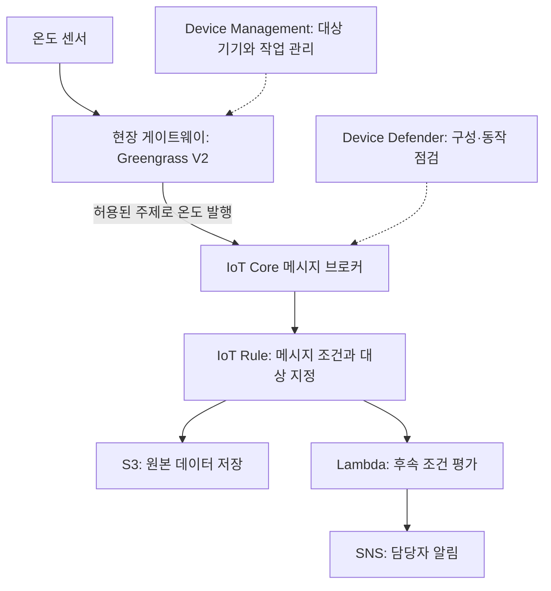

IoT(Internet of Things)는 센서·설비·가전 같은 물리 장치를 네트워크에 연결해 데이터를 수집하고 상태를 확인하거나 제어하는 기술이다. AWS에서는 기기 통신, 원격 관리, 보안 점검, 현장 처리와 산업 데이터 활용을 서로 다른 서비스로 구성한다.

이 글에서는 AWS IoT의 주요 서비스와 관련 소프트웨어를 역할별로 정리한다. 공식 개요에 남아 있는 종료 서비스와 신규 고객 제한 항목은 별도로 설명한다. 사용 예시는 이해를 돕기 위한 가상 상황이다.

**자료 확인 기준: 2026년 11월 2일**

[공식 자료: AWS IoT 서비스 개요](https://docs.aws.amazon.com/whitepapers/latest/aws-overview/internet-of-things-services.html)

## 먼저 구분할 작업

- **기기 연결:** 기기를 인증하고 센서값과 명령을 주고받는다.
- **기기 관리:** 기기를 등록·분류하고 설정 변경과 소프트웨어 업데이트를 배포한다.
- **보안 점검:** 인증·정책 구성과 통신 동작의 이상을 확인한다.
- **현장 처리:** 클라우드에 모두 보내기 전에 현장에서 필터링·집계하거나 로컬 동작을 수행한다.
- **산업 데이터 활용:** 설비별 데이터 모델과 지표를 구성하고 관련 정보를 조회·시각화한다.
- **기기 소프트웨어:** 제한된 자원의 장치에서 실행할 운영체제·라이브러리와 연결 모듈을 선택한다.

센서가 데이터를 전송한 상태, 클라우드에 저장된 상태와 실제 설비 제어가 완료된 상태는 서로 다르다. 네트워크 연결과 데이터 수집만으로 전체 운영이 구현됐다고 판단하지 않는다.

## AWS IoT Core — 기기와 클라우드의 통신

기기와 애플리케이션을 AWS 서비스에 연결하는 관리형 서비스다. 메시지 브로커를 통한 발행·구독과 규칙 기반의 서비스 연동 등을 제공한다.

- **사용하기 좋은 상황:** 다수의 장치가 센서값을 보내고 필요한 명령이나 상태 변경을 받아야 할 때.
- **간단한 예시:** 냉장 창고 센서가 온도를 주제(topic)에 발행하고, 관제 애플리케이션이 허용된 주제를 구독한다.
- **구분할 점:** 기기 연결과 메시지 전달을 지원하는 계층이다. 모든 센서 이력을 보관하는 분석용 데이터베이스나 설비 제어 프로그램을 대신하지 않는다.

MQTT는 주제별로 메시지를 발행·구독하는 경량 통신 프로토콜이다. IoT Core 메시지 브로커는 MQTT와 MQTT over WSS의 발행·구독을 지원하며, HTTPS로는 메시지를 발행할 수 있다. 프로토콜별 지원 동작을 모두 같다고 가정하지 않는다.

**AWS IoT Core for LoRaWAN**은 저전력·장거리 LoRaWAN 기기와 게이트웨이를 연결하는 기능이다. LoRaWAN Network Server를 직접 개발·운영하는 부담을 줄인다. 일반 Wi-Fi 연결과 필요한 하드웨어·망 구성이 다르다.

[공식 자료: AWS IoT Core 개요와 연결 방식](https://docs.aws.amazon.com/iot/latest/developerguide/what-is-aws-iot.html)

### 인증과 접근 권한

기기가 누구인지 확인하는 인증과, 어떤 주제에 발행·구독할 수 있는지 결정하는 인가는 구분한다. 예를 들어 MQTT over TLS의 X.509 인증서 기반 연결에서는 인증서와 AWS IoT Core 정책을 함께 구성한다.

한 기기에 다른 모든 기기의 명령 주제까지 접근하도록 허용하지 않고, 기기별 역할과 필요한 동작에 맞춰 권한을 정한다. 사용하는 인증 방식과 API 종류에 따라 IAM 정책과 IoT 정책의 적용 관계가 달라진다.

기기 자격 증명의 보관·교체·폐기도 설계해야 한다. 클라우드 측 정책을 설정했다고 물리 장치의 비밀 정보가 자동으로 보호되는 것은 아니다.

[공식 자료: AWS IoT Core 인가](https://docs.aws.amazon.com/iot/latest/developerguide/iot-authorization.html)

### Rules — 받은 메시지를 다른 서비스로 연결

주제의 메시지를 조건에 따라 필터링·변환하고 다른 AWS 서비스의 작업으로 연결하는 기능이다.

- **사용하기 좋은 상황:** 기기가 보낸 메시지를 저장하거나 후속 처리를 실행할 때.
- **간단한 예시:** 온도 메시지를 조건에 따라 Lambda로 보내고, 원본 데이터는 S3에 저장하는 작업을 구성한다.
- **구분할 점:** 규칙을 만드는 것과 대상 서비스가 작업을 성공한 것은 다르다. 대상에 접근할 역할·권한과 오류 처리도 확인해야 한다.

DynamoDB 저장, SQS 전송, Lambda 호출, SiteWise 자산 속성 전달 등이 가능한 작업의 예다. 선택한 대상 서비스의 사용 요금과 제한도 별도로 적용된다.

[공식 자료: AWS IoT Rules](https://docs.aws.amazon.com/iot/latest/developerguide/iot-rules.html)

### Device Shadow — 기기 상태를 클라우드에 기록

기기의 상태를 JSON 문서로 저장하고 공유하는 기능이다. 기기가 연결되지 않은 동안에도 애플리케이션은 저장된 상태를 조회하거나 원하는 상태를 기록할 수 있다.

- **desired:** 애플리케이션이 원하는 상태다.
- **reported:** 기기가 보고한 상태다.
- **delta:** 원하는 상태와 보고된 상태의 차이다.

예를 들어 앱이 조명의 밝기를 desired에 기록하면 기기 소프트웨어가 이를 확인하고 실제 밝기를 변경한 뒤 reported를 갱신하도록 구현한다.

**desired를 수정했다고 실제 장치가 즉시 바뀌는 것은 아니다.** 연결이 끊긴 기기는 재연결 후 상태를 조회·동기화하는 처리가 필요하다. Shadow는 상태 공유 기능이지 모든 명령의 실행 이력이나 물리적 동작 성공을 보장하는 기능이 아니다.

[공식 자료: AWS IoT Device Shadow](https://docs.aws.amazon.com/en_en/iot/latest/developerguide/iot-device-shadows.html)

## AWS IoT Device Management — 다수 기기의 등록과 원격 관리

기기를 등록·분류·검색·모니터링하고 원격 작업을 관리하는 서비스다. 많은 기기를 하나의 집합(fleet)으로 운영할 때 사용한다.

- **사용하기 좋은 상황:** 장소·모델·버전별로 기기를 관리하고 대상 기기에 업데이트를 배포하려는 경우.
- **간단한 예시:** 특정 지점에 설치된 온도 센서 중 구형 소프트웨어를 사용하는 기기를 찾아 업데이트 대상으로 지정한다.
- **구분할 점:** 기기 관리 기능과 메시지 브로커, 보안 이상 탐지의 역할은 다르다.

**AWS IoT Jobs**로 다운로드·설치, 재부팅, 인증서 교체 같은 원격 작업을 정의할 수 있다. 실제 장치에서 작업을 받아 실행하고 결과를 보고할 소프트웨어도 필요하다. 작업 생성만으로 모든 기기의 업데이트가 성공했다고 판단하지 않는다.

배포 대상과 실패 조건, 점진적 적용과 복구 절차를 정한다. 특히 물리 장치가 운영 중인 경우에는 소프트웨어 버전뿐 아니라 재시작 가능 시간과 장치 상태도 고려해야 한다.

[공식 자료: IoT Device Management](https://aws.amazon.com/iot-device-management/) · [AWS IoT Jobs](https://docs.aws.amazon.com/iot/latest/developerguide/iot-jobs.html)

### Managed integrations — 여러 제조사의 기기 통합

여러 제조사와 연결 프로토콜의 기기를 공통 API와 사용자 경험으로 관리하도록 지원하는 Device Management의 기능이다. 직접 연결, 허브 연결과 타사 클라우드 연동 등 지원 방식에 맞춰 구성한다.

- **사용하기 좋은 상황:** 서로 다른 제조사의 스마트홈 기기를 하나의 앱에서 제어하려는 경우.
- **간단한 예시:** 지원되는 조명과 온도 조절기를 등록하고 앱에서 상태 조회와 제어를 제공한다.
- **구분할 점:** 모든 상용 기기가 별도 준비 없이 자동 연결되는 것은 아니다. 지원 기기, SDK·허브·커넥터와 리전을 확인한다.

이 기능의 Managed Thing과 IoT Core의 thing은 같은 리소스로 단정하지 않는다. 각각의 등록 방식과 데이터 모델을 확인해야 한다.

[공식 자료: Managed integrations 개요](https://docs.aws.amazon.com/iot-mi/latest/devguide/what-is-managedintegrations.html)

## AWS IoT Device Defender — IoT 보안 구성과 동작 점검

IoT 기기 집합의 보안 구성을 감사하고, 연결된 기기의 보안 지표와 동작에서 이상을 탐지하는 서비스다.

- **사용하기 좋은 상황:** 많은 기기의 인증·정책 구성을 점검하고 평소와 다른 통신을 찾으려는 경우.
- **간단한 예시:** 지나치게 넓은 접근 권한을 감사하고, 특정 기기의 비정상적인 메시지 전송 패턴을 탐지해 담당자에게 알린다.
- **구분할 점:** 경고가 발생한 상태와 침해가 확정된 상태, 대응이 완료된 상태는 다르다.

**Audit**는 보안 설정과 모범 사례 준수 여부를 점검한다. **Detect**는 지표와 동작을 평가하며 사용자 정의 규칙이나 ML 기반 탐지를 사용할 수 있다. 탐지에 사용할 지표의 수집과 기준 설정도 필요하다.

문제가 확인되면 인증서·정책 조정 등 대응과 이후 정상 여부 확인을 연결한다. Device Defender를 사용한다고 기기의 펌웨어 취약점과 현장 보안까지 자동으로 해결되는 것은 아니다.

[공식 자료: Device Defender 개요](https://docs.aws.amazon.com/iot-device-defender/latest/devguide/what-is-device-defender.html)

## AWS IoT Greengrass — 현장에서 실행하는 IoT 소프트웨어

기기에서 IoT 애플리케이션을 실행하고 배포·관리하는 오픈소스 엣지 런타임과 클라우드 서비스다. 이 글에서는 Version 2를 기준으로 설명한다.

- **사용하기 좋은 상황:** 현장에서 데이터를 필터링·집계하거나 연결 상태와 관계없이 준비된 로컬 처리를 수행해야 할 때.
- **간단한 예시:** 공장 게이트웨이에서 여러 센서의 값을 모아 요약하고 필요한 데이터를 클라우드로 전송한다.
- **구분할 점:** IoT Core가 클라우드 통신을 지원한다면 Greengrass는 현장 기기에서 실행되는 소프트웨어와 배포에 초점을 둔다.

V2에서는 애플리케이션을 컴포넌트 단위로 구성한다. 로컬 실행, 다른 장치와의 통신과 클라우드 전송 방식은 사용하는 컴포넌트에 맞게 설계한다.

네트워크가 끊겨도 모든 기능이 자동으로 유지되는 것은 아니다. 로컬 처리에 필요한 모델·설정, 저장 용량과 재전송 정책을 준비해야 한다. 일반적인 현장 처리와 안전이 중요한 설비의 제어 요구사항도 구분한다.

[공식 자료: Greengrass V2 개요](https://docs.aws.amazon.com/greengrass/v2/developerguide/what-is-iot-greengrass.html)

### 공식 이미지: 현장 기기와 AWS 클라우드의 관계

_Greengrass 기기가 현장 장치 및 AWS 클라우드와 연결되는 구조. AWS 공식 문서의 원본 이미지._

[이미지 출처: What is AWS IoT Greengrass?](https://docs.aws.amazon.com/greengrass/v2/developerguide/what-is-iot-greengrass.html)

그림에서는 현장 기기에서 실행되는 처리와 AWS 클라우드의 역할을 구분하면 된다. 모든 센서에 Greengrass를 설치하는 것이 아니라, 지원되는 게이트웨이·장치에 설치하고 주변 장치와 연결할 수도 있다.

**Greengrass V1의 공식 지원 종료일은 2026년 10월 7일**로, 확인 시점에는 이 날짜가 지났다. 이 공지는 V2 전체 종료를 뜻하지 않는다. V1에서 V2로의 전환은 단순한 동일 버전 업데이트로 취급하지 않고 구성·런타임 차이를 확인해야 한다.

[공식 자료: Greengrass V1에서 V2로 이전](https://docs.aws.amazon.com/greengrass/v2/developerguide/migrate-from-v1.html)

## AWS IoT SiteWise — 산업 설비 데이터의 수집과 모델링

산업 설비의 데이터를 수집·저장·구성·모니터링하는 관리형 서비스다. 자산 모델에 측정값과 관계, 계산할 지표를 정의하고 실제 설비를 자산으로 표현한다.

- **사용하기 좋은 상황:** 공장·설비별 데이터를 일정한 구조로 관리하고 운영 지표를 계산하려는 경우.
- **간단한 예시:** 동일 모델의 펌프 여러 대에 공통 자산 모델을 적용하고 유량·온도·가동 관련 지표를 비교한다.
- **구분할 점:** 단순한 메시지 전달이나 임의의 파일 저장과 달리 산업 자산 모델과 데이터의 관계를 중심으로 사용한다.

SiteWise Monitor는 산업 데이터를 보는 웹 애플리케이션 구성에 사용한다. SiteWise Edge는 현장 수집 등 엣지 작업을 지원하는 구성 요소다. 서비스 전체와 하위 기능을 별개의 독립 서비스처럼 중복해서 세지 않는다.

[공식 자료: SiteWise 개요](https://docs.aws.amazon.com/iot-sitewise/latest/userguide/what-is-sitewise.html)

**하위 기능의 제공 상태:** SiteWise Edge의 Data Processing Pack은 신규 고객에게 제공되지 않으며 유지보수 모드다. SiteWise 전체와 Edge Data Collection Pack은 계속 제공된다. 예전 문서의 현장 변환·지표·로컬 시각화 구성을 신규 도입하려면 이 제한과 대안을 확인해야 한다.

[공식 자료: Data Processing Pack 제공 변경](https://docs.aws.amazon.com/iot-sitewise/latest/userguide/iotsitewise-dpp-availability-change.html)

## AWS IoT TwinMaker — 운영 데이터와 디지털 트윈 구성

물리·디지털 시스템을 모델링하고 여러 데이터 소스와 연결해 운영용 디지털 트윈을 만드는 서비스다. 설비·공간·프로세스와 연결된 데이터의 맥락을 함께 표현한다.

- **사용하기 좋은 상황:** 설비 구조와 센서값, 영상 등의 정보를 연결해 현장 상황을 이해하려는 경우.
- **간단한 예시:** 공장의 설비 위치를 나타내는 화면에서 해당 펌프의 측정값과 관련 영상을 함께 조회한다.
- **구분할 점:** 센서값 수집과 저장 자체를 모두 대체하거나, 물리 시스템을 자동으로 정확하게 복제하는 도구는 아니다.

SiteWise가 산업 자산 데이터와 지표에 초점을 둔다면 TwinMaker는 여러 위치의 데이터와 모델을 연결해 조회·시각화하는 데 사용한다. 필요한 모델, 연결과 사용자 애플리케이션은 별도로 구성해야 한다.

디지털 트윈 화면을 만들었다고 물리 시뮬레이션이나 자동 제어까지 구현된 것으로 판단하지 않는다.

[공식 자료: TwinMaker 개요](https://docs.aws.amazon.com/iot-twinmaker/latest/guide/what-is-twinmaker.html)

## FreeRTOS와 AWS IoT ExpressLink — 기기 측 소프트웨어와 연결

### FreeRTOS

마이크로컨트롤러와 소형 마이크로프로세서용 오픈소스 실시간 운영체제다. MIT 라이선스로 제공되며 연결·보안·OTA 업데이트 등에 사용할 수 있는 라이브러리를 포함한다.

- **사용하기 좋은 상황:** 메모리와 처리 자원이 제한된 장치의 소프트웨어를 개발하려는 경우.
- **간단한 예시:** 작은 센서 보드에서 주기적으로 온도를 읽는 작업과 통신 작업을 구성한다.
- **구분할 점:** 클라우드에서 관리형으로 실행되는 서버가 아니라 장치에 올리는 소프트웨어다. IoT Core나 Greengrass와 같은 종류의 서비스로 이해하면 안 된다.

실시간 운영체제를 사용한다는 사실만으로 애플리케이션의 모든 응답 시간과 안전 요구사항이 보장되는 것은 아니다. 하드웨어, 드라이버와 작업 설계를 확인해야 한다.

[공식 자료: FreeRTOS 개요](https://docs.aws.amazon.com/freertos/latest/userguide/what-is-freertos.html)

### AWS IoT ExpressLink

기기의 네트워크 연결과 암호화 작업을 지원되는 하드웨어 모듈에 맡겨 AWS 연결 개발을 단순화하는 방식이다.

- **사용하기 좋은 상황:** 제한된 자원의 기존 장치에 연결 기능을 추가하면서 통신 소프트웨어 구현 부담을 줄이려는 경우.
- **간단한 예시:** 기존 센서 제어 보드에 호환되는 연결 모듈을 추가해 측정값을 AWS로 전송한다.
- **구분할 점:** 모든 보드에 소프트웨어만 설치하면 되는 구조가 아니다. 모듈 공급업체, 연결 방식과 지원 기능을 확인해야 한다.

[공식 자료: AWS IoT ExpressLink](https://aws.amazon.com/iot-expresslink/)

### AWS Partner Device Catalog

AWS와 연동 가능한 하드웨어를 찾는 카탈로그다. 장치·보드·게이트웨이를 고를 때 지원 조건을 확인하는 데 사용한다. 데이터를 처리하는 별도 클라우드 서비스는 아니다.

공식 개요의 AWS IoT Button 역시 하드웨어 예시다. 버튼, FreeRTOS, 모듈과 클라우드 서비스의 이름을 모두 같은 종류의 관리형 서비스로 합산하지 않는다. 오래된 예제를 사용할 때는 장치의 현재 공급·지원과 연결 방식도 확인해야 한다.

[공식 자료: IoT 개요의 관련 하드웨어·소프트웨어](https://docs.aws.amazon.com/whitepapers/latest/aws-overview/internet-of-things-services.html)

## AWS IoT FleetWise — 신규 고객 제한이 있는 차량 데이터 서비스

차량의 신호와 데이터 형식을 모델링하고 차량 데이터를 수집·활용하는 서비스다. 일반적인 기기 집합 관리와 차량 신호 모델링을 구분한다.

**현재 신규 고객에게 제공되지 않는다.** 기존 고객은 계속 이용할 수 있으며, 새 프로젝트의 선택지로 공식 안내는 Guidance for Connected Mobility on AWS를 제시한다. 아래 예시는 기존 구성의 역할을 이해하기 위한 것이다.

- **활용 상황:** 차량별 신호 형식을 정리하고 필요한 차량 데이터를 클라우드로 수집하는 경우.
- **간단한 예시:** 여러 차량의 주행 거리와 엔진 온도 신호를 공통 차량 모델에 맞춰 수집한다.
- **구분할 점:** Device Management의 fleet과 FleetWise의 차량 모델·신호 카탈로그는 같은 개념이 아니다. 신규 프로젝트에 기존 서비스 가입이 가능한 것으로 안내하지 않는다.

[공식 자료: FleetWise 제공 변경](https://docs.aws.amazon.com/iot-fleetwise/latest/developerguide/iotfleetwise-availability-change.html) · [차량과 신호 모델](https://docs.aws.amazon.com/iot-fleetwise/latest/developerguide/vehicles.html)

## 종료된 서비스와 기능

공식 개요에 이름이 남아 있어도 현재 사용할 수 있다는 뜻은 아니다. 다음 항목은 확인 시점의 공식 종료 목록을 기준으로 구분한다.

- **AWS IoT Analytics:** IoT 데이터 정제·저장·분석을 제공하던 서비스다. 2025년 12월 15일 종료됐다.
- **AWS IoT Events:** 기기 입력의 상태와 조건을 평가해 이벤트를 처리하던 서비스다. 2026년 5월 20일 종료됐다.
- **AWS IoT 1-Click:** 지원 기기의 간단한 동작으로 클라우드 작업을 실행하던 서비스다. 2025년 1월 29일 종료됐다. IoT Core 전체 종료나 모든 물리 버튼의 폐기를 뜻하지 않는다.
- **Fleet Hub for AWS IoT Device Management:** 기기 집합을 모니터링하는 웹 애플리케이션 기능이다. 2025년 10월 18일 종료됐다. Device Management 전체는 별개다.
- **AWS IoT Things Graph:** 기기·서비스 간 상호작용을 모델링하던 서비스다. 2022년 11월 9일 종료됐다.
- **AWS IoT RoboRunner:** 로봇 시스템의 운영 데이터 통합을 지원하던 서비스다. 2024년 3월 14일 종료됐다.

종료된 서비스가 맡던 기능을 구현해야 한다면 필요한 수집·저장·상태 평가·알림 작업을 분리하고, 현재 지원되는 서비스와 솔루션으로 다시 설계해야 한다. 특정 후속 제품 하나가 모든 기능을 그대로 대체한다고 가정하지 않는다.

[공식 자료: 완전 종료된 AWS 서비스와 기능](https://docs.aws.amazon.com/general/latest/gr/full_shutdown_services.html)

## 예시: 냉장 창고의 온도 수집과 확인

다음은 서비스 역할을 설명하기 위해 작성한 Mermaid 흐름이다. AWS 공식 아키텍처나 모든 IoT 시스템의 필수 구성은 아니다.

게이트웨이를 사용하는 예시이며, 조건에 맞는 센서가 IoT Core에 직접 연결되는 구성도 가능하다. 실제 규칙과 서비스 연결에는 인증·정책·실행 권한이 필요하다.

온도 메시지 수신, 저장 성공, 알림 전송과 담당자의 조치는 각각 확인해야 한다. 연결이 끊긴 동안의 저장·재전송과 중복 데이터 처리도 설계한다. 이 흐름에 SiteWise 자산 모델이나 TwinMaker 화면을 추가할지는 필요한 운영 기능에 따라 판단한다.

## 비슷한 항목을 구분하는 기준

- **IoT Core와 Device Management:** 메시지를 주고받는지, 기기 집합과 원격 작업을 관리하는지 구분한다.
- **Device Management와 Device Defender:** 운영 작업을 관리하는지, 보안 구성과 동작 이상을 점검하는지 구분한다.
- **IoT Core와 Greengrass:** 클라우드 통신 계층인지, 현장에서 실행되는 애플리케이션인지 확인한다.
- **Device Shadow와 TwinMaker:** 기기의 원하는·보고된 상태를 공유하는지, 여러 운영 데이터와 시스템 모델을 연결하는지 구분한다.
- **SiteWise와 TwinMaker:** 산업 설비 데이터와 지표 관리인지, 데이터·모델·시각화의 통합인지 비교한다.
- **FreeRTOS와 Greengrass:** 마이크로컨트롤러용 운영체제인지, 지원 장치에서 애플리케이션을 실행·관리하는 엣지 런타임인지 확인한다.

## SAA 공부와 연결해서 볼 내용

확인 시점의 SAA-C03 공식 안내는 **Internet of Things의 모든 서비스를 시험 범위 밖(Out of Scope)**으로 표시한다. 따라서 이 글은 IoT 서비스를 필수 시험 암기 대상으로 소개하는 글이 아니라 AWS의 서비스 역할을 이해하기 위한 정리다. 시험 범위는 응시 시점에 다시 확인해야 한다.

함께 연결되는 일반 개념은 다음과 같다.

1. **인증과 권한:** 연결이 허용됐다는 사실과 모든 데이터·주제에 접근할 수 있다는 사실은 다르다.
2. **저장과 전달:** 메시지 전달, 장기 보관, 분석과 알림은 다른 역할이다.
3. **엣지와 클라우드:** 현장에서 처리할 데이터와 클라우드로 보낼 데이터를 구분한다.
4. **상태와 실행 결과:** 원하는 상태 기록, 작업 배포와 실제 장치의 동작 완료를 구분한다.
5. **가용성과 비용:** 기기 수만이 아니라 메시지 크기·빈도, 재전송과 연결된 서비스의 사용량을 고려한다.

[공식 자료: SAA-C03 시험 범위 밖 서비스](https://docs.aws.amazon.com/aws-certification/latest/solutions-architect-associate-03/saa-03-out-of-scope-services.html)

