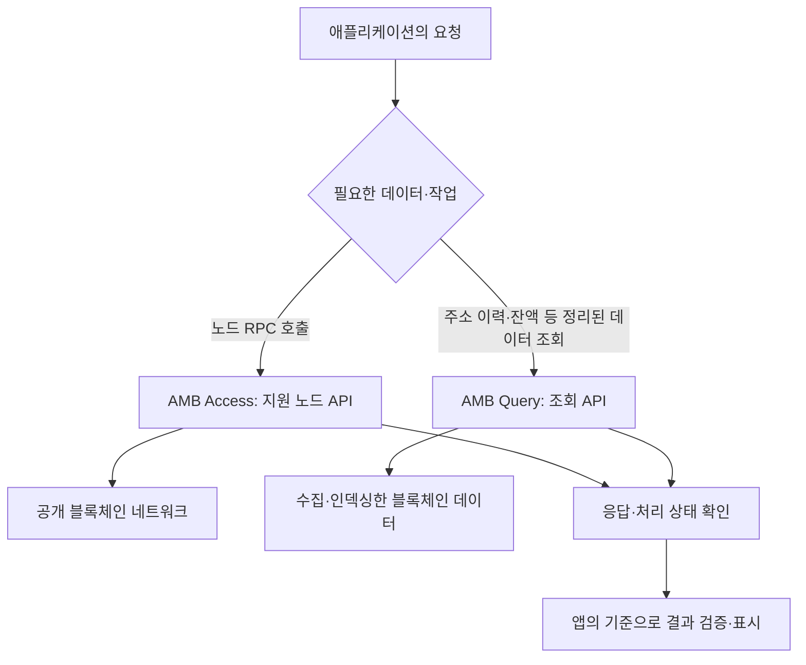

AWS의 블록체인 분야는 Amazon Managed Blockchain(AMB)을 중심으로 이해할 수 있다. 공개 블록체인의 노드에 접근하는 기능, 정리된 데이터를 조회하는 기능과 참여자가 정해진 네트워크를 운영하는 기능은 서로 다르다.

**제공 상태부터 확인해야 한다. AMB는 2026년 10월 29일부터 신규 고객을 받지 않으며, 2027년 9월 29일에 지원이 종료될 예정이다.** 기존 고객은 종료일까지 이용할 수 있지만, 공식 안내는 이전 계획을 준비하도록 권고한다.

아래 내용과 사용 예시는 기존 구성과 서비스의 역할을 이해하기 위한 설명이다. 신규 고객이 지금 가입해 구축할 수 있는 서비스로 안내하는 글이 아니다. 예시는 이해를 돕기 위한 가상 상황이다.

**자료 확인 기준: 2026년 11월 2일**

[공식 자료: Amazon Managed Blockchain 지원 종료 안내](https://docs.aws.amazon.com/managed-blockchain/latest/hyperledger-fabric-dev/managed-blockchain-end-of-support.html)

## 블록체인에서 먼저 구분할 개념

블록체인은 여러 참여자가 규칙에 따라 거래 기록을 공유·검증하는 분산 원장 기술이다. 블록을 연결하고 합의와 암호학적 검증을 사용해 기록의 일관성과 변경 이력을 관리한다.

- **원장(Ledger):** 거래와 상태 변경 기록이다.
- **노드(Node):** 네트워크에 참여해 데이터를 보관하거나 요청 처리·검증 등을 수행하는 소프트웨어와 실행 환경이다.
- **트랜잭션:** 네트워크에서 처리할 거래나 상태 변경 요청이다.
- **스마트 계약:** 블록체인에서 실행되는 업무 규칙을 코드로 정의한 것이다. 플랫폼마다 실행·검증 방식이 다르다.
- **공개 네트워크:** Ethereum·Bitcoin 같은 공개 블록체인이다.
- **허가형 네트워크:** 참여 자격과 접근 권한을 정한 네트워크다. Hyperledger Fabric 기반 구성이 대표적인 예다.

공개 네트워크의 데이터를 조회하는 일과 새로운 허가형 네트워크를 만드는 일은 다르다. 모든 블록체인이 같은 참여 방식과 합의 규칙을 사용하지도 않는다.

[공식 자료: 블록체인 개념](https://aws.amazon.com/what-is/blockchain/)

## Amazon Managed Blockchain — 블록체인 인프라와 데이터 접근

AMB는 블록체인 애플리케이션에 필요한 노드·네트워크 운영과 데이터 접근 부담을 줄이는 관리형 서비스다. 기능을 크게 나누면 다음과 같다.

- **AMB Access:** 블록체인 노드나 네트워크에 접근하는 기능이다. 공개 네트워크의 노드 접근과 Hyperledger Fabric 기반 허가형 네트워크 구성을 구분한다.
- **AMB Query:** 지원되는 공개 블록체인의 데이터를 정리된 API로 조회하는 기능이다.

Access와 Query는 AMB 안의 기능 구분이다. 각각이 모든 체인과 동일한 작업을 지원하는 것은 아니며, 한쪽의 지원 네트워크 목록을 다른 쪽에도 그대로 적용하면 안 된다.

AWS 공식 분야 개요는 Fabric과 Ethereum 중심의 설명을 포함하지만, 현재 구성을 이해하려면 Access·Query의 개별 문서와 지원 종료 안내를 함께 확인해야 한다.

[공식 자료: AMB 분야 개요](https://docs.aws.amazon.com/whitepapers/latest/aws-overview/blockchain.html) · [AMB Query 개요](https://docs.aws.amazon.com/managed-blockchain/latest/ambq-dg/what-is-service.html)

## AMB Access Ethereum — Ethereum 노드 접근

Ethereum 공개 네트워크에 연결된 관리형 전용 노드를 사용해 지원되는 JSON-RPC API를 호출하는 기능이다. 애플리케이션이 노드 운영과 동기화를 직접 관리하는 부담을 줄이는 데 사용한다.

- **활용 상황:** Ethereum 데이터를 조회하거나 스마트 계약과 상호작용하는 기존 애플리케이션을 운영하는 경우.
- **간단한 예시:** 서비스 백엔드가 특정 트랜잭션과 스마트 계약 데이터를 노드 API로 조회한다.
- **구분할 점:** Ethereum 공개 네트워크에 접근하는 것이지 사용자의 독립적인 사설 Ethereum 네트워크가 자동으로 만들어지는 것은 아니다.

관리형 노드를 사용하더라도 애플리케이션의 업무 로직과 요청 처리, 필요한 서명·자격 증명 관리는 별도다. AMB API에 접근할 권한과 블록체인상의 거래 권한을 같은 것으로 이해하지 않는다.

노드에 요청이 접수된 상태와 트랜잭션이 네트워크에서 처리된 상태도 다르다. 앱에서는 필요한 처리 상태와 확인 기준을 정해야 한다.

[공식 자료: AMB Access Ethereum](https://docs.aws.amazon.com/managed-blockchain/latest/ethereum-dev/managed-blockchain-ethereum-overview.html)

## AMB Access Bitcoin — Bitcoin 노드 API 접근

직접 노드 인프라를 구성하지 않고 리전 엔드포인트를 통해 Bitcoin 노드의 지원 JSON-RPC 요청을 호출하는 기능이다. 기반 노드는 여러 고객이 공유하는 관리형 구조다.

- **활용 상황:** Bitcoin 원장 데이터를 읽거나 트랜잭션을 전송하는 기존 애플리케이션의 노드 접근이 필요한 경우.
- **간단한 예시:** 트랜잭션 식별자를 기준으로 노드에서 거래 데이터를 확인한다.
- **구분할 점:** 노드 API를 제공하는 기능이다. 지갑의 모든 주소별 이력과 과거 잔액을 임의 조건으로 검색하는 완성된 분석 데이터베이스와는 다르다.

지원 네트워크와 RPC 메서드는 공식 문서에서 확인해야 한다. Ethereum의 메서드나 데이터 형식을 Bitcoin에도 그대로 적용할 수는 없다.

[공식 자료: AMB Access Bitcoin](https://docs.aws.amazon.com/managed-blockchain/latest/ambbtc-dg/what-is-service.html)

## AMB Access Polygon — Polygon 네트워크 접근

Polygon 블록체인에 서버리스 방식으로 접근하는 기능이다. Polygon은 EVM을 기반으로 하는 네트워크이지만 Ethereum과 동일한 네트워크는 아니다.

- **활용 상황:** Polygon을 사용하는 기존 애플리케이션에서 지원되는 블록체인 API가 필요한 경우.
- **간단한 예시:** Polygon에 배포된 계약과 관련된 데이터를 조회하는 백엔드를 연결한다.
- **구분할 점:** EVM 기반이라는 공통점만으로 체인 식별자·주소의 의미·지원 API·운영 조건이 모두 같다고 가정하면 안 된다.

AMB Access Polygon은 공식 보안 문서에 미리보기(preview)로 표시되는 항목이며, AMB의 신규 고객 제한과 지원 종료 안내도 적용된다. 오래된 예제를 현재 신규 도입의 일반 제공 서비스로 소개하지 않는다.

[공식 자료: AMB Access Polygon](https://docs.aws.amazon.com/managed-blockchain/latest/ambp-dg/what-is-service.html) · [제공 상태와 보안 안내](https://docs.aws.amazon.com/managed-blockchain/latest/ambp-dg/security.html)

## AMB Access Hyperledger Fabric — 참여자가 정해진 네트워크

Hyperledger Fabric을 사용해 허가형 블록체인 네트워크를 구성·관리하는 기능이다. 네트워크 참여 조직, 피어 노드와 접근 제어 등을 구성한다.

- **활용 상황:** 여러 조직이 참여 규칙과 거래 검증 조건을 합의하고 공동으로 기록을 관리하던 기존 구성을 이해할 때.
- **간단한 예시:** 제조사·운송사·판매사가 상품 인계 기록의 형식과 승인 규칙을 정하고 해당 거래를 네트워크에 기록한다.
- **구분할 점:** 일반 데이터베이스를 여러 계정에 공개하는 것과 다르다. 참여 조직과 거래 규칙, 접근 범위와 운영 책임에 대한 합의가 필요하다.

여기서 사용하는 용어는 다음과 같다.

- **Network:** Fabric 프레임워크를 실행하는 네트워크다.
- **Member:** 네트워크 참여 조직을 나타내는 고유한 식별 단위다. 한 AWS 계정이 여러 멤버를 가질 수도 있다.
- **Peer node:** chaincode를 실행하고 트랜잭션을 보증하며 참여한 채널의 원장·상태를 보관한다.
- **Chaincode:** Fabric의 거래 처리와 검증에 사용하는 업무 로직이다.

멤버 추가·제거와 거래 보증의 규칙을 구분해야 한다. 모든 참여자가 모든 정보를 무조건 동일하게 볼 수 있는 구조로 단정하지 않는다.

[공식 자료: AMB Hyperledger Fabric 개요](https://docs.aws.amazon.com/managed-blockchain/latest/hyperledger-fabric-dev/what-is-managed-blockchain.html) · [네트워크·멤버·피어 개념](https://docs.aws.amazon.com/managed-blockchain/latest/hyperledger-fabric-dev/network-components.html)

### 공식 이미지: Fabric 네트워크와 참여 조직

_여러 멤버와 피어 노드, VPC 연결로 구성된 AMB Hyperledger Fabric 네트워크. AWS 공식 문서의 원본 이미지._

[이미지 출처: AMB 네트워크·멤버·피어 개념](https://docs.aws.amazon.com/managed-blockchain/latest/hyperledger-fabric-dev/network-components.html)

그림은 네트워크의 멤버와 각 멤버의 피어, 클라이언트가 접근하는 연결을 구분하는 데 사용한다. 멤버 수와 피어 수는 같은 의미가 아니며, 실제 구성은 참여 조직과 가용성 요구사항에 따라 달라진다.

이 이미지는 기존 서비스 구조를 설명하는 자료다. 이미지가 공식 문서에 남아 있다는 이유로 신규 고객이 지금 네트워크를 생성할 수 있다고 판단하면 안 된다.

## AMB Query — 정리된 블록체인 데이터 조회

지원되는 공개 블록체인의 현재·과거 데이터를 정규화된 API로 조회하는 서버리스 기능이다. 원본 블록 데이터를 직접 수집·해석하고 인덱싱하는 운영 부담을 줄이는 데 사용한다.

- **활용 상황:** 주소별 거래 이력이나 현재·과거 잔액을 조회하는 기존 애플리케이션을 운영하는 경우.
- **간단한 예시:** 특정 주소의 거래 목록과 지원 토큰 잔액을 조회해 사용자 화면에 제공한다.
- **구분할 점:** Query는 데이터 조회 기능이다. 거래 전송이나 사설 네트워크 생성 기능으로 이해하지 않는다.

지원되는 조회에는 잔액, 트랜잭션과 이벤트, 토큰·계약 관련 정보 등이 있다. Bitcoin과 Ethereum의 데이터 의미와 지원 범위가 다르므로 같은 API 이름만 보고 모든 필드를 동일하게 처리하지 않는다.

[공식 자료: AMB Query 개요](https://docs.aws.amazon.com/managed-blockchain/latest/ambq-dg/what-is-service.html) · [Query API 개요와 지원 상태](https://docs.aws.amazon.com/managed-blockchain/latest/AMBQ-APIReference/Welcome.html)

### Access와 Query의 차이

- **Access:** 노드의 지원 RPC를 통해 블록체인 네트워크와 상호작용한다.
- **Query:** 미리 수집·인덱싱·정리한 블록체인 데이터를 조회한다.

예를 들어 단일 트랜잭션을 노드에서 조회하는 작업과, 특정 주소의 과거 거래를 정렬·페이지 단위로 조회하는 작업은 필요한 데이터 처리가 다르다. 표준 노드 하나를 실행했다고 AMB Query의 조회 API 전체가 자동으로 대체되는 것은 아니다.

[공식 자료: Query 이전 시 노드와 인덱싱 API의 차이](https://docs.aws.amazon.com/managed-blockchain/latest/ambq-dg/migrating-query-workloads.html)

## 예시: 조회 요구사항에 따른 접근 방식

다음은 기존 AMB 구성의 역할을 설명하기 위해 작성한 Mermaid 흐름이다. AWS 공식 아키텍처 이미지나 신규 구축 절차는 아니다.

이 그림은 공개 블록체인 접근과 조회의 차이를 보여준다. Hyperledger Fabric 허가형 네트워크의 멤버·피어 구성은 앞의 공식 이미지와 별개로 이해해야 한다.

노드의 응답, 거래 실행 성공과 앱이 요구하는 확정 상태는 구분한다. 조회 데이터도 최신 블록 반영 시점과 인덱싱 지연, 블록 재구성에 따른 변화를 고려해야 한다.

## 지원 종료에 따른 이전 방향

공식 안내의 이전 방향은 기능에 따라 다르다.

- **Access Ethereum·Bitcoin·Polygon:** AWS에서 직접 운영하는 노드나 타사 블록체인 인프라 제공자를 검토한다.
- **Query:** 필요한 인덱싱·정규화 데이터를 제공하는 관리형 데이터 제공자를 검토한다.
- **Access Hyperledger Fabric:** 다른 관리형 Fabric, EC2·EKS 등에서 직접 운영하는 Fabric 또는 업무에 적합한 AWS 데이터베이스를 검토한다.

이 항목들은 모두 기능이 동일한 교체품이라는 뜻이 아니다. 직접 운영하면 동기화·저장소·버전·가용성과 모니터링 책임도 달라진다.

[공식 자료: AMB 지원 종료와 이전 방향](https://docs.aws.amazon.com/managed-blockchain/latest/hyperledger-fabric-dev/managed-blockchain-end-of-support.html)

특히 Query 이전은 주소만 바꾸는 작업으로 끝나지 않을 수 있다. 인증 방식, 필드와 숫자 표현, 과거 데이터 범위, 페이지 처리·정렬, 처리 상태와 최신성 등을 비교해야 한다.

기존 응답을 대표 사례로 확보하고 대상 시스템의 결과와 대조한다. 필요한 기능이 맞는지 검증한 뒤 전환해야 하며, 표준 노드로 조회 기능을 대체하려면 별도의 인덱싱 구현이 필요할 수 있다.

[공식 자료: AMB Query 워크로드 이전](https://docs.aws.amazon.com/managed-blockchain/latest/ambq-dg/migrating-query-workloads.html)

## 일반 데이터베이스와 비교할 때 확인할 내용

다음은 서비스 선택을 위한 검토 기준이다.

- **참여 조직:** 하나의 운영 주체가 데이터를 관리하면 되는지, 여러 조직이 공동 규칙으로 기록을 검증해야 하는지 확인한다.
- **수정과 삭제:** 기록 정정·삭제·개인정보 처리 요구사항이 기록 구조와 맞는지 확인한다.
- **데이터 범위:** 블록체인에 기록할 항목과 일반 저장소에서 관리할 문서·파일을 구분한다.
- **성능과 운영:** 처리량·지연·비용과 참여 조직 간 운영 절차를 함께 비교한다.
- **입력의 정확성:** 기록이 검증 가능한 구조라는 사실과 최초 입력이 현실의 사실과 일치한다는 사실은 다르다.

예를 들어 상품 인계 기록을 남겼어도 실제 상품이 올바르게 전달됐는지는 별도 확인이 필요하다. 여러 조직이 데이터를 공유한다는 이유만으로 모든 업무에 블록체인이 필요한 것은 아니다.

### Amazon QLDB와 혼동하지 않기

이름에 원장(Ledger)이 들어간다고 모든 서비스가 같은 블록체인 네트워크를 제공하는 것은 아니다. 또한 Amazon QLDB는 공식 종료 목록에 **2025년 7월 31일 지원 종료**로 표시되어 있다. AMB의 신규 고객을 위한 현재 대안으로 소개하면 안 된다.

[공식 자료: 완전 종료된 서비스 목록](https://docs.aws.amazon.com/general/latest/gr/full_shutdown_services.html)

## SAA 공부와 연결해서 볼 내용

확인 시점의 SAA-C03 공식 안내는 **Amazon Managed Blockchain을 시험 범위 밖(Out of Scope)**으로 표시한다. 이 글은 필수 시험 암기 목록이 아니라 AWS 블록체인 서비스의 역할과 기존 구성을 이해하기 위한 정리다. 시험 범위와 서비스 제공 상태는 각각 최신 자료로 확인해야 한다.

1. **공개 네트워크에 접근한다:** Access와 노드 API의 역할을 확인한다.
2. **정리된 이력·잔액을 조회한다:** Query와 인덱싱 데이터의 역할을 확인한다.
3. **허가형 네트워크를 구성한다:** Fabric의 참여 조직·피어·업무 규칙을 구분한다.
4. **기록이 남았다:** 실제 입력의 정확성과 거래 처리 상태까지 모두 검증됐다고 판단하지 않는다.
5. **과거 문서에 구축 절차가 있다:** 신규 고객 제한과 지원 종료 예정일을 먼저 확인한다.

[공식 자료: SAA-C03 시험 범위 밖 서비스](https://docs.aws.amazon.com/aws-certification/latest/solutions-architect-associate-03/saa-03-out-of-scope-services.html)

