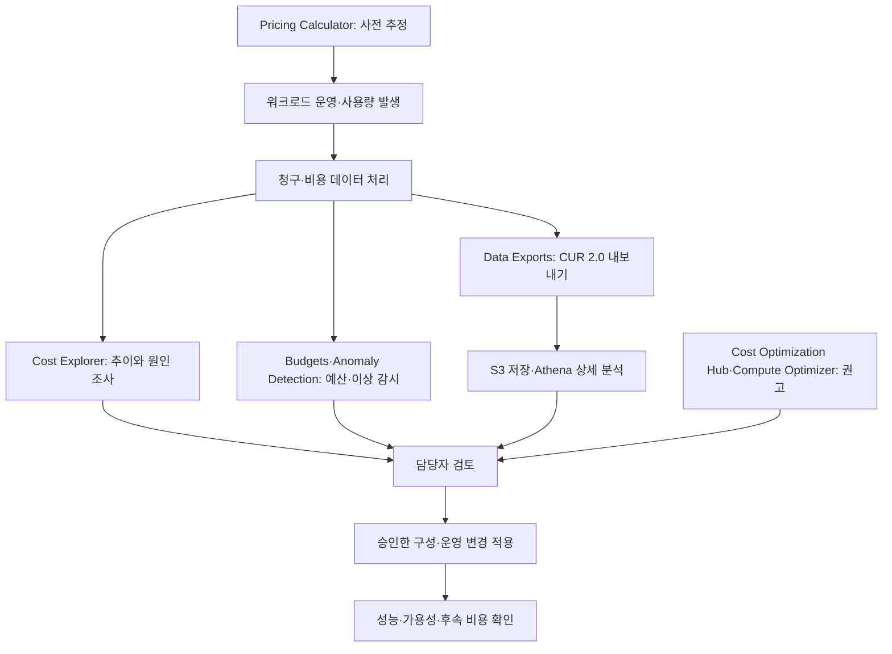

AWS 비용 관리는 사용한 금액을 확인하는 일뿐 아니라 예상 비용 산정, 예산 감시, 비용 배분과 최적화까지 포함한다. 각 도구는 사용하는 데이터와 목적이 다르므로 기능을 나눠 이해해야 한다.

이 글에서는 비용을 조회·분석하는 도구, 상세 데이터 내보내기, 조직별 비용 배분과 할인 약정 관리 기능을 정리한다. 사용 예시는 이해를 돕기 위한 가상 상황이다. 특정 할인율이나 가격을 모든 계정에 동일하게 적용하지 않으며, 실제 이용 조건은 사용 시점의 공식 가격과 계약을 확인해야 한다.

**자료 확인 기준: 2026년 11월 2일**

[공식 자료: AWS Cloud Financial Management 개요](https://docs.aws.amazon.com/whitepapers/latest/aws-overview/aws-cost-management.html)

## 먼저 구분할 작업

- **사용 전 산정:** 예상 구성과 사용량을 바탕으로 비용을 계산한다.
- **사용 후 조회:** 실제 발생한 비용과 사용량의 추이를 확인한다.
- **예산 감시:** 정한 예산과 실제·예측 비용을 비교한다.
- **이상 탐지:** 평소와 다른 비용 패턴을 찾아 알린다.
- **상세 분석:** 청구·사용량 데이터를 내보내 자체 분석에 활용한다.
- **배분과 보고:** 계정·팀·프로젝트에 비용을 분류하고 내부 기준으로 보고한다.
- **최적화:** 사용량과 리소스 구성, 약정 적용 상태를 검토해 절감 기회를 찾는다.

AWS Billing and Cost Management는 이 작업을 수행하는 여러 서비스·기능의 관리 환경이다. 화면의 각 메뉴가 모두 독립적인 인프라 서비스인 것은 아니다. 할인 약정, 보고서와 비용 배분 기능도 역할에 따라 구분한다.

## AWS Pricing Calculator — 사용 전 비용 산정

서비스 구성과 예상 사용량을 입력해 비용을 추정하는 도구다.

- **사용하기 좋은 상황:** 새 시스템을 만들기 전 구성별 비용을 비교하려는 경우.
- **간단한 예시:** EC2 인스턴스와 스토리지, 데이터 전송량을 가정하고 월간 비용을 계산한다.
- **구분할 점:** 실제 사용 내역을 자동으로 확정하는 청구 시스템이 아니다. 입력에서 빠진 사용량은 예상 비용에도 반영되지 않는다.

일반적으로 컴퓨팅만 계산하지 말고 저장소, 요청 수와 데이터 전송 등 구성에 필요한 항목도 확인해야 한다. 공개 웹 계산기의 추정치는 입력 조건에 따른 값이며 적용될 세금 등 실제 청구와 차이가 날 수 있다.

[공식 자료: AWS Pricing Calculator](https://docs.aws.amazon.com/pricing-calculator/latest/userguide/what-is-pricing-calculator.html)

## AWS Cost Explorer — 비용과 사용량 추이 조회

비용과 사용량을 그래프·보고서로 조회하고 필터·그룹을 적용해 원인을 분석하는 도구다.

- **사용하기 좋은 상황:** 어느 서비스나 계정에서 비용이 늘었는지 빠르게 확인하려는 경우.
- **간단한 예시:** 지난달과 이번 달의 비용을 서비스별로 비교하고, 비용이 증가한 리전과 사용 유형을 추가로 확인한다.
- **구분할 점:** 사람이 분석할 수 있는 조회 도구이며, 조회했다고 리소스 설정이 자동으로 바뀌거나 비용이 줄어들지는 않는다.

계정·리전·서비스·태그 등의 관점으로 범위를 좁힐 수 있다. 과거 데이터를 바탕으로 예측 비용과 할인 약정 관련 보고서를 살펴볼 수도 있다.

데이터는 실시간 결제 내역이 아니다. 공식 문서는 비용 데이터를 최소 하루 한 번 갱신하지만 일부 상위 청구 데이터는 더 늦게 반영될 수 있다고 설명한다. 오늘 생성한 자원이 화면에 아직 보이지 않는다고 비용이 발생하지 않은 것으로 판단하면 안 된다.

화면 이용과 API 호출, 추가 데이터 기능의 과금 조건도 구분한다.

[공식 자료: Cost Explorer](https://docs.aws.amazon.com/cost-management/latest/userguide/ce-what-is.html)

## AWS Budgets — 예산과 약정 지표 감시

비용·사용량 예산을 설정하고 실제 값이나 예측 값이 기준에 도달했을 때 알림을 받는 기능이다. RI·Savings Plans의 활용률과 적용 범위도 감시할 수 있다.

- **사용하기 좋은 상황:** 프로젝트의 월간 비용 목표를 정하고 초과 가능성을 담당자에게 알리려는 경우.
- **간단한 예시:** 개발 계정에 월간 비용 예산을 설정하고 실제 비용이 일정 비율을 넘거나 예측 비용이 예산을 넘을 때 알린다.
- **구분할 점:** 예산 금액을 설정한다고 모든 AWS 사용량과 요금이 그 금액에서 자동 차단되는 것은 아니다.

알림은 이메일이나 SNS 등으로 연결한다. 예산 대상의 계정·서비스·태그, 계산에 포함할 할인·크레딧·세금 등의 조건을 정해야 한다. 예측 알림은 예측에 필요한 이력이 충분해야 동작한다.

**예산은 실시간 강제 과금 상한이 아니다.** 비용 데이터 처리와 알림에 지연이 있고, 이미 발생한 비용이 알림 이후에 반영될 수도 있다.

[공식 자료: AWS Budgets](https://docs.aws.amazon.com/cost-management/latest/userguide/budgets-managing-costs.html) · [Budgets 모범 사례](https://docs.aws.amazon.com/cost-management/latest/userguide/budgets-best-practices.html)

### Budget Actions — 예산 기준에 따른 대응

예산 임계값에 따라 IAM 정책·SCP 적용이나 지정한 EC2·RDS 인스턴스 대상 작업을 실행하도록 구성하는 기능이다. 자동 실행과 수동 승인 후 실행을 구분할 수 있다.

- **사용하기 좋은 상황:** 예산 초과 시 특정 사용자의 추가 자원 생성을 제한하는 등 미리 정한 대응이 필요한 경우.
- **간단한 예시:** 개발 환경의 임계값 초과 시 담당자 검토 후 지정한 제한 정책을 적용한다.
- **구분할 점:** 대상·권한·지원 작업을 명시적으로 구성해야 한다. 모든 서비스와 기존 비용을 일괄 중단하는 기능은 아니다.

자동 실행을 사용할 때는 운영 영향과 복구 방법을 정해야 한다. 예를 들어 Auto Scaling 그룹의 인스턴스만 정지하면 대체 인스턴스가 다시 실행될 수 있다. 자원 하나에 대한 조치와 전체 워크로드 비용 제어는 다른 문제다.

[공식 자료: Budget Actions](https://docs.aws.amazon.com/cost-management/latest/userguide/budgets-controls.html) · [Auto Scaling 관련 주의사항](https://docs.aws.amazon.com/cost-management/latest/userguide/budgets-best-practices.html)

## AWS Cost Anomaly Detection — 평소와 다른 비용 패턴 탐지

머신러닝으로 비용 패턴을 평가하고 비정상적인 증가를 탐지하는 기능이다.

- **사용하기 좋은 상황:** 고정 예산을 넘기 전이라도 평소보다 급격히 증가한 비용을 찾으려는 경우.
- **간단한 예시:** 월 예산에는 여유가 있지만 특정 서비스의 비용이 평소보다 크게 늘어난 상황을 탐지해 조사한다.
- **구분할 점:** Budgets가 정한 예산과 비교한다면, Cost Anomaly Detection은 학습한 패턴과 다른 지출을 찾는 데 초점을 둔다.

서비스·계정·리전·사용 유형 등의 비용 영향과 원인 후보를 조사할 수 있다. 탐지 알림만으로 자원 오용이나 장애가 확정되는 것은 아니므로 실제 사용 변경과 연결해 확인해야 한다.

Cost Explorer 데이터에 의존하므로 즉시 발생하는 모든 비용을 실시간 탐지하지 않는다. 새 모니터나 새 서비스에는 초기 준비와 이력도 필요하다. 확인 시점에는 billing transfer를 사용하는 bill-source 계정과 관련 뷰에 제한이 있으므로 해당 구조에서는 지원 여부를 따로 확인한다.

[공식 자료: Cost Anomaly Detection](https://docs.aws.amazon.com/cost-management/latest/userguide/manage-ad.html)

## AWS Data Exports와 CUR — 상세 비용 데이터 내보내기

### AWS Data Exports

청구·비용 관리 데이터를 선택해 S3로 반복 내보내는 기능이다. 지원되는 SQL로 필요한 열을 선택하거나 행을 필터링할 수 있다.

- **사용하기 좋은 상황:** 자체 비용 분석 시스템이나 조직별 보고서를 구성하려는 경우.
- **간단한 예시:** 계정·서비스·사용 유형 등의 데이터를 S3로 내보내 팀별 분석에 활용한다.
- **구분할 점:** Cost Explorer의 조회 화면과 달리 분석에 사용할 데이터를 전달하는 계층이다. 저장소와 조회 도구의 권한·비용도 따로 관리해야 한다.

비용·사용량 데이터 외에도 최적화 권고, 지원되는 FOCUS 형식과 탄소 배출 데이터 등의 내보내기를 제공한다. 서로 다른 데이터셋을 모두 같은 보고서 형식으로 이해하지 않는다.

[공식 자료: AWS Data Exports](https://docs.aws.amazon.com/cur/latest/userguide/what-is-data-exports.html)

### Cost and Usage Report 2.0 — CUR 2.0

상세한 비용·사용량 데이터 테이블이다. 공식 문서는 새 상세 비용 데이터 수신 방식으로 **Data Exports의 CUR 2.0을 권장**한다.

- **사용하기 좋은 상황:** 화면의 집계보다 상세한 청구 항목과 사용량을 분석하거나 반복 보고서를 생성하려는 경우.
- **간단한 예시:** CUR 2.0을 S3로 내보내고 Athena로 프로젝트별 사용량과 비용을 집계한다.
- **구분할 점:** Data Exports는 내보내는 기능이고 CUR 2.0은 내보낼 데이터 테이블 중 하나다. 두 이름을 같은 제품의 단순한 별칭으로 쓰면 안 된다.

기존 Legacy CUR와 비교하면 고정 스키마와 중첩 데이터 등 구조가 다르다. 기존 분석 쿼리를 옮길 때 열 이름·중첩 값·태그 처리와 내보내기 설정을 검토해야 한다.

기존 CUR가 존재한다는 사실과 현재 권장 방식은 구분한다. 권장 방식이 바뀌었다는 이유만으로 기존 CUR가 이미 종료됐다고 표현해서도 안 된다.

[공식 자료: CUR에서 CUR 2.0으로 이전](https://docs.aws.amazon.com/cur/latest/userguide/dataexports-migrate.html)

### S3·Athena를 이용한 자체 분석

S3는 내보낸 파일을 저장하고, Athena는 준비된 테이블과 스키마를 이용해 SQL 분석을 수행한다. 파일을 내보내는 작업과 분석 테이블을 준비하는 작업, 조회 권한을 주는 작업은 별도다.

전체 기간의 모든 파일을 매번 읽기보다 분석 목적에 맞는 형식·기간·열을 선택한다. 보고서의 갱신과 정정도 고려해야 하므로 처음 받은 파일을 최종 확정 청구로 단정하지 않는다.

[공식 자료: CUR 데이터의 Athena 분석](https://docs.aws.amazon.com/cur/latest/userguide/cur-query-athena.html) · [CUR 2.0의 통합과 형식](https://docs.aws.amazon.com/cur/latest/userguide/dataexports-migrate.html)

## 비용 할당 태그와 AWS Cost Categories — 비용 분류

### Cost allocation tags — 리소스 기준의 분류

리소스에 붙인 태그를 비용 분석과 보고에 사용한다.

- **사용하기 좋은 상황:** 프로젝트·담당 팀·환경별로 비용을 구분하려는 경우.
- **간단한 예시:** EC2와 S3에 `Project=Reservation`, `Environment=Dev`를 붙여 프로젝트 개발 비용을 추적한다.
- **구분할 점:** 리소스에 태그를 붙이는 것과 비용 할당 태그로 활성화하는 것은 별도다. 분석에 사용할 태그는 Billing에서 활성화 상태도 확인한다.

태그가 빠진 자원과 분류되지 않은 비용도 확인해야 한다. 모든 비용 항목에 같은 방식으로 태그가 붙는다고 가정하지 않는다.

[공식 자료: 비용 할당 태그](https://docs.aws.amazon.com/awsaccountbilling/latest/aboutv2/cost-alloc-tags.html)

### 공식 이미지: 자원을 태그로 분류하기

_EC2 인스턴스에 비용 센터와 스택 태그를 붙인 예시. AWS 공식 문서의 원본 이미지._

[이미지 출처: AWS 비용 할당 태그](https://docs.aws.amazon.com/awsaccountbilling/latest/aboutv2/cost-alloc-tags.html)

그림에서는 각 자원에 붙인 태그의 키와 값을 구분하면 된다. 태그는 분류 기준을 제공하며, 태그 자체가 자원의 가격을 할인하거나 접근 권한을 자동으로 결정하는 것은 아니다.

### AWS Cost Categories — 규칙 기반의 비용 분류

계정·서비스·태그 등 여러 조건으로 비용을 조직 내부 구조에 맞게 묶는 기능이다.

- **사용하기 좋은 상황:** 계정 경계와 팀 구성이 정확히 일치하지 않거나 여러 조건을 묶어 보고하려는 경우.
- **간단한 예시:** 일부 계정은 플랫폼 팀으로, 다른 계정의 특정 프로젝트 태그 비용은 서비스 팀으로 분류한다.
- **구분할 점:** 기존 리소스에 새 태그를 직접 붙이는 기능과 다르다. 비용 데이터에 적용할 분류 규칙을 정의한다.

Cost Explorer, Budgets, CUR와 Cost Anomaly Detection 등에서 분류 결과를 활용할 수 있다. 분류 규칙과 미분류 비용 처리 기준도 함께 관리해야 한다.

[공식 자료: AWS Cost Categories](https://docs.aws.amazon.com/awsaccountbilling/latest/aboutv2/manage-cost-categories.html)

## Savings Plans와 Reserved Instances — 할인 약정 관리

### Savings Plans

선택한 기간 동안 일정한 시간당 사용 금액을 약정하고, 조건에 맞는 사용량에 할인 가격을 적용받는 요금 모델이다.

- **사용하기 좋은 상황:** 지속적으로 발생할 사용량을 분석한 뒤 약정이 적합한지 검토하려는 경우.
- **간단한 예시:** 웹 서비스의 안정적인 기본 사용량과 변동하는 추가 사용량을 나눠 약정 후보를 평가한다.
- **구분할 점:** 월 예산이나 사용량 상한이 아니다. 사용하지 못한 약정도 지불 의무가 생길 수 있으므로 사용 감소와 구조 변경 가능성을 함께 검토한다.

확인 시점의 공식 문서는 다음 네 종류를 안내한다.

- **Compute Savings Plans:** 조건에 맞는 EC2·Fargate·Lambda 사용량에 유연하게 적용한다.
- **EC2 Instance Savings Plans:** 선택한 리전의 특정 EC2 인스턴스 패밀리를 기준으로 적용한다.
- **Database Savings Plans:** 지원되는 데이터베이스 서비스와 사용량에 적용한다.
- **SageMaker AI Savings Plans:** 지원되는 SageMaker AI 인스턴스 사용량에 적용한다.

종류마다 대상·약정 기간과 조건이 다르다. 한 종류의 할인 범위를 다른 종류에도 그대로 적용하거나 모든 관련 비용이 할인된다고 가정하지 않는다.

[공식 자료: Savings Plans 개요](https://docs.aws.amazon.com/savingsplans/latest/userguide/what-is-savings-plans.html) · [Savings Plans 종류](https://docs.aws.amazon.com/savingsplans/latest/userguide/plan-types.html)

### Reserved Instances와 RI reporting

RI는 조건에 맞는 사용량에 할인 혜택을 적용하는 약정 방식이다. 여기서는 EC2 RI를 예로 설명한다.

- **사용하기 좋은 상황:** 특정 구성의 지속적인 사용을 예상하고 해당 RI 조건이 적합한지 검토하려는 경우.
- **간단한 예시:** 이미 운영 중인 EC2 사용량에 맞는 RI의 적용 가능성을 비교한다.
- **구분할 점:** EC2 RI는 새 물리 서버를 생성하는 작업이 아니라 적합한 사용량에 적용되는 청구 할인이다.

적용 속성과 변경·교환 조건, 결제 방식과 기간을 확인해야 한다. 다른 서비스의 예약 상품에 EC2 RI 조건을 그대로 적용하지 않는다. 자원의 용량 확보가 필요한 경우에도 할인과 용량 예약 조건을 별도로 확인한다.

RI와 Savings Plans 보고서에서는 **활용률(Utilization)**과 **적용 범위(Coverage)**를 구분한다. 전자는 구매한 약정을 얼마나 사용했는지, 후자는 대상 사용량이 약정으로 얼마나 커버되는지를 보는 관점이다. 약정을 크게 구매해 적용 범위를 높였어도 미사용 약정이 늘면 유리하지 않을 수 있다.

[공식 자료: EC2 Reserved Instances](https://docs.aws.amazon.com/AWSEC2/latest/UserGuide/ec2-reserved-instances.html) · [비용·약정 지표 감시](https://docs.aws.amazon.com/cost-management/latest/userguide/budgets-managing-costs.html)

## Cost Optimization Hub와 Compute Optimizer — 최적화 권고

### AWS Cost Optimization Hub

여러 계정·리전의 비용 최적화 권고를 모아 우선순위를 정하는 Billing and Cost Management의 기능이다.

- **사용하기 좋은 상황:** 리소스 조정, 유휴 자원 정리와 할인 약정 권고를 함께 비교하려는 경우.
- **간단한 예시:** 여러 계정의 절감 후보를 모아 예상 절감액과 필요한 변경을 검토한다.
- **구분할 점:** 권고를 확인한 상태와 실제 변경을 적용해 절감한 상태는 다르다.

관련 권고의 중복 절감을 조정하고 할인 조건을 고려한 추정치를 제공한다. 동일 자원 축소와 약정 구매의 예상 절감액을 단순 합산하면 절감을 과대평가할 수 있다.

[공식 자료: Cost Optimization Hub](https://docs.aws.amazon.com/cost-management/latest/userguide/cost-optimization-hub.html)

### AWS Compute Optimizer

지원되는 리소스의 구성과 사용 지표를 분석해 적정 크기 조정과 유휴 자원 관련 권고를 제공하는 서비스다.

- **사용하기 좋은 상황:** 현재 자원의 크기가 사용 패턴에 맞는지 검토하려는 경우.
- **간단한 예시:** 사용 지표가 충분히 쌓인 EC2의 대체 인스턴스 구성을 비교하고 실제 부하 테스트로 검증한다.
- **구분할 점:** Compute라는 이름만 보고 EC2만 지원한다고 판단하지 않는다. EBS·Lambda·Fargate 기반 ECS·데이터베이스 등 지원 대상과 분석 요건을 확인한다.

분석에 필요한 기간과 지표가 충분해야 한다. 평소 부하뿐 아니라 주기적 배치와 피크, 메모리 요구와 응답 시간도 검토해야 한다. 권고를 검토한 뒤 변경·검증하고 실제 비용과 성능을 비교한다.

Cost Optimization Hub는 여러 최적화 기회를 모아 비교하는 데, Compute Optimizer는 지원 자원의 구성·사용 지표에 따른 구체적인 권고에 초점을 둔다.

[공식 자료: Compute Optimizer](https://docs.aws.amazon.com/compute-optimizer/latest/ug/what-is-compute-optimizer.html)

## AWS Billing Conductor — 내부 기준에 따른 비용 보고

가격 계획·가격 규칙·사용자 정의 항목 등을 사용해 고객이나 조직 내부 단위에 보여 줄 별도의 비용 데이터를 구성하는 서비스다.

- **사용하기 좋은 상황:** 부서별 비용 보고(showback)나 내부 청구·배분(chargeback)에 별도 기준이 필요한 경우.
- **간단한 예시:** 여러 계정을 청구 그룹으로 묶고 내부 계약 단가와 공통 비용 항목을 반영한 비용을 보고한다.
- **구분할 점:** Billing Conductor가 만드는 pro forma 비용은 AWS의 실제 청구 비용과 구분된다.

**가격 규칙을 바꿨다고 AWS가 청구하는 실제 금액이 바뀌는 것은 아니다.** 내부 배분 정책이나 고객 계약에 맞는 두 번째 비용 관점을 만드는 것이다. 비용을 표시하는 기능과 외부 회계 시스템의 수금·정산 완료도 구분한다.

Cost Categories가 비용을 묶는 분류 규칙이라면 Billing Conductor는 별도 가격 규칙을 반영한 비용 관점을 구성하는 데 사용한다.

[공식 자료: AWS Billing Conductor](https://docs.aws.amazon.com/billingconductor/latest/userguide/what-is-billingconductor.html)

## AWS Organizations 통합 결제와 billing transfer

**통합 결제(Consolidated billing)**는 Organizations의 여러 계정에 대한 청구·결제를 모으는 기능이다. 관리 계정은 구성원 계정의 비용을 확인하고 결제를 관리한다. 할인 공유 등의 적용 조건도 확인해야 한다.

- **사용하기 좋은 상황:** 팀별 계정은 분리하면서 조직 차원에서 비용을 관리하려는 경우.
- **간단한 예시:** 개발·운영 계정을 분리하고 관리 계정에서 전체 비용과 계정별 비용을 확인한다.
- **구분할 점:** 결제를 모으는 것과 모든 구성원에게 전체 조직 비용의 조회 권한을 주는 것은 다른 일이다. 판매 법인 등의 조건에 따라 청구서가 나뉠 수도 있다.

[공식 자료: Organizations 통합 결제](https://docs.aws.amazon.com/awsaccountbilling/latest/aboutv2/consolidated-billing.html)

**Billing transfer**는 조직 외부 계정이 해당 조직의 통합 청구를 관리하고 결제하도록 지정하는 기능이다. 여러 Organizations의 청구를 중앙에서 관리할 때 검토한다. 조직 자체를 합치는 기능이나 Billing Conductor의 가격 규칙과 혼동하지 않는다.

계정 간 초대와 수락, 적용 시점과 비용 데이터 접근 영향을 확인해야 한다. 이 글의 사용 예시는 기능 설명이며 실제 결제 관계 변경을 수행하는 절차는 아니다.

[공식 자료: Billing transfer](https://docs.aws.amazon.com/awsaccountbilling/latest/aboutv2/orgs_transfer_billing.html)

## 예시: 프로젝트 비용을 분석하고 조정하기

다음은 설명을 위해 작성한 Mermaid 흐름이다. AWS 공식 아키텍처 이미지나 자동 실행되는 비용 제어 구성은 아니다.

알림과 분석에는 비용 데이터 반영 지연이 있다. 사전 추정, 발생 비용, 아직 확정되지 않은 비용과 최종 청구를 구분한다.

예를 들어 비용이 늘었다면 먼저 계정·서비스·사용 유형을 좁힌다. 정상적인 트래픽 증가인지, 남아 있는 개발 자원인지, 데이터 전송이나 저장량 증가인지 확인한 뒤 적절한 변경을 선택한다. 비용만 보고 자원을 무조건 줄이면 성능과 가용성 요구사항을 충족하지 못할 수 있다.

## 비용 숫자를 비교할 때 확인할 조건

- **기간:** 같은 날짜 범위와 집계 기준인지 확인한다.
- **대상:** 계정·리전·서비스·태그 필터가 같은지 확인한다.
- **비용 관점:** 할인·크레딧·환급·세금·지원 요금 등의 포함 여부를 확인한다.
- **상각 여부:** 약정 관련 비용을 기간에 배분해 보는 값인지 확인한다.
- **데이터 시점:** 최신 사용량과 정정 내역이 반영됐는지 확인한다.
- **비용 종류:** 실제 청구 비용인지 Billing Conductor의 pro forma 비용인지 확인한다.

Cost Explorer, 예산과 내부 보고서의 숫자가 다르다고 즉시 오류라고 판단하지 않는다. 먼저 기간·필터·비용 지표와 데이터 반영 시점을 맞춰야 한다.

비용 관리 도구 자체의 비용도 살펴본다. API와 추가 분석 기능, 내보낸 파일의 S3 저장 및 Athena 조회 등의 요금 조건은 기능별로 다르다. 모든 비용 관리 기능을 무료라고 묶어 설명하면 안 된다.

[공식 자료: Budgets 비용 계산 조건](https://docs.aws.amazon.com/cost-management/latest/userguide/budgets-best-practices.html) · [Cost Explorer 갱신·과금](https://docs.aws.amazon.com/cost-management/latest/userguide/ce-what-is.html) · [Billing Conductor 비용 관점](https://docs.aws.amazon.com/billingconductor/latest/userguide/what-is-billingconductor.html)

## SAA 공부와 연결해서 볼 내용

확인 시점의 SAA-C03 공식 시험 범위 목록은 AWS Cost Management 아래에 **AWS Budgets, AWS Cost and Usage Report, AWS Cost Explorer, Savings Plans**를 나열한다. Compute Optimizer와 Organizations는 관리 분야에서 함께 연결해 이해할 수 있다. 목록은 비포괄적이며 변경될 수 있다.

1. **구성 전 예상 비용을 계산한다:** Pricing Calculator를 확인한다.
2. **이미 발생한 비용의 증가 원인을 조회한다:** Cost Explorer를 확인한다.
3. **정한 예산과 실제·예측 비용을 비교한다:** Budgets와 알림을 확인한다.
4. **평소와 다른 비용 증가를 탐지한다:** Cost Anomaly Detection을 확인한다.
5. **상세 비용 데이터를 자체 분석한다:** CUR·CUR 2.0, Data Exports와 S3·Athena의 역할을 구분한다.
6. **팀별로 비용을 나눈다:** 비용 할당 태그와 Cost Categories를 비교한다.
7. **조직 내부 가격으로 비용을 보고한다:** Billing Conductor와 실제 청구 비용을 구분한다.
8. **자원 크기와 약정 구매를 검토한다:** 사용량 조정과 할인 약정의 효과를 각각 평가한다.
9. **예산 알림을 설정했다:** 이를 실시간 요금 상한이나 자동 절감 완료로 해석하지 않는다.

[공식 자료: SAA-C03 시험 범위 서비스](https://docs.aws.amazon.com/aws-certification/latest/solutions-architect-associate-03/saa-03-in-scope-services.html)

