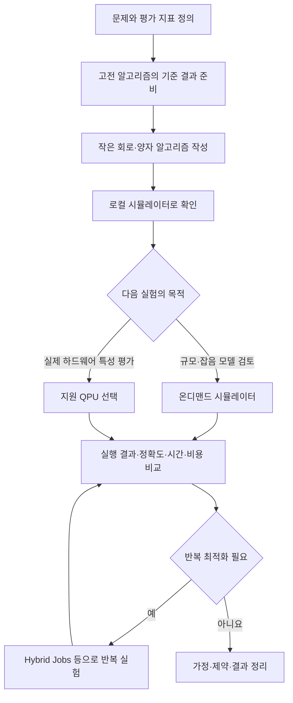

양자 컴퓨팅은 양자역학의 성질을 이용해 정보를 처리하는 계산 방식이다. AWS에서는 Amazon Braket을 통해 양자 알고리즘을 작성하고, 시뮬레이터로 검증한 뒤 실제 양자 장치에서 실행할 수 있다.


이 글에서는 Braket의 주요 기능과 사용 상황을 정리한다. 시뮬레이터, 실제 양자 장치와 하이브리드 작업은 Braket 안의 기능·실행 방식이며, 각각을 별개의 AWS 서비스로 세지는 않는다. 사용 예시는 이해를 돕기 위한 가상 상황이다.


**자료 확인 기준: 2026년 11월 2일**


[공식 자료: AWS 양자 기술 분야 개요](https://docs.aws.amazon.com/whitepapers/latest/aws-overview/quantum-technologies.html)


## 양자 컴퓨팅에서 먼저 구분할 개념

- **큐비트(Qubit):** 양자 정보를 표현하는 기본 단위다. 측정 전에는 0과 1에 대응하는 상태의 중첩을 표현할 수 있으며, 계산 기저로 측정하면 0 또는 1의 결과를 얻는다.
- **양자 게이트:** 큐비트 상태를 바꾸는 연산이다.
- **양자 회로:** 게이트와 측정을 조합해 계산을 정의한 것이다.
- **얽힘(Entanglement):** 여러 큐비트의 상태를 각 큐비트의 독립된 상태만으로 설명할 수 없는 양자적 관계다.
- **측정:** 양자 상태에서 고전적인 결과를 얻는 과정이다. 실행을 반복해 결과 분포를 확인하는 경우가 많다.
- **고전 컴퓨팅:** CPU·GPU 등 일반적인 컴퓨팅 자원에서 수행하는 계산을 뜻한다.

큐비트가 중첩을 표현한다고 모든 가능한 답을 한 번에 읽을 수 있는 것은 아니다. 어떤 문제를 어떤 알고리즘으로 풀고 측정 결과에서 필요한 정보를 어떻게 추출할지가 중요하다.


양자 컴퓨터를 사용하면 웹 서버, 데이터베이스 조회와 모든 최적화 문제가 자동으로 빨라진다고 이해해서는 안 된다.


[공식 자료: 양자 컴퓨팅 개념](https://aws.amazon.com/what-is/quantum-computing/)


## Amazon Braket — 양자 알고리즘 개발과 실행


연구자와 개발자가 여러 양자 컴퓨팅 기술을 실험하도록 지원하는 관리형 서비스다. 개발 도구, 양자 회로 시뮬레이터와 외부 하드웨어 제공자의 양자 장치 접근을 제공한다.

- **사용하기 좋은 상황:** 양자 알고리즘을 학습하거나 연구용 실험과 개념 검증을 수행하려는 경우.
- **간단한 예시:** 작은 양자 회로를 작성하고 시뮬레이터 결과와 실제 장치의 측정 결과를 비교한다.
- **구분할 점:** 일반 애플리케이션을 양자 컴퓨터에서 그대로 실행하는 서비스가 아니다. 문제 표현과 알고리즘, 측정·평가 방법을 준비해야 한다.

AWS는 개발·시험·실행을 하나의 서비스 환경에서 연결한다. 다만 하드웨어의 잡음과 지원 연산, 연결 구조 등의 제약이 있으므로 현재 장치로 수행할 수 있는 실험 범위를 확인해야 한다.


관리형이라는 의미는 인프라 접근과 운영 부담을 줄인다는 것이다. 알고리즘의 정확성이나 기존 방식보다 빠른 실행을 보장한다는 뜻은 아니다.


[공식 자료: Amazon Braket 개요](https://docs.aws.amazon.com/braket/latest/developerguide/what-is-braket.html)


## 개발 도구 — SDK와 관리형 노트북


Amazon Braket SDK로 회로와 실행 요청을 작성하고 결과를 처리할 수 있다. 관리형 Jupyter 노트북은 예제와 개발 도구가 준비된 환경을 제공하며, 자신의 개발 환경에서 SDK를 사용할 수도 있다.

- **사용하기 좋은 상황:** 예제를 수정하며 회로를 구성하거나 실험 결과를 코드·그래프로 분석하려는 경우.
- **간단한 예시:** 큐비트 수와 게이트를 바꿔 가며 측정 결과 분포를 비교한다.
- **구분할 점:** 코드를 작성하는 환경과 양자 계산을 수행하는 장치는 별개다. 노트북을 실행했다고 실제 QPU에서 계산 중인 것은 아니다.

관리형 노트북에서 로컬 시뮬레이터를 실행하면 해당 시뮬레이션은 노트북의 고전 컴퓨팅 자원을 사용한다. 로컬 시뮬레이터 자체와 별개로 노트북 인스턴스 비용은 발생할 수 있다.


[공식 자료: Braket 개발·시험 환경](https://docs.aws.amazon.com/braket/latest/developerguide/what-is-braket.html) · [노트북 과금](https://aws.amazon.com/braket/pricing/)


## 시뮬레이터 — 고전 컴퓨터에서 양자 계산 모의 실행


시뮬레이터는 양자 회로나 프로그램을 고전 컴퓨팅 자원에서 계산한다. 실제 양자 장치와 다른 실행 방식이다.


### 로컬 시뮬레이터


SDK를 실행하는 자신의 컴퓨터나 노트북 환경에서 사용하는 시뮬레이터다.

- **사용하기 좋은 상황:** 작은 회로를 빠르게 수정하고 결과를 확인하려는 경우.
- **간단한 예시:** 두 큐비트 회로를 실행해 예상한 측정 결과가 나오는지 확인한다.
- **구분할 점:** 실행 가능한 규모는 자신의 CPU·메모리와 프로그램 구조에 영향을 받는다.

공식 문서는 상태 벡터 방식의 `braket_sv`, 잡음을 다루는 밀도 행렬 방식의 `braket_dm`, 아날로그 해밀토니안 시뮬레이션용 `braket_ahs`를 구분한다.


[공식 자료: 로컬 시뮬레이터](https://docs.aws.amazon.com/braket/latest/developerguide/braket-submit-tasks-simulators.html)


### 온디맨드 시뮬레이터 — SV1과 DM1


AWS가 관리하는 컴퓨팅 자원에서 시뮬레이션 작업을 실행한다.

- **SV1:** 상태 벡터 기반으로 양자 회로를 시뮬레이션한다.
- **DM1:** 밀도 행렬 방식으로 잡음이 있는 회로 등을 시뮬레이션한다.
- **사용하기 좋은 상황:** 로컬 환경보다 큰 시뮬레이션이나 관리형 실행이 필요한 경우.
- **간단한 예시:** 같은 회로를 이상적인 조건과 잡음을 포함한 조건으로 실행하고 결과 차이를 비교한다.

시뮬레이터의 이상적인 결과와 실제 하드웨어의 결과가 같다고 가정하지 않는다. 잡음 모델을 사용해도 실제 장치의 모든 특성을 완전히 재현하는 것은 아니다.


[공식 자료: 지원 시뮬레이터와 장치](https://docs.aws.amazon.com/braket/latest/developerguide/braket-devices.html) · [시뮬레이터별 특성](https://docs.aws.amazon.com/braket/latest/developerguide/braket-submit-tasks-simulators.html)


## QPU — 실제 양자 장치에서 실행


QPU(Quantum Processing Unit)는 실제 양자 하드웨어다. Braket에서 선택한 장치에 양자 작업을 제출해 실행한다.

- **사용하기 좋은 상황:** 실제 장치의 잡음·제약이 결과에 미치는 영향을 확인하거나 하드웨어 기반 실험을 수행하려는 경우.
- **간단한 예시:** 시뮬레이터로 확인한 작은 회로를 QPU에서도 실행하고 측정 분포와 오류 영향을 비교한다.
- **구분할 점:** 시뮬레이터에서 실행된 회로가 모든 QPU에서 그대로 실행되는 것은 아니다. 지원 게이트와 연결 구조, 제한을 확인해야 한다.

확인 시점의 공식 장치 목록은 **AQT, IonQ, IQM, QuEra, Rigetti**의 장치를 안내한다. 게이트 기반 장치 외에 QuEra의 아날로그 해밀토니안 시뮬레이션(AHS) 장치도 있으므로 모든 장치를 같은 회로 모델로 취급하지 않는다.


여기서 AHS QPU는 실제 양자 하드웨어를 사용하는 장치이며, CPU에서 실행하는 로컬 AHS 시뮬레이터와 구분해야 한다.


장치별 리전, 상태와 사용 가능 시간, 큐와 지원 기능은 다를 수 있다. 예전 문서의 장치 ARN을 그대로 복사하기보다 현재 목록과 장치 속성을 확인해야 한다.


[공식 자료: 지원 리전·장치 목록](https://docs.aws.amazon.com/braket/latest/developerguide/braket-devices.html) · [QPU 작업 제출](https://docs.aws.amazon.com/braket/latest/developerguide/braket-submit-tasks.html)


### Shot과 Quantum task


**Shot**은 회로 실행과 측정을 한 번 수행하는 단위다. 같은 회로를 반복 실행한 측정값을 모아 결과 분포를 분석한다.


**Quantum task**는 선택한 장치에서 실행할 양자 계산 요청을 관리하는 단위다. 예를 들어 하나의 회로를 1,000 shots로 실행하는 요청은 1,000개의 독립적인 작업 요청과 같은 뜻이 아니다.


shots를 늘리면 측정 통계를 더 많이 얻을 수 있지만, 장치의 체계적인 오류가 자동으로 없어지는 것은 아니다. 반복 수는 정확도 목표와 비용을 함께 고려해 정한다.


[공식 자료: Braket 용어와 개념](https://docs.aws.amazon.com/braket/latest/developerguide/braket-terms.html)


## Amazon Braket Hybrid Jobs — 고전 계산과 양자 계산 반복


고전 컴퓨팅 코드와 양자 계산을 반복해서 수행하는 알고리즘의 실행 환경을 관리하는 기능이다. 알고리즘을 컨테이너 환경에서 실행하고 결과와 지표를 수집한다.

- **사용하기 좋은 상황:** 고전 최적화 코드가 파라미터를 갱신하고 양자 계산 결과를 반복 평가해야 할 때.
- **간단한 예시:** VQE 실험에서 회로 파라미터를 바꾸고 에너지 추정값을 평가하는 과정을 반복한다.
- **구분할 점:** 양자 장치만 실행하는 기능이 아니다. 작업을 제어하는 고전 컴퓨팅 자원과 양자 장치·시뮬레이터를 함께 사용한다.

VQE(Variational Quantum Eigensolver)는 에너지 등의 값을 추정하는 변분 알고리즘의 예다. QAOA(Quantum Approximate Optimization Algorithm)는 조합 최적화 연구에 사용하는 알고리즘의 예다. 특정 문제에서 기존 방식보다 좋은 결과가 나오는지는 별도 실험으로 평가해야 한다.


작업 완료 후 결과는 S3에 저장하고 지표는 CloudWatch 등으로 확인할 수 있다. 대상은 QPU뿐 아니라 온디맨드 시뮬레이터나 작업 컨테이너 안의 임베디드 시뮬레이터가 될 수도 있다.


[공식 자료: Braket Hybrid Jobs](https://docs.aws.amazon.com/braket/latest/developerguide/braket-jobs.html)


### 공식 이미지: Hybrid Jobs의 실행 구조


_고전 작업 인스턴스와 QPU·시뮬레이터, 결과 저장·지표 수집의 관계. AWS 공식 문서의 원본 이미지._


[이미지 출처: Working with Amazon Braket Hybrid Jobs](https://docs.aws.amazon.com/braket/latest/developerguide/braket-jobs.html)


그림에서는 알고리즘을 제어하는 작업 인스턴스와 실제 계산 대상, 결과 저장소를 구분하면 된다. 모든 분기를 동시에 사용해야 하는 것은 아니다.


## 장치 예약 — 정해진 시간의 전용 접근


지원 장치를 예약해 일정 시간 동안 전용으로 접근하는 방식이다.

- **사용하기 좋은 상황:** 실험 시간을 계획하고 반복 실행을 집중적으로 수행해야 할 때.
- **간단한 예시:** 연구팀이 정해진 시간에 여러 파라미터 실험을 모아 실행한다.
- **구분할 점:** 일반 온디맨드 작업 제출과 예약은 이용·요금 조건이 다르다. 예약했다고 실험의 성공과 양자적 성능 우위가 보장되는 것은 아니다.

현재 제공 장치와 예약 방법, 취소·요금 조건을 확인해야 한다. 이 글은 기능 설명이며 실제 예약이나 유료 작업을 수행하는 절차는 아니다.


[공식 자료: 장치 예약](https://docs.aws.amazon.com/braket/latest/developerguide/braket-reservations.html)


## 예시: 작은 회로를 로컬에서 확인하기


다음은 Braket SDK가 설치된 개인 컴퓨터의 Python 환경에서 실행할 수 있는 학습용 코드다. 클라우드 장치에 작업을 제출하지 않고 로컬 시뮬레이터를 사용한다. 이 글을 작성하면서 실행한 결과는 아니다.


```python
from braket.circuits import Circuit
from braket.devices import LocalSimulator

# 두 큐비트의 Bell 상태를 준비한다.
circuit = Circuit().h(0).cnot(0, 1)
shots = 1000

simulator = LocalSimulator()
result = simulator.run(circuit, shots=shots).result()

# 반복 측정한 결과별 횟수를 확인한다.
print(result.measurement_counts)
```


이상적인 이 회로에서는 `00`과 `11`이 각각 약 절반의 확률로 측정된다. 실행마다 횟수는 달라질 수 있으며 정확히 500번씩 나와야 하는 것은 아니다.


이 코드는 얽힌 상태의 측정 통계를 확인하는 예다. 실제 양자 장치에서 수행한 실험이나 일반 컴퓨터 대비 성능 향상의 증거는 아니다.


[공식 자료: 첫 회로 작성과 로컬 실행](https://docs.aws.amazon.com/braket/latest/developerguide/braket-get-started-run-circuit.html)


## 실험을 설계하는 순서


다음은 설명을 위해 작성한 Mermaid 흐름이다. AWS 공식 아키텍처 이미지나 모든 연구의 필수 절차는 아니다.





양자 계산 시간만 비교하지 않고 준비·대기·반복 측정·후처리에 필요한 시간과 비용도 포함해야 한다. 계산 규모가 다른 실험을 같은 성능 비교로 취급하지 않는다.


## 비용과 실행 범위 확인


Braket에서는 선택한 실행 방식에 따라 비용이 달라진다.

- **QPU 온디맨드:** 장치별 작업·shot 요금 등의 조건을 확인한다.
- **장치 예약:** 예약 시간과 장치에 따른 조건을 확인한다.
- **온디맨드 시뮬레이터:** 시뮬레이션 실행 시간 등의 과금 기준을 확인한다.
- **Hybrid Jobs:** 고전 작업 인스턴스와 계산 대상의 요금을 구분한다.
- **관리형 노트북:** 양자 작업과 별개로 노트북 자원 이용 비용이 발생할 수 있다.
- **결과 저장·관측:** S3와 관련 AWS 서비스의 사용량도 고려한다.

개인 컴퓨터의 로컬 시뮬레이터와 유료 AWS 노트북 안에서 실행하는 로컬 시뮬레이터는 실행 장소의 비용이 다르다. 단순히 “로컬”이라는 이름만으로 전체 환경이 무료라고 판단하지 않는다.


[공식 자료: Braket 가격](https://aws.amazon.com/braket/pricing/)


### QPU spending limits


Braket은 장치별 선택적 지출 한도 기능을 제공한다. 한도가 설정되어 있고 새 작업의 예상 비용이 남은 한도를 넘으면 작업 생성 요청을 거절한다.


이 기능은 온디맨드·Hybrid Jobs의 QPU 작업에 적용하며, 시뮬레이터·관리형 노트북·Hybrid Jobs의 고전 인스턴스·전용 예약 비용은 제외된다. 이미 생성되거나 실행 중인 작업을 한도 변경만으로 조기 종료하지도 않는다.


따라서 이 한도를 전체 AWS 계정 비용의 상한으로 이해하면 안 된다. 기능별 적용 범위와 별도의 예산·비용 감시를 함께 확인해야 한다.


[공식 자료: Braket 비용 추적과 지출 한도](https://docs.aws.amazon.com/braket/latest/developerguide/braket-pricing.html)


## 오래된 장치·시뮬레이터 설명 주의


하드웨어와 시뮬레이터 목록은 계속 바뀐다. 공식 변경 이력에는 **2026년 6월 23일 TN1 시뮬레이터 사용 중지에 따른 문서 제거**가 기록되어 있으며, 현재 시뮬레이터 목록은 SV1·DM1과 로컬·임베디드 방식 등을 안내한다.


IonQ Aria 계열 등 일부 장치의 지원 종료도 변경 이력에 기록되어 있다. 장치 이름이 예제나 가격 설명에 남아 있더라도 현재 사용 가능하다고 판단하지 않는다. 실행 전에는 지원 장치 목록·상태와 개별 공지를 함께 확인한다.


[공식 자료: Braket 변경 이력](https://docs.aws.amazon.com/braket/latest/developerguide/doc-history.html) · [현재 지원 장치](https://docs.aws.amazon.com/braket/latest/developerguide/braket-devices.html)


## SAA 공부와 연결해서 볼 내용


확인 시점의 SAA-C03 공식 안내는 **Amazon Braket을 시험 범위 밖(Out of Scope)**으로 표시한다. 이 글은 시험 필수 암기 대상으로 소개하는 것이 아니라 AWS 양자 컴퓨팅 서비스의 역할을 이해하기 위한 정리다.

1. **양자 알고리즘을 작성한다:** SDK·노트북과 실행 장치를 구분한다.
2. **양자 회로를 시뮬레이션한다:** 고전 컴퓨터에서 모의 실행한다는 점을 확인한다.
3. **실제 장치에서 실험한다:** QPU의 지원 연산·잡음·가용성과 리전을 확인한다.
4. **고전 계산과 양자 계산을 반복한다:** Hybrid Jobs의 역할을 확인한다.
5. **작업이 완료됐다:** 알고리즘의 유용성과 기존 방식보다 나은 성능까지 검증된 것으로 해석하지 않는다.

시험 범위와 장치·기능의 제공 상태는 응시·사용 시점에 각각 다시 확인해야 한다.


[공식 자료: SAA-C03 시험 범위 밖 서비스](https://docs.aws.amazon.com/aws-certification/latest/solutions-architect-associate-03/saa-03-out-of-scope-services.html)

