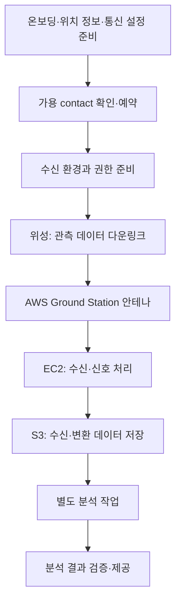

위성에서 생성된 데이터를 활용하려면 위성과 지상 사이의 통신이 필요하다. 지상국은 안테나와 관련 장비를 사용해 위성의 신호를 수신하거나 위성으로 데이터·명령을 전송하는 시설이다.

AWS Ground Station은 이런 지상국 인프라를 직접 구축·운영하는 부담을 줄이고, 위성 통신과 AWS의 저장·처리 환경을 연결하는 관리형 서비스다. 이 글에서는 주요 기능과 사용 예시, 준비 과정과 데이터 전달 방식을 정리한다. 사용 예시는 이해를 돕기 위한 가상 상황이다.

**자료 확인 기준: 2026년 11월 2일**

[공식 자료: AWS 위성 분야 개요](https://docs.aws.amazon.com/whitepapers/latest/aws-overview/satellite.html)

## AWS Ground Station — 위성 통신과 지상 데이터 수신

AWS의 지상 안테나를 이용해 위성과 통신하고 수신 데이터를 AWS 환경으로 전달하는 서비스다.

- **사용하기 좋은 상황:** 위성을 운영하거나 승인된 위성 데이터를 수신해야 하며, 자체 지상국 구축·운영 부담을 줄이려는 경우.
- **간단한 예시:** 지구 관측 위성에서 데이터를 내려받고 AWS에서 처리해 분석용 데이터로 만든다.
- **구분할 점:** 위성 신호의 수신과 전송을 위한 서비스다. 위성 이미지가 이미 S3에 있다면 그 파일을 분석하기 위해 Ground Station을 반드시 사용할 필요는 없다.

지원되는 위성과 주파수·신호 조건, 지상국 위치와 통신 기회를 확인해야 한다. 계정을 만들었다는 이유만으로 임의의 위성과 즉시 통신할 수 있는 것은 아니다.

Ground Station은 위성 자체를 발사하거나 위성의 모든 운영 소프트웨어를 대신하는 서비스도 아니다. 통신을 연결한 뒤 데이터를 해석하고 명령을 구성하는 애플리케이션은 별도로 준비해야 한다.

[공식 자료: AWS Ground Station 개요](https://docs.aws.amazon.com/ground-station/latest/ug/what-is.html)

### 공식 이미지: 위성 통신부터 데이터 처리까지

_위성 온보딩·통신 예약, 명령·데이터 송수신과 AWS에서의 데이터 처리 흐름. AWS 공식 문서의 원본 이미지._

[이미지 출처: What is AWS Ground Station?](https://docs.aws.amazon.com/ground-station/latest/ug/what-is.html)

그림에서는 위성과 통신하는 단계와 수신한 데이터를 처리·배포하는 단계를 나눠 보면 된다. 안테나에서 데이터를 받았다는 사실과 애플리케이션에서 사용할 분석 결과가 완성됐다는 사실은 다르다.

## 통신과 데이터 처리에서 사용하는 용어

- **Downlink:** 위성에서 지상으로 데이터를 내려보내는 통신이다.
- **Uplink:** 지상에서 위성으로 데이터나 명령을 올려보내는 통신이다.
- **TT&C:** Telemetry, Tracking and Command의 약어다. 위성의 상태 확인·추적·명령과 관련된 작업을 뜻한다.
- **Contact:** 특정 지상국 위치와 시간에 안테나를 사용하도록 예약한 통신 구간이다.
- **Ephemeris:** 위성의 위치를 시간에 따라 예측·추적하는 데 필요한 궤도·위치 정보다.
- **Mission profile:** 추적 방식과 송수신 데이터 흐름 등을 묶어 정의한 설정이다.
- **Dataflow:** 신호·데이터의 출발지와 처리·전달 대상을 연결하는 구성이다.

위성이 지상국에서 보이고 필요한 통신 조건을 만족하는 시간은 제한될 수 있다. 원하는 시각에 API를 호출한다고 언제든 같은 위성과 연결되는 방식으로 이해하면 안 된다.

[공식 자료: Ground Station 동작 방식](https://docs.aws.amazon.com/ground-station/latest/ug/how-it-works.html)

## 위성 온보딩 — 통신 대상과 조건 확인

Ground Station에서 사용할 위성을 등록하고 기술·운영 조건을 검증하는 과정이다.

- **사용하기 좋은 상황:** 사용할 위성을 AWS 지상국과 연결하기 전에 지원 여부와 운영 조건을 확인해야 할 때.
- **간단한 예시:** 위성 궤도와 필요한 주파수, 사용할 지상국 위치를 제출해 통신 준비를 진행한다.
- **구분할 점:** 일반적인 클라우드 자원 생성과 달리 자료 수집, 기술 검증, 주파수 관련 승인과 통합 시험 등이 필요한 과정이다.

공식 문서는 위성 온보딩을 수동 검토가 포함된 다단계 과정으로 설명한다. 위성 정보와 요청을 검토·승인한 뒤 사용 가능 상태가 반영된다.

공개 방송 위성의 예제가 있다고 해서 모든 위성이 누구에게나 같은 조건으로 열려 있다고 판단하지 않는다. 실제 대상 위성과 위치별 사용 조건을 확인해야 한다.

[공식 자료: 위성 온보딩](https://docs.aws.amazon.com/ground-station/latest/ug/getting-started.step1.html)

## Mission profile과 Config — 통신 구성을 정의

Mission profile은 위성 통신에 필요한 추적 설정과 데이터 흐름 등을 묶는다. 각 Config는 안테나 송수신이나 저장 대상처럼 특정 동작의 설정을 나타낸다.

- **사용하기 좋은 상황:** 같은 송수신 구성을 반복해서 사용하거나 운영 모드별 통신 구성을 나누려는 경우.
- **간단한 예시:** 관측 데이터를 수신하는 구성과 상태 확인·명령 전송을 위한 구성을 준비한다.
- **구분할 점:** 설정을 만들었다는 사실과 특정 위성의 통신 예약이 완료됐다는 사실은 다르다.

Mission profile 자체는 개별 위성을 직접 지정하는 리소스가 아니다. 기술적 구성이 같은 여러 위성에서 재사용할 수도 있다. 실제 contact에서는 사용할 위성·위치·시간과 설정을 연결한다.

EC2 수신 환경이나 S3 버킷을 사용한다면 필요한 AWS 자원과 권한도 준비해야 한다.

[공식 자료: Mission profile 구성](https://docs.aws.amazon.com/ground-station/latest/ug/how-it-works.html) · [Dataflow 구성](https://docs.aws.amazon.com/ground-station/latest/ug/dataflows.html)

## Contact — 안테나 사용 예약과 실행

조건에 맞는 통신 기회를 확인하고 사용할 안테나 시간을 예약한다.

- **사용하기 좋은 상황:** 위성의 통과 시간에 맞춰 수신·전송 작업을 계획하려는 경우.
- **간단한 예시:** 위성이 특정 지상국의 가시 범위를 지나는 구간을 선택해 데이터 수신 시간을 예약한다.
- **구분할 점:** 예약 요청은 비동기 처리된다. 요청을 보낸 상태와 실제 예약이 확보된 상태를 구분해야 한다.

주요 상태는 다음처럼 이해할 수 있다.

- **SCHEDULING:** 예약 가능 여부를 평가 중이다.
- **SCHEDULED:** 통신에 필요한 예약이 완료됐다.
- **PREPASS:** 통신 시작 전 자원을 준비한다.
- **PASS:** 실제 위성과 통신 중이다.
- **POSTPASS:** 통신 후 자원을 정리한다.
- **COMPLETED:** contact가 오류 없이 완료됐다.

실패·취소 상태도 별도로 있다. 예를 들어 사용자 자원 구성 문제와 Ground Station 서비스 문제에 따른 실패를 구분한다.

**COMPLETED는 해당 contact의 완료 상태이지, 후속 영상 처리나 분석 애플리케이션까지 성공했다는 표시가 아니다.** 수신 데이터와 후속 작업 결과를 각각 확인해야 한다.

[공식 자료: Contact 수명주기와 상태](https://docs.aws.amazon.com/ground-station/latest/ug/contacts.lifecycle.html)

## 데이터 전달 — EC2 수신과 S3 저장

### EC2로 전달해 처리

지원되는 실시간 데이터 흐름을 자신이 관리하는 EC2 환경에서 수신해 처리하는 방식이다.

- **사용하기 좋은 상황:** 수신 중 신호 처리를 수행하거나 기존 SDR·FEP 소프트웨어를 사용하려는 경우.
- **간단한 예시:** EC2에서 수신 신호를 처리하고 추출한 관측 데이터를 S3에 저장한다.
- **구분할 점:** EC2의 애플리케이션과 수신 준비는 사용자가 관리한다. 인스턴스가 실행 중이라는 사실만으로 데이터 처리가 준비됐다고 볼 수는 없다.

SDR(Software Defined Radio)은 소프트웨어로 신호를 처리하는 방식이며, FEP(Front End Processor)는 수신 신호의 초기 처리 등에 사용하는 구성 요소다. 어떤 처리가 필요한지는 위성의 파형과 선택한 dataflow에 따라 달라진다.

[공식 자료: Ground Station 송수신·신호 처리](https://docs.aws.amazon.com/ground-station/latest/ug/what-is.html)

### AWS Ground Station Agent

지원되는 DigIF(Digital Intermediate Frequency) 다운링크 데이터를 EC2에서 수신하는 데 사용하는 소프트웨어다. 별개의 위성 서비스가 아니라 데이터 전달을 위한 구성 요소다.

- **사용하기 좋은 상황:** Agent 기반의 데이터 전달 구성을 EC2에서 운영하려는 경우.
- **간단한 예시:** 지정한 수신 인스턴스에 Agent와 처리 프로그램을 준비해 신호 데이터를 전달받는다.
- **구분할 점:** Agent가 모든 위성 데이터의 업무 해석과 영상 생성까지 자동으로 수행하는 것은 아니다.

지원 인스턴스·CPU·네트워크와 암호화 구성을 확인해야 한다. 수신 속도에 비해 후속 처리가 느리면 데이터 처리 흐름의 병목이 될 수 있다.

[공식 자료: Ground Station Agent 개요](https://docs.aws.amazon.com/ground-station/latest/gs-agent-ug/overview.html)

### S3로 전달해 후속 처리

선택한 dataflow에 따라 수신 데이터를 S3 버킷에 비동기 저장하는 방식이다.

- **사용하기 좋은 상황:** 수신한 데이터를 보관한 뒤 배치 처리와 재분석에 활용하려는 경우.
- **간단한 예시:** 수신 파일을 S3에 저장하고 별도 처리 작업에서 분석용 파일로 변환한다.
- **구분할 점:** S3에 저장되는 파일이 즉시 열어 볼 수 있는 완성된 위성 사진이나 분석 결과라는 뜻은 아니다.

데이터 구조와 형식은 선택한 dataflow와 위성 설정에 따라 달라진다. 원시 디지털 신호와 복조·디코딩된 데이터의 차이를 확인해야 한다. 전달 방식별 지원 조합과 필요한 권한도 별도로 확인한다.

S3 저장 방식에 EC2 Agent 기반 실시간 수신의 설정·제약을 그대로 적용하거나 두 방식을 항상 동시에 제공된다고 가정하지 않는다.

[공식 자료: Dataflow와 전달 형식](https://docs.aws.amazon.com/ground-station/latest/ug/dataflows.html) · [EC2·S3 전달 방식](https://docs.aws.amazon.com/ground-station/latest/gs-agent-ug/overview.html)

## Digital twin — 실제 안테나 없이 연동 시험

가상 지상국을 대상으로 예약과 설정 검증, 오류 처리 등 통신 운영 소프트웨어의 연동을 시험하는 기능이다.

- **사용하기 좋은 상황:** 실제 안테나 자원을 쓰기 전에 예약·이벤트 처리 흐름을 검증하려는 경우.
- **간단한 예시:** contact 상태 이벤트를 받아 수신 환경 준비와 정리 작업을 실행하는 프로그램을 시험한다.
- **구분할 점:** 확인 시점의 공식 문서는 Digital twin이 실제 dataflow의 데이터 전달과 telemetry 전달을 지원하지 않는다고 설명한다.

따라서 Digital twin에서 API와 이벤트 흐름이 정상이어도 실제 무선 수신 품질이나 위성 데이터 처리까지 검증됐다고 표현하면 안 된다. 이 기능을 사용하기 위한 별도 온보딩도 필요하다.

이름이 같더라도 IoT TwinMaker의 운영 데이터 시각화 기능과 같은 서비스는 아니다.

[공식 자료: Ground Station Digital twin](https://docs.aws.amazon.com/ground-station/latest/ug/digital-twin.html)

## Dedicated Antennas — 전용 안테나 구성

조직의 요구사항에 맞춰 구축하고 AWS가 관리하는 전용 안테나 시스템이다.

- **사용하기 좋은 상황:** 공유 안테나의 시간 예약만으로 충족하기 어려운 위치·사양·전용 접근 요구가 있는 경우.
- **간단한 예시:** 위성 운영 조직이 필요한 안테나 사양과 연결 리전을 AWS와 검토한다.
- **구분할 점:** 일반 공유 안테나의 contact 한 건을 예약하는 것과 전용 안테나 구성을 준비하는 것은 다른 일이다.

전용 안테나도 Ground Station의 API와 mission profile·contact 흐름을 사용한다. 계약에 따라 여러 AWS 계정이 사용할 수 있는 구성도 있으므로 전용이라는 이름만으로 계정 구조까지 단정하지 않는다.

[공식 자료: Ground Station Dedicated Antennas](https://docs.aws.amazon.com/ground-station/latest/ug/dedicated-antennas.html)

## 예시: 지구 관측 데이터 수신과 분석

다음은 설명을 위해 작성한 Mermaid 흐름이다. AWS 공식 아키텍처 이미지나 즉시 실행 가능한 운영 구성은 아니다. EC2에서 수신·처리한 뒤 S3에 저장하는 한 가지 예시이며, Ground Station의 S3 직접 전달 방식과는 구분한다.

Ground Station은 위성 통신과 데이터 전달을 담당한다. EC2는 준비한 처리 프로그램을 실행하고 S3는 데이터를 저장한다. 이후의 영상 보정·형식 변환·분석은 별도 작업이다.

분석에 머신러닝이 필요하다면 SageMaker AI 등을 연결할 수 있지만, Ground Station을 사용한다고 분석 모델이 자동으로 준비되는 것은 아니다. 목적에 맞는 처리 단계와 검증 기준을 설계해야 한다.

[공식 자료: Ground Station과 AWS 데이터 처리 서비스 연결](https://docs.aws.amazon.com/whitepapers/latest/aws-overview/satellite.html)

## 비용과 위치를 확인할 때

공식 가격 안내는 안테나 이용에 **On-Demand와 Reserved** 방식을 구분한다. On-Demand는 장기 약정 없이 이용하는 방식이며, Reserved는 월간 이용 약정 등 별도 조건에 따라 가격과 예약 조건이 달라진다.

- **안테나 이용:** 통신 시간과 지원 기능, 이용 방식의 조건을 확인한다.
- **EC2:** 수신 전 준비 시간과 통신 후 처리 시간을 포함해 자원 사용을 관리한다.
- **S3:** 수신·처리 파일의 저장량과 요청, 보관 기간을 고려한다.
- **데이터 전달·분석:** 선택한 AWS 서비스와 리전 구성에 따른 비용을 확인한다.
- **전용 안테나:** 공유 안테나의 공개 이용 조건을 전용 구성에 그대로 적용하지 않는다.

고정 할인율이나 금액을 모든 위성과 위치에 동일하게 적용하지 않는다. 실제 사양과 계약, 예약·취소 조건은 사용 시점의 공식 안내를 확인해야 한다.

[공식 자료: AWS Ground Station 가격](https://aws.amazon.com/ground-station/pricing/)

안테나의 물리적 위치와 데이터를 처리할 AWS 리전도 구분한다. 지원되는 cross-region 전달을 사용할 수 있지만, 모든 안테나·주파수·대상 리전 조합이 동일하게 지원된다고 가정하면 안 된다.

[공식 자료: 위치·기능과 데이터 전달 구성](https://docs.aws.amazon.com/ground-station/latest/ug/how-it-works.html)

## 혼동하기 쉬운 구분

- **위성 통신과 파일 분석:** 위성에서 신호를 받는 일과 이미 받은 파일을 분석하는 일은 다르다.
- **예약 요청과 예약 완료:** 요청이 접수된 뒤 지원 조건과 가용성이 평가된다.
- **Contact 완료와 업무 완료:** 통신 완료 뒤 파일 검증과 분석 결과를 별도로 확인한다.
- **수신 신호와 완성된 영상:** 필요한 신호 처리·디코딩·변환 단계를 구분한다.
- **Digital twin과 실통신 시험:** API·이벤트 연동 검증과 실제 데이터 수신 검증을 구분한다.
- **공유 안테나 예약과 전용 안테나:** 시간 단위 이용과 맞춤 전용 인프라 요구사항을 구분한다.

## SAA 공부와 연결해서 볼 내용

확인 시점의 SAA-C03 공식 안내는 **AWS Ground Station을 시험 범위 밖(Out of Scope)**으로 표시한다. 이 글은 필수 시험 암기 대상으로 소개하는 것이 아니라 AWS 위성 통신 서비스의 역할을 이해하기 위한 정리다.

1. **물리 인프라와 클라우드를 연결한다:** 안테나, 네트워크와 데이터 처리 환경의 역할을 구분한다.
2. **EC2와 S3를 사용한다:** 실행 자원과 객체 저장소의 목적을 구분한다.
3. **외부에서 데이터가 들어온다:** 인증·권한·형식·처리 속도와 오류 대응을 확인한다.
4. **상태가 완료로 바뀐다:** 어떤 단계의 완료인지와 후속 검증 대상을 확인한다.
5. **서비스를 선택한다:** 이미 파일이 있는 경우와 위성 통신 자체가 필요한 경우를 구분한다.

시험 범위와 서비스의 위치·기능 지원은 응시·사용 시점에 각각 다시 확인해야 한다.

[공식 자료: SAA-C03 시험 범위 밖 서비스](https://docs.aws.amazon.com/aws-certification/latest/solutions-architect-associate-03/saa-03-out-of-scope-services.html)

