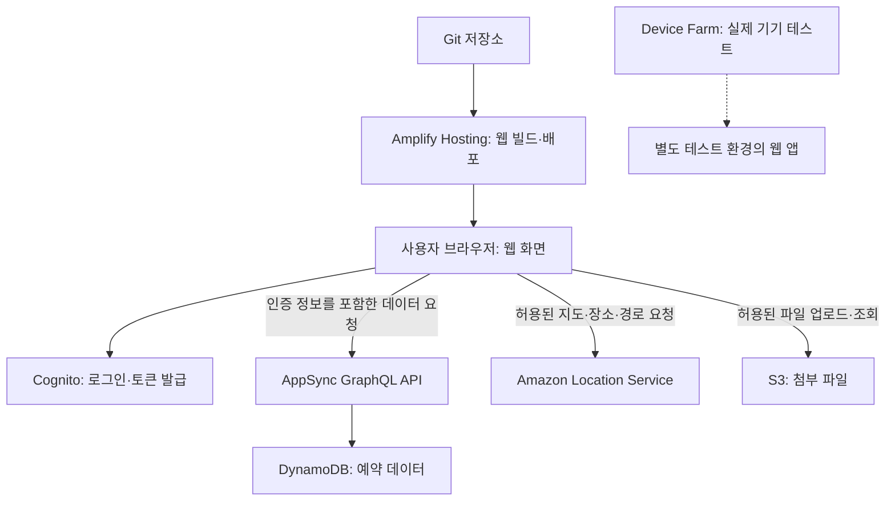

웹·모바일 애플리케이션에는 화면을 배포하는 기능 외에도 로그인, 데이터 조회·변경, 실시간 통신, 위치 검색과 기기별 테스트가 필요하다. AWS는 이 작업을 지원하는 개발 도구와 관리형 서비스를 제공한다.

이 글에서는 AWS 공식 개요의 프런트엔드·모바일 분야에 포함된 Amplify, AppSync, Device Farm, Amazon Location Service를 정리한다. 함께 사용하는 인증·저장소·API 서비스는 역할을 구분하기 위해 간단히 설명한다. 사용 예시는 이해를 돕기 위한 가상 상황이다.

**자료 확인 기준: 2026년 11월 2일**

[공식 자료: AWS 프런트엔드·모바일 서비스 개요](https://docs.aws.amazon.com/whitepapers/latest/aws-overview/mobile-services.html)

## 먼저 구분할 작업

- **화면 개발과 배포:** 웹 화면을 빌드하고 사용자가 접속할 주소로 제공한다.
- **백엔드 구성:** 로그인, API, 데이터 저장소와 파일 저장소를 연결한다.
- **실시간 통신:** 접속한 사용자에게 변경 사항과 이벤트를 전달한다.
- **위치 기능:** 지도 표시, 장소 검색, 경로와 위치 추적을 제공한다.
- **테스트:** 실제 기기와 운영체제 조합에서 앱의 동작을 확인한다.

하나의 제품이 이 작업을 모두 독립적으로 처리하는 것은 아니다. Amplify로 구성한 기능도 실제로는 Cognito, AppSync, DynamoDB, S3 같은 AWS 리소스를 사용한다. 반대로 Amplify를 사용하지 않고 각 서비스를 직접 구성할 수도 있다.

## AWS Amplify — 웹·모바일 앱 개발과 AWS 연결

웹·모바일 앱의 백엔드 구성, 프런트엔드 연동과 웹 배포를 지원하는 도구와 서비스다. 단순한 웹 서버나 데이터베이스 하나를 뜻하지 않는다.

- **사용하기 좋은 상황:** 프런트엔드 중심의 팀이 인증·데이터·파일 기능을 AWS와 연결하고 코드와 배포 구성을 함께 관리하려는 경우.
- **간단한 예시:** 사진 공유 앱에서 회원 로그인, 본인 게시물 조회와 사진 업로드 기능을 정의하고 웹 화면과 연결한다.
- **구분할 점:** 개발 편의를 제공해도 권한 설계, 데이터 모델, 비용과 실제 업무 로직까지 자동으로 올바르게 결정되는 것은 아니다.

Amplify 안에서도 백엔드 정의, 클라이언트 라이브러리·UI 구성 요소, Hosting의 역할을 나눠 이해해야 한다. 웹 화면만 Hosting으로 배포하거나 기존 AWS 리소스에 라이브러리를 연결하는 등 필요한 기능부터 사용할 수 있다.

[공식 자료: Amplify 문서](https://docs.amplify.aws/react/)

### Amplify Gen 2 — 코드로 백엔드 정의

TypeScript 기반으로 인증, 데이터 모델과 접근 규칙 등을 정의하는 개발 방식이다. AWS CDK를 기반으로 필요한 리소스를 구성하고 확장한다.

- **사용하기 좋은 상황:** 백엔드 구성을 소스 코드로 검토하고 개발 환경과 배포 환경의 변경을 관리하려는 경우.
- **간단한 예시:** 게시물 모델과 작성자만 수정할 수 있는 규칙을 코드로 정의하고 앱에서 타입이 있는 데이터 클라이언트로 호출한다.
- **구분할 점:** Gen 1의 CLI·Studio 중심 자료와 Gen 2의 파일·명령을 그대로 섞어 적용하지 않는다. 기존 프로젝트의 버전과 기능 지원 범위를 먼저 확인한다.

일반적인 Gen 2 Data 구성은 AppSync GraphQL API와 DynamoDB를 사용한다. Auth를 추가하면 Cognito를 구성한다. 추가 서비스와 기존 리소스를 연결할 수도 있으므로 모든 Amplify 앱의 구조가 같다고 가정하지 않는다.

개발자별 클라우드 샌드박스도 실제 AWS 리소스를 생성한다. 로컬에서 코드를 실행한다는 이유만으로 클라우드 자원이 생성되지 않거나 비용이 발생하지 않는다고 판단하면 안 된다.

[공식 자료: Amplify 개념과 백엔드 구성](https://docs.amplify.aws/react/how-amplify-works/concepts/) · [Amplify Data](https://docs.amplify.aws/react/build-a-backend/data/)

### Amplify Hosting — 웹 앱 빌드와 배포

Git 기반의 지속적 배포와 CDN을 통한 웹 앱 제공을 지원하는 관리형 호스팅 서비스다. 정적 사이트와 SPA뿐 아니라 지원되는 SSR 프레임워크도 배포할 수 있다.

- **사용하기 좋은 상황:** 저장소의 변경을 빌드·배포하고 브랜치별 환경이나 변경 미리보기를 운영하려는 경우.
- **간단한 예시:** React 웹 앱의 검토용 브랜치를 별도 주소로 배포하고, 검토한 코드를 운영 브랜치에 반영한다.
- **구분할 점:** 웹 화면을 배포하는 것과 모바일 앱을 앱스토어에 배포하는 것은 다른 작업이다. Amplify Hosting이 네이티브 앱의 스토어 심사와 출시를 대신하지 않는다.

지원 프레임워크, SSR 기능과 런타임 제한은 배포 전에 확인한다. 환경 변수와 비밀 값도 구분해야 한다. 브라우저로 전달되는 코드나 설정에 포함된 값은 사용자가 확인할 수 있으므로 서버용 비밀 정보를 넣으면 안 된다.

[공식 자료: Amplify Hosting](https://docs.aws.amazon.com/amplify/latest/userguide/welcome.html)

## AWS AppSync — 데이터 API와 실시간 통신

AppSync는 GraphQL API와 실시간 Pub/Sub API를 제공하는 관리형 서비스다. 데이터베이스를 대체하는 저장소가 아니라 앱이 데이터와 이벤트에 접근하는 API 계층이다.

### AppSync GraphQL API

GraphQL 스키마를 통해 클라이언트가 요청할 수 있는 데이터의 형태를 정의하고, 리졸버가 데이터 소스에 대한 조회·변경을 처리하도록 구성한다.

- **사용하기 좋은 상황:** 여러 데이터 소스의 정보를 화면에 맞는 API로 제공하거나 데이터 변경을 구독하는 앱을 만들려는 경우.
- **간단한 예시:** 주문 화면에서 주문 정보와 배송 상태를 필요한 필드만 요청하고 변경 알림을 구독한다.
- **구분할 점:** GraphQL은 데이터 요청 방식을 정의한다. 데이터를 실제로 어디에 저장하고 어떤 권한으로 읽을지는 별도로 구성해야 한다.

스키마는 API의 타입과 작업을 정의하고, 리졸버는 요청한 필드를 데이터 소스의 작업과 연결한다. DynamoDB나 Lambda 등은 연결 대상의 예다. 하나의 API가 여러 데이터 소스에 연결될 수 있다.

인증을 통과했다는 사실과 특정 사용자의 데이터에 접근할 권한이 있다는 사실도 다르다. 로그인 여부뿐 아니라 소유자·그룹·필드별 접근 규칙을 검토한다.

[공식 자료: AppSync 개요](https://docs.aws.amazon.com/appsync/latest/devguide/what-is-appsync.html)

### 공식 이미지: GraphQL API와 데이터 소스의 관계

_GraphQL API가 여러 AWS 데이터 소스에 연결되는 구조. AWS 공식 문서의 원본 이미지._

[이미지 출처: AppSync 데이터 소스](https://docs.aws.amazon.com/appsync/latest/devguide/data-source-components.html)

그림은 클라이언트에 제공하는 GraphQL API와 실제 데이터를 처리하는 여러 서비스의 관계를 보여준다. 앱이 요청하는 데이터 형태와 데이터를 보관·처리하는 서비스를 구분해서 보면 된다.

실제 요청 처리는 스키마와 연결된 리졸버·데이터 소스 구성을 따른다. 그림에 나온 모든 서비스를 반드시 사용해야 하는 것은 아니다.

### AppSync Events

채널 기반의 이벤트 발행·구독을 위한 서버리스 WebSocket API다. 클라이언트는 HTTP나 WebSocket으로 이벤트를 발행하고 WebSocket으로 채널을 구독할 수 있다.

- **사용하기 좋은 상황:** 실시간 채팅, 경기 점수, 공동 작업 알림처럼 접속한 사용자에게 이벤트를 전달하려는 경우.
- **간단한 예시:** 고객 상담방별 채널을 만들고 해당 상담방에 접근 가능한 사용자에게 새 메시지를 전달한다.
- **구분할 점:** GraphQL 데이터 API와 별도 API 유형이다. 이벤트 전달을 위해 GraphQL 스키마와 mutation 기반 구독을 반드시 구성해야 하는 것은 아니다.

연결과 확장 관리 부담은 줄어들지만 발행·구독 권한, 채널 설계와 메시지 검증은 필요하다. 연결 중 전달되는 이벤트와 나중에 조회할 메시지 이력 저장도 구분한다. 앱이 꺼져 있을 때 운영체제가 표시하는 모바일 푸시 알림과도 다르다.

[공식 자료: AppSync Events](https://docs.aws.amazon.com/appsync/latest/eventapi/event-api-welcome.html)

## AWS Device Farm — 실제 기기에서 앱 테스트

AWS가 제공하는 실제 휴대전화·태블릿에서 Android, iOS와 웹 앱을 테스트하는 서비스다. 자동화 테스트와 원격 기기 접근을 지원한다.

- **사용하기 좋은 상황:** 여러 기기·운영체제 조합에서 호환성을 확인하거나 특정 기기에서만 발생하는 문제를 재현하려는 경우.
- **간단한 예시:** 앱과 테스트를 업로드해 여러 기기에서 회원가입·사진 업로드를 실행하고 로그와 스크린샷을 비교한다.
- **구분할 점:** 앱의 테스트 환경이지 운영 사용자에게 앱을 제공하는 서버나 앱스토어는 아니다.

자동화 테스트는 준비한 테스트와 설정에 따라 실행된다. 실제 기기를 사용해도 모든 사용자 환경과 네트워크 조건, 업무 흐름이 검증되는 것은 아니다. 테스트용 계정과 데이터를 준비하고 결과·실패 원인을 확인해야 한다.

확인 시점의 공식 문서에는 Device Farm이 **미국 서부 오리건 리전(us-west-2)에서 제공**된다고 안내한다. 기기 목록, 테스트 프레임워크, 접근 방식과 비용 조건도 함께 확인한다.

[공식 자료: Device Farm 개요](https://docs.aws.amazon.com/devicefarm/latest/developerguide/welcome.html)

## Amazon Location Service — 지도와 위치 기능

지도, 장소 검색과 지오코딩, 경로 계산, 위치 추적과 지오펜스 기능을 제공하는 관리형 서비스다.

- **사용하기 좋은 상황:** 매장 찾기, 배송 경로, 자산 위치 표시처럼 위치 기반 기능을 앱에 추가하려는 경우.
- **간단한 예시:** 고객 주소로 가까운 매장을 검색하고 이동 경로를 표시한다. 배송 차량이 지정된 구역에 들어오면 후속 작업에 연결한다.
- **구분할 점:** 지도 표시와 위치 추적, 경로 계산은 서로 다른 기능이다. 서비스를 사용한다고 단말기의 위치가 자동으로 수집되는 것은 아니다.

주요 기능은 다음처럼 구분한다.

- **Maps:** 앱에서 지도를 표시하는 데 사용한다.
- **Places:** 장소를 검색하거나 주소와 좌표를 변환한다.
- **Routes:** 출발지와 목적지 사이의 경로를 계산한다.
- **Trackers:** 앱이나 장치가 전달한 위치 데이터를 관리한다.
- **Geofences:** 지정한 지리적 경계의 진입·이탈을 판단하는 데 사용한다.

단말기의 위치 권한과 수집 주기, 이용자 동의·보관 정책은 애플리케이션에서 설계해야 한다. 데이터 공급자와 지역에 따른 기능 범위, 지도 표시·경로·저장 데이터의 이용 조건도 확인한다.

[공식 자료: Amazon Location Service 개요](https://docs.aws.amazon.com/location/latest/developerguide/what-is.html)

## 함께 사용하는 서비스

이 서비스들은 프런트엔드 전용 제품이 아니다. 앱을 구성할 때 역할이 겹쳐 보일 수 있어 구분해 둔다.

- **Amazon Cognito:** 앱 사용자의 가입·로그인과 토큰 기반 인증에 활용한다. Amplify Auth는 이를 구성하고 앱에 연결하는 방법 중 하나다.
- **Amazon S3:** 업로드한 사진·문서 같은 객체를 저장한다. Amplify Storage와 연결하더라도 접근 권한과 공개 범위를 정해야 한다.
- **Amazon DynamoDB:** 게시물·주문 같은 데이터를 저장하는 데이터베이스다. AppSync는 여기에 접근하는 API 계층으로 사용할 수 있다.
- **Amazon API Gateway:** REST·HTTP·WebSocket API 등 요구사항에 맞는 API를 구성할 때 검토한다. GraphQL 중심의 AppSync와 API 형태·연결 방식·권한 요구사항을 비교한다.

화면에 로그인 버튼을 추가하는 일, 사용자를 인증하는 일, 요청한 데이터에 대한 접근을 허용하는 일은 각각 다른 단계다.

[공식 자료: Amplify의 AWS 리소스 연결](https://docs.amplify.aws/react/how-amplify-works/concepts/) · [AppSync 데이터 소스](https://docs.aws.amazon.com/appsync/latest/devguide/data-source-components.html) · [Cognito 개요](https://docs.aws.amazon.com/cognito/latest/developerguide/what-is-amazon-cognito.html) · [API Gateway 개요](https://docs.aws.amazon.com/apigateway/latest/developerguide/welcome.html)

## 예시: 매장 검색과 예약을 제공하는 웹 앱

다음은 서비스의 역할을 설명하기 위해 작성한 Mermaid 구성도다. AWS 공식 아키텍처 이미지나 자동으로 생성되는 기본 구성이 아니다.

웹 배포, 사용자 로그인, 예약 데이터와 위치 기능은 각각 다른 서비스가 맡는다. Amplify Gen 2로 백엔드 일부를 정의할 수 있지만 위 서비스 전체가 항상 자동으로 구성되는 것은 아니다.

브라우저의 로그인 토큰만으로 S3나 Location의 접근까지 자동 허용되는 것도 아니다. 각 요청에 필요한 인증 방식과 최소 권한을 설정해야 한다. 실제 예약 처리에는 중복 예약 방지, 취소 규칙과 오류 처리도 필요하다.

Device Farm에서는 운영 데이터에 영향을 주지 않는 테스트 환경과 계정을 사용해 기기별 동작을 확인한다.

## 오래된 모바일 개발 자료에서 확인할 사항

### Amplify Gen 1과 구형 모바일 SDK

Amplify Gen 1 문서가 남아 있다는 사실과 모든 관련 SDK가 계속 지원된다는 것은 다르다. 공식 Android 문서는 **구형 AWS SDK for Android의 지원 종료일을 2026년 8월 1일**로 명시하고 AWS Amplify for Android로의 전환을 안내한다.

이 안내를 Amplify 전체나 AWS SDK for Kotlin의 종료로 해석하지 않는다. 사용하는 라이브러리 이름과 버전을 먼저 확인한다.

[공식 자료: 구형 AWS Mobile SDK for Android 안내](https://docs.amplify.aws/gen1/android/sdk/)

### AWS Mobile Hub

AWS Mobile Hub는 공식 종료 목록에 **2021년 10월 31일 종료**로 표시돼 있다. 예전 앱 개발 자료에 나오더라도 새 프로젝트의 현재 구성 도구로 제시하지 않는다.

[공식 자료: 완전 종료된 서비스 목록](https://docs.aws.amazon.com/general/latest/gr/full_shutdown_services.html)

### Amazon Pinpoint

확인 시점에는 **2026년 10월 30일 지원 종료일이 지났다.** 종료 대상인 엔드포인트·세그먼트·캠페인·여정·분석 등의 고객 참여 기능과 계속 지원되는 메시지 전송 기능을 구분해야 한다.

공식 안내는 모바일 푸시, OTP와 전화번호 검증 등의 계속 지원 여부를 별도로 설명한다. 기존 고객에게 유지되는 전송 기능도 있으며, 새 SMS·음성 채널은 AWS End User Messaging, 새 이메일 채널은 Amazon SES를 검토하도록 안내한다. 따라서 “모든 모바일 푸시와 SMS API가 함께 종료됐다”라고 정리하면 안 된다.

[공식 자료: Pinpoint 지원 종료와 기능별 영향](https://docs.aws.amazon.com/pinpoint/latest/userguide/migrate.html)

## SAA 공부와 연결해서 볼 내용

확인 시점의 SAA-C03 공식 시험 범위 목록은 Front-End Web and Mobile 아래에 **AWS Amplify, Amazon API Gateway, AWS Device Farm**을 나열한다. Cognito는 보안 분야에 포함된다. 목록은 비포괄적이며 변경될 수 있으므로 이름이 없는 서비스가 반드시 시험에서 제외된다고 단정하지 않는다.

AppSync와 Location은 앱 구성과 서비스 역할을 이해하는 데 함께 정리했다. 이 글의 설명 순서는 출제 빈도나 중요도 순위가 아니다.

1. **웹 앱을 저장소 변경에 맞춰 빌드·배포한다:** Amplify Hosting의 역할을 확인한다.
2. **앱의 인증·데이터 구성을 코드로 정의한다:** Amplify Gen 2와 실제 생성되는 리소스를 구분한다.
3. **GraphQL API로 여러 데이터 소스에 접근한다:** AppSync의 스키마·리졸버·데이터 소스를 구분한다.
4. **접속한 사용자에게 실시간 이벤트를 전달한다:** AppSync Events와 모바일 푸시, 데이터 저장을 구분한다.
5. **실제 휴대전화에서 호환성을 테스트한다:** Device Farm의 목적과 지원 환경을 확인한다.
6. **앱에 지도·장소 검색·경로를 추가한다:** Location의 기능별 역할을 확인한다.
7. **사용자가 로그인했다:** 데이터 소유권과 각 AWS 서비스에 대한 접근 권한까지 자동으로 해결됐다고 판단하지 않는다.

[공식 자료: SAA-C03 시험 범위 서비스](https://docs.aws.amazon.com/aws-certification/latest/solutions-architect-associate-03/saa-03-in-scope-services.html)

