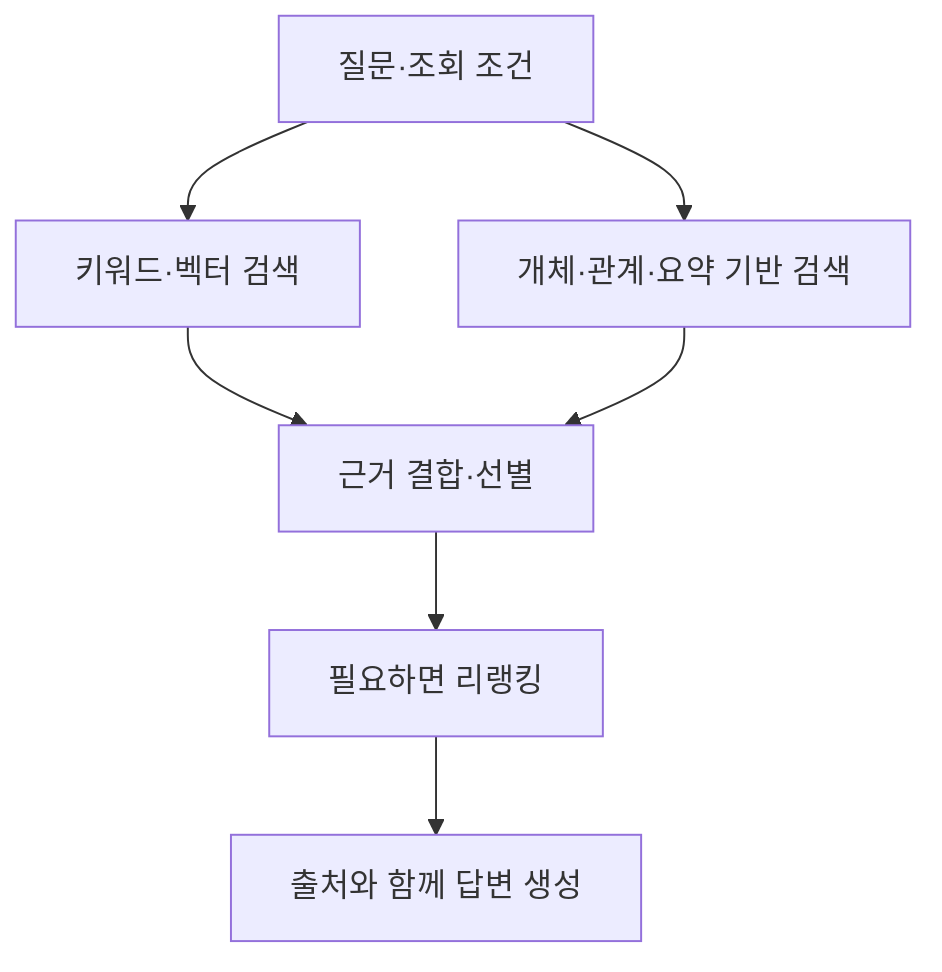

GraphRAG는 그래프 구조를 검색과 답변 생성에 활용하는 접근이다. Microsoft의 프로젝트 이름이기도 하지만, 그래프를 사용하는 모든 RAG가 Microsoft GraphRAG와 같은 방식으로 동작하는 것은 아니다.

아래 다섯 구현은 목적과 제공 범위가 다르다. 성능 순위보다 **어떤 질문을 처리하고, 데이터를 어떻게 구성·갱신하는지**를 기준으로 비교한다.

## Microsoft GraphRAG — 개체 검색과 문서 집합 전체 요약

문서에서 추출한 개체·관계와 커뮤니티 요약 등을 활용한다. 커뮤니티는 그래프에서 서로 연결이 밀접한 대상들의 묶음이며, 요약 보고서는 그 묶음의 정보를 정리한 것이다.

- **Local Search:** 특정 개체와 관련된 그래프 정보·원문 청크를 결합한다.
- **Global Search:** 커뮤니티 보고서를 활용해 문서 집합 전체를 다루는 질문에 답한다.
- **DRIFT Search:** 커뮤니티 정보를 활용해 질문을 후속 질문으로 구체화하고 탐색 범위를 넓힌다.

예를 들어 “전체 장애 보고서에서 반복되는 문제는 무엇인가?” 같은 질문을 다루는 구성을 검토할 수 있다. 그래프 추출과 요약 생성, 질의 시 호출 비용을 함께 확인해야 한다.

[공식 문서](https://microsoft.github.io/graphrag/query/overview/)

## LightRAG — 개체·관계 검색과 원문 검색 결합

문서에서 개체·관계를 구성하고 벡터 표현과 함께 활용한다. 개체 중심의 local 검색과 관계 중심의 global 검색을 제공한다.

여기서 **hybrid는 local·global 결과의 결합**을 뜻한다. BM25와 벡터 검색의 결합을 자동으로 의미하는 것은 아니다. 현재 문서의 `mix`는 여기에 원문 청크의 벡터 검색도 결합하는 모드다.

예를 들어 “인증 서비스와 연결된 장애 및 해결 문서는?” 같은 질문에서 관계 정보와 원문을 함께 찾는 구성을 검토할 수 있다. 모드 이름이 같아도 Microsoft GraphRAG의 Local·Global과 같은 알고리즘으로 이해하면 안 된다.

[공식 저장소](https://github.com/HKUDS/LightRAG)

## HippoRAG 2 — 여러 문서의 연결을 활용하는 검색

새 지식의 연결을 활용해 여러 단계의 근거를 찾는 검색·메모리 프레임워크다. 하나의 문단에서 바로 답을 찾기보다 여러 문서의 정보를 연결해야 하는 문제를 비교할 후보다.

예를 들어 한 문서에는 “서비스 A는 시스템 B에 의존한다”, 다른 문서에는 “시스템 B는 담당 조직 C가 운영한다”는 정보가 있을 때, 연결된 근거를 찾아 질문에 답하는 구성을 평가할 수 있다.

이름의 Memory를 대화 기록 저장 기능과 같은 의미로만 해석하지 않는다. 문서에서 만든 지식 구조와 검색 방식이 질문에 필요한 연결을 복원하는지 확인해야 한다. 논문의 특정 데이터셋 성능이 자신의 문서에서도 그대로 재현되는 것은 아니다.

[공식 저장소](https://github.com/OSU-NLP-Group/HippoRAG) · [HippoRAG 2 논문](https://arxiv.org/abs/2502.14802)

## Graphiti — 시간에 따라 바뀌는 사실과 관계

정보를 점진적으로 추가하고, 사실·관계의 유효 시점과 출처를 관리하는 시간 기반 그래프 프레임워크다. 의미 검색·키워드 검색·그래프 탐색을 결합한다.

예를 들어 “현재 인증 시스템 담당자는 누구이며, 이전 담당자는 누구였나?”처럼 변경 전후를 구분하는 질문에 활용할 구성을 검토할 수 있다.

Graphiti는 그래프를 구축·조회하는 프레임워크다. 사용하는 그래프 DB와 LLM·임베딩, 데이터 수집·권한·운영 환경은 별도로 준비한다. 시간 필드를 지원한다는 사실만으로 입력의 날짜와 사실이 자동으로 정확해지는 것은 아니다.

[공식 저장소](https://github.com/getzep/graphiti)

## Neo4j GraphRAG Python — 검색 구성을 조합하는 라이브러리

**Neo4j는 그래프 데이터베이스이고, Neo4j GraphRAG Python은 이를 활용하는 RAG 라이브러리다.** 둘을 같은 제품 역할로 묶으면 비교가 흐려진다.

라이브러리는 벡터 검색, 전문 검색과의 결합, 그래프 탐색과 Text2Cypher 등 여러 Retriever를 제공한다. 예를 들어 HybridCypherRetriever는 벡터·전문 검색으로 후보를 찾은 뒤 Cypher 질의로 관련 맥락을 확장한다.

기존 Neo4j 그래프가 있거나 관계·검색 질의를 직접 설계하려는 경우 검토할 수 있다. Text2Cypher처럼 LLM이 질의를 만드는 방식도 생성된 질의의 정확성과 접근 권한을 별도로 확인해야 한다.

[공식 문서](https://neo4j.com/docs/neo4j-graphrag-python/current/user_guide_rag.html)

## 기본 제공 도구와 별도 구성 범위

검색 방식 외에 **직접 만들어야 하는 화면과 API가 얼마나 남는지**도 비교한다.

- **LightRAG:** Server의 Web UI로 문서를 관리하고, 지식 그래프를 탐색하며, 검색 매개변수를 바꿔 질의를 시험할 수 있다. REST API도 제공한다. SDK만 사용하는 구성과 Server·Web UI를 실행하는 구성은 구분한다. LLM·임베딩·저장소 설정은 필요하다. [공식 저장소](https://github.com/HKUDS/LightRAG)
- **Microsoft GraphRAG:** 초기화·색인·질의·프롬프트 튜닝용 CLI를 제공한다. 공식 시각화 가이드는 GraphML 출력을 별도 Gephi에서 여는 방식이다. [CLI](https://microsoft.github.io/graphrag/cli/) · [시각화 안내](https://microsoft.github.io/graphrag/visualization_guide/)
- **HippoRAG:** 공식 저장소의 MCP 서버는 검색·답변 생성·문서 추가와 삭제·색인 통계를 제공한다. 설치 버전의 지원 범위를 확인한다. [공식 저장소](https://github.com/OSU-NLP-Group/HippoRAG)
- **Graphiti:** MCP·REST 서버의 참조 구현을 제공한다. 완성된 운영 서비스가 아니며, 인증·권한 등은 별도로 구성해야 한다. [공식 저장소](https://github.com/getzep/graphiti)
- **Neo4j:** Browser로 Cypher를 실행하고 결과의 노드·관계를 시각화할 수 있다. 이는 Neo4j DB의 개발 도구이며 GraphRAG Python 라이브러리 자체의 문서 관리 UI는 아니다. [Browser 안내](https://neo4j.com/docs/browser/)

그래프 화면은 잘못 추출된 관계를 확인할 때 유용하다. 화면이 제공된다는 사실과 검색·답변 품질이 좋다는 판단은 별도로 확인한다.

## 비교할 때 먼저 볼 기준

| 요구사항                      | 우선 살펴볼 구현·기능                      |
| ------------------------- | --------------------------------- |
| 문서 집합 전체의 주제와 반복 패턴을 요약한다 | Microsoft GraphRAG의 Global Search |
| 개체·관계와 원문을 함께 검색한다        | LightRAG의 검색 모드                   |
| 여러 문서에 흩어진 근거를 연결한다       | HippoRAG 2                        |
| 사실과 관계의 변경 이력을 다룬다        | Graphiti                          |
| Neo4j의 그래프·검색 질의를 직접 조합한다 | Neo4j GraphRAG Python             |

표는 각 구현의 강조점을 정리한 것이다. 한 요구사항을 특정 구현만 처리할 수 있다는 뜻은 아니다.

## 그래프와 하이브리드 검색은 함께 사용할 수 있다

아래는 직접 작성한 일반적인 조합 예시다. 다섯 프로젝트의 공통 내부 구조나 기본 실행 순서를 나타내는 그림은 아니다.

따라서 GraphRAG를 도입한다고 BM25·벡터 검색·RRF가 모두 사라지는 것은 아니다. 어떤 결과를 결합하고 어디에서 순위를 정할지는 구현과 설정에 따라 달라진다.

## 도입 전에 확인할 세 가지

1. **관계가 실제로 필요한가:** 일반 문단 검색으로 놓치는 질문에서 그래프가 근거를 보완하는지 확인한다.
2. **갱신 가능한가:** 문서를 추가·수정·삭제했을 때 개체·관계·요약과 출처도 적절히 갱신되는지 확인한다.
3. **추가 비용이 유용한가:** 색인 생성·추론 비용과 지연을 포함해 답변 품질의 개선을 비교한다.

그래프는 원문의 오류나 잘못된 관계 추출을 자동으로 해결하지 않는다. 답변에 사용한 관계를 실제 원문 근거로 되짚을 수 있는지도 중요하다.

자료 확인: 2026년 11월 4일의 공식 문서·저장소 기준이다. 설치할 버전의 지원 기능과 호환성은 별도로 확인해야 한다. 본문의 질문·구성도는 설명용이며 직접 수행한 성능 실험 결과나 도입 점유율 순위가 아니다.

