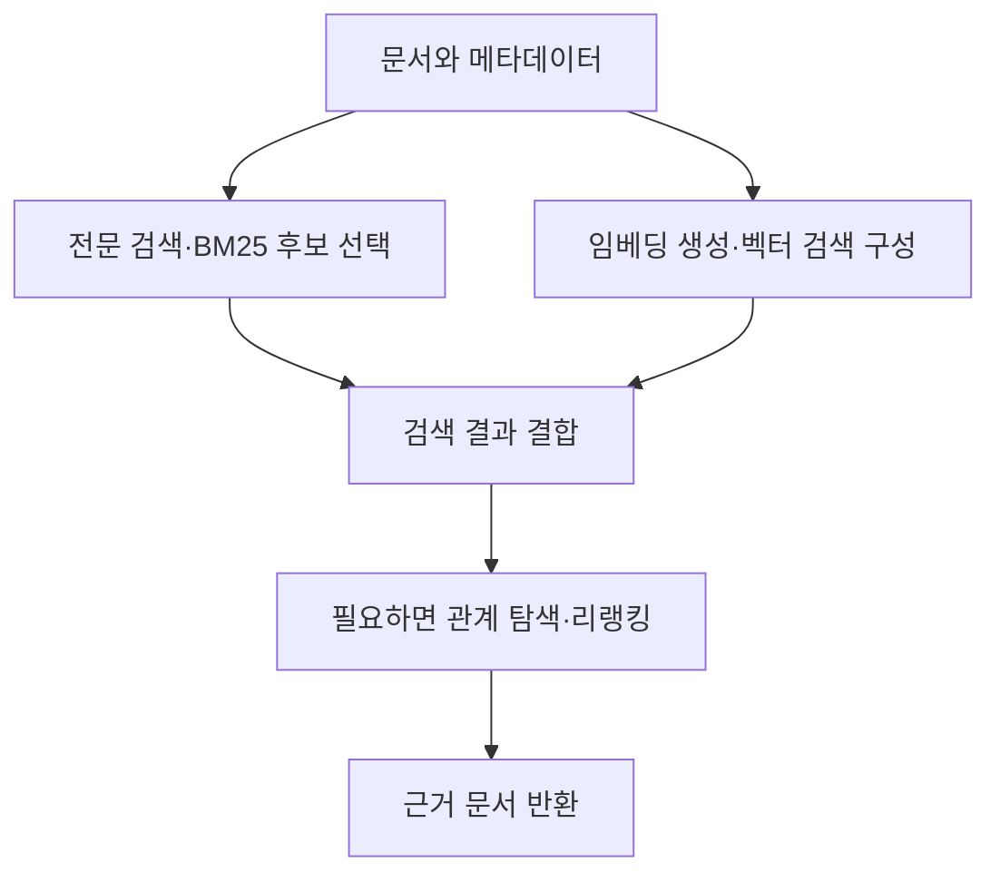

PostgreSQL의 검색 기능은 이름보다 역할로 구분하면 선택하기 쉽다. 문자열이 비슷한지, 같은 단어가 있는지, 의미가 가까운지, 대상 사이에 관계가 있는지는 서로 다른 문제다.

아래는 문서 검색에 검토할 만한 기본 기능과 확장이다. 모든 확장을 설치하거나 같은 성능 순위로 비교할 필요는 없다.

## 기본 검색과 문자열 유사도

- **기본 전문 검색:** `tsvector`·`tsquery`로 문서를 검색하고 GIN 인덱스 등을 활용한다. 추가 검색 엔진 없이 시작할 기준이다. 기본 순위 함수인 `ts_rank` 계열과 BM25는 구분해야 한다.
- **pg_trgm:** 문자를 세 글자 조각으로 나눠 유사도를 비교하는 확장이다. 비슷한 제품명·이름과 오타 후보를 찾는 데 활용한다. 문장의 의미를 비교하는 임베딩 검색과는 다르다.
- **PGroonga:** Groonga를 인덱스로 사용하는 다국어 전문 검색 확장이다. 한국어 문서를 다룰 때 토큰화와 부분 일치 요구사항에 맞는지 검토할 후보다.

예를 들어 “PostgreSQL”과 비슷하게 입력한 이름을 찾는 문제와, “데이터베이스 연결이 끊긴다”에 관련된 문서를 찾는 문제는 다르다.

[공식 자료: 기본 전문 검색](https://www.postgresql.org/docs/current/textsearch.html) · [pg_trgm](https://www.postgresql.org/docs/current/pgtrgm.html) · [PGroonga](https://pgroonga.github.io/)

## BM25 기반 검색

BM25는 검색어와 문서에 등장하는 단어를 바탕으로 관련성을 계산하는 순위 함수다. 같은 BM25를 사용해도 토크나이저·인덱스·필터 처리와 제공 기능은 다를 수 있다.

| 확장               | 주요 역할                                                           | 선택할 때 볼 점                            |
| ---------------- | --------------------------------------------------------------- | ------------------------------------ |
| pg_search        | ParadeDB의 검색 확장. BM25 전문 검색 외에 현재 문서는 벡터·하이브리드 검색, 필터·집계도 안내한다. | 검색과 필터·JOIN·집계를 함께 처리할 요구가 있는지       |
| VectorChord-bm25 | PostgreSQL 안에서 BM25 순위 검색을 제공한다.                                | 별도 pg_tokenizer와 토큰화·인덱스 구성이 요구에 맞는지 |
| pg_textsearch    | PostgreSQL 텍스트 검색 설정을 사용하는 BM25 확장이다.                           | 언어별 text_config와 필터 조건의 실행 방식이 맞는지   |

이 셋은 우선 **BM25 검색을 구현할 선택지**로 비교하면 된다. 전부 설치해야 하는 구성 요소는 아니다. 특히 `pg_search`를 BM25만 지원하는 확장으로 제한해서 설명하면 현재 기능 범위를 놓칠 수 있다.

예를 들어 기술 문서에서 오류 코드·제품명이 중요한 검색을 구성한다면, 같은 문서와 질문을 넣고 관련 문서가 상위에 나오는지 비교한다.

[공식 자료: pg_search](https://www.paradedb.com/docs/start/introduction) · [VectorChord-bm25](https://github.com/supervc-stack/VectorChord-bm25) · [pg_textsearch](https://github.com/timescale/pg_textsearch)

## 벡터 검색

임베딩 벡터를 저장하고 가까운 벡터를 찾는 기능이다. 어떤 문장이 어떤 벡터로 표현되는지는 별도로 선택한 임베딩 모델이 결정한다.

- **pgvector:** 벡터 타입과 유사도 검색을 제공한다. 정확 검색과 HNSW·IVFFlat 기반 근사 검색을 지원한다.
- **VectorChord:** pgvector 데이터 타입·검색 문법과 호환되는 벡터 검색 확장이다. 데이터 규모와 메모리·디스크 조건에 맞는 인덱스 선택지로 검토한다.
- **pgvectorscale:** pgvector를 보완하며 StreamingDiskANN 인덱스 등을 제공한다. pgvector와 완전히 분리된 대체품으로만 보면 부정확하다.

**VectorChord와 VectorChord-bm25는 다르다.** 전자는 벡터 검색, 후자는 BM25 검색을 위한 확장이다.

예를 들어 “로그인이 풀린다”라는 질문으로 “인증 세션 만료” 문서를 찾으려면 임베딩 모델의 표현 능력과 검색 인덱스를 함께 살펴봐야 한다. 인덱스만 바꿨다고 의미 검색의 품질이 자동으로 좋아지는 것은 아니다.

[공식 자료: pgvector](https://github.com/pgvector/pgvector) · [VectorChord](https://docs.vectorchord.ai/vectorchord/getting-started/overview.html) · [pgvectorscale](https://github.com/timescale/pgvectorscale)

## 그래프 질의 — Apache AGE

Apache AGE는 PostgreSQL에 노드·관계 기반의 그래프 저장과 질의 기능을 추가하는 확장이다.

예를 들어 `서비스 → 의존 시스템 → 관련 장애` 관계를 구성하고 연결을 따라 탐색할 때 검토한다. 벡터 검색의 유사도 순위와는 다른 역할이다.

AGE를 설치했다고 문서에서 개체·관계를 자동으로 추출하거나 GraphRAG가 완성되지는 않는다. 무엇을 노드로 만들고 관계를 어떻게 추출·갱신하며 원문 근거와 연결할지 별도로 설계해야 한다.

또한 HNSW·DiskANN 같은 벡터 인덱스에서 말하는 “그래프”와 업무 개체·관계를 담은 지식 그래프는 구분해야 한다.

[공식 자료: Apache AGE](https://age.apache.org/)

## 실제 구현에서 유용한 부가 기능

검색 알고리즘 외에도 결과 표시와 검색 조정에 필요한 기능을 확인한다.

- **기본 전문 검색:** `ts_headline`으로 검색어를 강조한 본문 발췌를 만들 수 있다. 검색 결과에서 어떤 내용이 일치했는지 보여줄 때 유용하다. [공식 문서](https://www.postgresql.org/docs/current/textsearch-controls.html)
- **pg_search:** 일치 부분의 하이라이트·스니펫을 생성하고, 필터·집계·패싯과 검색을 조합할 수 있다. 패싯은 “문서 종류별 결과 수” 같은 분류별 집계에 활용한다. 하이라이트에는 비용이 들어 결과 수를 제한하는 편이 좋다. [스니펫](https://www.paradedb.com/docs/reference/full-text/highlight) · [기능 개요](https://www.paradedb.com/docs/start/introduction)
- **VectorChord-bm25:** 별도 `pg_tokenizer.rs`와 함께 불용어·동의어·어간 처리 등을 조정할 수 있다. 제품의 정식 명칭과 약어를 연결하는 요구 등에 검토한다. [공식 릴리스 안내](https://github.com/supervc-stack/VectorChord-bm25/releases)
- **pgvector:** iterative scan을 켜면 근사 검색에서 필터로 결과가 줄어들 때 추가로 인덱스를 탐색할 수 있다. 탐색 상한에 도달할 수도 있으므로 결과 수와 지연을 함께 확인한다. [공식 문서](https://github.com/pgvector/pgvector#iterative-index-scans)
- **Apache AGE:** 별도 웹 도구인 AGE Viewer로 저장된 그래프를 시각화할 수 있다. AGE 확장 설치만으로 UI가 실행되는 것은 아니며 Viewer를 따로 설치·연결한다. [공식 저장소](https://github.com/apache/age-viewer)

**SQL 기능·별도 관리 도구·사용자용 검색 화면은 구분한다.** 스니펫이나 검색 함수를 제공해도 문서 업로드·채팅 UI가 함께 제공되는 것은 아니다. 애플리케이션 화면은 별도 구현할 범위를 확인한다.

## 조합은 필요한 기능부터

다음은 설명을 위해 작성한 구성 예시다. 모든 확장의 상호 호환성을 검증한 설치 구성이나 성능 실험 결과는 아니다.

처음에는 전문 검색과 벡터 검색을 각각 확인하고, 필요한 경우 RRF 등으로 결과를 결합할 수 있다. 관계를 따라야 하는 질문이 있다면 그래프 질의를 추가해 효과를 평가한다.

## 선택 전에 확인할 네 가지

1. **한국어 처리:** “장애대응”과 “장애 대응”, 영문 약어와 오류 코드가 어떻게 토큰화되는지 확인한다. “BM25 지원”과 “내 문서의 한국어 검색 품질”은 같은 의미가 아니다.
2. **필터 조건:** 고객·권한·문서 버전·날짜 조건을 적용한 상태에서 결과 수와 품질, 실행 계획을 확인한다.
3. **설치 환경:** 지원 PostgreSQL 버전·운영체제와 관리형 DB의 허용 확장 목록을 확인한다. 확장이 공개되어 있어도 사용하는 DB에 설치할 수 있다는 뜻은 아니다.
4. **운영 비용:** 조회 속도뿐 아니라 색인 생성·갱신, 메모리·디스크, 백업·복구와 업그레이드 조건을 비교한다.

프로젝트별 벤치마크는 데이터·장비·검색 조건에 따라 달라진다. **같은 문서와 질문, 필터·검색 품질 목표를 맞춘 뒤** 자신의 환경에서 비교해야 한다.

자료 확인: 2026년 11월 4일. 기능은 공식 문서를 기준으로 정리했으며, 이 글에서 직접 설치·성능 비교를 수행한 것은 아니다.

