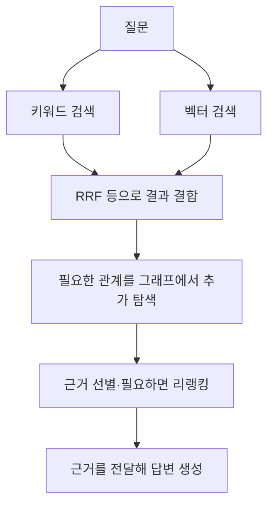

문서 검색에 쓰이는 도구를 고르기 전에 무엇을 기준으로 찾을지 구분해야 한다. 대표적인 기준은 **단어, 의미, 관계**다. 키워드·벡터·그래프 검색은 이 기준이 서로 다르며 함께 사용할 수도 있다.

RAG는 검색한 근거를 LLM에 전달해 답변을 생성하는 구성이다. 검색에서 필요한 근거를 놓치면 답변 모델만 바꿔도 해결되지 않을 수 있다.

## 키워드 검색 — 문서에 등장하는 단어로 찾기

검색어와 문서의 단어를 비교해 관련 문서를 찾는다. BM25는 단어의 등장 빈도와 희소성, 문서 길이 등을 고려해 관련성을 계산하는 대표적인 순위 함수다.

- **유용한 질문:** “ERR_AUTH_401 오류의 해결 방법은?”
- **강점:** 오류 코드, 제품명, 전문 용어처럼 특정 단어가 중요한 검색에 유용하다.
- **주의점:** 문서에 다른 표현이 쓰였으면 놓칠 수 있다. 한국어의 띄어쓰기·복합어와 약어 처리도 검색 결과에 영향을 준다.

BM25는 문자열의 완전 일치를 보장하는 필터가 아니다. 코드나 식별자의 정확한 일치가 필요하면 전용 필드와 필터도 검토해야 한다.

[참고: PostgreSQL 전문 검색](https://www.postgresql.org/docs/current/textsearch-intro.html) · [BM25 설명](https://www.paradedb.com/learn/search-concepts/bm25)

## 벡터 검색 — 표현이 달라도 의미가 비슷한 내용 찾기

문서와 질문을 임베딩 모델로 숫자 벡터로 바꾸고, 벡터 간 유사도로 관련 내용을 찾는다.

- **유용한 질문:** “로그인이 자꾸 풀리는데 어떻게 해야 해?”
- **강점:** 문서에 “인증 세션 만료”처럼 다른 표현이 쓰여 있어도 관련 내용을 찾는 데 도움이 된다.
- **주의점:** 비슷한 의미와 정확한 사실은 다르다. 제품 버전·날짜·식별자 조건을 놓칠 수 있다.

임베딩 모델과 문서를 나누는 단위에 따라서도 결과가 달라진다. 의미가 비슷한 문서를 찾았다고 해당 질문의 정답 근거를 확보한 것은 아니다.

[참고: 벡터 검색 설명](https://www.paradedb.com/learn/search-concepts/vector-search)

## 그래프 검색 — 대상 사이의 관계를 따라 찾기

사람·시스템·문서 등을 노드로, 의존·담당·참조 등의 관계를 엣지로 표현하고 연결을 탐색한다.

- **유용한 질문:** “로그인 서비스가 의존하는 인증 시스템과 관련 장애 문서는?”
- **강점:** 여러 대상과 문서 사이의 연결을 따라 근거를 모으는 데 유용하다.
- **주의점:** 필요한 관계를 먼저 만들고 갱신해야 한다. 잘못 추출한 관계가 있으면 검색도 잘못될 수 있다.

GraphRAG는 이런 그래프 구조를 검색과 답변 생성에 활용하는 접근이다. 하나의 고정된 알고리즘을 뜻하지 않으며, 그래프 주변의 원문이나 커뮤니티 요약 등을 함께 사용하는 구현도 있다.

[참고: Microsoft GraphRAG 검색 방식](https://microsoft.github.io/graphrag/query/overview/)

## 함께 쓰면 어떤 구성이 될까?

**하이브리드 검색**은 여러 검색 방식을 결합하는 접근이다. 문서 검색에서는 키워드 검색과 벡터 검색을 결합하는 구성이 대표적이다.

여러 결과를 합칠 때는 **RRF(Reciprocal Rank Fusion)** 등을 사용할 수 있다. RRF는 BM25 점수와 벡터 유사도를 직접 더하는 대신, 각 검색 결과에서의 순위를 이용한다.

후보를 모은 뒤 질문과 후보를 다시 비교해 순서를 조정하는 **리랭커**를 추가할 수도 있다. 결과를 합치는 RRF와 관련성을 다시 평가하는 리랭커는 역할이 다르다.

위 그림은 설명을 위해 작성한 조합 예시다. 모든 시스템이 이 순서를 따라야 하는 것은 아니다. 그래프 탐색을 먼저 하거나, 관계 탐색 없이 키워드·벡터 검색만 사용할 수도 있다.

따라서 **GraphRAG와 하이브리드 검색은 반드시 둘 중 하나를 고르는 관계가 아니다.** 실제로 벡터·전문 검색으로 후보를 찾은 뒤 그래프에서 맥락을 확장하는 구현도 있다.

[참고: pgvector의 하이브리드 검색 안내](https://github.com/pgvector/pgvector#hybrid-search) · [RRF 설명](https://www.paradedb.com/learn/search-concepts/reciprocal-rank-fusion) · [Neo4j의 검색·그래프 결합](https://neo4j.com/docs/neo4j-graphrag-python/current/user_guide_rag.html)

## 선택 기준은 질문과 문서다

검색 도구를 고를 때는 먼저 다음을 확인한다.

- **단어가 중요한가?** 오류 코드·제품명·식별자를 놓치지 않는지 확인한다.
- **다른 표현도 찾아야 하는가?** 질문과 문서의 표현이 달라도 근거를 찾는지 확인한다.
- **관계를 연결해야 하는가?** 한 문단에 없는 답을 여러 문서와 대상의 연결에서 찾아야 하는지 확인한다.

일반적인 문서 검색을 처음 구성한다면 키워드·벡터 검색을 각각 시험하고 결합 결과를 비교하는 것이 한 방법이다. 관계 탐색이 필요한 질문에서는 그래프를 추가했을 때 근거와 답변이 개선되는지 확인한다.

더 많은 도구를 붙이는 것보다 **실제 질문에서 필요한 근거를 찾는지**가 선택 기준이다.

자료 확인: 2026년 11월 4일. 본문의 질문과 구성도는 설명을 위한 예시이며 성능 실험 결과가 아니다.

