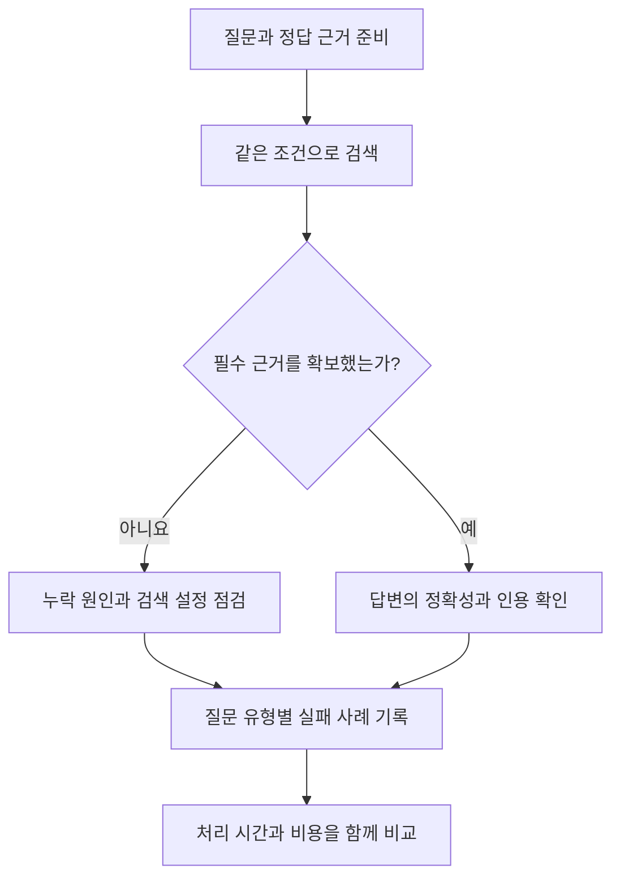

검색 결과가 자연스러운 답변으로 이어졌다고 해서 검색이 잘됐다고 판단하기는 어렵다. 필요한 문서를 놓쳤는데 모델이 추측했을 수도 있고, 근거는 찾았지만 답변에서 잘못 설명했을 수도 있다.

검색 방법을 비교하려면 **검색 결과와 생성 답변을 따로 평가**해야 한다. 이 글은 실제 성능 비교 결과가 아니라, 문서 검색을 시험하기 전에 준비할 질문과 평가 기준을 정리한 내용이다.

## 1. 질문과 정답 근거를 함께 준비한다

처음에는 질문 20~30개 정도로 작은 점검을 시작할 수 있다. 이는 준비 부담을 줄이기 위한 제안이며, 충분한 성능 검증을 보장하는 문항 수는 아니다.

질문마다 다음 내용을 기록한다.

- **질문:** 사용자가 실제로 입력할 만한 표현
- **기대 답변:** 반드시 포함해야 하는 사실과 허용할 수 있는 다른 표현
- **정답 근거:** 관련 문서와 문단의 ID, 근거가 되는 내용
- **조건:** 문서 버전, 기준 날짜, 사용자 권한과 검색 필터
- **답변 가능 여부:** 현재 자료만으로 답할 수 있는지

정답 문장 하나만 저장하면 표현이 다른 올바른 답변을 오답으로 처리하기 쉽다. 같은 사실을 뒷받침하는 다른 문서도 정답 근거로 인정할 수 있도록 검토한다.

문서를 다시 나눌 때 청크 ID가 달라질 수 있다. 청크 크기를 비교한다면 원문 문단 ID처럼 유지되는 기준으로 근거를 대응시키는 편이 좋다.

### 질문 유형을 섞는다

아래는 평가용으로 만든 가상 질문이다.

- **정확한 용어:** “E-104 오류의 조치 절차는 무엇인가?”
- **다른 표현:** “로그인이 자꾸 풀릴 때 확인할 설정은?”
- **문서 간 연결:** “A 서비스가 의존하는 시스템의 담당 팀은?”
- **전체 요약:** “이번 분기 장애 보고서에서 반복된 원인은?”
- **시점 구분:** “정책 변경 이후의 승인 절차는?”
- **답이 없는 질문:** “문서에 없는 내년 예산 계획은?”

원문의 문장을 그대로 질문으로 옮긴 사례만 넣으면 실제 사용자가 다른 말로 질문했을 때의 문제를 찾기 어렵다. 전체 요약 질문은 정답 문서 하나를 고르기보다, 요약에 포함돼야 할 핵심 사실과 각 사실의 근거를 준비한다.

## 2. 검색은 근거의 포함 여부와 순서를 확인한다

검색 지표를 계산하려면 어떤 문서나 문단을 관련 근거로 볼지 먼저 정해야 한다. Sentence Transformers의 검색 평가 도구도 질문, 검색 대상 문서, 질문별 관련 문서 ID를 받아 Recall@k·MRR·nDCG 등을 계산한다. [공식 문서](https://www.sbert.net/docs/package_reference/sentence_transformer/evaluation.html)

**Recall@k**는 정답 근거 중 상위 k개 검색 결과에 포함된 비율이다.

예를 들어 관련 근거가 두 개이고 상위 5개 결과에서 하나만 찾았다면, 해당 질문의 Recall@5는 1/2이다. 여기서 k는 검색 결과 개수이며, 전체 질문의 점수는 질문별 값을 평균내어 정리할 수 있다.

**MRR@k**는 상위 k개 안에서 첫 관련 결과가 얼마나 앞에 나오는지 확인한다. 첫 관련 결과가 1위라면 1, 4위라면 1/4이며, 상위 k개에 없으면 0으로 두고 질문 전체에서 평균낸다.

**nDCG@k**는 관련성이 높은 결과를 앞에 배치했는지 평가할 때 사용한다. “핵심 근거·보조 근거·무관”처럼 관련성에 등급을 줄 경우에도 활용할 수 있다. 등급 기준은 평가 전에 정한다.

### 근거 하나를 찾는 것만으로 충분하지 않을 수 있다

가상 문서 두 개가 다음과 같다고 하자.

- D1의 2번 문단: A 서비스는 B 시스템을 사용한다.
- D2의 1번 문단: B 시스템의 담당 팀은 C팀이다.

질문이 “A 서비스가 의존하는 시스템의 담당 팀은?”이라면, 답변은 C팀이며 두 문단을 연결해야 한다. D2만 1위에 나와 MRR이 높더라도 연결에 필요한 근거를 모두 확보했다고 볼 수는 없다.

이런 질문은 Recall과 함께 **필수 근거를 모두 확보한 질문의 비율**을 별도로 기록한다. 자료에 정답이 없는 질문은 일반적인 Recall 계산 대상에서 분리하고, 답변을 유보했는지 평가한다.

## 3. 답변은 정확성과 근거 일치를 나눠 본다

답변 평가에서는 다음 네 가지를 확인한다.

1. **정확성:** 기대한 핵심 사실이 맞고 빠짐없이 포함됐는가?
2. **근거 일치:** 답변의 주장이 검색된 자료로 뒷받침되는가?
3. **출처 적절성:** 인용한 문단이 바로 앞의 주장을 실제로 설명하는가?
4. **답변 유보:** 근거가 없거나 부족할 때 추측하지 않고 한계를 밝혔는가?

Ragas의 Faithfulness는 답변의 주장 중 검색된 문맥으로 뒷받침할 수 있는 비율을 평가한다. [공식 문서](https://docs.ragas.io/en/stable/concepts/metrics/available_metrics/faithfulness/)

다만 오래되거나 틀린 자료를 그대로 설명한 답변도 문맥과는 일치할 수 있다. **근거에 충실하다는 평가만으로 현재 사실까지 정확하다고 판단하지 않는다.**

LLM을 평가자로 사용할 때는 평가 모델과 프롬프트를 기록한다. 자동 점수를 최종 판정으로 삼기보다, 실패 사례와 판단이 애매한 사례를 사람이 확인하는 용도로 활용한다.

## 4. 같은 조건에서 한 단계씩 비교한다

처음부터 모든 도구를 조합하기보다 다음 순서로 비교할 수 있다.

1. BM25와 벡터 검색을 각각 실행한다.
2. 두 검색 결과를 RRF로 결합한다.
3. 필요하면 리랭커를 추가한다.
4. 관계 연결이나 전체 요약에서 부족한 점이 남으면 그래프 기반 방법을 비교한다.

이 순서는 실험을 단순하게 시작하기 위한 제안이다. 관계 탐색이 핵심인 서비스라면 그래프 기반 방법을 초기 비교 대상으로 포함할 수 있다.

비교할 때는 같은 문서 버전과 질문, 권한 조건을 사용한다. 검색 단계만 비교한다면 답변 모델·프롬프트·입력 문맥의 토큰 예산도 맞춘다. 구조가 다른 방법끼리는 동일한 청크 수만 강제하기보다, 조건과 차이를 함께 기록한다.

설정 조정용 질문과 최종 확인용 질문도 분리한다. 같은 질문을 반복해서 보며 설정을 맞춘 뒤 그 점수만 제시하면 새로운 질문에서의 품질을 확인하기 어렵다.

리랭커를 사용한다면 후보 검색 단계와 최종 선택 단계의 근거 포함 여부를 각각 남긴다. 후보에 없던 문서를 리랭커가 복구할 수는 없기 때문이다.

최종 기록에는 질문 유형별 품질과 함께 검색 시간, 전체 응답 시간, 색인 생성·갱신 비용을 남긴다. 반복 측정이 가능하면 평균뿐 아니라 지연이 큰 요청도 확인한다.

도구를 고를 때는 전체 평균 점수 하나보다 **어떤 질문에서 실패했고, 개선에 얼마의 시간과 비용이 필요한지**를 함께 보는 편이 판단에 도움이 된다.

참고 자료 확인일: 2026년 11월 4일. 질문과 문서 예시는 설명을 위해 만든 가상 사례이며, 실제 측정 결과는 포함하지 않았다.

