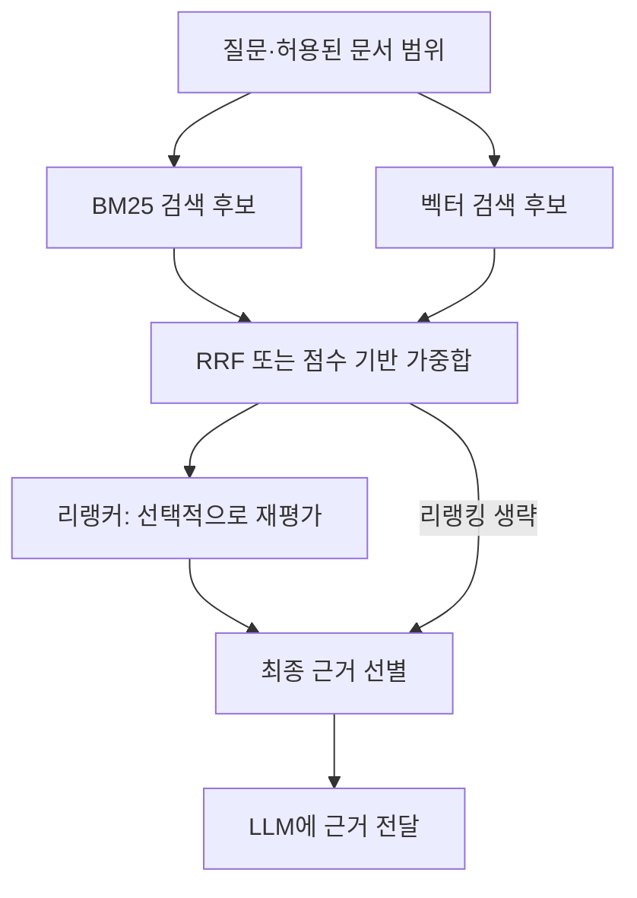

키워드 검색과 벡터 검색을 함께 쓰면 서로 다른 기준으로 찾은 후보를 모을 수 있다. 하지만 두 결과를 단순히 이어 붙이는 것만으로 최종 순위가 정해지는 것은 아니다.

**RRF는 순위로 합치고, 가중합은 점수로 합치며, 리랭커는 질문과 후보를 다시 비교한다.** 이 차이를 중심으로 하이브리드 검색의 결과 정렬을 정리한다.

## 하이브리드 검색은 후보를 모으는 구성이다

이 글에서는 BM25 기반 키워드 검색과 임베딩 기반 벡터 검색을 결합하는 경우를 다룬다.

예를 들어 “ERR_AUTH_401 때문에 로그인이 반복해서 실패한다”라는 질문이 있다고 하자.

- **키워드 검색:** 오류 코드와 관련 용어가 등장하는 문서를 찾는다.
- **벡터 검색:** 인증 실패·세션 만료처럼 의미가 관련된 문서를 찾는다.
- **결과 결합:** 두 검색의 후보를 공통 문서·청크 식별자로 묶고 순서를 정한다.

두 방식의 점수는 척도가 다르다. BM25 점수 12와 코사인 유사도 0.8을 그대로 더하면 한쪽의 수치 범위가 결과를 지배할 수 있다. 거리처럼 작을수록 가까운 값을 사용하는 경우에는 점수 방향도 맞춰야 한다.

[공식 자료: 하이브리드 검색과 결합 방식](https://docs.weaviate.io/weaviate/concepts/search/hybrid-search)

## RRF — 원래 점수 대신 순위로 합치기

RRF(Reciprocal Rank Fusion)는 각 결과 목록에서의 순위를 사용한다. 기본 방식은 각 목록에서 얻은 기여도를 합산한다.

`기여도 = 1 / (k + 순위)`

여기서 k는 상위 순위의 영향 정도를 조정하는 상수다. 검색에서 가져올 후보 개수인 top-k와는 다른 값이다. 한 목록에 없는 후보는 해당 목록의 기여도를 0으로 처리한다.

다음은 설명을 위해 만든 가상의 검색 순위이며, 실제 검색 결과가 아니다.

| 후보                    | BM25 순위 | 벡터 순위 |
| --------------------- | ------- | ----- |
| A: 오류 코드 목록           | 1       | 3     |
| B: 해당 오류의 세션 만료 해결 문서 | 2       | 1     |

k를 60으로 두고 두 후보만 비교하면 다음과 같다.

- **A:** 1/61 + 1/63 ≈ 0.0323
- **B:** 1/62 + 1/61 ≈ 0.0325

따라서 B가 A보다 앞선다. 한 검색에서 1위인 문서를 무조건 선택하기보다 여러 순위의 기여도를 반영한 결과다. 이 숫자는 관련성 확률이나 답변 정확도를 뜻하지 않는다.

RRF는 서로 다른 점수 척도를 직접 맞추지 않아도 된다는 장점이 있다. 대신 원래 점수의 차이가 컸는지 작았는지는 사용하지 않는다. 두 검색의 영향력을 달리 주는 Weighted RRF도 있으며, 이것은 아래의 원점수 기반 가중합과 구분한다.

[참고: RRF의 계산과 가중치](https://www.paradedb.com/learn/search-concepts/reciprocal-rank-fusion)

## 가중합 — 점수의 크기를 반영하기

각 검색 점수를 비교 가능한 형태로 변환한 뒤 가중치를 적용해 합치는 방식이다.

`최종 점수 = α × 키워드 점수 + (1−α) × 벡터 점수`

위 식의 점수는 방향과 척도를 맞춘 값이라고 가정한다. 예를 들어 α=0.5로 두었다고 원래 BM25 값과 유사도를 그대로 더해도 된다는 뜻은 아니다.

- **장점:** 후보 사이의 점수 차이를 반영할 수 있다.
- **확인할 점:** 정규화 방법·후보 범위·가중치에 따라 결과가 달라진다.
- **선택 기준:** 실제 질문에서 적합한 근거가 상위에 오는지 비교한다.

하이브리드 검색이 항상 RRF를 사용하는 것은 아니다. 예를 들어 Weaviate는 순위 기반 결합과 정규화 점수 기반 결합을 구분해 제공한다. 사용하는 도구의 실제 결합 방식을 확인해야 한다.

[공식 자료: 순위 기반·점수 기반 결합 비교](https://docs.weaviate.io/weaviate/concepts/search/hybrid-search)

## 리랭커 — 모은 후보의 관련성을 다시 평가하기

리랭커는 검색으로 모은 후보를 질문과 다시 비교해 순서를 조정한다. 대표적인 Cross-Encoder 방식은 질문과 후보 텍스트를 함께 입력해 관련성을 평가한다.

예를 들어 오류 코드가 자주 나오는 일반 문서보다 질문의 원인·해결 절차를 직접 설명하는 문서를 앞에 배치하는 데 도움이 될 수 있다. 실제 개선 여부는 선택한 모델과 데이터로 확인해야 한다.

전체 문서를 모두 이렇게 평가하면 비용과 지연이 커질 수 있어, 먼저 후보를 좁힌 뒤 적용하는 구성이 일반적이다.

**후보에 들어오지 않은 근거를 리랭커가 새로 찾아주지는 않는다.** 필요한 문서가 계속 누락된다면 리랭커보다 토큰화·임베딩·청크·필터와 후보 개수를 먼저 점검해야 한다.

[공식 자료: Sentence Transformers의 Retrieve & Re-Rank](https://sbert.net/examples/sentence_transformer/applications/retrieve_rerank/README.html)

## 함께 사용하는 흐름

다음은 직접 작성한 구성 예시다. RRF와 가중합 중 하나로 결합하고, 필요하면 리랭킹을 추가한다.

이 구성에서 문서를 조회할 권한과 날짜·제품 버전 같은 필수 조건은 별도로 적용해야 한다. 높은 검색 점수나 리랭커 점수가 해당 조건을 대신하지는 않는다.

## 무엇부터 비교하면 될까?

1. **후보를 찾는가:** BM25·벡터 검색 각각에서 정답 근거가 후보에 포함되는지 확인한다.
2. **결합이 도움이 되는가:** RRF와 가중합으로 상위 결과가 어떻게 바뀌는지 비교한다.
3. **리랭킹이 필요한가:** 최종 근거의 품질 개선이 추가 지연·비용에 비해 유용한지 확인한다.

처음에는 RRF를 단순한 비교 기준으로 둘 수 있다. 이후 점수 차이를 활용할 필요가 있으면 가중합을, 후보의 순서가 문제라면 리랭커를 비교한다. 이 순서는 구현 제안이며 어느 방식이 항상 우수하다는 성능 순위는 아니다.

자료 확인: 2026년 11월 4일. 순위·계산·구성도는 개념 설명용이며 직접 수행한 성능 실험 결과가 아니다.

