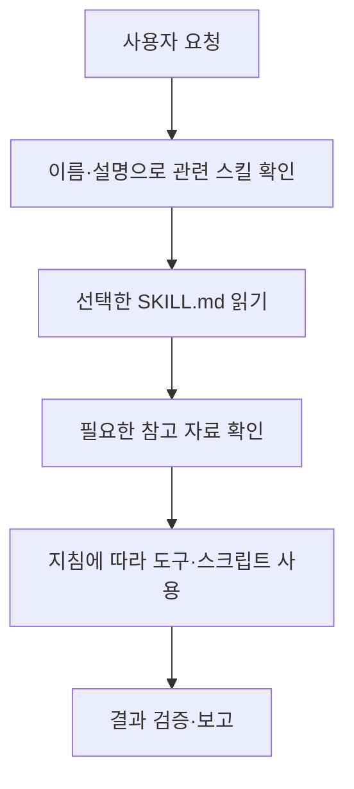

AI 에이전트에서 말하는 스킬은 특정 작업에 필요한 지침과 자료를 묶어 재사용하는 단위다. 예를 들어 기술 블로그를 작성할 때마다 문체, 조사 순서, 출처 표기, 검수 기준을 길게 설명하는 대신 이를 스킬로 관리할 수 있다. 에이전트는 요청에 맞는 스킬을 선택해 지침을 읽고 작업에 적용한다. [Agent Skills 공식 개요](https://agentskills.io/home)


이 글에서 다루는 대상은 `SKILL.md`를 사용하는 Agent Skills이다. 제품마다 “스킬”이라는 이름의 기능이 모두 같은 구조로 동작하는 것은 아니다. 공통 파일 형식과 Codex·Claude Code의 사용 방법을 구분하고, 직접 설계한 블로그 작성 예제로 활용 방식을 설명한다.


## 1. 스킬에는 무엇을 담는가


스킬을 만들 때는 “AI가 어떤 일을 잘했으면 좋겠다”를 실제 작업 절차로 바꾸어 적는다. 다음은 블로그 작성 스킬을 설계한다고 가정한 예시다.

- **적용 대상:** 기술 블로그의 새 글 작성과 기존 글 보완
- **입력:** 주제, 대상 독자, 필요한 깊이, 참고 자료
- **처리:** 공식 자료 확인 → 개념 설명 → 예시 작성 → 검수
- **결과:** 제목, 본문, 출처, Notion 속성
- **완료 기준:** 확인한 사실과 예시가 구분되고, 요청한 저장 결과가 확인됨

이처럼 작업 범위를 정하면 무엇을 확인해야 하는지 분명해진다. 문장이 자연스러워도 출처를 확인하지 않았거나 저장하지 않은 페이지를 저장했다고 말했다면 완료로 보지 않는 식이다.


스킬을 설치하는 과정에서 모델의 가중치를 학습시키는 것은 아니다. 실행 환경이 지침과 자료를 제공하고 모델이 이를 활용하는 방식이다. 따라서 스킬을 추가했다고 모델이 모든 상황에서 새로운 능력을 영구적으로 익혔다고 이해하면 부정확하다.


## 2. 프롬프트·프로젝트 지침·MCP와는 어떻게 다른가


스킬도 지침을 담는다. 차이는 **언제 발견하고, 어떤 자료와 절차를 재사용하도록 구성했는가**에 있다. 한 번만 필요한 요청은 채팅 프롬프트로 충분할 수 있다. 같은 설명을 반복하고 있다면 스킬로 관리할 이유가 생긴다.


주변 기능은 다음과 같이 역할을 나누어 이해할 수 있다.

- **프로젝트 지침:** 저장소의 개발 규칙이나 빌드 방법처럼 해당 프로젝트에서 지속해서 참고할 규칙이다. Codex의 `AGENTS.md`가 여기에 해당한다.
- **스킬:** 특정 작업에 적용할 전문 지식과 재사용 절차다.
- **MCP·연결 도구:** 외부 데이터나 기능에 접근하는 수단이다.
- **서브에이전트:** 작업을 다른 실행 주체에 위임하는 방식이다.

이 구분은 OpenAI의 사용자 지정 문서에서도 설명한다. 스킬과 도구, 프로젝트 지침은 함께 사용할 수 있다. [OpenAI Customization](https://learn.chatgpt.com/docs/customization/overview)


예를 들어 “Notion에 기술 글을 작성해라”라는 요청을 처리하는 구성을 직접 설계한다면, 글의 문체와 검수 순서는 스킬에, 페이지 조회·생성은 연결 도구에 맡길 수 있다. “카테고리는 최상위부터 넣는다”는 블로그 전체 규칙은 프로젝트 지침이나 별도 분류 규칙으로 관리할 수 있다.


플러그인은 설치·배포 단위로 볼 수 있다. OpenAI 플러그인은 스킬이나 MCP 서버, 또는 둘을 함께 포함할 수 있다. 다만 다른 제품의 플러그인까지 같은 구성을 가진다고 일반화하지는 않는다. [OpenAI Plugin architecture](https://developers.openai.com/plugins/concepts/plugins)


## 3. 폴더와 `SKILL.md`의 구성


Agent Skills의 필수 파일은 `SKILL.md`이다. 이 파일은 YAML frontmatter와 Markdown 본문으로 구성한다. 공통 명세에서 frontmatter의 필수 필드는 `name`과 `description`이며, 이름은 규칙에 맞는 소문자 영숫자·하이픈으로 작성하고 폴더명과 일치시킨다. [Agent Skills 명세](https://agentskills.io/specification)


다음은 설명을 위해 직접 구성한 폴더 예시다.


```plaintext
blog-draft/
├── SKILL.md
├── references/
│   ├── style-guide.md
│   └── category-rules.md
└── assets/
    └── post-outline.md
```


`SKILL.md`에는 적용할 작업과 진행 순서, 확인 기준을 적는다. `references/`에는 필요할 때 읽을 상세 문서를, `assets/`에는 템플릿이나 기타 자료를 둘 수 있다. 실행 코드가 필요하면 선택적으로 `scripts/`를 추가한다. 이 폴더들을 모두 만들어야 하는 것은 아니다. [Agent Skills 명세](https://agentskills.io/specification)


위 예제는 자주 바뀌는 문체와 카테고리 규칙을 별도로 관리하려는 설계다. 규칙이 몇 줄뿐이라면 `SKILL.md` 하나로 시작해도 충분하다.


명세에는 `license`, `compatibility`, `metadata` 등의 선택 필드도 있다. `allowed-tools`는 실험적 필드이며 지원 방식은 실행 제품에 따라 다르다. 이름만 보고 인증이나 실제 실행 권한을 부여하는 설정으로 해석해서는 안 된다. [Agent Skills 명세](https://agentskills.io/specification)


## 4. 필요한 내용을 단계적으로 읽는다


스킬은 일반적으로 이름과 설명으로 발견하고, 적용할 때 전체 지침을 읽으며, 필요에 따라 추가 자료를 확인하는 방식으로 동작한다. 이를 점진적 공개 또는 점진적 로딩이라고 설명한다. 모든 스킬의 본문과 참고 파일을 처음부터 한꺼번에 읽는 방식과는 다르다. [Agent Skills 공식 개요](https://agentskills.io/home)


아래 그림은 이 과정을 단순화한 것이다. 특정 제품의 내부 실행 코드를 그대로 나타내지는 않는다.





이 구조에서 `description`은 중요한 역할을 한다. 본문에 자세한 작성 절차가 있어도 설명에 “무엇을 하는지”와 “언제 쓰는지”가 드러나지 않으면 적절한 작업에서 선택하기 어렵다.


설명을 “모든 개발·문서 작업에 사용한다”처럼 넓게 적으면 불필요한 요청에도 적용될 수 있다. 블로그 작성과 단순 번역을 구분하도록 적용·제외 범위를 함께 설계한다.


참고 파일이나 스크립트가 폴더에 존재한다는 사실만으로 이번 작업에서 사용됐다고 판단해서도 안 된다. Claude의 공식 설명도 추가 자료 읽기와 도구를 통한 코드 실행을 구분한다. 실제 사용 여부는 실행 기록과 산출물로 확인한다. [Anthropic Agent Skills overview](https://platform.claude.com/docs/en/agents-and-tools/agent-skills/overview)


## 5. 직접 작성한 `SKILL.md` 예제


다음은 기술 블로그 초안 작성을 위한 **설명용 예제**다. 실제 제품에서 설치·실행을 검증한 배포 스킬은 아니다. 스크립트 없이 지침만 사용하는 최소 구성으로 작성했다.


```markdown
---
name: blog-draft
description: 기술 블로그의 새 글을 작성하거나 기존 본문을 보완할 때 사용한다. 개념 설명, 공식 자료 확인, 예시, 출처와 글 속성을 구성한다. 단순 번역, 제목만 제안하기, 서비스 연결 상태 확인에는 사용하지 않는다.
---

# 기술 블로그 작성

## 입력 확인
- 주제, 대상 독자, 원하는 깊이, 제공된 자료를 확인한다.
- 기존 대화에서 확인한 요구사항은 다시 묻지 않는다.
- 중요한 정보가 부족하면 필요한 항목만 질문한다.

## 진행 순서
1. 작업 범위와 핵심 질문을 정한다.
2. 변경될 수 있는 기술 정보는 공식 자료에서 확인한다.
3. 개념, 동작 방식, 구체적인 예시, 주의점을 작성한다.
4. 제목·본문·출처·글 속성을 구분해 구성한다.
5. 아래 검수 기준으로 결과를 확인한다.
6. 사용자가 저장을 요청했고 도구가 있으면 저장한다.

## 참고 자료
- 문체는 references/style-guide.md를 확인한다.
- 분류가 필요하면 references/category-rules.md를 확인한다.
- 기본 구성이 필요하면 assets/post-outline.md를 참고한다.

## 검수 기준
- 확인한 사실과 직접 만든 예시를 구분한다.
- 공식 문서에 없는 기능이나 측정 결과를 만들어내지 않는다.
- 설명에 필요한 경우에만 코드·Mermaid·이미지를 사용한다.
- 출처 링크가 해당 설명을 실제로 뒷받침하는지 확인한다.
- 저장 결과와 실제 게시 결과를 구분해 보고한다.

## 결과 보고
- 작성한 내용과 확인한 범위를 간단히 설명한다.
- 저장했다면 실제로 반환된 페이지 주소를 제공한다.
- 저장 도구가 없으면 복사 가능한 글과 속성을 제공한다.
```


코드 블록 안의 YAML은 **스킬 파일의 메타데이터**다. 블로그 글 상단에 붙이는 Jekyll front matter와는 용도가 다르다. 이 예제의 YAML을 블로그 게시 속성으로 사용하는 것은 아니다.


`references/style-guide.md`에는 “평서체로 작성한다”, “감성적인 비유를 사용하지 않는다”, “처음 나오는 약어는 설명한다”처럼 실제로 반복해서 확인할 규칙을 적을 수 있다. `category-rules.md`에는 허용된 분류와 순서를, `post-outline.md`에는 기본 문단 구성을 적는다. 이는 예제에서 제안한 파일 분리 방식이며 표준이 강제하는 이름은 아니다.


실제로 사용할 때는 기존 글의 부분 수정 범위도 정한다. “기존 본문 보완”이라는 설명만으로 전체 재작성을 허용한 것은 아니다. 처음부터 모든 예외를 넣기보다 반복되는 실패를 확인하며 보완한다.


## 6. Codex와 Claude Code에서 사용하는 방법


스킬 폴더의 형식과 이를 발견하는 경로는 구분한다. 공통 명세가 모든 제품의 설치 위치나 호출 문법을 강제하는 것은 아니다. 파일 읽기나 전용 도구를 통한 활성화 등 구현 방법에도 차이가 있다. [Agent Skills 구현 가이드](https://agentskills.io/client-implementation/adding-skills-support)


### Codex


현재 공식 문서의 로컬 경로는 개인용 `~/.agents/skills`, 저장소용 `.agents/skills`이다. CLI·IDE 확장에서는 `/skills` 또는 `$`로 스킬을 선택하고, 설명이 요청에 맞으면 자동 선택할 수도 있다. 선택 파일인 `agents/openai.yaml`에는 UI 표시, 호출 정책, 도구 의존성을 설정할 수 있다. 기본 `skill-creator`·`skill-installer`도 제공한다. [OpenAI Build skills](https://learn.chatgpt.com/docs/build-skills)


앞의 예제를 Codex에서 사용한다고 가정한 요청은 다음과 같다. 해당 환경에 스킬이 등록되어 있어야 한다.


```plaintext
$blog-draft
pgvector 검색에 필터를 추가했을 때 결과가 줄어드는 이유를
초급 개발자가 이해할 수 있는 글로 작성해줘.
공식 자료와 간단한 예시를 포함해줘.
```


명시 호출은 사용할 스킬을 직접 지정하고, 자동 선택은 에이전트가 관련 스킬을 고르는 방식이다. 직접 지정했을 때 성공해도 자동 선택이 정확하다고 볼 수는 없다.


### Claude Code


Claude Code는 개인용 `~/.claude/skills/<name>/SKILL.md`, 프로젝트용 `.claude/skills/<name>/SKILL.md` 등의 경로를 사용하며 `/skill-name`으로 호출한다. `disable-model-invocation`과 `user-invocable`은 각각 자동 호출과 사용자 호출을 제어한다. `context: fork`는 별도 서브에이전트 맥락에서 실행하는 제품 옵션이다. 이 필드들을 모든 제품의 공통 규칙으로 복사하지 않는다. [Claude Code skills](https://code.claude.com/docs/en/skills)


```plaintext
/blog-draft PostgreSQL의 검색 방법을 설명하는 글을 작성해줘.
```


같은 `SKILL.md` 구조를 사용하더라도 실행 도구나 파일 접근 방식이 다르면 그대로 동작하지 않을 수 있다. 다른 제품으로 옮길 때는 특정 도구 이름, 로컬 경로, 추가 설정, 외부 서비스 연결을 먼저 확인한다.


## 7. 어떤 작업에 활용할 수 있는가


다음은 이 글에서 직접 설계한 활용 예시다. 특정 제품에서 기본 제공되는 스킬 목록이나 도입 효과를 측정한 사례는 아니다.


### 코드 리뷰


변경 내역과 요구사항을 받고 실제 동작 경로를 확인한 뒤, 문제가 발생하는 조건과 근거를 정리하도록 구성할 수 있다. 테스트를 실행할 수 없는 환경이라면 코드 검토만 했다는 사실을 결과에 남긴다.


### 데이터·가격표 검수


행 순서가 달라도 안정적인 ID로 대응시키고 통화·지역·단위를 확인하도록 만들 수 있다. 행 번호로 값을 비교하는 실수를 반복한다면 ID 연결과 누락 검사를 추가한다. 계산이 반복되면 스크립트로 분리할 수 있다.


### 장애 분석


상태·로그 확인, 원인 후보 정리, 허용된 조치, 복구 확인을 구분하도록 구성할 수 있다. “재시작 명령 성공”과 “사용자 요청 정상 처리”를 다른 확인 항목으로 두는 식이다.


## 8. 새 스킬은 실제 실패를 기준으로 만든다


Anthropic의 작성 지침은 대표 작업과 평가 사례를 먼저 준비하고, 실제 실패를 해결하는 최소 지침을 작성한 뒤 재평가하는 방식을 권한다. 상황에 따라 판단할 부분은 설명으로, 일관성이 중요한 처리는 코드로 구성할 수 있다. [Skill authoring best practices](https://platform.claude.com/docs/en/agents-and-tools/agent-skills/best-practices)


이를 앞의 블로그 예제에 적용하면 다음 순서로 시작할 수 있다.

1. 평소 작성하던 기술 글 하나를 스킬 없이 요청한다.
2. 출처 누락, 용어 설명 부족, 문체 불일치 등 실제 문제를 기록한다.
3. 그 문제를 방지할 절차와 확인 기준만 스킬에 추가한다.
4. 같은 유형의 새 주제로 요청해 개선 여부를 확인한다.
5. 정상적인 요청까지 방해하는 규칙은 줄이거나 적용 조건을 좁힌다.

처음부터 조사·개발·운영을 모두 묶으면 예외가 많아진다. 함께 실행할 절차를 묶고 입력과 완료 기준이 다른 작업은 분리하는 편을 권한다. 기술 글 작성과 가격표 검수는 모두 문서를 다뤄도 검증 방법은 다르다.


참고 문서가 길어지면 어떤 조건에서 어떤 파일을 읽을지 적는다. 파일을 나누고도 전부 무조건 읽게 하면 단계적 로딩의 이점을 줄일 수 있다.


## 9. 스킬 선택과 결과 품질을 따로 검증한다


OpenAI의 스킬 평가 글은 결과·과정·스타일·효율 목표를 정하고, 실행 기록과 산출물을 검사하는 방법을 설명한다. 명시 호출뿐 아니라 자동 선택, 실제 문맥이 섞인 요청, 선택되지 않아야 할 요청도 평가에 포함한다. [Testing Agent Skills Systematically with Evals](https://developers.openai.com/blog/eval-skills)


블로그 작성 스킬이라면 다음과 같은 점검을 직접 구성할 수 있다.

- **선택:** 글 작성 요청에서 적용되고, 단순 연결 확인에서는 적용되지 않는가?
- **과정:** 변경 가능한 기술 정보를 공식 자료에서 확인했는가?
- **결과:** 제목·본문·출처·속성이 요구한 형식으로 작성됐는가?
- **사실 구분:** 가상 예시를 실제 실험 결과처럼 설명하지 않는가?
- **완료 보고:** Notion 저장과 실제 블로그 게시를 구분하는가?
- **효율:** 불필요한 자료 읽기나 반복 도구 호출이 늘지 않았는가?

“선택은 됐지만 글의 내용이 틀린 경우”와 “수동 호출은 성공하지만 자동 선택이 안 되는 경우”는 원인이 다르다. 전자는 조사·검수 절차를, 후자는 이름·설명과 적용 범위를 먼저 살펴볼 수 있다.


속성 누락처럼 명확한 항목은 코드 검사로, 설명의 이해도나 문체는 구체적인 평가 기준과 사람의 검토로 확인할 수 있다. 한 번 성공한 실행만으로 충분하다고 보지 말고, 자주 사용할 요청과 경계 사례를 남겨 수정할 때마다 다시 확인한다.


## 10. 토큰과 시간을 항상 줄여주는가


스킬이 토큰이나 시간을 반드시 줄인다고 단정할 수는 없다. 이전에 생략하던 출처 확인을 수행하면 호출과 시간이 늘 수 있고, 대신 근거 없는 설명을 줄이는 효과를 기대할 수 있다. 비용과 품질은 따로 확인한다.


같은 입력·모델·도구 환경에서 사용 전후의 결과 품질, 수정 횟수, 호출, 시간, 측정 가능한 토큰 사용량을 비교한다. 이 글에서는 비교 실험을 수행하지 않아 절감률이나 정확도 향상 수치를 제시하지 않는다.


## 11. 도구·권한·자동 실행은 별도로 준비한다


스킬에 “Notion에 저장한다”라고 적어도 연결된 Notion 도구가 없으면 저장할 수 없다. 도구가 있어도 계정 권한이나 대상 데이터베이스 접근이 허용되지 않으면 실행이 제한된다. 지침을 작성하는 것과 실제 실행 환경을 준비하는 일은 구분해야 한다.


스킬을 스케줄러나 영구 메모리로 이해해서도 안 된다. “매일 자정에 실행한다”는 문장만으로 예약 작업이 만들어지지 않으며, 이전 실행 결과를 다음에도 사용하려면 파일·DB·서비스 등에 저장하고 다시 읽는 절차가 필요하다. 자동화는 작업을 시작하는 조건을, 스킬은 시작된 작업의 수행 방법을 담당하도록 구성할 수 있다.


외부 스킬을 가져올 때는 지침뿐 아니라 포함된 코드와 자료도 확인한다. Anthropic은 신뢰하지 않는 스킬의 의존성·외부 연결을 검토하고 프롬프트 주입이나 데이터 유출 위험을 확인하도록 안내한다. [Use skills in Claude](https://support.claude.com/en/articles/12512180-use-skills-in-claude)


실제로 확인할 항목은 스킬의 목적에 맞게 좁히면 된다. 문서 요약 스킬이 왜 외부 주소로 파일을 전송하는지, 비교 작업에 왜 원본 삭제 명령이 필요한지처럼 요청한 결과와 실행 동작의 관계를 살펴본다. 검토할 수 없는 코드를 지침에 적혀 있다는 이유만으로 실행하는 것은 피한다.


## 12. 사용하면서 유지할 기준


공유할 때는 지침과 함께 필요한 자료·도구·실행 조건을 관리한다. 특정 사람의 로컬 파일이나 계정에만 의존하면 다른 환경에서 재사용하기 어렵다.


수정할 때는 고치려는 실패와 확인용 요청을 함께 남긴다. 설명을 좁혔다면 적용·제외 요청을 다시 확인하고, 스크립트를 추가했다면 실행 성공과 산출물의 정확성을 따로 검사한다. 유용성은 파일 길이나 개수보다 반복되던 누락과 수정이 줄었는지로 판단한다.


자료 확인일: 2026년 11월 6일. 제품별 경로와 호출 방식은 공식 문서 기준이며 설치·실행 검증은 수행하지 않았다. 폴더·요청·`SKILL.md`와 활용 사례는 설명을 위해 직접 작성한 예제이다.

